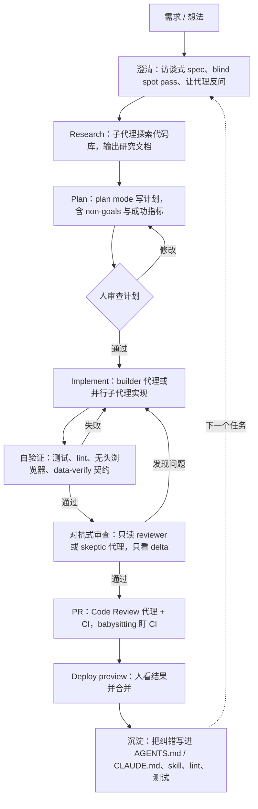

# 00 · 总结：67 份实战资料里的共性模式与最佳实践

**一句话看懂**：67 份资料（23 个视频，加上工程博客、官方文档和指南）、多家工具、来自 Anthropic、OpenAI、Google、xAI、Cursor、Cognition、Factory、OpenHands、Sourcegraph 和独立开发者的作者，最后都指向同一套做法：先让代理能自己验证；做事的和检查的分开；上下文做减法；动手前先把需求问清楚；每次纠错都沉淀成规则；人只负责定目标和看结果。

::: tip 小白先懂这几个词
[Agent](/glossary#agent)、[子代理](/glossary#subagent)、[上下文窗口](/glossary#context-window)、[Harness](/glossary#harness)、[CLAUDE.md](/glossary#claude-md) / [AGENTS.md](/glossary#agents-md)、[Plan Mode](/glossary#plan-mode)。不认识的词随时查[术语表](/glossary)。
:::

> 覆盖：67 份。**分类原则：按一个 AI 代理开发任务从开始到上线的顺序分组**：打地基 · 上下文与规范（49、52、46、37、14、07、26、21、20、28）；做规划 · 需求澄清与任务拆解（64、06、03、13、61、29、04）；去执行 · 从单代理到多代理（42、65、08、23、11、17、27、05、18、30）；验收这一次的产出 · 测试、审查与完成标准（60、15、59、12、32、25、31）；评测代理本身与给动作把关 · 评测、分类器与分数噪声（62、39、56、50、47、19）；接进 PR 与 CI · 触发、审查与流水线（63、41、57、10、55、67、33、22、34）；云端与后台运行环境 · 代理在哪里跑（53、48、58、02、51、01、40）；看原理 · Harness 与内部机制（43、54、09、66、45、16、38、24、35、36、44）。括号内按原始发布日期从新到旧。类型：视频 23、文章 35、官方文档 3、指南 2。工具：Claude Code 21、Codex 13、Grok 6、Cursor 9、Gemini CLI 1、OpenHands 1、Devin 1、Amp 1、Aider 1、Factory Droid 2、通用 7。本文只总结各篇分析里有来源支撑的内容，细节和原话见对应文章；按阶段的详细对照见各[阶段指南](/guide/foundation)。

## 1. 共性模式（多数资料独立得出的结论）

### 模式 A：验证排第一，先让代理能自己“跑起来”

**为什么**：代理写得再快，没人检查就只是快速制造返工。能自己跑测试、开浏览器看结果的代理，交给你的半成品少得多。

- Boris Cherny（01）把验证定义为代理能否把东西真正跑起来；Arno（03）让组件输出 `data-verify-*`，供代理和 CI 核验。
- Dominik Kundel（10）的飞轮是 context → validation → verification；Ryan Lopopolo（07）把“测试 + lint + reviewer agents”当作 harness 的核心。
- Grok 这边，Bijan Bowen（13）看到代理用无头浏览器自测；ForrestKnight（12）则证明**测试全绿 ≠ 代码正确**，人工审查仍然必要。
- 2026-10-09 新增的资料把这一条推得更远：Factory（26）认为限制代理的是代码库的自动化验证，并给出 8 根验证支柱；Simon Willison（25）用 “Use red/green TDD”“First run the tests” 两句话把测试纪律交给代理；Carlini（17）说任务验证器必须近乎完美，否则代理会去解决一个错误的问题。详见 [做验证](/guide/verification)。
- 第三批（2026-10-12）：Cursor（37）把开发环境当成给代理用的产品：统一 CLI 收起杂乱的构建命令，让云端代理能端到端测试、录屏证明改动；Cursor（39）展示了评测怎么接进生产链路：真实会话 + 合成用例，重复跑找结果翻转的用例。
- 第二批（2026-10-09）：Cognition（32）让 Devin 用 Computer Use 实测改动，先根据源码写测试计划、每步先写预期，最后交回截图和录屏，因为异步触发的会话已经比交互式多。

- 第五批（2026-10-14）：Addy Osmani（48）的云端会话演示里，prompt 写明“测试至少连跑 30 次”，会话就跑了 40 次；作者的结论是给会话能跑测试的环境，否则你审的是没人跑过的改动。

::: tip 实践
先给代理一个能跑的命令（测试、浏览器、预览环境），再给任务。
:::

### 模式 B：做与查分开（maker / checker），最好是对抗式的

**为什么**：让写代码的代理自己检查自己，它倾向于认为自己做对了。换一个只读的、专门找茬的代理，才能抓住问题。

- Builder + Validator 成对子代理（05）、只读审查 persona 与 stop hook（08）、只读 Auto Review 子代理（09）。
- 扇出找 bug 后再做对抗式复核（02）、`/goal` 完成后由 skeptic 代理复查（15）、CI 中按 persona 设置 reviewer（07）。
- 新增：Anthropic 的 Planner / Generator / Evaluator（16）把验收交给单独调教的 Evaluator，并坦言开箱即用的 Claude 是很差的 QA 代理；Cole Medin（23）在 `/clear` 后的新会话里审查，再加一轮跨模型审查；Agent Evals 文章（19）主张能用确定性评分就别用模型评分。
- 第三批：Cursor 的 Auto-review（39）在工具调用前用小模型分类器把关，拦截时把理由还给主代理，而不是弹窗问人；和 Codex 的 Auto Review（09）同类。
- 第二批：OpenAI（31）专门训练审查代理，结论是**精确率优先**、审查者要能读整个仓库并运行代码；Cursor（33）的 Bugbot 用多次审查投票压低误报，用“解决率”衡量效果。两者对“该少报还是多报”有分歧，见 [做验证](/guide/verification)。

- 第八批：Claude Code 团队（60）在代码量翻倍后把审查拆成七层：AI 审查发现先投票再发，人工批准按改动风险 0 / 1 / 2 人，代理批准不算、批准绑定 commit；AI 审查三轮封顶，因为反复标出的内容约 59% 是旧代码。Anthropic（62）把“爬分不自欺”做成命令：先验证评分器，再拆留出集、一次一个补丁、不涨就回滚。

- 第七批：Factory（59）发现大任务上单代理常常“自认为做完”就收工，gdal 只到 36%；先由独立验证者建完成标准、实现者看不到用例，同一模型到 90%（代价是 14 倍额度）。Anthropic playbook（57）把 CLAUDE.md、skills、hooks 的改动交给 CI 里的评测把关。

- 第五批：OpenAI（47）给 Skill 写评测：确定性检查先行，主观风格再让模型按固定 JSON 格式打分；Anthropic（50）提醒评测分数里混着基础设施噪声，配置未对齐时低于 3 个百分点的差距要存疑。

::: tip 实践
审查代理只给只读权限；让它“尽量证伪”，而不是“确认完成”；复查只看 delta。#15 画面上的那句提示词可以直接借用：<Trans zh="下面的工作不是你做的……你的任务是证伪“目标已经达成”。">“You are NOT the agent that produced the work… Your job is to refute that the objective has been met.”</Trans>
:::

<figure class="shot"><figcaption>📷 #15 视频截图 · <a href="https://www.youtube.com/watch?v=1NwO2dPzwRM&t=575s" target="_blank" rel="noopener">9:35</a> · Grok Build 自动派出的“goal achievement skeptic”验证代理，提示词要求它证伪目标已达成。</figcaption></figure>

### 模式 C：上下文是稀缺资源，要做减法和压缩

**为什么**：上下文窗口装得越满，模型越容易遗漏和混淆；消除互相矛盾的指令，比堆更多内容更重要（10）。

- RPI 与“频繁有意压缩”（04）、Claude Code 删掉 80% system prompt（06）。
- skills 渐进加载、deferred tools、服务端 compaction（09）、子代理隔离上下文（05 / 08 / 15）。
- 新增：HumanLayer（20）指出指令是有“预算”的，规则文件少即是多；Skills 的创建者（21）讲三层渐进加载；Huntley（24）把上下文窗口比作数组，主张每轮全新上下文。注意来源在“压缩还是重开”上有分歧，见[长时自主任务专题](/guide/long-running)。
- 第二批：Amp（35）指出工具定义和工具调用都在吃上下文，读太少又会陷入 doom loop，用专长子代理隔离搜索；Anthropic（36）把 MCP 服务器包装成代码 API 按需加载，示例中 token 从 150,000 降到 2,000。

::: tip 实践
用 research → plan 的产物（Markdown 文件）在会话之间交接，不要让单个会话无限变长。
:::

<figure class="shot"><figcaption>📷 #04 视频截图 · <a href="https://www.youtube.com/watch?v=rmvDxxNubIg&t=871s" target="_blank" rel="noopener">14:31</a> · Dex Horthy 的示意图：子代理在各自的上下文里调研，最后写出一份 research.md，此时上下文约用了 40%。</figcaption></figure>

### 模式 D：先澄清需求，再动手

**为什么**：代理走偏，多半是因为碰到了你脑子里有、但没写下来的东西。先挖出来，比事后返工便宜。

- 让 Claude 采访你写 spec（03）、blind spot pass 和让模型反过来考你（06）、Steinberger 常问“Do you have any questions?”（11）。
- Grok Build plan mode 的可交互计划含 non-goals 和成功指标（13）、计划式 prompt + skills（14）。
- 新增：Sprint Contract，让写代码的代理和验收的代理在开工前约定完成标准（16）；把每个 GitHub issue 当作规格输入（23）。
- 第八批：Giant Swarm（64）在 PR 一年涨三倍后把人的审查挪到计划上：拷问式访谈、写成规格、规格里每条关于现有代码的说法对照真实代码核对、再让反方试图毙掉计划；“含可争议决策才写计划”。
- 第二批：Gemini CLI 的 Conductor（29）把产品背景、spec 和 plan 写成仓库里的文件，代理按 plan.md 打勾，人先审计划；OpenHands（30）强调大任务开工前要有清晰的完成标准，并拆成“一个代理一次做完”的小块。

::: tip 实践
复杂任务先进 plan mode，或者明确要求代理反问；计划里写明 non-goals。
:::

### 模式 E：把每一次纠错沉淀进 harness

**为什么**：在对话里纠正一次，下次还会再错；写成规则、测试或 skill，同类问题就不会再出现第二次。

- 犯错就写进 CLAUDE.md / Skill（01）；把团队标准写成带修复指引的 lint 和文件行数测试（07）。
- 每周 Garbage Collection Day（07）、复用设计 skills（14）、PR 看护 skill（10）。
- 新增：Mitchell Hashimoto（27）把这一步叫“改造 harness”，每个错误都对应 AGENTS.md 的一行或一个脚本；第三批的 Cloud Doctor（37）把这件事自动化：读其他代理的 trace，修 skill、简化流程、高把握时开 PR；Cole Medin（23）的“自愈层”修 bug 时同时修规则、技能和流程；HumanLayer（20）提醒新增内容要普遍适用。第二批：能写成脚本的规则写成 hook，在固定时刻一定执行（28；Gemini CLI、Grok Build 的 hooks 结构几乎相同，34）。反方向也成立：模型升级后，要逐个拆掉过时的脚手架（16）。

- 第四批（2026-10-13）：Grok Build（46）让代理在每个回合后自动记下约定、决定和项目事实，并给出“不记任务状态、未定结论、密钥和仓库已有内容”的筛选标准。

::: tip 实践
同一类问题第二次出现时，就把它变成规则、测试或 skill，而不是再口头提醒一次。
:::

### 模式 F：人从“写代码”转为“定目标 + 审结果”，代理并行 / 后台运行

- 给目标而不是任务、经由 Slack 的 Claude Tag（02）；Routines、`/loop`、Auto mode（01）。
- 10 个 checkout 并行（11）；手机上完成修复 → 预览 → 合并（10）；57 个并行子代理（15）。
- 新增：issue → worktree → PR 的并行流程（23）；CI 失败后由 `codex exec` 生成补丁（22）；下班前 30 分钟启动代理（27）。
- 第四批：Anthropic（41）总结了定时代理的六条规则：按书签读、读失败要明说、发帖前复查、确认送达再记账、每次重读偏好、只读权限 + 花费上限；OpenAI（42）演示了 Codex 应用里的两种自动化和长任务的线程分工。
- 第三批：Cursor（40）的云端代理需要一整套运行层：完整开发环境、Temporal 持久化执行、代理循环 / 机器 / 对话状态解耦；内部超过 40% 的 PR 来自云端代理（两个月后 #37 说一半以上）。
- 第二批：OpenHands（30）用迁移分支 + 3–5 个并行代理 + 每个 PR 人审完成大迁移，目标是 90% 自动化；Grok Build（34）的 `grok -p`、hooks 和 `/loop` 让代理跑进脚本和 CI。

::: warning 注意
并行的前提是 A–E 都已经到位。没有验证兜底的并行，只会放大返工。Factory（26）的说法更直接：没有能自动判断 PR 是否基本可用的验证，就不可能同时并行多个代理。
:::

### 模式 G：长时自主任务——进度落在文件里，验证决定上限

**为什么**：让代理连续跑几小时到几周，单个会话撑不住，人也没法一直盯着。

- Ralph 循环每轮全新上下文、一轮一个目标（24）；16 个代理靠 git + 锁文件协作写 C 编译器（17）；Cursor 数百代理改为 Planner / Worker / Judge 分层（18），续篇（38）定型为递归 Planner + Worker 交接报告，并有意接受小而稳定的错误率；Anthropic 用 Evaluator 守住长任务质量（16）；Codex 的 `/goal`（09、10）。
- 来源在“压缩还是重开”“扁平还是分层”上有分歧，对照表见[长时自主任务专题](/guide/long-running)。

- 第四批：Anthropic Managed Agents（45）把事件日志放在 harness 之外，harness 和容器都可丢弃、从日志恢复；Codex 的 `/goal` 要写可验证的完成标准，并在里程碑处做目标审计（42）。

- 第五批：Claude Code 云端会话（48）和 Cursor Self-Hosted Machines（51）都把“一个任务一台机器”做成默认，循环留在厂商侧、执行可以放进自己的网络；Anthropic（49）在每天合并 3 万多个改动后重做了源代码管理，工程师的工作变成审意图、对 Claude 说“不”。

- 第八批（下）：Cognition（67）把代理接在团队已有的信号后面：Bug 标签触发分诊、PR 事件触发审查和自动修、告警经 API 开会话（厂商自述）；Grok Build Workflows（65）把“扇出 + 核验 + 汇总”做成后台脚本并存成团队命令。
- 第八批：OpenAI 的 25 小时 Codex 实验（61）把长任务的记忆写成四份 Markdown（目标、带验证命令的里程碑、执行规则、状态日志）；OpenAI 实验平台团队（63）让 Codex 带着证据批量开维护 PR，一处清理一个小 draft PR，审查意见写回下一版 prompt。

- 第七批：Cursor Projects（58）在你和代理之间再加一层只派活的协调代理，默认云端、共享上下文跨机器同步、订阅 Slack / 定时 / PR；迁移时审查强度随结果递减，同一错误两次就变 lint 规则。

- 第六批：Factory OpenCompute（53）把“一台远程机器”扩展成按需开关的沙箱机队，意图持久化、reconciler 调和、不支持的能力提前拒绝；Cursor（54）说明长任务的 token 大多花在每轮重复的前缀上，稳定前缀 + 缓存断点 + 工具按需加载合计降 7%；Claude Code auto mode（56）用只看用户消息和工具调用的两段式分类器代替人点批准，并公开对真实过度主动动作仍漏 17%。

::: tip 实践
先在短任务上把验证做扎实，再拉长时间；进度写进 README、进度文件或计划文件，让下一个会话能接着干。
:::

## 2. 工具 / 方法对比

本站按任务阶段分类；这张表换个角度，把同一类做法在三家工具里的对应功能并排放在一起。表格以 01–15 为主，第二批补充了 Claude Code hooks（28）和 Grok Build 官方文档（34）；Cursor（18、33）、Gemini CLI（29）、OpenHands（30）、Devin（32、67）、Amp（35）和通用资料不列入此表。

| 维度 | Claude Code（01–06） | Codex（07–11） | Grok Build / Grok 4.x（12–15） |
|---|---|---|---|
| 规则文件 | CLAUDE.md、Skills | AGENTS.md、Skills（上下文占比有上限，09） | 兼容 AGENTS.md / CLAUDE.md 与 skills（14、官方文档） |
| 规划 | plan mode、访谈式 spec（03）、RPI 命令（04） | plan / `/goal`（09、10） | plan mode 生成可交互计划（13、15） |
| 子代理 | Task 系统 + 依赖（05）、扇出 workflows（02） | subagents + 按角色的 TOML 配置（08） | 大规模并行子代理（15） |
| 自动审查 | Hooks 自检（05、官方配置见 28）、对抗式复核（02） | Auto Review 只读子代理（09）、GitHub Code Review（10）、CI reviewer（07） | `/goal` 结束后的验证代理（15）；PreToolUse hooks，兼容 Claude Code / Cursor 的 hook 文件（34） |
| 长时 / 后台 | Routines、`/loop`、Remote Control（01）、Claude Tag（02） | `/goal` continuation、PR babysitting、Deploy preview（10） | `/goal`（15）、`grok -p` headless、`/loop`（34） |
| 视频证据来源 | 官方团队一手分享 + 独立开发者 | 官方工程师一手分享（harness 开源） | 第三方实测 + 官方文档（34），仍缺官方长篇工程内容 |
| 视频中暴露的风险 | 上下文膨胀（04、06） | 需要大量前期投入 harness（07） | 越界修改（13）、“测试过了但实现有坏味道”（12） |

## 3. 端到端工作流（综合全部资料）

把六个模式按顺序串起来，就是下面这条流程。每个节点后面括号里的做法，都能在对应文章里找到原始出处。

## 4. 推荐阅读顺序

::: info 只有 30 分钟？
先看 **27**（Mitchell 的六步路线）→ 再读 **20**（规则文件怎么写）→ 最后读本页第 1 节的七个模式。按阶段系统阅读，请走[学习路径](/paths)（新手 / 进阶 / 专家三条）。
:::

八个阶段按一个任务从开始到上线的顺序排列，和左侧边栏一致。每个阶段先读阶段指南，再按下面的顺序读资料。小标签是资料类型和所用工具。

**打地基 · 上下文与规范**（[阶段指南](/guide/foundation)）

- [20 · CLAUDE.md 怎么写：少即是多](/20-humanlayer-writing-good-claude-md) 文章 Claude Code：规则文件怎么写，最短最实用。
- [21 · 别造代理，写 Skills](/21-anthropic-agent-skills-talk) 视频 Claude Code：Skills 为什么是文件夹、怎么渐进加载。
- [14 · 用 Skills 约束 UI 风格](/14-orcdev-grok-build-skills) 视频 Grok Build：10 分钟看一个新代理工具怎么上手，Skills 如何约束风格。
- [26 · 让代码库为代理做好准备](/26-factory-agent-ready-codebases) 视频 通用（不限工具）：给自己的代码库的可验证性打分。
- [46 · Grok Build 的跨会话记忆](/46-grok-build-memory) 文章 Grok Build：代理自动记项目知识，该记什么、不该记什么。
- [49 · 为代理重做源代码管理](/49-anthropic-scion-source-control) 文章 通用（不限工具）：代理规模放大后，开发基础设施怎么撑住。
- [37 · 把开发环境做成给代理用的产品](/37-cursor-cloud-agent-environment) 文章 Cursor：代理不只要读懂代码，还要能跑起来、测起来。
- [28 · Hooks：让规则一定会执行](/28-claude-code-hooks-guide) 官方文档 Claude Code：把必须每次执行的规则写成 hook，配置可直接抄。
- [52 · Claude Code mods：可编程的扩展](/52-claude-code-mods) 文章 Claude Code：Hooks 不够用时，mods 能改写事件和替换功能；团队怎么管。
- [07 · 把团队规范变成 lint 和测试](/07-harness-engineering) 视频 Codex：最激进的“人不写代码”团队实践，适合最后看。

**做规划 · 需求澄清与任务拆解**（[阶段指南](/guide/planning)）

- [03 · 访谈式需求与可验证组件](/03-how-we-claude-code) 视频 Claude Code：可以照着复现的 workshop（有配套仓库）。
- [06 · 找出未知，给上下文做减法](/06-field-guide-to-fable) 视频 Claude Code：需求盲区与上下文减法。
- [04 · RPI：研究、计划、实施](/04-no-vibes-allowed-rpi) 视频 Claude Code：在复杂代码库中做上下文管理的方法论。
- [13 · Grok Build 实测：从计划到执行](/13-bijan-bowen-grok-build) 视频 Grok Build：更长的全流程实测：plan mode、截图反馈、无头浏览器自测。
- [61 · Codex 跑 25 小时的四份 Markdown](/61-codex-long-horizon-tasks) 文章 Codex：长任务的目标、里程碑、执行规则和状态日志怎么分文件写，原文可照抄。
- [64 · 把审查挪到计划：五步规格驱动](/64-giant-swarm-spec-driven-development) 文章 通用（不限工具）：PR 多到审不过来时，人审计划 PR；事实核对和反方两步可以单独抄。
- [29 · Conductor：把计划写进仓库](/29-gemini-cli-conductor) 文章 Gemini CLI：spec 和 plan 写成仓库里的文件，适合团队。

**去执行 · 从单代理到多代理**（[阶段指南](/guide/execution)）

- [27 · 从怀疑到离不开：六步采用 AI](/27-mitchellh-ai-adoption-journey) 文章 通用（不限工具）：从怀疑到熟练的六步路线，最适合刚起步。
- [11 · 一个人用 Codex 建 OpenClaw](/11-peter-steinberger-openclaw) 视频 Codex：轻松的访谈，先建立“代理主导开发”的直观印象。
- [05 · Builder + Validator 代理团队](/05-indydevdan-task-system) 视频 Claude Code：builder / validator 团队的编排。
- [08 · Codex 子代理、Hooks 与插件](/08-codex-masterclass) 视频 Codex：子代理、hooks、plugins 的实操。
- [23 · 5 个并行代理 + worktree](/23-cole-medin-parallel-worktrees) 视频 Claude Code：完整的并行开发演示，配套脚本可参考。
- [17 · 16 个代理并行写 C 编译器](/17-anthropic-c-compiler-agent-teams) 文章 Claude Code：十几个代理、无编排者，靠 git + 锁文件协作。
- [30 · 大型重构拆给并行代理](/30-openhands-parallel-refactors) 视频 OpenHands：互相依赖的大迁移怎么拆、怎么审。
- [42 · Codex 应用实战：从上下文到自动化](/42-openai-cooking-with-codex) 视频 Codex：Computer Use、`/goal`、子代理和线程交接的实际用法。
- [65 · Grok Build Workflows：后台扇出脚本](/65-grok-build-workflows) 文章 Grok Build：很短的产品公告，看“能拆成独立块、最后要一份报告”这个判断标准。
- [18 · 数百个代理协作写浏览器](/18-cursor-scaling-long-running-agents) 文章 Cursor：数百代理时扁平协作为什么失败、分层后怎么跑。

**验收这一次的产出 · 测试、审查与完成标准**（[阶段指南](/guide/review)）

- [25 · 测试驱动与代理手动测试](/25-simonw-agentic-engineering-testing-patterns) 指南 通用（不限工具）：三句马上能用的测试提示词。
- [12 · 测试全绿也要读代码](/12-forrestknight-grok-4-5) 视频 Cursor + Grok 4.5：学会怎么审查 AI 产出，警惕“测试全绿”。
- [15 · 57 个子代理与对抗式验证](/15-arcade-grok-build-57-agents) 视频 Grok Build：大规模并行与对抗式验证（建议配合 Grok Build 官方文档）。
- [32 · Devin 用 Computer Use 自测](/32-cognition-verifying-agentic-development) 文章 Devin：让代理实际操作应用并交回证据。
- [31 · AI 代码审查：精确率优先](/31-openai-verifying-code-at-scale) 文章 Codex：审查器为什么要“宁缺毋滥”。
- [59 · 先建完成标准，再让代理做大任务](/59-factory-large-software-tasks) 文章 Factory Droid：代理为什么提前收工，独立完成标准能补多少、要花多少。
- [60 · 代码审查的七层把关](/60-claude-code-team-code-review) 文章 Claude Code：代码多到读不过来时，审查分几层、人工批准按什么定。

**评测代理本身与给动作把关 · 评测、分类器与分数噪声**（[阶段指南](/guide/evals)）

- [19 · Agent Evals 入门](/19-anthropic-demystifying-agent-evals) 文章 通用（不限工具）：系统评测代理时再读。
- [47 · 给 Skill 写评测](/47-openai-eval-skills) 文章 Codex：可照抄的 Skill 评测脚本。
- [50 · 评测分数里的基础设施噪声](/50-anthropic-infrastructure-noise) 文章 通用（不限工具）：读分数前先知道噪声有多大。
- [39 · Auto-review：分类器与评测](/39-cursor-auto-review-classifier) 文章 Cursor：评测怎么接进真实产品链路。
- [56 · auto mode：两段式权限分类器](/56-anthropic-claude-code-auto-mode) 文章 Claude Code：给代理动作把关的另一种设计，误报漏报数据都公开。
- [62 · 评测设计与爬分不自欺](/62-claude-eval-design-hillclimbing) 文章 Claude Code：评分器先验证，留出集 + 一次一个补丁 + 不涨就回滚。

**接进 PR 与 CI · 触发、审查与流水线**（[阶段指南](/guide/ci)）

- [10 · OpenAI 用 Codex 守住 PR 质量](/10-how-openai-uses-codex) 视频 Codex：PR 审查、CI 看护、Deploy preview 全链路。
- [22 · CI 挂了让 Codex 自动修](/22-openai-codex-ci-autofix) 官方文档 Codex：能抄进仓库的 CI 配置和安全布局。
- [55 · 用 Skills 维护开源仓库](/55-openai-skills-oss-maintenance) 文章 Codex：把验证、发版、PR 交接写成 Skills，再用 GitHub Action 搬进 CI。
- [57 · 把 agent evals 接进 CI](/57-claude-continuous-evals-in-ci) 指南 Claude Code：给代理配置的改动加一道评测关卡，三个文件可以照抄。
- [33 · Bugbot：用解决率迭代审查机器人](/33-cursor-building-bugbot) 文章 Cursor：常驻 PR 审查机器人怎么衡量和迭代。
- [34 · Grok Build 跑进脚本和 CI](/34-grok-build-headless-hooks) 官方文档 Grok Build：headless、hooks、`/loop`、worktree。
- [41 · 定时代理自动化的六条规则](/41-anthropic-agent-automations) 文章 Claude Code：无人值守的定时代理怎么不悄悄出错。
- [67 · Cognition 把 Devin 接进日常](/67-cognition-devin-builds-devin) 文章 Devin：工单标签、PR 事件、告警和每日审计触发代理；Playbook 六要素；厂商自述。
- [63 · 让代理批量开维护 PR](/63-openai-gpt-6-software-maintenance) 文章 Codex：删死代码、清过期实验、给 CI 提速，prompt 原文可借用。

**云端与后台运行环境 · 代理在哪里跑**（[阶段指南](/guide/cloud)）

- [01 · Claude Code 一周年：验证与 Routines](/01-claude-code-one-year) 视频 Claude Code：从工具作者口中了解验证、CLAUDE.md、Routines 等基本观念。
- [02 · Claude Code 团队的工作流](/02-claude-code-team-workflows) 视频 Claude Code：团队级协作与动态 workflows。
- [48 · Claude Code 云端会话实战](/48-claude-code-cloud-sessions) 文章 Claude Code：一个任务一台 VM，七种用法和 GitHub 排错。
- [40 · 云端代理一年的四条教训](/40-cursor-cloud-agent-lessons) 文章 Cursor：云端代理背后的环境、持久化执行和状态解耦。
- [51 · 云端代理跑在自己的机器上](/51-cursor-self-hosted-machines) 文章 Cursor：执行放进自己的网络，推理留在云端。
- [53 · OpenCompute：给代理按需发电脑](/53-factory-opencompute) 文章 Factory Droid：从一台机器到一支沙箱机队，以及“合约 + 一致性测试”怎么让代理写基础设施。
- [58 · Projects：一个协调代理管一群子代理](/58-cursor-projects) 文章 Cursor：跨月工作交给一个只派活的协调者，注意是产品发布文。

**看原理 · Harness 与内部机制**（[阶段指南](/guide/harness)）

- [66 · 源码解剖 11 个代理外壳](/66-harness-engineering-eleven-systems) 文章 通用（不限工具）：先读这篇当本阶段的总图：七个子系统、两个“缺席”、18 条建议。
- [09 · Codex Harness 内部机制](/09-how-codex-works) 视频 Codex：harness 内部机制，理解前面所有现象的“为什么”。
- [24 · Ralph 循环：为什么每轮重开](/24-huntley-horthy-ralph-loop) 视频 Claude Code：“上下文窗口就是数组”的心智模型。
- [16 · Planner / Generator / Evaluator 长时 harness](/16-anthropic-harness-design-long-running-apps) 文章 Claude Code：做与查分离，以及模型升级后逐个拆脚手架。
- [35 · Amp 的专长子代理架构](/35-amp-next-generation-ai-coding) 视频 Amp：子代理和工具集的设计取舍。
- [36 · 用代码调用 MCP 省上下文](/36-anthropic-code-execution-with-mcp) 文章 通用（不限工具）：工具很多时怎么按需加载。
- [54 · 长任务的 token 省在哪](/54-cursor-token-efficiency) 文章 Cursor：删提示、工具按需加载、稳定前缀和缓存断点。
- [38 · 多代理 harness 的五次改版](/38-cursor-self-driving-codebases) 文章 Cursor：#18 的续篇，每一版为什么失败、最后怎么定型。
- [45 · Managed Agents：大脑与双手解耦](/45-anthropic-managed-agents) 文章 Claude Code：harness 也会被替换时，系统怎么设计。
- [43 · 在 Codex harness 上做自己的客户端](/43-codex-app-server) 视频 Codex：app server 协议和三条建议。
- [44 · Architect / Editor：推理与编辑分开](/44-aider-architect-editor) 文章 Aider：推理和输出格式交给两个模型，注意时效。

## 5. 你可以这样开始（一周计划）

- [ ] **第 1 天**：给项目写一个“怎么把我跑起来”的 Skill 或 AGENTS.md 小节（模式 A）。
- [ ] **第 2 天**：下一个任务开工前，让代理先采访你或做一次 blind spot pass（模式 D）。
- [ ] **第 3 天**：加一个只读的 reviewer 子代理，提示词强调“尽量证伪”（模式 B）。
- [ ] **第 4 天**：上下文接近 40% 时，练习一次“写进 Markdown → 开新会话”的交接（模式 C）。
- [ ] **第 5 天**：把这周出现两次以上的同类问题，写成一条 lint、测试或规则（模式 E）。
- [ ] **第 6 天**：新会话第一句话写 “First run the tests”，新功能加一句 “Use red/green TDD”（模式 A，见 #25）。
- [ ] **第 7 天**：对照 #20 把 CLAUDE.md / AGENTS.md 删到只剩每次都用得上的内容（模式 C）。

## 6. 缺口与局限（如实说明）

- **Grok**：没有找到 xAI 官方或大会级的长篇工程实战内容，官方频道只有 1–2 分钟的宣传片。4 个 Grok 视频都是第三方实测，以 demo 或新项目为主，缺少大型存量代码库和长期团队实践的证据。其中 #15 的自动字幕质量差，结合简介、官方文档和画面文字分析。对 Grok 的结论请视为初步观察。第二批补上了 xAI 官方 Grok Build 文档（34），第四批又补上一篇官方产品说明（46，Grok Build 记忆），第八批补上 Workflows 产品公告（65），但仍没有官方工程博客或大会演讲。
- **Codex**：#09、#10、#43 为同一讲者（Dominik Kundel），但主题不重叠（harness 内部 vs. 团队流程 vs. 外部接口 app server）。
- **Cursor**：9 篇（#18、#33、#37–#40、#51、#54、#58），全部是 Cursor 自己的研究博客，结论请视为该厂商的经验；内部工具（anydev、Cloud MCP、Cloud Doctor）和分类器的准确率都没有公开。
- **原文配置**：第一批缺的 hooks 配置和 Ghostty AGENTS.md，第二批已逐字收录（[[28§3.2]]、[[27§3.5]]）。仍缺：Ralph 官方插件 hook 实现的逐字引用（[[24§3.4]]）；Grok Build 文档里 `bin/safety-check.sh` 只有占位名、没有内容（本站不补写）；把 agent evals 接进 CI 的完整配置，2026-10-16 已由 #57 补上（[[57§3.2]]、[[57§3.3]]、[[57§3.4]]）。
- **已覆盖**（2026-10-16 第七批）：“把 agent evals 接进 CI”的端到端配置示例由 #57 补上：eval JSON、GitHub Actions workflow、`check.sh` 和行为检查脚本全文（[[57§3.3]]）。它的局限是示例场景为课程构造、没有成本数据、每条 eval 只跑一次（[[57§4]]）。
- **第八批（下）的局限**：#64 是一家公司的自述，“不经人读 diff 合并”后没有出错数据，例子来自虚构示例计划；#65 是约 480 词的产品公告，没有效果和成本；#66 只读源码不跑分，Claude Code 依据流传的源码快照，arXiv 编号 2609 与 7 月提交不合常规，本站只精读了部分章节；#67 是厂商讲自家产品，659 个 PR 没有分母、没有失败案例。
- **第八批的局限**：#60 的 PR 翻倍、回滚降 40%、16% → 54% 都是团队自报、无绝对数，并推广自家 Code Review 产品；#61 是单次自报实验，质量没有独立评估，博客与配套仓库有小出入；#62 的两个例子都是内部基准，客服留出集只有 14 单；#63 的模型对比只跑一次，两处“1,400 多个 PR”口径未说明。
- **第七批的局限**：#58 是产品发布文，30% / 6 倍 PR 为厂商自报；#59 每格只跑一次、任务手挑、系统组与单代理组算力不对等，结尾推广 Missions。
- **第六批的局限**：#52 mods 和 #53 OpenCompute 都是发布公告，没有 API 示例或性能数据，OpenCompute 仍在 private preview；#54 的各项百分比口径不同；#56 的真实过度主动样本只有 52 个。
- **单一来源的工具**：Gemini CLI（29）、OpenHands（30）、Amp（35）、Aider（44）各只有 1 篇，Devin 有 2 篇（32、67），Factory Droid 有 2 篇（53、59），且都来自厂商自己，结论请视为该厂商的经验。Amp 在演讲后停用了编辑器扩展、取消了广告，文中已注明。
- **长时任务的数字**：#18、#38 都没有给出成本；#24 的直播结束时循环仍在跑，没有最终结果。
- **范围**：按要求排除了以漏洞挖掘 / 攻防安全为主题的资料。
- **时效**：#44（Aider，2024-09）是全站最老的资料，模型配置已过时；#42、#43 录制于 2026 年 6–7 月、10 月才上传；#04、#20、#21、#26、#29、#31、#35、#36 为 2025 年 11–12 月发布；#28、#34 为持续更新的官方文档；#22（官方文档）和 #25（连载指南）会持续更新，以 2026-10-09 抓取的版本为准；其余均为 2026 年。工具更新很快，具体命令和 UI 以官方最新文档为准。
