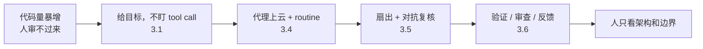
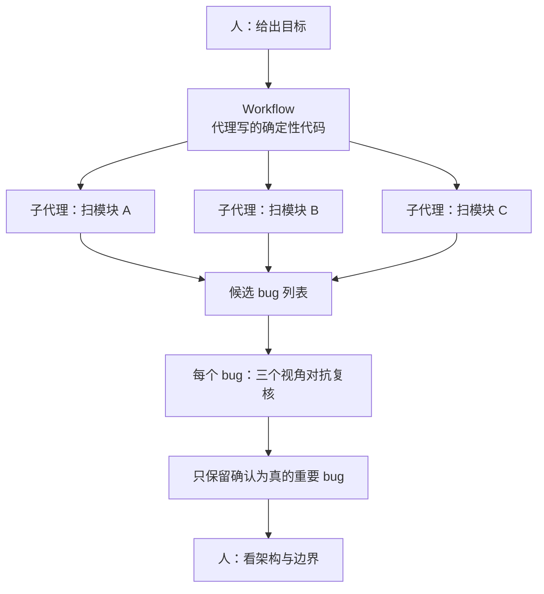

# 代码多到审不过来时，人该做什么：Claude Code 团队怎么用 Claude Code

Claude Code

**一句话看懂**：Claude Code 团队三位工程师聊自己现在的工作方式：大部分活在 Slack 里交给 Claude Tag，给它目标而不是逐步指令；代码审查交给“先扇出找 bug、再对抗式复核”的 workflow；人靠截图、录屏、事件数据这些证据建立信任，只看架构和边界这类大问题。

## 读完你能带走的 6 条收获

1. **人和代理的接口在上移**：从盯每一次 tool call，变成交代一个目标、看它通过消息工具汇报（见 3.1）。
2. **harness 里的很多功能是给旧模型打的补丁**，模型变强后要敢删；to-do list 就是例子（见 3.2）。
3. **让代理离开你的笔记本**：托管容器 + routine，才能让它在你下班后继续干活（见 3.4）。
4. **扇出找 bug、每个 bug 再从三个视角对抗复核**，用推理算力换置信度，只把真问题交给人（见 3.5）。
5. **编排写成代码、判断交给模型**：for 循环保证一项都不漏，这是人敢信任 workflow 的原因（见 3.5）。
6. **信任来自三个原语：验证、审查、反馈**。要求代理附上截图或录屏，把事件数据接回来（见 3.6）。

::: tip 小白先懂这几个词
- [Claude Tag](/glossary#claude-tag)：住在 Slack 里的 Claude 代理，@它就能干活。
- [扇出（Fan-out）](/glossary#fan-out)：把大任务拆给很多子代理同时做，再汇总。
- [对抗式复核](/glossary#adversarial-review)：专门派代理去判断“这个 bug 是不是真的”。
- [Artifact](/glossary#artifact)：代理生成的独立成品，比如一个 HTML 页面。
- [Harness](/glossary#harness)：包在模型外面、负责工具和上下文的那层程序。
- Routine：定时或按事件自动运行的代理任务。
:::

## 1. 基本信息

<YouTube id="S-sYlFiGFv8" title="How the Claude Code team uses Claude Code" />

| 项目 | 内容 |
|---|---|
| 讲者 / 频道 | Thariq Shihipar、Sid Bidasaria、Robert Boyce（Claude Code 团队）／ 官方频道 **Claude** |
| 发布日期 | 2026-09-02 |
| 时长 | 22:23 |
| 使用工具 | Claude Code（TUI、桌面 App、Claude Code on the web）、Claude Tag、AskUserQuestion、Artifacts、Routines、Workflows |
| 分析依据 | YouTube 人工英文字幕全文（yt-dlp，2026-10-14 重新抓取，引语逐字核对）+ 视频截图。字幕不标说话人，除简介明确的信息外，引语不归到具体个人。这是 Anthropic 官方频道介绍自家产品的对谈，没有量化数据。“我觉得”开头的段落是本站评论，不是讲者观点。 |

## 2. 这篇在回答什么

一年前用 Claude Code 是什么样子？讲者开场就说了：写 prompt、给反馈、点权限确认。

现在代码生成得太快，人不可能逐行审查，也不可能盯着每一个工具调用。那人的工作变成了什么？这期 22 分钟的对谈，回答了这几个问题：

1. 人和代理的接口变成什么样？（3.1）
2. 模型变强以后，harness 该加什么、删什么？（3.2、3.3）
3. 怎么让代理离开你的电脑，一直干活？（3.4）
4. 代码多到审不过来，审查怎么做？（3.5）
5. 不看 transcript 了，凭什么信任结果？（3.6）

主线只有一条：**交出目标，用确定性的编排和看得见的证据建立信任**。

## 3. 怎么做

### 3.1 工作入口搬到 Slack：给目标，不盯过程

Claude Tag 是一个 Slack 原生的代理。讲者说，交给它的问题，已经远比“实现这个类、写这个函数”复杂。

为什么放在 Slack？因为产品讨论和团队决策本来就在那里。代理能自己查到“这个产品该是什么样、团队做过哪些决定”，判断就更靠谱。

一位讲者给了自己的比例：

- <Trans zh="我现在 70% 到 80% 的工作都在 Claude Tag 上完成，剩下 20% 可能会打开 TUI 或桌面 App 去精修一些东西。">“70 to 80% of my work happens on Claude Tag now, and for 20% of the work, I will maybe open up the TUI or the desktop app to like, refine something.”</Trans>

工作方式也变了。以前在乎 transcript、在乎每一个工具调用；现在是：

::: tr 我有一个目标，想达成它。你就把目标交给模型，让它替你完成。
> "I have a goal and I'd like to achieve this goal. And you just kind of give that goal to the model to achieve for you."
:::

更关键的是界面的变化。Claude Tag 在 Slack 里说的每句话，都是它调用一个“发消息”工具发出来的；它内部的推理默认看不见，只有一个链接能打开完整 transcript。讲者说，这是第一次把用户界面和 transcript 彻底分开。

起初这让人<Trans zh="有点吓人">“a little scary”</Trans>：看不到 Claude 在想什么。但它也逼着人<Trans zh="放手让 Claude 干">“let Claude cook”</Trans>，结果发现不用细看 transcript，也能拿到好结果。

我觉得这里的要点不是“用 Slack”，而是**让代理自己决定什么时候、对你说什么**。你还能随时打开 transcript，但默认不看，这就把人的注意力从过程挪到了结果上。

### 3.2 harness 里的补丁，模型变强后要敢删

讲者说，以前一项技术的“保质期”以年计；现在模型每两个月就变一次，而且越来越快。团队既要站在前沿之外去摸边界，又要让今天的用户用得好。

他举的例子是 to-do list。那是 Sonnet 3.5 的时候：

::: tr 你给它五件事，它做三件就放弃了。
> "you would give it like five things to do, and it would do three things and just give up."
:::

加上 to-do list 以后效果很好。可一年后：

::: tr 它已经消失了，你不再真的需要 to-do list。
> "it's disappeared, like you don't really need the to do list anymore."
:::

讲者的总结是：harness 里很多功能，就是为了遮住当前模型的失败模式。模型变强了，就可以说“这些不需要了”，删掉。与此平衡的是，任务变得更大，模型需要的新工具也会不一样。

所以他们的态度是：<Trans zh="你得对自己做的东西保持很不执着，因为它们会很快消失。">“you got to be very unattached to the things you're building. Because they're going to go away fairly quickly.”</Trans>

我觉得这条对普通团队同样适用。你在 CLAUDE.md、自定义命令、提示词模板里加过的“补丁”，每次换模型后都值得重看一遍。

### 3.3 代理怎么问人：从 AskUserQuestion 到 HTML artifact

AskUserQuestion 是另一个例子。讲者想让 Claude 能和人互动：最早把提问放在规划之后，后来改成一个模型随时能调用的工具。

这个工具不好做。他说设计它<Trans zh="花了我很长时间">“took me so long”</Trans>，一开始 Claude 也调不好。后来模型越来越会用它。

而最近，他自己反倒不怎么用这个工具了：

::: tr 我直接生成一个 artifact，让 artifact 来问我问题。它是 HTML 的，里面有图和 mockup。
> "I just create an artifact. And the artifact asks me questions, you know, and it's like in HTML, it has diagrams and mockups and things like that."
:::

<figure class="shot"><figcaption>📷 视频截图 · <a href="https://www.youtube.com/watch?v=S-sYlFiGFv8&t=391s" target="_blank" rel="noopener">6:31</a> · 6:31 前后：讲者说现在常让 Claude 直接生成一个会“反问你”的 HTML artifact，随后话题转到 loops 与远程运行。</figcaption></figure>

这和 3.2 是同一个规律：一个能力从“模型几乎做不到”到“做得很好”，再到“被更通用的东西取代”，只用了很短时间。团队的做法是做一些底层原语（权限怎么工作、可视化怎么工作），让它们一层层叠起来。

### 3.4 从本地到云端：Loops 与 Routines

为什么要上云？讲者讲了一个很朴素的起因：代理在笔记本上跑，下班回家要合上电脑，代理就停了。

他们走过的路是这样的：

1. **笔记本本地运行**：合上盖子就停。
2. **远程托管的开发机**：电脑不用一直开着，但要 ssh 回去，不方便。
3. **Claude Code on the web**：托管容器，在后台一直跑。麻烦在于，要给容器访问你开发环境的权限，讲者说<Trans zh="有点麻烦">“a bit of a pain”</Trans>，但他认为完全值得，<Trans zh="让我的效率提高了 10 倍">“10x my productivity”</Trans>。
4. **Routines**：既然代理在云上，就可以让它定时干活。

他给的 routine 例子：

::: tr 每天去看我们收到的所有反馈，按重要程度分桶，然后把它有高把握修好的那些修掉。
> "every day go and look at all the feedback that we're getting and look at, you know, bucket them into buckets of importance and fix the ones that it actually has high confidence in fixing."
:::

讲者把这称为 Boris 常说的 loop 之路：从在一个会话里提示模型，变成突破会话的边界，去提示“上一层”的东西，让它替你修 bug。

注意“10 倍”是讲者的主观感受，不是测量值。

### 3.5 代码审查：扇出 + 对抗式复核，演化成 Workflows

先说人的审查变了什么。讲者观察到，传统审查里常有人挑三个小毛病发出来，只是为了表明“我认真读过了”。现在这些小问题让 Claude 自己找、自己改。人该看的是更大的东西：

- 这个 API 为什么是这个结构？
- 服务边界为什么划在这里？

这些是 Claude 写 PR 时可能还没完全理解的背景。

再说机器那一侧。代码审查是团队第一次做大规模扇出：怎么找出每一个 bug？做法是：

::: tr 你让 Claude 扇出去找 bug。然后对每个 bug 做一次对抗式复核：让它从三个不同的观点或视角去看这个 bug，判断它是不是真的。
> "you tell Claude to go out and fan out and find bugs. And then for each bug, you might do an adversarial review where you ask it to look at the bug from three different, you know, opinions or perspectives and see if the bug is actually real."
:::

为什么要复核？扇出之后信息太多，<Trans zh="如果我去读扇出的输出，我会疯掉">“if I read the fan out output I'm going to go crazy”</Trans>。复核把假 bug 过滤掉，只留下需要人关注的重要问题。讲者说这像一个 MapReduce 问题，建立信心的办法就是在推理时多投入算力（test-time compute）。

这套做法后来变成了 **Workflows**，而且不限于代码审查：性能问题、通用的深度调研都能用。讲者举了个生活例子：下周带父母去 Tahoe，住哪儿？发十个搜索，再让一些代理排序、一些代理核实。

<figure class="shot"><figcaption>📷 视频截图 · <a href="https://www.youtube.com/watch?v=S-sYlFiGFv8&t=727s" target="_blank" rel="noopener">12:07</a> · 12:07 前后：讲者用“规划去 Tahoe 的旅行”举例，说明扇出（同时发十个搜索）再由其他 Agent 排序筛选的模式。</figcaption></figure>

扇出的拓扑不用人设计：<Trans zh="Claude 其实很擅长给自己搭 harness">“Claude is actually really good at making its own harnesses”</Trans>。它能决定怎么扇出、怎么把一层代理的输出接到下一层、最后怎么汇总。

Workflows 最值得学的是这一点：**由代理写代码来编排子代理**。确定性的代码和 LLM 的判断混在一起。讲者说，看到 Claude 写了一个 for 循环去遍历所有条目，他就放心了：

::: tr 它不会漏掉任何一项，会对所有这些东西一视同仁地用同一个方法。
> "it's not going to skip one of the items like it's going to apply the same technique to all of these things equally."
:::

我觉得“三个视角”是讲者随口举的数，视频没有给误报率、成本这些数据。但结构本身可以直接照搬：用 [headless 模式](/glossary#headless)（`claude -p`）或 Agent SDK，先让脚本对每个模块并行找 bug，再对每个候选 bug 开几个只读的复核，只把多数确认的贴到 PR 上。

### 3.6 不看 transcript，凭什么信任：验证、审查、反馈

Robert 在做 Claude Tag，而团队正在<Trans zh="用 Claude Tag 开发 Claude Tag">“using Claude Tag to build Claude Tag”</Trans>。他说自己很大一部分精力，是让开发环境和 dev loop 对 Claude 足够好用，让它能<Trans zh="做到我作为人类为了构建软件、端到端测试它能用所需要做的一切">“do everything that I, as a human need to do to build the software and test that it's working end to end”</Trans>。软件越复杂、集成越多，这件事越难。

<figure class="shot"><figcaption>📷 视频截图 · <a href="https://www.youtube.com/watch?v=S-sYlFiGFv8&t=839s" target="_blank" rel="noopener">13:59</a> · 13:59 前后：话题转到 Claude Tag，讲者说团队正在“用 Claude Tag 开发 Claude Tag”。</figcaption></figure>

另一位讲者讲了他内测一个新工具的完整过程，全在 Slack 里：

1. 问 Claude Tag：我有这个想法，该找谁聊？拿到一批相关的人。
2. 让它做 mockup，手机上就能看。
3. 让它实现。不确定好不好用，就加很多事件埋点。
4. 内部部署，看大家怎么用。
5. Claude Tag 负责监控，有人给反馈就 tag 他，他能马上回应。
6. 发现漏斗里用户没走完。他本想下一个具体指令，转念改成让 Claude 自己想改进方案，把自己的想法只当一个例子。

讲者把这些归成三件事：**验证、代码审查、获取反馈**（接上事件库、指标、Slack 或 GitHub issues），三者在 Claude Code 里都是原语。

验证的样子是这样的：Claude 给 Claude Code 提 PR 时会自测，发来截图。有一次，他先让它<Trans zh="录下自己使用 TUI 的过程">“record itself using the TUI”</Trans>，然后为了保险，自己 clone 下来试了一遍。他说以后大概连 clone 都不用了。

我觉得 3.5 和 3.6 合起来，回答了“人还要不要审”的问题：要，但审的是证据和大方向。截图、录屏、埋点数据，比逐行读 diff 更快让人判断“它是不是真的做成了”。

### 3.7 工程师还剩什么

结尾几位讲者聊了各自怀念什么：

- 一位以前很享受性能优化，现在 Claude 比他更擅长，但他照样享受性能提升的结果；他的精力转到了更快地把新想法变成原型、再变成产品。
- 另一位曾花一天用 CSS 一层层叠径向渐变，复刻 Mac OS 10.4 的 Aqua 按钮；现在不会再手工做这种事。他想起七八岁时想做游戏，不会编程，就用 PowerPoint 画可以点的形状。现在任何想法都不再受技术能力限制。
- 最后一位说，软件工程本来就是<Trans zh="变化的职业">“the profession of change”</Trans>：从手写 JavaScript 到框架、编译器，现在只是变得更快，本质仍是解决问题。

## 4. 结果与局限

视频没有实验，也没有审查准确率、误报率、成本这些数据。能确认的是讲者的口述：

| 说法 | 性质 |
|---|---|
| 一位讲者 70–80% 的工作在 Claude Tag 上 | 个人自述 |
| 云端容器让效率提高 10 倍 | 主观感受 |
| 对每个 bug 从三个视角复核 | 举例，未给效果数据 |
| to-do list 一年后已不再需要 | 团队经验 |

::: warning 局限与注意
- **官方立场**：这是 Anthropic 官方频道介绍自家产品，Claude Tag、Workflows 是内部或新的产品形态，外部能用到的形式可能不同。
- **上云有成本**：要给容器开放开发环境的访问权限，讲者承认麻烦。
- **不看 transcript 依赖信任**：信任要靠截图、录屏和反馈数据来补；讲者自己也还会 clone 下来亲手试。
- **对抗复核没有给参数**：几个视角、怎么判定“确认”，视频都只是举例。
:::

## 5. 结论

当代码多到审不过来，人的工作不是审得更快，而是往上挪一层：交出目标，让代理用确定性的编排把每一项都处理到，再用截图、录屏、事件数据向你证明它做成了。人留下来的，是 API 为什么这样设计、边界为什么划在这里这类判断。

我觉得最容易借鉴的是两件事：把“一个都不能漏”的部分写成代码，以及要求代理交付证据，而不只是交付 diff。

### 你可以这样试

- [ ] 挑一个模块，让代理并行开 3 个子代理找 bug，再对每个候选 bug 开只读子代理，从“安全 / 正确性 / 能否复现”三个角度复核，比较复核前后的数量。
- [ ] 让代理写一个脚本来编排这件事，而不是在对话里一个个派，检查它有没有漏项。
- [ ] 在 PR 模板里加一栏“代理自测证据（截图 / 录屏）”。
- [ ] 列出你给代理加过的“补丁式”规则，换模型后挑一条删掉试试。

::: details 读完自测（点开看答案）
1. **对抗式复核解决什么问题？** 扇出找 bug 会产生大量候选和误报，复核从多个视角判断 bug 是否真实，只把重要的交给人。
2. **为什么编排要写成代码？** for 循环保证每一项都被同样处理，不会漏，这让人敢信任结果。
3. **团队为什么删掉 to-do list？** 它是给“五件事做三件就放弃”的旧模型打的补丁，新模型不再需要。
4. **Claude Tag 和人沟通的方式有什么不同？** 它通过发消息工具决定什么时候说什么，内部推理默认不显示。
:::
