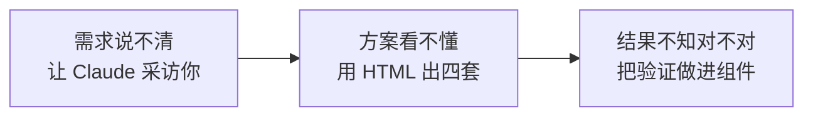

# 代理要跑很久时，先把方向定对、再让它自证：Anthropic 的三步工作坊

<div class="meta-tags"><span class="tool-tag tool-claude">Claude Code</span></div>

<div class="hook">

**一句话看懂**：代理跑得越久，跑错方向烧掉的 token 越多。Anthropic 架构师 Arno 的办法是把人本来最后才做的检查往前挪：需求阶段让 Claude 反过来采访你；设计阶段让它出四套 HTML 方案给你点；实现阶段让每个组件把自己的状态写在 DOM 上，人、代理和 CI 用同一套标准判对错。

</div>

## 读完你能带走的 6 条收获

1. **Claude 可能比你更擅长把你的需求挖出来。** 好 prompt 只说你关心哪些方面，再点名让它用 AskUserQuestion 采访你（见 3.1）。
2. **超过 200 行的 Markdown 没人读，方案用 HTML 看。** 一次要四个截然不同的设计方向，点一点再反馈（见 3.2）。
3. **验证不是测试，是在运行时看产物真的表现成什么样。** 让组件把状态写成 `data-verify-*` 属性，代理读契约，不用扒 React 内部（见 3.3）。
4. **同一套判定给三个人用：人看仪表盘、代理调 `window.__verify`、CI 跑 `bun run verify`**（见 3.3）。
5. **故意埋一个必然失败的检查，证明框架能抓住“谎言”。** 每个单元至少要有一个推离理想路径的 probe（见 3.3、3.4）。
6. **HTML spec 单次更贵，但长期迭代更少**（见 3.5）。

::: tip 小白先懂这几个词
- [AskUserQuestion](/glossary#ask-user-question)：Claude Code 弹选择题问你的工具。
- [Spec](/glossary#spec)：写清“要做什么、做到什么算完成”的需求文档。
- [MCP](/glossary#mcp)：给 Agent 接外部工具的标准插头，这里接的是 Playwright 浏览器。
- [Fixture / Invariant / Probe](/glossary#fixture)：测试输入 / 必须成立的规则 / 刁钻边界用例。
- [Happy Path](/glossary#happy-path)：一切正常、不出错的那条路径。
:::

## 1. 基本信息

<YouTube id="IlqJqcl8ONE" title="How we Claude Code" />

| 项目 | 内容 |
|---|---|
| 讲者 / 频道 | Arno（字幕自我介绍：Anthropic Applied AI 团队架构师）／ 官方频道 **Claude**（Code w/ Claude 2026 工作坊） |
| 发布日期 | 2026-05-23（YouTube 上传日期，yt-dlp 核实） |
| 时长 | 31:43 |
| 使用工具 | Claude Code（Opus 4.7、Auto mode、Fast mode、`/effort`、AskUserQuestion）、Playwright MCP、Bun、Vite + React、Zod、Vitest |
| 配套仓库 | https://github.com/anthropics/cwc-workshops/tree/main/how-we-claude-code |
| 分析依据 | YouTube 英文字幕全文（2026-10-14 用 yt-dlp 重新拉取并逐字核对）+ 视频简介 + 配套 GitHub 仓库 `anthropics/cwc-workshops/how-we-claude-code`（`phase-1`、`phase-2` 的 PROMPT.MD 与 `phase-3-verify/README.md` 原文，Apache-2.0，同日抓取）。英文引号内容是字幕或仓库原文；“我觉得”开头的段落是本站评论，不是讲者观点。 |

<figure class="shot"><figcaption>📷 视频截图 · <a href="https://www.youtube.com/watch?v=IlqJqcl8ONE&t=237s" target="_blank" rel="noopener">3:57</a> · 讲者的总纲幻灯片“Three tools for working with long-running agents”：消除歧义（让 Agent 先采访你）、理解与规划（用 HTML 而非 Markdown 写计划）、内建验证（从一开始就做验证，而不是最后补）。</figcaption></figure>


## 2. 这篇在回答什么

模型越来越强，代理能一口气跑更久，你可以交给它更复杂的任务。讲者说，这也意味着我们得改习惯：

::: tr 如果你要让代理跑更长时间，它做错了事，就会烧掉很多 token。你最好在一开始就避免这种情况。
> "If you're going to let your agent run for a longer period of time, then you can burn through a lot of tokens if it does the wrong thing. And you want to avoid that ideally at the beginning."
:::

那怎么在一开始就避免？讲者的思路是：人本来要在 spec 里做的检查，往前挪，挪进一个更好读的 HTML 文件；再往后，把检查做进产物本身，让代理自己能跑。

<figure class="shot"><figcaption>📷 视频截图 · <a href="https://www.youtube.com/watch?v=IlqJqcl8ONE&t=237s" target="_blank" rel="noopener">3:57</a> · 讲者的总纲幻灯片“Three tools for working with long-running agents”：消除歧义（让 Agent 先采访你）、理解与规划（用 HTML 而非 Markdown 写计划）、内建验证（从一开始就做验证，而不是最后补）。</figcaption></figure>

这场 32 分钟的工作坊按三个问题展开，配套仓库也分三个阶段：



讲者说前两步“比较基础”，第三步才是重点。内容基于同事 Thariq 一周半前的演讲和博文《The Unreasonable Effectiveness of HTML files》（[[06]] 是 Thariq 的另一场演讲）。

## 3. 怎么做

### 3.1 需求：让 Claude 采访你

第一个问题是需求说不清。讲者先借了强化学习之父 Richard Sutton 的“苦涩的教训”：与其用人的聪明把系统事先写死，不如堆更多数据和算力。放到这里就是：模型越强，越别去约束它。

::: tr 你应该接受这一点：模型很可能比你更擅长从你身上提取需求，而不是你自己去定义需求。
> "you should accept that the model is probably better at extracting requirements from you than you are at defining your requirements."
:::

他的理由是，需求潜藏在你心里，就像你的用户：看到了才知道要不要，但很难说清楚。

那怎么写 prompt？讲者说，他看很多人用 Claude Code 只打一句<Trans zh="把它做得更好">“Just make it better.”</Trans>，或者<Trans zh="别犯错">“make no mistakes”</Trans>。这不是好 prompt。好 prompt 的做法是：

- 只给出你关心的**领域**（比如受众），不预设结果；
- 让问题保持开放，而不是事先把答案定死；
- 这样 Claude 就会一轮轮地采访你。

仓库里第一阶段的原始 prompt（`phase-1-exploration/PROMPT.MD`）：

::: tr 我想做一个分账 App。你能先和我一起头脑风暴一下目标用户是谁，然后用 AskUserQuestion 工具深入采访我要做什么吗？重点是把所有歧义都挖出来，最后写成一份 spec。
> I want to build a bill-splitting app, can you help me brainstorm with me on who the audience is, and then interview me in-depth using the AskUserQuestion tool about what to build, focusing on  pulling out any ambiguities to create a spec.
:::

关键在于**点名 AskUserQuestion 工具**：

::: tr 你看到我在 prompt 里明确提到了 AskUserQuestion 工具，正是它触发了这个流程。prompt 写得越好，结果越好。
> "you saw me in my prompt explicitly referring to the ask you a question tool. That's what triggers this workflow, and you know, depending on how well you specify that prompt, you'll get better outcomes."
:::

现场演示中，Claude 弹出选择题问受众是谁、有没有第二受众，讲者点几下，它就写出 spec。

<figure class="shot"><figcaption>📷 视频截图 · <a href="https://www.youtube.com/watch?v=IlqJqcl8ONE&t=396s" target="_blank" rel="noopener">6:36</a> · 6:36 前后，演示用的分账 App（A bill-splitting app）界面：讲者随后让 Claude 就这个 App 采访自己。</figcaption></figure>

### 3.2 方案：用 HTML 而不是 Markdown

第二个问题是方案看不懂。有了 spec 和计划，你要检查它是不是你想要的。过去大家用 Markdown。讲者引了一位同事的话：Markdown 是 AI 原生软件开发流程的<Trans zh="通用语">“lingua franca”</Trans>。但它太长了：

::: tr 尤其是 Markdown 文件超过大约 200 行，你多半不会读，你的同事就更不会读了。
> "especially if the markdown files get, you know, they get more than about 200 lines long, it's unlikely you're going to read it, and certainly unlikely that your colleagues are going to read them."
:::

HTML 信息更密，能看见界面长什么样，还能截图、配合 Playwright MCP 交互。仓库第二阶段的 prompt（`phase-2-planning/PROMPT.MD`）：

::: tr 读取 ../phase-1-planning 里的 spec 文件，然后帮我确定这个 App 的整体设计。探索 4 种不同的设计方向，为每种方向把重要页面做成一组 HTML 文件。
> Read ../phase-1-planning for its spec file, then help me figure out the overall design of this app. Explore 4 different designs, and create a set of HTML files with important screens for each.
:::

现场展示了 Opus 4.7 提前生成的几套：一个粗野主义（brutalist）风格，一个“东京金融科技”风格，审美完全不同。讲者一个个点开对比，说这比从 Markdown 里猜界面长什么样好反馈得多。

他还鼓励多截图给 Claude，尤其是前端：“有点不对劲”“这里没对齐”这种话很难说清，Opus 4.7 的视觉能力更好，能从截图里自己看出问题。

我觉得这一步和 [[06§3.3]] 的“四个迥异原型”是同一招：用可以看、可以点的东西，把“看到才知道”的偏好逼出来。

### 3.3 结果：把验证做进组件

第三个问题是重点：代理说“做完了”，你怎么知道对不对？讲者先区分了验证和测试：

::: tr 如何验证。其实不是测试，只是在这个语境下的验证。怎样让验证原生于产物本身，让代理能和人一起驱动它，最终也能不靠人、无头地跑。
> "And then, how to verify. Not test, actually, but just to verify in this context. Um how to make verification native to the thing itself, so that the agent can drive it alongside a human. Or eventually not, headlessly as well."
:::

仓库 README 说得更明白：验证是<Trans zh="在表面做运行时观察：把东西跑起来、操作它、读它实际显示了什么">“runtime observation at the surface — you run the thing, drive it, read what it actually shows”</Trans>；测试和类型检查是 CI 的事。

第三阶段换了一个小的 React 待办应用（Vite + React），整套设计建立在一句话上：<Trans zh="App 的每一部分都应该能在运行时被 AI 代理轻松验证">“every piece of the app should be trivially verifiable by an AI agent at runtime”</Trans>。README 列了六个设计点：

1. **DOM 是机器可读的接口。** 每个组件输出 `data-verify-*` 属性描述自己的状态：
   ```html
   <section data-verify-unit="TodoApp" data-verify-total="3"
            data-verify-done="1" data-verify-active="2" data-verify-filter="all">
   ```
   意思是：TodoApp 当前共 3 项、完成 1 项、未完成 2 项、筛选为“全部”。代理读这份契约，而不是 React 内部状态，所以内部随便重构，只要契约不变就行。
2. **每个单元声明 fixtures 和 invariants。** 用 Zod schema 校验 props；fixture 是有名字、可复现的渲染配置；invariant 是对 DOM 必须成立的断言。标了 `probe: true` 的 fixture 是对抗性的边界用例。README 原话：<Trans zh="一个没有任何 probe 的单元，只是把理想路径重放了一遍。">“A unit with zero probe fixtures has only replayed the happy path.”</Trans>
3. **隔离渲染路由** `/verify/:unit/:fixture`：每个“单元 × fixture”有一个只挂载该单元的页面，加 `?chrome=0` 得到干净截图。
4. **可插拔的验证器**：`schema`、`invariants`、`dom-contract`、`a11y`（按钮有名字、输入框有 label、图片有 alt）。加一种新验证只要加一个文件。
5. **代理句柄** `window.__verify`：`manifest()` 列出全部组合，`current()` 返回当前挂载的结果，`runAll()` 跑整个矩阵。
6. **一套判定，三个使用者**：人点 `/verify` 仪表盘的“Run all”，代理调 `window.__verify.runAll()`，CI 跑 `bun run verify`。走的是同一条 `runFixture()` 代码路径。

判定分 `PASS | FAIL | BLOCKED | SKIP`，其中 BLOCKED（没法观察）和 FAIL（观察到了、是错的）被刻意分开。README 有一句很好的取舍原则：

::: tr 拿不准时，runner 判失败：一个错误的 PASS 会把 bug 发出去，一个错误的 FAIL 只是多看一眼。
> When in doubt, the runner fails — a false PASS ships bugs, a false FAIL costs one more look.
:::

<figure class="shot"><figcaption>📷 视频截图 · <a href="https://www.youtube.com/watch?v=IlqJqcl8ONE&t=872s" target="_blank" rel="noopener">14:32</a> · “Three principles”幻灯片：1）从一开始就为验证而构建；2）按可验证性划分模块；3）跨层验证（单元、集成、视觉、行为）。</figcaption></figure>

我觉得这一节的核心不是哪个库，而是“组件主动把状态写出来”这个习惯。讲者自己也说，新东西只是把你早就熟悉的原语<Trans zh="重新组合、重新排列">“the remixing and the the new arrangement of of of of of primitives that you're already familiar with”</Trans>，让代理优先用得上。

### 3.4 现场演示：抓谎言、破契约、让代理诊断

讲者用这个待办应用演示了四件事。

**一、故意埋的失败能被抓住。** `TodoStats/inconsistent-counts` 是一个<Trans zh="设计成必然失败的 probe">“probe that is DESIGNED to fail”</Trans>，用来证明框架<Trans zh="能抓住谎言，而不只是确认事实">“catches lies, not just confirms truths”</Trans>。仪表盘上点“Run all”，其余通过，只有它失败：讲者的说法是 3 + 4 不等于 10。

**二、破坏契约，而不是破坏应用。** 他从 `TodoApp` 里删掉统计总数的属性，应用照常能用，但底下一批检查全红了：

::: tr 这些全失败了。不是因为我们弄坏了 App，而是因为我们破坏了契约。
> "All of these are failing. Not because we broke the app but because we broke the contract."
:::

这正是 README 里的建议练习：删掉 `data-verify-total`，看 `dom-contract` 和 `counts-add-up` 检查在仪表盘、`bun run verify` 和 `window.__verify` 三处同时报出精确原因。

**三、让代理自己诊断。** 他让已连上 Playwright MCP 的 Opus 4.7 去查那个失败的检查，它报告 schema 被拒、4 + 3 不等于 10。讲者顺带说明：直接跑 `bun verify` 的测试矩阵会通过，因为那条失败是故意设计在验证层里的演示。

**四、录制证据。** 回放验证步骤不是为了再验一次，而是<Trans zh="为了提供验证的证据">“to provide the evidence of the verification”</Trans>：可以录成视频片段，存到 S3 或分享给同事。讲者说 Claude Code 团队基本所有前端改动都这样录。

<figure class="shot"><figcaption>📷 视频截图 · <a href="https://www.youtube.com/watch?v=IlqJqcl8ONE&t=1665s" target="_blank" rel="noopener">27:45</a> · 27:45 前后的 Replay 页面（localhost:5199/verify/replay）：21 个检查里 20 个 PASS，唯一的 FAIL 正是故意埋下的 TodoStats / inconsistent-counts；左上角可以“Record clips”录制证据。</figcaption></figure>

字幕里有些操作细节听不清（屏幕字小、讲者边点边说），以上以仓库 README 为准。

### 3.5 现场问答与设置建议

工作坊没有单独的问答环节，但讲者在过程中回答了两个问题，也给了几条设置建议。

**问：录下来的验证视频存哪？** 答：存 S3 或者直接分享给同事都行。Anthropic 内部有一套更自动化的版本，会定期录制，具体保存多久他不确定。

**问：HTML spec 是不是更费 token？**

::: tr 答案往往是否定的。原因是，长期看，如果你有一份好的、丰富的 HTML spec，你需要的迭代次数更少，即便单次生成它要花更多 token。
> "And the answer tends to be no. And the reason is that in the long term you iterate less if you have a good and rich HTML spec, even if and one-off instances you spend more tokens to generate it."
:::

**设置建议**（讲者原话里的推荐，带有明显的产品立场）：

- 用 auto mode：<Trans zh="你必须用 auto mode">“You need to be using auto mode.”</Trans>（Shift+Tab 切换）；
- effort 推荐 xhigh，也可以设 max（`/effort`）；
- fast mode（`/fast`）更贵，但适合快速迭代 spec；
- 这一套用 Opus 4.7 效果好，因为视觉模型更强；他明确说不推荐用 Sonnet。

## 4. 结果与局限

- **演示结果**：Replay 页面上 21 个检查 20 个通过，唯一的失败是故意埋下的那个；删掉契约属性后一批检查同时失败；代理通过 Playwright MCP 正确诊断出失败原因。
- **没有给出**：任何量化数据，比如用了这套方法后返工减少多少、HTML spec 实际多花多少 token。

::: warning 局限与注意
- 第三阶段是一个很小的待办应用，`data-verify-*` 契约要每个组件手写；放到大型存量前端，成本和收益文中没讨论。
- “HTML 长期更省 token”是讲者的判断，没有数据。
- 字幕里演示部分有不少口误和听不清的操作，具体以仓库代码为准。
- 讲者来自 Anthropic，推荐 auto mode、fast mode、Opus 4.7 带有产品立场。
- 讲者说 Claude Code 团队的前端改动都录证据，但没展示内部那套更自动化的系统。
:::

## 5. 结论

这场工作坊的主线是：**把人最后才做的检查往前挪，并做进产物。**

需求阶段，让 Claude 采访你，而不是你自己憋 spec；设计阶段，看四套 HTML 而不是读几百行 Markdown；实现阶段，让组件把状态写在 DOM 上，人、代理、CI 读同一份契约、得出同一个判定。

我觉得最值得带走的是第三步的两个习惯：组件主动“说出”自己的状态，以及故意埋一个必然失败的检查来证明验证真的在工作。前者让代理不用猜，后者防止验证框架本身在撒谎。

### 你可以这样试

- [ ] 下一个新功能，先用第一阶段那条 prompt 的格式（换掉“bill-splitting app”），点名 AskUserQuestion，让 Claude 采访你后再写 spec。
- [ ] 做 UI 前，用第二阶段的 prompt 要 4 套 HTML 设计，点开对比后再选。
- [ ] 克隆 `cwc-workshops/how-we-claude-code/phase-3-verify`，`bun run dev` 后照 README 删掉 `data-verify-total`，看三处报错。
- [ ] 给你项目里最关键的一个组件加上 `data-verify-*` 属性，让代理改完后读属性自证。
- [ ] 在你的验证里故意加一条必然失败的检查，确认它真的会红。

::: details 读完自测（点开看答案）
1. **为什么讲者认为该让 Claude 采访你？** 需求潜藏在你心里，像用户一样“看到才知道”；模型很可能比你更擅长把需求提取出来。
2. **触发访谈流程的关键是什么？** 在 prompt 里明确点名 AskUserQuestion 工具。
3. **`data-verify-*` 属性解决什么问题？** 让组件把状态写在 DOM 上，代理读这份契约，而不用扒 React 内部状态；内部重构不影响验证。
4. **BLOCKED 和 FAIL 有什么区别？** BLOCKED 是没法观察，FAIL 是观察到了且错误；拿不准时判失败。
5. **为什么要故意埋一个必然失败的 probe？** 证明框架能抓住错误，而不只是确认正确。
:::
