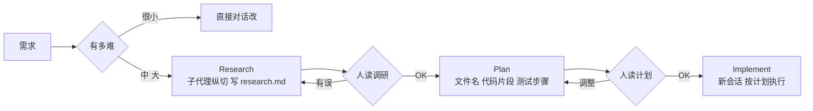

# No Vibes Allowed：AI 一进老代码库就返工，问题出在上下文

Claude Code

**一句话看懂**：AI 在新项目里很好用，一进有年头的老代码库就开始返工。Dex Horthy 认为根子在上下文：模型是无状态的，你喂什么它就吐什么，上下文用得越满越笨。他的解法是“先调研、再计划、后实现”（RPI），每一步都把成果压缩成一份文档，下一步从干净的会话开始；人把精力放在读调研和计划上，而不是读每一行代码。

## 读完你能带走的 6 条收获

1. **想要更好的输出，唯一的办法是给更好的输入。** 避免错误信息比避免缺失信息更重要，噪音最后才考虑（见 3.1）。
2. **上下文用到大约 40% 时，效果就开始下降。** 讲者叫它 dumb zone，MCP 接太多会一直待在里面（见 3.2）。
3. **子代理是用来省上下文的，不是用来扮演角色的。** 让它去搜，只把“文件在哪”带回来（见 3.3）。
4. **主动压缩，别等上下文满了再说。** 调研、计划各写成一份文档，下一阶段开新会话读文档（见 3.4）。
5. **别维护会过时的 onboarding 文档，每次按需调研一份。** 代码才是事实，文档会“撒谎”（见 3.5）。
6. **人读计划，不读每一行代码。** 调研错一行，整件事都会跑偏；计划错一处，可能变成上百行坏代码（见 3.6）。

::: tip 小白先懂这几个词
- [上下文窗口](/glossary#context-window)：模型一次能“看见”的内容上限。
- [Dumb Zone / Smart Zone](/glossary#dumb-zone)：上下文用到约 40% 后，模型效果开始变差。
- [子代理](/glossary#subagent)：在独立上下文里干活、只交回结论的“分身”。
- [Compaction（压缩）](/glossary#compaction)：把长对话浓缩成一份摘要再继续。
- [Brownfield](/glossary#brownfield)：有大量历史代码的存量项目。
- [Slash Command](/glossary#slash-command)：以 / 开头的自定义命令。
:::

## 1. 基本信息

<YouTube id="rmvDxxNubIg" title="No Vibes Allowed" />

| 项目 | 内容 |
|---|---|
| 讲者 / 频道 | Dex Horthy（HumanLayer 创始人，“12 Factor Agents”作者）／ **AI Engineer**（AI Engineer Code Summit） |
| 发布日期 | 2025-12-02 |
| 时长 | 20:31 |
| 使用工具 | Claude Code（子代理、slash command）；方法与工具无关，讲者提到也适用于 Codex、Cursor |
| 配套资料 | https://github.com/humanlayer/humanlayer/tree/main/.claude/commands |
| 分析依据 | AI Engineer 官方讲稿页（ai.engineer/talks/rmvDxxNubIg，含完整时间戳文字稿，2026-10-14 抓取）+ HumanLayer 仓库 `.claude/commands/` 里 research / plan / implement 三个命令的原文（2026-10-14 抓取）+ 视频截图。英文引号内容为文字稿或命令文件原话。“我觉得”开头的段落是本站评论。 |

## 2. 这场演讲在回答什么

你可能有过这种体验：用 AI 写一个新的小项目，几小时就做完了，非常顺；换到公司那个十年的老代码库，它就开始乱改，改完你得返工，下周再返工一次。

Dex 引用了 AI Engineer 6 月一场演讲的调研（Igor 的团队调查了约 10 万名开发者），结论和这种体验一致：用 AI 交付得更多了，但

<Trans zh="很多工作其实是在返工上周交付的 slop">“a lot of it is just reworking the slop that you shipped last week”</Trans>

而且，在复杂任务和老代码库上，效果尤其差。

很多人的结论是“等模型变强再说”。Dex 不这么看。他的团队（三个人）花了八周改造工作方式，说拿到了<Trans zh="两到三倍的产出">“two to three X more throughput”</Trans>。办法不是换模型，而是管好上下文。

这场 20 分钟的演讲回答了四个问题：为什么上下文是关键？怎么省上下文？流程怎么设计？人该站在哪里？

## 3. 怎么做

### 3.1 为什么是上下文

Dex 的论证很简单。大模型是无状态的，每一轮决定下一步调哪个工具时，正确的下一步可能有几百个，错误的也有几百个，而唯一影响它选哪个的，就是到目前为止的对话。所以：

::: tr 想让 LLM 表现更好，唯一的办法就是输入更好的 token，这样才能得到更好的 token 输出。
> "the only way to get better, better performance out of an LLM is to put better tokens in, and then you get better tokens out."
:::

他把上下文的质量分成四个维度：正确、完整、大小、轨迹。最糟的是错误信息，其次是缺失信息，再次是噪音太多。

“轨迹”最容易被忽略。很多人的对话是这样的：让代理做事，它做错了，你骂它；它又做错，你又骂它。模型看到的是一个“我做错、人骂我”反复出现的模式，于是最可能的下一步是什么？Dex 的说法是，它会觉得自己<Trans zh="最好再做错一次，好让人再骂我">“better do something wrong so the human can yell at me again”</Trans>。

所以，对话一旦跑偏，与其继续纠正，不如开个新会话重来：同样的任务，告诉它“别走那条路”。

### 3.2 Dumb zone：用到 40% 就开始变笨

上下文越满，效果越差。Dex 用 Claude Code 举例：窗口约 168,000 个 token，扣掉留给输出和压缩的部分，

<Trans zh="大约在 40% 这条线，你会开始看到收益递减">“Around the forty percent line is where you're going to start to see some diminishing returns”</Trans>

他半开玩笑地把 40% 以上叫做 dumb zone，以下是 smart zone。40% 不是精确值，取决于任务有多复杂，但可以当参考线。

一个直接的推论是：如果你接了一大堆 MCP，光工具说明就占掉一大块，那你<Trans zh="所有工作都在 dumb zone 里做">“are doing all your work in the dumb zone”</Trans>，结果不会好。

那上下文都被什么占了？找文件、理解代码流程、编辑文件、测试和构建的输出，还有某些 MCP 吐出来的一大堆 JSON 和 UUID。

### 3.3 子代理：省上下文，不是扮角色

很多人喜欢建一组子代理：前端、后端、QA、数据科学家……Dex 直接说：请停下来。

::: tr 子代理不是用来拟人化扮演角色的，而是用来控制上下文的。
> "Sub-agents are not for anthropomorphizing roles, they are for controlling context."
:::

正确用法是：主代理需要知道“某个功能在大代码库里是怎么实现的”，就派一个子代理去。子代理在自己的上下文里读文件、搜索、理解代码，最后只带回一句很短的结论，比如“你要的文件在这里”。主代理读那一个文件，就能开工。

搜索过程中读过的那一大堆东西，留在子代理的上下文里，不会污染主代理。

### 3.4 频繁有意压缩：Research → Plan → Implement

比子代理更进一步的，是把整个工作流都围绕上下文来设计。Dex 叫它“频繁有意压缩”（frequent intentional compaction）。

**什么是有意压缩？** 不管当前进展顺不顺，都可以让代理把当前上下文压缩成一份 markdown 文件。你可以审一遍、改一改，新会话读这份文件就能直接开工，不用重新搜索、重新理解代码。好的压缩长这样：正在做什么，以及和问题相关的确切文件和行号。

<figure class="shot"><figcaption>📷 视频截图 · <a href="https://www.youtube.com/watch?v=rmvDxxNubIg&t=461s" target="_blank" rel="noopener">7:41</a> · 7:41 幻灯片<Trans zh="频繁有意压缩：围绕上下文管理来构建你的整个工作流">“Frequent Intentional Compaction — Building Your ENTIRE WORKFLOW around context management”</Trans>。</figcaption></figure>

**RPI 把压缩固定在三个点上：**

| 阶段 | 做什么 | 产物 |
|---|---|---|
| Research | 弄清系统怎么工作，找到相关文件，保持客观 | research 文档：<Trans zh="我们在压缩事实">“We are compressing truth.”</Trans> |
| Plan | 写出精确步骤，包括文件名、代码片段，以及每一步改完怎么测试 | plan 文件：<Trans zh="意图的压缩">“compression of intent”</Trans> |
| Implement | 新会话，照着计划执行，上下文保持很小 | 代码和验证结果 |

Dex 说，读过他们的计划就知道，<Trans zh="世界上最笨的模型大概也不会把这件事搞砸">“the dumbest model in the world is probably not gonna screw this up”</Trans>。

<figure class="shot"><figcaption>📷 视频截图 · <a href="https://www.youtube.com/watch?v=rmvDxxNubIg&t=871s" target="_blank" rel="noopener">14:31</a> · 14:31 前后的 Research 阶段示意图：上下文里依次是系统指令、CLAUDE.md、内置工具、MCP 工具、用户的 /research_codebase 命令，以及 locator / analyzer / pattern-finder 等子代理，最后 Write() 出一份 300–1000 行的 research.md，此时上下文约用了 40%。</figcaption></figure>

三个阶段的命令都开源在 HumanLayer 仓库的 `.claude/commands/` 里。几句关键原文（2026-10-14 抓取）：

- `research_codebase.md` 的任务定义：

  ::: tr 你的任务是在整个代码库中开展全面调研：派出并行的子代理，综合它们的发现，来回答用户的问题。
  > "You are tasked with conducting comprehensive research across the codebase to answer user questions by spawning parallel sub-agents and synthesizing their findings."
  :::

  它反复强调只描述现状、不提建议：

  ::: tr 你唯一的工作是记录和解释代码库现在的样子。
  > "YOUR ONLY JOB IS TO DOCUMENT AND EXPLAIN THE CODEBASE AS IT EXISTS TODAY"
  :::

- `create_plan.md` 对规划者的要求：

  ::: tr 你应该保持怀疑、做到周全，并与用户协作，产出高质量的技术规格说明。
  > "You should be skeptical, thorough, and work collaboratively with the user to produce high-quality technical specifications."
  :::

- `implement_plan.md` 只执行批准过的计划：

  ::: tr 执行 thoughts/shared/plans/ 目录中一份已批准的技术计划……这些计划按阶段划分，每个阶段都有具体改动和成功标准。
  > "You are tasked with implementing an approved technical plan from `thoughts/shared/plans/`. These plans contain phases with specific changes and success criteria."
  :::

我觉得调研命令里“只描述、不建议”这条特别关键。调研阶段一旦开始提建议，就混进了还没验证的判断，后面的计划会建立在这些判断上。

### 3.5 Onboarding：按需调研，别维护会过时的文档

Dex 用电影《记忆碎片》打比方：主角每天醒来都失忆，只能靠身上的纹身弄清自己是谁、在干什么。代理也一样，<Trans zh="如果你不给代理做入职引导，它们就会瞎编">“If you don't onboard your agents, they will make stuff up.”</Trans>

怎么引导？他比较了三种办法：

1. **每个仓库放一份 onboarding 文档。** 问题是代码库越大，这份文档要么越来越长，要么丢信息。读一份五百万行 monorepo 的说明，smart zone 就用完了。
2. **分层放置（渐进披露）。** 仓库根目录放一份，每一层再放补充说明，代理在哪一层工作就读哪一层。可以用 CLAUDE.md 或 hooks 实现。问题是会过时：每次发新功能，都得更新一大片文档。
3. **按需压缩的上下文。** 这是他推荐的。做一个和 Jira、Linear 的 SCM provider 有关的功能，就给代理一点方向：“我们要改这一块。”然后调研命令派子代理在代码库里纵向切几刀，生成一份只基于代码本身的调研文档。

他在台上问了一个问题：代码、函数名、注释、文档，这张图的纵轴是什么？答案是“谎言的数量”：从代码到文档，谎言越来越多。所以你可以把更新文档写进流程，但<Trans zh="你大概不应该这么做，因为你多半不会坚持">“you probably shouldn't 'cause you probably won't”</Trans>。

### 3.6 人读计划，而不是读每一行代码

这一节是演讲的核心。

Dex 问：代码审查是为了什么？他的答案是 mental alignment（心智对齐）：找 bug 当然重要，但最重要的是让团队每个人都知道代码库在怎么变、为什么变。

他每周读不完上千行 Go 代码，也不想读。但作为技术负责人，他可以读计划，这就足够跟上系统的演进，还能早发现问题。他们的代码仍然都有人审，只是负责人把注意力放在计划上。为了让计划可靠，他们的计划里写了实际要改的代码片段。他还提到 Mitchell Hashimoto 把 Amp 的对话记录附到 PR 上，审查的人能看到每一步做了什么、跑了什么命令。

计划不是越长越好：越长越可靠，但越难读。每个团队要找到自己的平衡点。

最重要的一句是：

::: tr 一行坏代码就是一行坏代码。计划里一处错误可能变成 100 行坏代码；而调研里一行错误……整件事都会完蛋。
> "a bad line of code is a bad line of code. And a bad part of a plan is-- could be a hundred bad lines of code. … And a bad line of research, … your whole thing's gonna be hosed."
:::

所以人的精力要放在流水线最上游、杠杆最大的地方：先读调研，再读计划。他反复强调：

::: tr 别把思考外包出去……如果你不读计划，这套方法就不会奏效。
> "don't outsource the thinking. … It will not work if you do not read the plan."
:::

他还说要警惕那种生成一大堆 markdown、只为让你“感觉很好”的工具。

### 3.7 按难度选流程强度，以及它的上限

不是每件事都要走全套 RPI：

- 改按钮颜色：直接跟代理说。
- 小功能：一份简单的计划。
- 跨多个仓库的中等功能：先调研，再计划。
- 越难的问题，越需要更多压缩和上下文工程。

怎么判断该用多少？没有捷径，<Trans zh="选一个工具，多练几遍">“Pick one tool and get some reps.”</Trans> 他不建议在 Claude、Codex 等工具之间来回比较。

**它能做到什么？** 讲者给了三个例子：

- 给 BoundaryML 那个 30 万行的 Rust 代码库修一个 bug：一晚上做完，对方 CTO 看了 PR，说会放进下一个版本。
- 和对方 CEO 一起，花约 7 小时提交了 35,000 行代码（他承认有一部分是代码生成和 golden file 更新），对方估计相当于一到两周的工作量。
- 失败的例子：尝试把 Hadoop 依赖从 Parquet-Java 里去掉，<Trans zh="不顺利">“it did not go well”</Trans>。他们最后推倒重来，回到白板上重新想怎么设计。他的结论是：<Trans zh="AI 替代不了思考，它只能放大你已经做过的思考，或者你没做的思考">“AI cannot replace thinking, it can only amplify the thinking you have done or the lack of thinking you have done.”</Trans>

**关于“规格驱动开发”。** 有人问：这不就是 spec-driven development 吗？Dex 说这个词已经“语义扩散”了：有人指更详细的提示词，有人指产品需求文档，有人指写一堆 markdown，所以说了等于没说。他也不在乎 RPI 这个名字，重要的是压缩、上下文工程和待在 smart zone。

<figure class="shot"><figcaption>📷 视频截图 · <a href="https://www.youtube.com/watch?v=rmvDxxNubIg&t=666s" target="_blank" rel="noopener">11:06</a> · 11:06 前后，讲者谈“语义扩散”：幻灯片列出 An agent is a person / a microservice / a chatbot / a workflow / tools in a loop，同一个词每个人理解都不一样，“spec”也是如此。</figcaption></figure>

**最后的难题在团队。** Dex 认为编码代理本身会变成标配，难的是团队和研发流程怎么适应“99% 的代码由 AI 交付”。他描述了一种正在出现的裂痕：资深工程师觉得 AI 没让自己快多少，不怎么用；中级工程师大量使用，补上了技能缺口，也带来了 slop；资深工程师每周清理这些 slop，越来越讨厌 AI。他说这不是 AI 的错，也不是中级工程师的错，文化变革要从上往下推。

<figure class="shot"><figcaption>📷 视频截图 · <a href="https://www.youtube.com/watch?v=rmvDxxNubIg&t=1179s" target="_blank" rel="noopener">19:39</a> · 19:39 前后的幻灯片：纵轴从 Hate AI 到 Love AI，两条曲线分别标注 Mid-Level 和 Senior+。讲者此时在谈团队和研发流程如何适应“99% 代码由 AI 交付”的文化转变。</figcaption></figure>

## 4. 结果与局限

- **讲者口述的成果**：三人团队花八周改造流程，吞吐量提高到两到三倍；30 万行 Rust 代码库的修复被对方接受；7 小时提交 35,000 行，其中一个 PR 一周后合并。
- **失败案例**：Parquet-Java 去掉 Hadoop 依赖没做成。

::: warning 局限与注意
- 所有成果数据都是讲者口述，没有独立测量。
- 40% 是经验线，随任务复杂度变化。
- 调研和计划必须有人认真读，否则这套方法没用。讲者原话：<Trans zh="没有完美的 prompt，也没有银弹。">“There is no perfect prompt. There is no silver bullet.”</Trans>
- 讲者在创业（做代理 IDE），演讲结尾有招聘内容。
:::

## 5. 结论

Dex 这场演讲的主线是：**一切为了待在 smart zone。** 子代理、有意压缩、RPI 三阶段、按需调研，都是在想办法让代理每次看到的上下文又小又对。

另一半结论是关于人的：省下来的精力，要用在读调研和读计划上。坏的调研会毁掉整件事，坏的计划会变成上百行坏代码，所以人应该站在流水线的上游。

我觉得最容易照做的一条是：下次对话跑偏时，别继续骂，让代理把当前进展和相关文件、行号写成一份 markdown，开个新会话从那份文件继续。

### 你可以这样试

- [ ] 把 HumanLayer 的 `research_codebase.md` 复制到 `.claude/commands/`，对一个你不熟的模块运行 `/research_codebase`。
- [ ] 读生成的调研文档，找出一处它说错的地方，体会一下“坏调研会污染后面所有步骤”。
- [ ] 开一个新会话，只给它这份调研文档，让它写计划；你逐段审完计划，再让它实现。
- [ ] 留意上下文占用，接近 40% 时停下来，做一次压缩交接。
- [ ] 数一数你的 MCP 工具说明占了多少上下文。

::: details 读完自测（点开看答案）
1. **为什么一直骂代理没用？** 模型会顺着“做错、被骂”的轨迹往下预测，更可能继续做错。
2. **子代理的真正用途是什么？** 控制上下文：在独立窗口里搜索，只带回精简结论。
3. **为什么说一行坏调研比一行坏代码更危险？** 计划和实现都建立在调研之上，调研错了，整件事都会跑偏。
4. **讲者推荐用什么替代长期维护的 onboarding 文档？** 按需调研：每次任务根据代码现场生成一份压缩的调研文档。
:::
