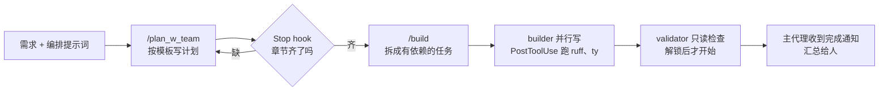

# 子代理越开越多，结果却没变好：IndyDevDan 用 Task 系统搭“一写一查”代理小队

<div class="meta-tags"><span class="tool-tag tool-claude">Claude Code</span></div>

<div class="hook">

**一句话看懂**：随手派出去的子代理没有共同的任务清单、没有先后依赖，也没法告诉主代理“我做完了”。IndyDevDan 用 Claude Code 的 Task 系统把这件事变成一个可以反复运行的流程：`/plan_w_team` 按模板写出带团队分工的计划，Stop hook 检查计划格式；`/build` 把计划拆成有依赖的任务，每个任务配一个 builder 写、一个只读的 validator 查。演示任务很简单，2 分钟就跑完，讲者自己也承认验证做得太浅。

</div>

## 读完你能带走的 6 条收获

1. **代理多不等于结果好**，缺的是共同任务、依赖关系和完成通知，Task 系统补的就是这三样（见 3.1）。
2. **用“模板元提示词”让计划每次都长一个样**：一个按固定格式生成另一个 prompt 的 prompt（见 3.2）。
3. **计划格式靠 Stop hook 保证**，不靠提示词叮嘱：规划代理结束时脚本检查必需章节，缺了就退回（见 3.2）。
4. **最小团队是一写一查**：builder 一次只做一个任务并自带 lint 检查，validator 从配置上就不能写文件（见 3.3）。
5. **需求和编排分开传**：同一个元提示词，换一句编排提示词就能换团队结构（见 3.4）。
6. **验证要接近真实运行**：讲者自认 validator 只做了编译检查，本该真的触发功能看日志（见 3.4、4）。

::: tip 小白先懂这几个词
- [Task 系统](/glossary#task-system)：主代理创建任务、设依赖、分派给子代理的机制。
- [Builder / Validator](/glossary#builder-validator)：一个代理写，另一个只读代理查。
- [Hooks](/glossary#hooks)：在固定时刻自动运行的检查脚本。
- [Front Matter](/glossary#front-matter)：Markdown 开头那段 YAML 配置。
- [Spec](/glossary#spec)：计划或需求文档。
- [Lint](/glossary#lint)：只读代码就能发现问题的检查工具。
:::

## 1. 基本信息

<YouTube id="4_2j5wgt_ds" title="Claude Code Task System" />

| 项目 | 内容 |
|---|---|
| 讲者 / 频道 | IndyDevDan（独立工程师，长期做 Claude Code 实战演示） |
| 发布日期 | 2026-02-02 |
| 时长 | 28:26 |
| 使用工具 | Claude Code（Opus；Task 系统：TaskCreate / TaskGet / TaskList / TaskUpdate）、Hooks（Stop、PostToolUse、SubagentStop）、自定义子代理、ruff、ty、uv |
| 配套仓库 | https://github.com/disler/claude-code-hooks-mastery |
| 分析依据 | YouTube 完整自动字幕（en-orig，2026-10-15 重新取得，此前因限流缺失，这次按片段分析重写全文）+ 讲者公开仓库 `.claude/commands/plan_w_team.md`、`.claude/agents/team/builder.md`、`validator.md` 原文（2026-10-15 抓取）+ 视频截图。字幕是自动生成的，“Claude” 常被识别成 “cloud”，本站引用时避开这类片段。视频后段有讲者课程推广，一笔带过。“我觉得”开头的段落是本站评论。 |

## 2. 这篇在回答什么

你让主代理“开几个子代理并行把这些 hook 都补上”。它确实开了，但每个子代理不知道别人在干什么，不知道哪些活要等别的活做完，做完了也只是把一段文字甩回来。代理越多，你越难知道整件事进行到哪了。

讲者开场就说：

<Trans zh="更多代理、更多自主、更多算力，并不总意味着更好的结果。">“More agents, more autonomy, and more compute doesn't always mean better outcomes.”</Trans>

他要的是“更有组织、能互相沟通、朝同一个目标工作的代理”。视频用一个真实的维护任务演示：讲者的 `claude-code-hooks-mastery` 仓库五六个月没更新了，要给 Claude Code 新增的几种 hook（SessionEnd、PermissionRequest、PostToolUseFailure、Setup 等）补实现和文档。

全文回答四个问题：

1. 普通子代理缺什么，Task 系统补了什么？（3.1）
2. 怎么让规划结果每次都是同一个格式？（3.2）
3. 最小的代理团队怎么配？（3.3）
4. 一次完整运行是什么样，什么时候值得这么搭？（3.4）



## 3. 怎么做

### 3.1 普通子代理缺什么：Task 系统的三样东西

讲者把以前的做法叫作“临时调用子代理”，问题是：

<Trans zh="没有共同的使命、没有任务依赖，也没办法告诉每个代理工作做完了没有">“without a common mission without task dependencies and without a way to communicate to each agent that the work is or isn't done yet”</Trans>

Task 系统用四个工具补上这些：TaskCreate、TaskGet、TaskList、TaskUpdate。主代理和子代理都能用它们，沟通就通过这张共享的任务清单进行。讲者说 TaskUpdate 是最关键的一个，因为状态、负责人和依赖都靠它更新。

和旧的 to-do 列表比，多了三件事：

| 能力 | 意味着什么 |
|---|---|
| 顺序、阻塞、依赖 | 任务可以等别的任务完成后才开始 |
| 完成后主动回报 | 子代理做完会通知主代理，主代理能实时反应，不用写 bash sleep 循环去轮询 |
| 更长的工作线程 | 主代理可以排一大张任务清单，放手让团队一批批做完 |

讲者还提到，写一个足够大的 prompt 时，Claude Code 和 Opus 默认就会用这些工具。但要规模化、可复用，就得把用法写进一个元提示词里，这就是 3.2。

### 3.2 让计划每次都长一个样：模板元提示词 + Stop hook

`/plan_w_team` 接收两个参数：用户需求，和一段可选的编排提示词。讲者说这个提示词有三个组成部分：自我验证、代理编排、模板化。

**模板化。** 讲者的定义很朴素：

<Trans zh="一个按特定格式生成另一个 prompt 的 prompt">“It's a prompt that generates another prompt in a specific format.”</Trans>

计划格式里预先写好了章节和占位说明，规划代理只负责把内容填进去。讲者在视频里把模板和生成的计划左右并排，章节一一对应：任务描述、目标、问题陈述、解决思路、团队编排、分步任务……他的理由是，做真正的工程时，你要能预知代理会产出什么，而不是每次碰运气。

**编排写进提示词。** 模板里的 Team Orchestration 段落给规划代理定了角色（仓库原文）：

::: tr 作为团队负责人……你绝不直接写代码，你用这些工具来编排团队成员。
> "You NEVER write code directly - you orchestrate team members using these tools."
:::

工作流的第 4、5 步要求它先定义团队成员（只从 `.claude/agents/team/` 里挑，或者用通用代理），再写分步任务。每个成员要填名字、角色、代理类型、出错时是否续跑。

**自我验证。** 模板能定格式，但模型可能漏写。讲者的办法是在命令的 front matter 里挂一个 Stop hook，规划代理准备结束时自动跑两个脚本（仓库原文，2026-10-15 抓取）：

::: tr 配置大意：禁止这个规划代理使用 Task 和 EnterPlanMode 工具；它准备结束时，先确认 specs/ 目录下新建了 .md 文件，再确认文件里有“任务描述、目标、相关文件、分步任务、验收标准、团队编排、团队成员”这些章节标题。
```yaml
disallowed-tools: Task, EnterPlanMode
hooks:
  Stop:
    - hooks:
        - type: command
          command: >-
            uv run $CLAUDE_PROJECT_DIR/.claude/hooks/validators/validate_new_file.py
            --directory specs
            --extension .md
        - type: command
          command: >-
            uv run $CLAUDE_PROJECT_DIR/.claude/hooks/validators/validate_file_contains.py
            --directory specs
            --extension .md
            --contains '## Task Description'
            --contains '## Objective'
            --contains '## Relevant Files'
            --contains '## Step by Step Tasks'
            --contains '## Acceptance Criteria'
            --contains '## Team Orchestration'
            --contains '### Team Members'
```
:::

缺了章节，`validate_file_contains` 会把修复指令回传给规划代理，让它继续改。讲者说这样他就能“绝对确定”生成的文件有正确的章节。

我觉得这一节最值得抄的是“用 hook 检查产物，而不是在提示词里叮嘱”。“记得写验收标准”这句话模型可能忘，一个检查章节标题的脚本不会忘。

### 3.3 最小团队：一个写，一个查

规划代理排出的团队是成对的：builder、validator、builder、validator……讲者认为这是最基础、最起码该有的配置：

<Trans zh="一个代理干活，一个代理检查。我给每个任务都投入了双倍的算力">“An agent that does the work and an agent that checks the work. I'm 2xing the compute for every single task”</Trans>

两个代理的定义都在仓库里：

**builder** 只专注一个任务，做完报告（仓库原文）：

::: tr 不要派生其他代理，也不要协调工作。你是干活的，不是管事的。
> "Do NOT spawn other agents or coordinate work. You are a worker, not a manager."
:::

它还自带一层微观检查：PostToolUse hook 在每次 Write 或 Edit 之后，如果改的是 Python 文件，就跑 ruff 和 ty。讲者说这些检查可以换成任何你需要的代码校验。

**validator** 只看结果是否达标，从配置上就不能写（仓库原文）：

::: tr 你不能修改文件，你是只读的。如果有问题，就报告出来。
> "You CANNOT modify files - you are read-only. If something is wrong, report it."
:::

它的 front matter 写着 `disallowedTools: Write, Edit, NotebookEdit`。检查通过就报告成功，不通过就报告失败。

这次运行里，每个 hook 都有自己的一对：SessionEnd builder 配 SessionEnd validator，PermissionRequest builder 配 PermissionRequest validator。分步任务先排一批 build，后面再排 validate，validate 被依赖关系卡住，要等对应的 builder 完成才解锁。

<figure class="shot"><figcaption>📷 视频截图 · <a href="https://www.youtube.com/watch?v=4_2j5wgt_ds&t=213s" target="_blank" rel="noopener">3:33</a> · 3:33 前后，主代理创建任务并设置依赖后，一次并行启动 6 个 builder 执行 Phase 1；任务列表里 “Validate … Hook” 都标着“blocked by #1/#2…”，要等对应的 builder 完成才解锁。</figcaption></figure>

讲者也提到可以加别的角色：QA 测试、审查、部署、日志监控、专门写文档的代理。但他认为一写一查是最基础的两个。

我觉得关键在 validator 的“物理只读”。让写代码的代理自己检查，它很容易发现问题顺手改掉，然后报告“没问题”。用 `disallowedTools` 从机制上拿走写权限，审查才是独立的。

### 3.4 一次完整运行，以及什么时候值得这么搭

**编排提示词。** 这次传给 `/plan_w_team` 的编排提示词只有一句（仓库 README 原文）：

::: tr 为每个 hook 建一组代理：一个 builder，一个 validator。
> "Create groups of agents for each hook, one builder and one validator"
:::

讲者说，这是一个高层提示词，经过元提示词“落地”成低层的详细计划。换一句编排提示词，同一个元提示词就能排出不同结构的团队。

**运行过程。** `/build` 读入计划，任务一条条堆进清单，依赖关系建好后，前五六个 builder 并行开工。SubagentStop hook 里接了语音合成，每个子代理完成都会播报一句摘要。讲者说整个运行大约 2 分钟就完成了。

**结果。** `git status` 和 diff 里能看到：新的 hook 脚本（SessionEnd、PermissionRequest、SubagentStart、Setup 等）、每个 hook 的日志文件、新的 status line、更新后的 README 和 settings 文件。讲者看了几处，判断格式和已有 hook 一致。

<figure class="shot"><figcaption>📷 视频截图 · <a href="https://www.youtube.com/watch?v=4_2j5wgt_ds&t=781s" target="_blank" rel="noopener">13:01</a> · 13:01 前后的完成汇总：语音播报“Dan, I&#x27;ve completed the hooks codebase update…”，下方列出 13 total hooks (was 8)、9 total status lines (was 4)，底部显示 Worked for 2m 6s。</figcaption></figure>

**讲者自曝的不足。** 回看时他承认错过了一个机会：每个 validator 本可以用 `claude -p` 真的触发一次 hook，再去 `logs/` 下检查日志，形成更紧的闭环。实际上 validator 只做了 Python 编译检查。他的判断是“对 Opus 来说可能够了”，但验证本可以更好。

**什么时候值得这么搭。** 讲者认为代理编程有两个主要瓶颈：规划和审查。这套做法主要帮规划：一次把元提示词写好，以后每次都能复用。他还给了一个顺序：先用好一个基础代理，再学上下文和提示工程，然后加更多代理、定制它们，最后加一个编排者来指挥。另一个好处是每个代理只有聚焦的上下文窗口；讲者也建议写完计划后刷新上下文，另开一个代理去执行。

视频最后几分钟，讲者表达了对过度依赖高抽象工具的担忧，主张掌握“context、model、prompt、tools”这几个基本要素。他说 Task 系统本身并不新，开源工具早有类似功能，Claude Code 做的是把它标准化。

## 4. 结果与局限

- **任务本身简单**：讲者自己说这对 Opus 来说是相对简单的任务，新 hook 基本照抄已有格式。2 分钟的速度不能推到复杂任务上。
- **验证太浅**：validator 只做了编译检查（3.4），没有实际运行功能。
- **没有成本数据**：讲者说给每个任务投入了双倍算力，但没给 token 或费用。
- **权限**：画面里能看到开着 bypass permissions，自己尝试时最好在隔离分支里跑。
- **推广**：视频后段推广讲者的课程，本站略过。

## 5. 结论

这期视频真正的贡献不是“开了很多代理”，而是把多代理变成一个可以反复跑的流程：模板定格式，hook 保格式，任务清单管依赖，一写一查保质量。

我觉得最容易抄、收益最大的两样是：给“产出计划”的命令加一个检查章节的 Stop hook；给 validator 用 `disallowedTools` 拿掉写权限。同时要记住讲者自己的教训：只编译通过不算验证，validator 要真的把功能跑一遍。更大规模、按角色配置子代理的做法，可以接着看 [[08]]。

**你可以这样试**

1. 从 `disler/claude-code-hooks-mastery` 复制 `builder.md`、`validator.md` 到自己项目的 `.claude/agents/team/`，把 ruff、ty 换成你的 lint 和类型检查。
2. 确认 validator 的 front matter 有 `disallowedTools: Write, Edit, NotebookEdit`。
3. 给 validator 加一条要求：必须实际运行一次功能（测试或命令），并贴出输出。
4. 用“每个任务一个 builder + 一个 validator”的编排提示词做一个小功能，观察 validator 是否真的等 builder 完成才开始。

**读完自测**

- Task 系统比临时调用子代理多了哪三样东西？
- 规划代理漏写了“验收标准”一节，会发生什么？
- 为什么 validator 要从配置上禁止写入，而不是在提示词里说“不要改文件”？
- 讲者自认验证哪里做得不够？
