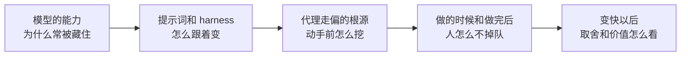
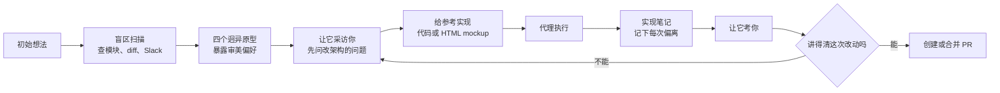

# 模型能走得更远以后，人要先把地图摊开：Thariq 的 Fable 使用指南

Claude Code

**一句话看懂**：新模型能独自走很远，也就会撞上更多你没交代过的决定。Claude Code 团队的 Thariq 给了两条路：给模型松绑（删掉旧的提示词和示例），也给自己松绑（动手前把脑子里没写下的东西挖出来，做完再让模型反过来考你）。

## 读完你能带走的 6 条收获

1. **模型答不出，不一定是不会，可能是没给它工具。** 同一个问题，聊天模型答错，给了代码执行就答对了，这叫能力过剩（见 3.1）。
2. **提示词要跟着模型代际改。** Claude Code 删掉了 80% 的系统提示词；新模型面前，示例会框住它，“不要做 X”不如讲清背景（见 3.2）。
3. **代理走偏，多半是撞上了你没写下来的决定。** 用“地图 / 疆域”和四象限去想：哪些是你知道但懒得写、哪些是你根本没想到（见 3.3）。
4. **动手前，四种办法挖未知**：盲区扫描、四个迥异的原型、让它采访你、直接给参考实现（见 3.3）。
5. **动手中记偏离，做完后被考一遍。** 让代理把每个计划外的决定写进实现笔记；合并 PR 前，让它出题考你（见 3.4）。
6. **做得快不等于做出了价值。** 很多以前要排优先级的事可以一起做，但找到有价值的东西仍要多试几次（见 3.5）。

::: tip 小白先懂这几个词
- [System Prompt](/glossary#system-prompt)：工具在每次对话前塞给模型的“岗位说明书”。
- [Unhobbling](/glossary#unhobbling)：模型能力够了，只是被工具或提示词限制住；松绑就是把这些限制拿掉。
- [Unknown Unknowns](/glossary#unknown-unknowns)：你没意识到自己不知道的事。
- [Blind Spot Pass](/glossary#blind-spot-pass)：动手前让代理扫一遍，告诉你没想到的问题。
- [人在回路](/glossary#human-in-the-loop)：关键节点必须由人理解、确认。
- [模型名称](/glossary#model-names)：Fable、Opus 等都是 Claude 系列的模型名。
:::

## 1. 基本信息

<YouTube id="9fubhllmsBU" title="Field Guide to Fable" />

| 项目 | 内容 |
|---|---|
| 讲者 / 频道 | Thariq Shihipar（Anthropic，Claude Code 团队）／ **AI Engineer** |
| 发布日期 | 2026-07-06 |
| 时长 | 19:28（AI Engineer World's Fair 2026 主题演讲，没有问答环节） |
| 使用工具 | Claude Code（Fable 模型、AskUserQuestion、Bash、HTML 报告）、Claude Tag |
| 形式 | 大会演讲，经验方法论，没有现场编码 |
| 分析依据 | AI Engineer 官方讲稿页（ai.engineer/talks/9fubhllmsBU，含完整时间戳文字稿，2026-10-14 重新抓取并逐字核对）+ 幻灯片截图。英文引号内容是文字稿原话；两条完整 prompt 来自幻灯片，以截图为准。“我觉得”开头的段落是本站评论，不是讲者观点。 |

## 2. 这篇在回答什么

假设你给代理一句话：“给这个项目接一个新的登录服务商。”

旧一代模型会照着你的话一步步做，碰到不确定的地方就停下来问。新一代模型（演讲里叫 Fable）不一样，它能一口气走很远：读代码、改配置、补测试。问题是，一路上它会碰到很多你没交代的决定，比如 token 存哪、旧用户怎么迁移。它只能自己拿主意。

讲者把这种感觉比作 RPG 游戏走完新手教程，地图一下子打开了。可以去的地方很多，也有点吓人。

::: tr Fable 是最早让我觉得必须先想清楚自己有哪些未知的模型之一，因为不这样做，它会走过很大一片区域，撞上很多未知。
> "Fable is one of the first models where I felt that like, I really have to figure out my unknowns, because if not, it's gonna traverse such a large area that like it's going to run into a lot of them."
:::

所以这场 19 分钟的演讲回答了四个问题：

讲者的四部分标题是 unhobbling Claude、finding your unknowns、dealing with the grief、being unreasonable。前两部分是方法，占了大半时间；后两部分是态度。

## 3. 怎么做

### 3.1 能力是“长”出来的，常被工具藏住

讲者先说了一个反直觉的观点：模型不是设计出来的，是“长”出来的。

::: tr 限制它们的是我们。我们给它套的 harness、我们提示它的方式，基本就是我们对 Claude 的理解。
> "what contains them is us, right? The harness we put them in and the way we prompt them is basically, like, a function of our understanding of Claude, right?"
:::

他举了一个网上流传的例子：一千多个宝可梦里，哪些名字以 A-W 结尾？答案只有两个：Croconaw 和 Drednaw。普通聊天模型答不出来，虽然它肯定“知道”所有名字。Claude Code 却能答对，因为它会去抓取全部名字，再写个脚本过滤。

::: tr 它并不是记住每个宝可梦再推理一遍。但如果你给它代码执行工具，它就能找出那两个以 A-W 结尾的宝可梦。
> "So it doesn't just remember every Pokémon and reason through it. But if you give it the code execution tool, it can find the two Pokémon that end with A-W, right?"
:::

讲者管这叫 capability overhang（能力过剩）：模型的能力是“尖刺状”的（spiky），有些地方强得出乎意料，但要配上合适的工具才发挥得出来。

编码也是一样。早年大家以为，解决编码的办法是上下文足够大，把整个代码库贴进去。结果发现，给它 Bash 和操作环境的手段，它就能<Trans zh="自己构建、搜索上下文">“build and search its own context”</Trans>。讲者说，这正是 Claude Code 诞生的那个洞见。下一步是 Claude Tag：让代理能主动醒来干活、多人协作，而不是等人发 prompt。

<figure class="shot"><figcaption>📷 视频截图 · <a href="https://www.youtube.com/watch?v=9fubhllmsBU&t=340s" target="_blank" rel="noopener">5:40</a> · 5:40 前后的幻灯片“The evolution of agents”：Chat（必须喂给它上下文）→ Claude Code（有了执行的手臂）→ Claude Tag（主动行动）。</figcaption></figure>

我觉得这一节的实用含义很朴素：代理做不好一件事时，先别急着换模型，先问一句“它有没有拿到能把这件事变成查数据 + 跑脚本的工具”。

### 3.2 给 system prompt 做减法

如果模型的能力被我们的理解限制住，那模型一变，我们的提示词也得变。讲者给了一个很具体的数字：

::: tr 我们最近把 Claude Code 的系统提示词删掉了 80%。
> "we recently removed 80% of the system prompt for Claude Code"
:::

为什么要删？他把系统提示词的写法分成三代：

| 年代 | 讲者描述的最佳实践 |
|---|---|
| Sonnet 3.5 new 时期 | 小提示词、少工具、大量示例 |
| 模型变聪明后 | 能听懂更多指令了，于是提示词变大、示例多、工具也多 |
| 最新一类模型 | 又要小提示词：示例反而会限制它 |

::: tr 示例往往会限制它，因为它其实比我们给的示例更有想象力。
> "The examples tend to constrain it, 'cause it's actually more imaginative than the examples we give it."
:::

替代办法是给上下文而不是约束。讲者说，他们<Trans zh="真的尽量避免写“不要做这个”，那对之前的模型确实是必需的">“really try and avoid being like, "Do not do this," um, which was really necessary for the previous models”</Trans>。

他用自己做过的 AskUserQuestion 工具（在规划时弹出多选题问你）说明，模型“从你那里拿信息”的方式也在跳着变：

- Opus 4 时代，模型<Trans zh="几乎调用不了它">“could barely call it”</Trans>，他得反复调工具定义才能用。
- 到 Opus 4.5，他试着让它<Trans zh="就这份 spec 问我 40 个问题">“ask me 40 questions about this spec”</Trans>，它开始能采访人了。
- 到 Opus 4.8 和 Fable，可以生成一整份把问题嵌在里面的 HTML 报告。

<figure class="shot"><figcaption>📷 视频截图 · <a href="https://www.youtube.com/watch?v=9fubhllmsBU&t=438s" target="_blank" rel="noopener">7:18</a> · 7:18 前后的幻灯片“AskUserQuestion”：Could call it（能调用）→ Could interview you（能采访你）→ Could build the interview（能把访谈本身做成页面）。</figcaption></figure>

输出也一样：先是 Markdown，然后 Plan Mode 让它变成给人看的计划，现在是详细的 HTML 报告。

讲者的总结是，这件事<Trans zh="更接近生物学而不是物理学">“closer to a biology than a physics”</Trans>：很依赖经验，规则并不全知道，只能靠实验积累直觉。

我觉得“删掉 80%”不能理解成“提示词越短越好”。讲者说的是写法要跟着模型代际变：旧模型需要的示例和禁令，到新模型那里可能变成束缚；但换回较弱的模型，这个结论未必成立。最稳妥的做法是：每次升级模型，挑出提示词和 CLAUDE.md 里的“不要 / 禁止”和示例，一条条试着删，看行为有没有变好。

### 3.3 地图不是疆域：动手前把未知挖出来

讲完给模型松绑，讲者说，用 Fable 时你也得<Trans zh="给自己松绑">“unhobble yourself”</Trans>。他借了一句老话：地图不是疆域。

- **地图**：你脑子里的计划、prompt、spec。
- **疆域**：真实的代码库、真实世界、Claude 要应付的各种约束。

代理在疆域里碰到地图上没画的东西，就是一个“未知”：一个你没有指定的决策点，代理只能自己定。模型越强、走得越远，碰到的未知越多。讲者甚至说，Fable 的瓶颈变成了他自己：

::: tr Fable 的瓶颈在于我能不能把地图和疆域对上、找出我的未知。
> "Fable is bottlenecked my abil- by my ability to match the map and the territory to find my unknowns."
:::

他把一个问题里的信息分成四格：

| 类型 | 意思 | 通常在哪 |
|---|---|---|
| Known knowns | 我知道自己要什么 | 写进 prompt 的部分 |
| Known unknowns | 我知道还没想清楚 | 待定的问题 |
| Unknown knowns | <Trans zh="显然到我根本不会写下来">“so obvious that I just wouldn't write it down”</Trans>，但看到了就知道对不对 | 审美、团队习惯 |
| Unknown unknowns | 完全没想到，但知道了会改变我怎么写 prompt | 陌生领域的坑 |

好消息是，可以反过来用模型挖这些未知。讲者给了四种动手前的办法，各自对着不同的格子：

**一、盲区扫描（blind spot pass），对付“完全没想到的”。** 比如要接一个自己完全不了解的登录服务商，就这样说：

::: tr 嘿，我在接一个我完全不了解的新 auth provider。在这个代码库里，你能做一次盲区扫描，帮我找出相关的“未知的未知”，帮我把 prompt 写得更好吗？
> "Hey, I'm working on a new auth provider that I know nothing about. Uh, like in this code base, can you do a blind spot pass to help me figure out my relevant unknown unknowns and help me prompt better?"
:::

它可能会翻 auth 模块，发现某个反复出问题的死角；你也可以告诉它去查 Git diff 或 Slack。讲者说这招不限于写代码，他最近学视频调色也这么用，因为<Trans zh="模型几乎在所有事上都比我懂得多，我只需要把它掏出来">“the model knows more about, you know, almost everything than I do. I just need to get it out of it.”</Trans>

**二、头脑风暴 + 原型，对付“看到才知道的”。** 设计最典型。讲者说自己没审美，于是让它<Trans zh="给我做一个 HTML 页面，放四个截然不同的设计决策，让我看了再反应">“make me an HTML page with four wildly different design decisions so I can react to them”</Trans>。幻灯片上的完整 prompt：

::: tr 我想为这份数据做一个仪表盘，但我没什么审美，也不知道有哪些可能。给我做一个 HTML 页面，放 4 个截然不同的设计方向，让我看了再反应。
> “I want a dashboard for this data but I have no visual taste and don't know what's possible. Make me an HTML page with 4 wildly different design directions so I can react to them.”
:::

<figure class="shot"><figcaption>📷 视频截图 · <a href="https://www.youtube.com/watch?v=9fubhllmsBU&t=730s" target="_blank" rel="noopener">12:10</a> · 12:10 前后的幻灯片“Brainstorms and prototypes”：用 4 个差异很大的 HTML 设计方向来暴露你自己说不清的审美偏好。</figcaption></figure>

**三、让它采访你，对付“没说明的决定”。** 有了大方向以后，让 Claude 采访你。关键是多给一点你自己、这件事、项目处在什么阶段的背景，并告诉它<Trans zh="优先问那些会改变架构的问题">“prioritize questions that would change the architecture”</Trans>。否则它容易问一堆无关紧要的细节。

**四、给参考实现，对付“说不清的”。**

::: tr 给 Claude 一张地图的最好办法之一，是给它另一张地图。
> "One of the best ways to give Claude a map is to give it another map, right?"
:::

与其写长篇 spec，不如说一句“这是一段代表我想要什么的代码”。它可以来自别的系统、别的语言；做 React 组件时，一份 HTML mockup 就是地图。

我觉得这一节最值得记住的是那张四格表和对应关系：没想到的用盲区扫描，看到才知道的用原型，没说明的用采访，说不清的用参考。遇到一个新任务，先问自己“这次我最缺的是哪一格”，再挑一招，比四招全上省事。

### 3.4 动手中记偏离，做完后让它考你

未知不可能在动手前挖干净。讲者还有两招，管执行中和执行后。

**实现笔记。** 让模型在碰到未知时记下来，这样你能看到在哪里偏离了计划，通常还能看到原因。幻灯片上给了一条可以直接用的 prompt：

::: tr 维护一个 implementation-notes.md 文件。如果遇到边界情况、不得不偏离计划，就选保守的方案，把它记在“Deviations（偏离）”一节下，然后继续干。
> “Keep an implementation-notes.md file. If you hit an edge case that forces you to deviate from the plan, pick the conservative option, log it under 'Deviations', and keep going.”
:::

<figure class="shot"><figcaption>📷 视频截图 · <a href="https://www.youtube.com/watch?v=9fubhllmsBU&t=827s" target="_blank" rel="noopener">13:47</a> · 13:47 前后的幻灯片“Implementation notes”：遇到计划外的边界情况，选保守方案、记到 Deviations 下、继续执行。</figcaption></figure>

这条 prompt 有三个要点：不停下来等人（keep going），遇到分歧选保守方案，事后能查到。它在“代理自主跑”和“人能掌握”之间取了个平衡。

**反过来考你。** 做完以后：

::: tr 我喜欢让 Fable 就发生了什么考考我，确保我理解自己在做什么，在创建或合并 PR 时能为这份工作讲得清楚。
> "And then finally, I like to get Cl- uh, Fable to quiz me about what happened, uh, just to make sure I understand what I'm doing and I can represent this work, you know, when I'm creating a PR or merging it."
:::

讲者说，这是确保你真正“在回路里”的好办法，也是用 Fable 最重要的部分之一。

把 3.3 和 3.4 连起来，就是一条完整的流程：

我觉得“被考”这一步最容易被跳过，也最便宜。代理写得越多，人越容易在不理解的情况下点合并；花两分钟答几道题，等于给自己的理解做一次验收。

### 3.5 失落感，以及“别太讲道理”

最后几分钟讲的是态度，没有新方法，但解释了讲者为什么这样用代理。

他以前在 YC 办过一家约 30 人的创业公司，那时处处是取舍：要么把 app 做快，要么试做新功能，每件事都要一两个月。几周前他回到那个代码库，发现<Trans zh="以前要几周的事，现在几小时就能做完">“the things that would have taken me weeks I could do in hours”</Trans>。他说又想笑又想哭：怀念手写代码、在脑子里“转动”整个代码库的感觉，但也记得熬夜调试、几周白干、多数项目失败。他的结论是回不去了，<Trans zh="唯一的出路是穿过去">“the only way out is through”</Trans>。

由此引出“别太讲道理”（being unreasonable）：以前他会列优先级表，这季度做这个不做那个。现在他问，为什么不全做？

::: tr 如果你逼现实把取舍亮出来呢？
> "What if you forced reality to show you the trade-off, right?"
:::

他的说法是：<Trans zh="好、快、便宜，现在三个都要">“Like good, fast, cheap. Now it's pick three, right?”</Trans>他举的例子是这场演讲的幻灯片，<Trans zh="昨晚用 Fable 大约四个小时做完">“I made this deck last night in about four hours with Fable”</Trans>。

但他马上补了一句提醒：

::: tr 构建变容易了，但创造价值依然很难。
> "building is easier, but generating value is still hard."
:::

他说做 AI 工程的人有时太在意构建过程和自己的配置，而重点是创造价值。这需要多试很多次。

我觉得这一节是整场演讲最清醒的地方。前面的方法都在讲怎么让代理做得更快、更准；这里提醒你，速度只是把“试一次”的成本降下来，并不保证试的方向对。

## 4. 结果与局限

- **可核实的陈述**：Claude Code 删掉了 80% 的系统提示词；AskUserQuestion 从 Opus 4 到 Fable 的三步演进；讲者旧项目里“几周变几小时”；幻灯片约四小时做完。
- **没有给出**：任何基准数据、缺陷率、团队级效率指标。上面的数字都是讲者个人陈述，没有对照实验。

::: warning 局限与注意
- 讲的是 Fable 这一代模型的体验。换用较弱的模型，“少约束、少示例”未必成立；讲者自己也说这更像生物学，要靠实验。
- 没有现场演示。挖未知的几种手法只有一两句 prompt 原话，盲区扫描、采访的输出长什么样，演讲没展示。
- 讲者是 Anthropic 员工，演讲当天正值 Fable 发布，开场有明显的发布宣传成分。
- 删掉 80% 系统提示词只给了结论，没说删了哪些、删后行为怎么评估。
:::

## 5. 结论

这场演讲的主线可以压成一句话：**先给模型松绑，再给自己松绑。**

- 给模型松绑：给它工具，让它把难题变成查数据 + 跑脚本；模型升级后删掉旧示例和禁令，多给背景。
- 给自己松绑：模型走得越远，越需要你把脑子里那张地图摊开。动手前用盲区扫描、原型、采访、参考挖未知；动手中记偏离；做完后被考一遍。

我觉得最值得马上用的是两样东西：那条 implementation-notes 的 prompt，可以原样放进 CLAUDE.md；以及“这次我最缺哪一格”的四格表，开工前花一分钟想一下。至于“三个都要”，它说的是可以多试，不是不用选。

### 你可以这样试

- [ ] 下一个陌生任务开工前，照抄盲区扫描那句话，把“auth provider”换成你的任务。
- [ ] 把 implementation-notes 那条 prompt 原样加进 CLAUDE.md 或 AGENTS.md，跑完看一眼 Deviations。
- [ ] 做 UI 前，用仪表盘那条 prompt 要四个迥异的方案，选一个再细化。
- [ ] 让代理采访你时，加一句“优先问会改变架构的问题”。
- [ ] 任务结束、合并 PR 前，让代理就这次改动出几道题考你，答不上来就先别合。
- [ ] 在 CLAUDE.md 里找出“不要 / 禁止”开头的句子，试着改写成“背景 + 原因”。

::: details 读完自测（点开看答案）
1. **什么是 capability overhang？** 模型有能力但被工具或提示词挡住了。比如宝可梦名字问题，聊天时答不出，给了代码执行就能答对。
2. **为什么 Claude Code 删掉了 80% 的系统提示词？** 新模型比示例更有想象力，示例和禁令反而限制它；给背景比给约束更好。
3. **“地图”和“疆域”分别指什么？未知是什么？** 地图是你脑中的计划和 prompt，疆域是真实代码库和约束；未知是代理在疆域里碰到、地图没指定的决策点。
4. **unknown knowns 用哪招挖？** 头脑风暴和原型，比如要四个截然不同的 HTML 设计，看了再反应。
5. **implementation notes 要求代理遇到偏离时怎么做？** 选保守方案，记在 Deviations 下，然后继续干。
:::
