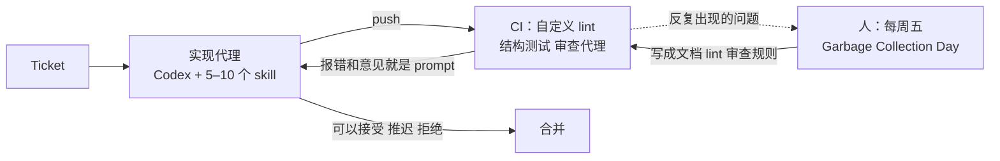

# Harness Engineering：人不碰编辑器以后，工程师做什么

Codex

**一句话看懂**：OpenAI 的 Ryan Lopopolo 禁止团队成员打开编辑器，所有代码都由 Codex 写。他的结论是：代码已经不稀缺，稀缺的是人的时间、注意力和模型的上下文窗口。所以工程师的工作，变成把“什么是好代码”写下来，并让 lint、测试和审查代理在合适的时机把这些标准递给代理。

## 读完你能带走的 6 条收获

1. **同一条审查意见，最好只给一次。** 第二次出现，就把它变成 lint、测试或审查代理的规则（见 3.2、3.6）。
2. **lint 和测试的报错就是 prompt。** 报错里写清“应该怎么改、为什么”，代理就能自己修（见 3.2）。
3. **规矩不要一开始全塞进去。** 先让代理自由做，到 lint 或测试阶段再要求它按标准改（见 3.3）。
4. **skill 少而精，把易变的细节藏在里面。** 他们只有 5–10 个 skill，底层工具换了，代理照常干活（见 3.4）。
5. **仓库结构本身就是 prompt。** 按领域拆包，每件事只留一种写法，代理在哪里看到的上下文都一样（见 3.5）。
6. **允许实现代理拒绝审查意见。** 否则它会被一群审查代理“欺负”，陷入无休止的返工（见 3.6）。

::: tip 小白先懂这几个词
- [Harness](/glossary#harness)：包在模型外面、管工具和上下文的那层程序。
- [AGENTS.md](/glossary#agents-md)：Codex 读取的项目说明文件。
- [Compaction](/glossary#compaction)：上下文快满时把旧内容压缩成摘要。
- [Lint](/glossary#lint)：只读代码就能发现问题的静态检查。
- [Persona](/glossary#persona)：给某类审查代理预设的角色配置。
- [Monorepo](/glossary#monorepo)：很多包放在同一个仓库里。
- [Slop](/glossary#slop)：看似能跑、实则质量差的 AI 产出。
:::

## 1. 基本信息

<YouTube id="am_oeAoUhew" title="Harness Engineering" />

| 项目 | 内容 |
|---|---|
| 讲者 / 频道 | Ryan Lopopolo（OpenAI Member of Technical Staff），问答主持 Vibhu Sapra ／ **AI Engineer**（AI Engineer Europe 2026，伦敦） |
| 发布日期 | 2026-04-17（YouTube 上传日期，yt-dlp 核实） |
| 时长 | 46:20（主题演讲约 18 分钟，之后约 27 分钟问答） |
| 使用工具 | Codex（GPT-5.4、auto compaction、skills、审查代理）、pnpm workspace、自定义 ESLint、Chrome DevTools、本地可观测性栈 |
| 延伸 | 同一讲者在 Latent Space 播客的长访谈：https://www.youtube.com/watch?v=CeOXx-XTYek（含 Symphony 编排器，本文未单独分析） |
| 分析依据 | AI Engineer 官方讲稿页（ai.engineer/talks/am_oeAoUhew，含完整时间戳文字稿，包括问答，2026-10-14 重新抓取核对）+ 视频截图。英文引号内容均为文字稿原话。“我觉得”开头的段落是本站评论。 |

## 2. 这场演讲在回答什么

先想象一个规定：从明天起，你的团队谁也不许打开编辑器，所有代码都必须让代理来写。

Ryan 的团队真这么做了，而且坚持了九个月。他说自己<Trans zh="禁止团队成员碰编辑器">“banning my team from even touching their editors”</Trans>，所有事情都得通过模型完成。

这样做，马上会遇到两个问题：

- 代码不用人写了，那人的时间该花在哪里？
- 代理写出来的代码，怎么保证能合并，而不是一堆 slop？

他的回答可以画成一个循环：

人不在循环里写代码，而是站在循环外面，把反复出现的问题变成规则。下面一步一步看。

## 3. 怎么做

### 3.1 先认清：代码不再稀缺，稀缺的是什么

Ryan 的出发点是一个大胆的判断：<Trans zh="代码是免费的">“Code is free.”</Trans>

他的意思不是代码没有维护成本，而是写代码、重构、删代码都不再需要人花时间。我们以前把代码当负担，是因为它消耗人的注意力；而模型非常有耐心，还可以无限并行。他说转折点是 GPT-5.2：从那时起，模型已经能完成一个软件工程师的全部工作。

那什么是稀缺的？

::: tr 在我们今天看到的这个世界里，稀缺资源有三样：人的时间、人和模型的注意力、模型的上下文窗口。
> "The scarce resources in this world that we see today are three things: human time, human and model attention, and model context window."
:::

<figure class="shot"><figcaption>📷 视频截图 · <a href="https://www.youtube.com/watch?v=am_oeAoUhew&t=347s" target="_blank" rel="noopener">5:47</a> · 5:47 前后的幻灯片：三张卡片分别写着 Human time、Human and model attention、Model context window，即讲者说的三种稀缺资源。</figcaption></figure>

这个判断会改变很多做法：

- **优先级不一样了。** 以前人手有限，需求只分 P0 和 P2，P3 永远没人做。现在 P3 可以<Trans zh="立刻开工，也许同时开 4 份，我们挑一个解决了问题的">“kicked off immediately, maybe 4X in parallel. We pick one that solves the problem”</Trans>。
- **质量门槛不一样了。** 他给同事做的内部工具，从第一天起就支持多语言，因为这不再挤占别的工作。
- **迁移能做完了。** 再也不会有拖了半年收不了尾的迁移，因为可以一次派 15 个代理把剩下的部分做完。

工程师的角色也变了。Ryan 说，每个人都相当于一个 staff engineer：手下有多少代理，取决于你能同时驱动多少，以及 token 预算够不够；你要做的，是提前想清楚需要搭什么结构，才能用好这些人手。

### 3.2 把“什么是好代码”写下来，并让它自己回到上下文里

代理能写代码，但它不知道你的团队认为什么是“好”。Ryan 说，写好一个 patch，背后要做大约<Trans zh="500 个小决定">“500 little decisions”</Trans>，大多是没人写下来的非功能需求：网络代码要不要重试？接口会不会被误用？模型在训练里见过所有可能的选择，你得告诉它你选哪一个。

**第一步，写下来。** 团队里每个人都有专长：有人懂前端架构，有人懂后端扩展，有人有产品感。让他们把自己的标准写成文档，每个代理就都能用上全队的经验。Ryan 的例子是一位产品型工程师写了“怎样写好 QA 计划”：先列出所有功能和关键用户路径，再规定每个面向用户的改动都要附 QA 计划和相应的截图、录屏。之后，审查代理就能据此检查每个 PR。

**第二步，让它自己回到上下文里。** 只写进 AGENTS.md 不够。Ryan 说，自动压缩已经好到他几乎不用 `/new` 开新会话了，但这也意味着，早期的指令迟早会被压缩掉。所以要在任务进行中不断刷新上下文。他们的做法有四种：

| 做法 | 例子 |
|---|---|
| CI 里的审查代理 | <Trans zh="代码库里的安全与可靠性审查代理，作为 CI 的一部分在每次 push 时持续运行">“security and reliability review agents in our code base that are continually running as part of every push in CI”</Trans>，检查网络代码有没有超时和重试 |
| 仓库专属的 lint | 每次调用 `fetch`，都检查外面有没有包 retry 和 timeout |
| 针对源码的测试 | <Trans zh="一个限制文件不超过 350 行的测试">“a test that limits the fact that files are no longer than 350 lines”</Trans>，让文件小到适合上下文 |
| 带修复步骤的报错 | 不只说“这里不该有 unknown”，而是解释原因：我们<Trans zh="在边界处做解析，而不是做校验">“parse, don't validate at the edge”</Trans>，这里应该已经有 Zod 推导出的类型 |

retry 和 timeout 这个例子很实在。Ryan 承认，自己也曾因为网络代码没加重试被半夜叫起来，修好、合并，然后就忘了。<Trans zh="在这个非功能需求上，我不是一个靠谱的审查者或作者">“I am not a reliable reviewer or author of code with respect to this non-functional requirement.”</Trans> 写一条 lint，再让代理把整个代码库迁移一遍，这个问题就一次性解决了。

他的总结是：

::: tr 我今天讲的一切都是 prompt。你完全不用碰模型权重就能做到。
> "Everything I've talked about here today is a prompt. You can do this without touching the model weights at all."
:::

<figure class="shot"><figcaption>📷 视频截图 · <a href="https://www.youtube.com/watch?v=am_oeAoUhew&t=1042s" target="_blank" rel="noopener">17:22</a> · 17:22 前后的幻灯片<Trans zh="你直接写 prompt 就行">“You can just prompt things.”</Trans>，对应上面这句总结。</figcaption></figure>

规则文件是 prompt，skills 是 prompt，lint 报错是 prompt，审查代理留在 PR 上的意见也是 prompt。他甚至让 Codex 读完 OpenAI 开发者网站上的所有提示词教程，合成了一个“怎么写 prompt”的 skill，以后要写 prompt 就用它。

我觉得这一节最值得照做的是“报错写修复步骤”。它几乎没有成本，任何团队明天就能开始：挑一条最常触发的 lint，把报错改成“应该怎么写、为什么”。

### 3.3 在对的时机给规矩

如果标准这么多，是不是该一开始就全塞给代理？Ryan 说不要。问答里有人问他怎么避免过度设计 harness，他的回答是：

::: tr harness 该做的，就是在正确的时机把指令呈现给模型。
> "All the harness should do is surface instructions to the model at the right time."
:::

一开始就塞满，会压垮代理；但这些要求在整个 PR 过程中又都得遵守。所以要么延后，要么在需要时才给。

他的例子是 React 组件。你希望组件拆得小、尽量无状态，方便做快照测试。不用一开始就说。先让代理自由地做原型、试界面，等到 lint 或测试阶段再告诉它：要完成这个任务，<Trans zh="把它拆开，让组件尽可能小、尽可能无状态">“break this apart so that your components are small and as stateless as possible”</Trans>。代理会把这当成一条新指令，改好后再提交。

为什么这种做法不会随着模型变强而过时？Ryan 的理由是：模型再强，也得有人告诉它这个任务的要求和该注意哪些护栏。上下文这件事永远不会过时。

### 3.4 Codex 是入口：少而精的 skill

问答里，Ryan 讲了他们实际怎么干活。

工作从 ticket 开始：把 ticket 交给代理，再配几个 skill。关键在于方向：

- **Codex 是入口，环境围着它转。** 不是先搭一个外壳，再把 Codex 放进去；而是用 skill 教 Codex 怎么启动应用、怎么拉起本地的日志和监控、怎么通过一个守护进程挂上 Chrome DevTools。仓库里所有本地开发工具，都是给 Codex 先用的。
- **skill 少而精。** <Trans zh="我们把杠杆集中在 5 到 10 个 skill 上">“we kinda centralize our leverage around 5 to 10 skills”</Trans>。仓库里的工具变化很快，他没精力跟踪，就把复杂性藏在 skill 后面。证据是：底层从直接用 Chrome DevTools Protocol 换成守护进程，他三周后才发现，因为 Codex 一直照常工作。
- **结构测试补 lint 的不足。** 除了一大包自定义 ESLint 规则，他们还有一层测试专门检查代码结构：包的可见性、各层之间的依赖方向、Zod schema 不能重复、异步 helper 只能有一份。原因是代理有时只顾当前包内部通顺，不去用共享的工具函数。

**别自己造 harness。** 有人问 Codex 和 Claude Code、OpenCode 比怎么样。Ryan 的看法是：各家实验室是在自己的 harness 里做后训练的，`apply_patch` 工具、bash 命令的引号写法都在训练循环里。所以直接用第一方 harness（通过 SDK 或 app server），就能吃到这部分好处。他自己不关心 harness 的内部，只关心“正确的代码长什么样”，以及不同版本模型的行为有什么差别。

### 3.5 仓库结构就是 prompt

有人问：代码库和团队都变大以后，怎么让代理只看到它需要的东西？

Ryan 讲了他们的经历。项目一开始是一个单包的 Electron 应用，很快就乱了：没有包的可见性，代理分不清哪些 API 是公开的，也分不清哪些领域应该分开。后来他们按“一万人的大公司”来设计架构，拆成<Trans zh="pnpm workspace 里有 750 个包，按业务领域或技术栈层次隔离">“750 packages in the pnpm workspace, isolated by business logic domain or layer of the stack”</Trans>。

好处有两个：

- **改动范围能限定在一个子目录里。** 即使不做微服务，大多数改动也只需要看一个子树。
- **代码本身也是 prompt。** 代码越统一，代理不管看到仓库哪一部分，学到的东西都能迁移到别处。

所以他主张每件事只留一种写法：<Trans zh="有界并发的 helper 应该只有一种写法……ORM 也应该只有一个">“you should have one way to, like, do a bounded concurrency helper … You should have one ORM”</Trans>。编程语言、CI 脚本、加 lint 规则的方式，都只留一种。他甚至建议团队里要有一个“独裁者”拍板“必须这么做”，然后让代理把整个代码库迁移成统一的样子。

### 3.6 审查：让同一条意见只出现一次

审查是怎么从瓶颈变成循环的？

一开始，三个人的团队每人每天 3 到 5 个 PR，PR 又大，又常改同一片代码，合并冲突非常痛苦。PR 之所以开着不合，是因为在等人审。

他们的解决办法是 **Garbage Collection Day**：每周五，每个工程师的全部工作，就是把这一周看到的、让 PR 难以合并的 slop 归类，想办法让这一类问题从源头上不再出现。

这样，一条人工审查意见会经过三步：

1. 审查时发现问题，说明代理缺了某个上下文；
2. 写成仓库里的文档；
3. 通过失败的测试，或者读过这些文档的审查代理，在下次自动出现在代理面前。

审查代理按“人格”来建。他们让大家把自己给过的审查意见按角色归类（前端架构师、可靠性工程师、可扩展性……），每个角色建一个审查代理，每次 push 都触发：

::: tr 根据这些描述“什么是好代码”的文档，找出任何会阻止这个 PR 合并的 P2 及以上级别的问题。
> "Surface any P2s or above that would block this PR from merging based on these documentation that says what good looks like."
:::

文档不断补充，结果是<Trans zh="我们看到 slop 一点点减少">“we started to see slop reduced, reduced, reduced”</Trans>。

还有一个容易被忽略的细节：审查意见不是命令。PR 是所有人和代理协作的地方，实现代理可以<Trans zh="接受、推迟或拒绝任何反馈">“acknowledge, defer, or reject any feedback”</Trans>。如果规定每条意见都必须处理，就可能出现实现代理被所有审查代理“欺负”的情况（Ryan 用的词是 “bullied”）。他们宁可偏向接受代码，不追求完美，也不陷入细枝末节。

<figure class="shot"><figcaption>📷 视频截图 · <a href="https://www.youtube.com/watch?v=am_oeAoUhew&t=2200s" target="_blank" rel="noopener">36:40</a> · 36:40 Q&amp;A 环节，屏幕字幕条为<Trans zh="代码审查会变成什么样">“What happens to Code Review”</Trans>。</figcaption></figure><figure class="shot"><figcaption>📷 视频截图 · <a href="https://www.youtube.com/watch?v=am_oeAoUhew&t=2432s" target="_blank" rel="noopener">40:32</a> · 40:32 Q&amp;A 环节“1B tokens breakdown”：讲者解释每天十亿级 token 的用量分布。</figcaption></figure>

### 3.7 问答里的其他几件事

**怎么起步？** 两条路。一是先让代理给现有代码补测试：测试多了，你对代码更有信心，代理也更容易在里面工作，你就不用那么仔细地审它的产出。二是看自己的时间花在哪：盯着编辑器？等测试？等人审？CI 慢、测试不稳？挑最耗时间的一项，让代理去自动化。

**用不用计划模式？** 他基本不用。他用过 ExecPlans（OpenAI 早期发布的一种“怎么写带里程碑和验收标准的计划”的说明）。他的理由是：大多数计划他根本不会读，而不读就批准，等于塞进了一堆你未必想要的指令。如果要用，就<Trans zh="把计划单独作为一个只含计划的 PR 推上去，让人逐行审">“push those up as single PRs with just the plan, where you actually have human review every line of it”</Trans>，审过再开工。

**token 花在哪？** 大约<Trans zh="各占三分之一">“a third, a third, a third”</Trans>：规划、整理工单和写文档一份，实现一份，CI 里跑的一份。他认为在 CI 上花 token 是必要的，因为难的已经不是写代码，而是让代码被接受。（主持人介绍他每天消耗超过十亿个输出 token，这是主持人的说法，不是讲者给的数据。）

**在车里怎么跑？** 下班前启动一个任务，笔记本连上手机热点，绑在后座上，回家路上 30 分钟让它继续跑。skill 里写着“一直做到测试变绿”，所以他不用回头点“继续”。他说：<Trans zh="每次我得对代理输入“继续”，都是 harness 的失败：它没有提供足够的上下文，让代理知道怎样才算做完">“Every time I have to type continue to the agent is, like, a failure of the harness to provide enough context around what it means to continue to completion.”</Trans>

**代码是构建产物吗？** 他回答“是”。他的比喻是把 LLM 当成一个模糊的编译器：仓库里的各种约束，就像编译器的静态分析和优化；换模型，就像 Rust 编译器把后端从 LLVM 换成 Cranelift，生成的机器码不同，但都必须是合法的。

**未来是什么样？** 给一份 token 预算和一个季度的工作，人只负责排优先级、定成功指标，剩下的交给机器。但每进入软件生命周期的一个新环节，都得从零补起。比如产品第一次发布时，代理对构建产物做冒烟测试的能力很弱：<Trans zh="没有文档，也没有工具">“There were no docs. There were no tools”</Trans>。写代码之外，还有用户反馈分诊、值班、检查日志里有没有泄露个人信息、给运营同事写 runbook……这些也都要一点点交给代理。

## 4. 结果与局限

- **讲者自述**：三人团队，每人每天 3–5 个 PR；仓库有 750 个包；token 大约三分之一用于规划和文档、三分之一用于实现、三分之一用于 CI；靠 Garbage Collection Day，slop 持续减少。
- **没有给出的**：PR 合格率、缺陷率、和人工开发的对比数据。

::: warning 局限与注意
- 立场很激进：禁用编辑器、每天上亿 token、团队很小。普通团队要按自己的预算和规模缩放。
- 讲者承认，前期要接受短期降速（“short-term velocity hits”），先把护栏搭起来。
- 每进入一个新环节（例如发布后的冒烟测试），都要重新补工具和验收标准。
- “代码免费”“GPT-5.2 能完成全部工作”是讲者的判断，没有给出评测数据。
:::

## 5. 结论

Ryan 的方法可以归成一句话：**人的每一条反馈，都应该变成代理下次会自动看到的东西。**

具体来说：

1. 把团队对好代码的标准写下来，变成 lint、测试和审查代理；
2. 报错写清修复步骤，在代理需要时出现，不要一开始全塞进去；
3. 仓库按领域拆开，每件事只留一种写法；
4. 每周花一天，把反复出现的问题变成规则；
5. 让实现代理有权拒绝意见，偏向接受，不追求完美。

我觉得，即使你的团队永远不会禁用编辑器，第 2 条和第 4 条也值得马上试：它们不依赖激进的前提，成本很低，而且每做一次，以后都会少一类问题。

### 你可以这样试

- [ ] 翻一翻最近 10 条代码审查意见，找出出现两次以上的同类问题，写成一条 lint 规则或测试。
- [ ] 把一条现有 lint 的报错改成“应该怎么写，为什么”，看代理自己修复的成功率有没有变化。
- [ ] 加一个“单个文件不超过 N 行”的测试，让代理自己去拆大文件。
- [ ] 参考上面那句 “Surface any P2s or above…”，写一个只读的可靠性审查代理，在 CI 里对每个 PR 跑一次。
- [ ] 每周固定一小时，做一次自己的 Garbage Collection Day。

::: details 读完自测（点开看答案）
1. **为什么只靠 AGENTS.md 不够？** 自动压缩会把早期指令挤出上下文，需要通过 lint、测试和审查代理，在合适的时机把标准重新递给代理。
2. **Garbage Collection Day 做什么？** 每周五把阻碍合并的问题归类，变成文档、测试或审查代理的规则。
3. **为什么允许实现代理拒绝审查意见？** 避免它被审查代理“欺负”，陷入无休止的返工。
4. **为什么建议用第一方 harness？** 各家实验室在自己的 harness 里做后训练，工具的形式都在训练循环里。
:::
