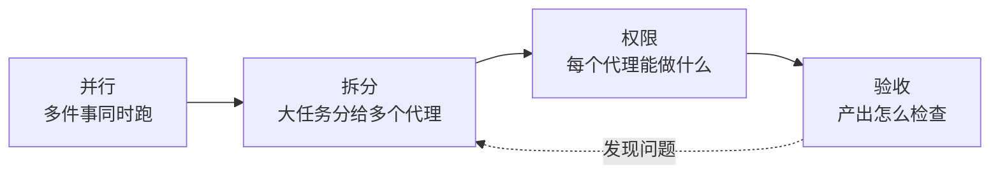
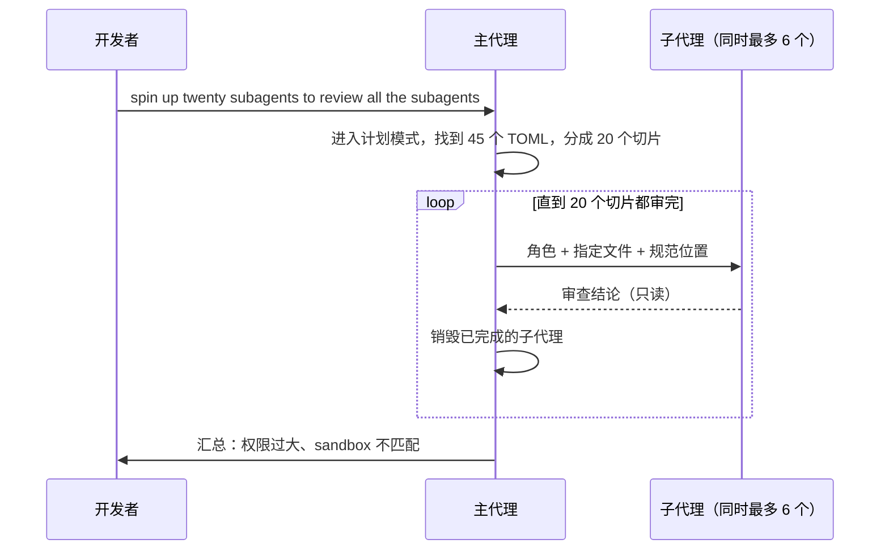

# OpenAI Codex Masterclass：代理比人写得快，人该守住什么

<div class="meta-tags"><span class="tool-tag tool-codex">Codex</span></div>

<div class="hook">

**一句话看懂**：OpenAI 两位开发者体验工程师用一场工作坊回答了一个问题：当几个代理同时写代码、人已经看不过来时，怎么拆任务、怎么给权限、怎么验收。最好的现场例子是：一句话派出 20 个只读子代理，去审查 45 个子代理配置文件，结果查出了“权限给大了”的配置。

</div>

## 读完你能带走的 6 条收获

1. **人看不过来时，让另一个代理做第一遍审查。** OpenAI 内部所有员工的 PR 默认都先过 Codex review（见 3.3）。
2. **子代理的前提是“能各干各的”。** 先让主代理出切片计划，再派发；切的可以是文件，也可以是假设或方案（见 3.4）。
3. **权限跟着角色走。** 审查、找漏洞的代理只读，写文档的才给写权限；定期拿“职责”对照“权限”（见 3.5）。
4. **别开全权限来躲审批，改让另一个代理先判。** 这是 guardian approvals 的思路（见 3.6）。
5. **验收要去目标系统看，并给“继续”设边界。** 代理说写了 57 行，就打开表格数一数；长任务用 stop hook 强制再验证一轮（见 3.2、3.6）。
6. **该建哪些子代理和自动化，让 Codex 翻你的历史会话来推荐。** 讲者说这是他最喜欢的做法（见 3.5、3.7）。

::: tip 小白先懂这几个词
- [Worktree](/glossary#worktree)：一个仓库同时开多个工作目录，互不干扰。
- [Routines / Automations](/glossary#routines)：按时间表自动运行的代理任务。
- [Plugins](/glossary#plugins)：把 Skills、Apps、MCP 打包在一起的扩展。
- [子代理](/glossary#subagent)：主代理派出去干小活的“分身”。
- [Persona](/glossary#persona)：给子代理配的角色、模型、权限和工具。
- [Sandbox](/glossary#sandbox)：限制代理读写范围的隔离环境。
- [P1 / P2](/glossary#severity)：审查意见的严重度等级。
:::

## 1. 基本信息

<YouTube id="MhHEGMFCEB0" title="OpenAI Codex Masterclass" />

| 项目 | 内容 |
|---|---|
| 讲者 / 频道 | Vaibhav Srivastav（VB）、Katia Gil Guzman（OpenAI Developer Experience，伦敦）／ **AI Engineer** |
| 发布日期 | 2026-04-29 |
| 时长 | 1:01:58（工作坊，最后约 5 分钟是问答） |
| 使用工具 | Codex app / CLI（GPT-5.4、GPT-5.3-Codex-Spark、GPT-5.4 mini / nano）、worktrees、Plugins、Automations、Code Review、Subagents、Guardian approvals、Hooks、Claude Code 中的 Codex 插件 |
| 分析依据 | AI Engineer 官方讲稿页（ai.engineer/talks/MhHEGMFCEB0，含 15 个章节和完整时间戳文字稿，2026-10-14 抓取）+ 视频画面截图。英文引号内容为文字稿或幻灯片原话；“我觉得”开头的段落是本站评论，不是讲者观点。 |

## 2. 这场工作坊在回答什么

先看一个场景。

你同时开了三个代理：一个写新功能，一个修 bug，一个在排查线上问题。一个小时后，它们交回来几千行改动。你会一行一行看完吗？

多半不会。讲稿页的概述把这个处境说得很直白：

<Trans zh="几个代理产出改动的速度，比一个人逐行检查的速度更快">“several agents can produce changes faster than one person can inspect every line”</Trans>

这场一小时的工作坊，表面上是 Codex 的功能巡礼：app、插件、自动化、代码审查、子代理、hooks。但把这些功能放在一起看，它们都在回答同一个问题：**代理比人写得快以后，人该把什么交出去，又该守住什么？**

我把它拆成四个小问题，也是本文的顺序：



先交代背景。Katia 开场说，Codex 不只是写代码的代理：

<Trans zh="它能跑命令、能跑测试、能探索代码库，基本能做软件工程师会做的所有事">“It can run commands. It can, uh, run tests. It can explore codebases. It can really do everything that a software engineer would do.”</Trans>

它分三层：底层是模型；中间是一个统一的 agent harness，负责执行工具、准备环境和安全；最上层是各种入口：桌面 app、IDE 扩展、命令行，还有 Slack 和 GitHub。OpenAI 内部经常直接在 Slack 里 @ Codex，让它去修东西。

## 3. 怎么做

### 3.1 并行：让多件事同时跑，而且不在你眼前跑

第一步是让代理能同时干几件事。

**Worktree 解决“同时”。** Git worktree 就是一个仓库同时检出好几个工作目录。Codex app 原生支持它：同一个项目里，一个 worktree 写功能，一个修 bug，一个排查问题，

<Trans zh="同时进行，彼此不干扰">“all at the same time, uh, without really interfering with individual tasks”</Trans>

VB 说他以前是重度命令行用户，转到 app 就是因为这一点：能跨项目，也能在同一个项目里并行，不用来回切换上下文。

**Automations 解决“不在眼前”。** 自动化就是定时运行的一段指令，类似 cron。Katia 自己在用两个：

- Slack：每天早上 9 点，找出她该回的消息，标出着急的，按主题总结昨天以来的动态，再单独列出公司重要频道的消息。
- Gmail：找出值得回复的邮件，判断是否紧急、看起来是否正规。

她说后者<Trans zh="每天帮我省下好几个小时">“saving me hours per, per day”</Trans>。这是她个人的体验。

现场有个小插曲。她想用对话方式让 Codex 建一个新的自动化（“在 Slack 里找值得放到网站上的 Codex 用例”），但应该弹出的配置框一直没稳定出现。最后她改用手动界面，其实只要填四样东西：

1. 打开自动化创建界面；
2. 写任务指令，选要用的插件（这里是 Slack）；
3. 选运行频率；
4. 选在哪个项目里运行。

我觉得这个失败比成功更有用。“跟代理说了要定时做某事”和“定时任务真的存下来了”是两回事。建完以后，去自动化列表里亲眼看一下。

### 3.2 复用：把重复的流程打包，再去目标系统验收

如果某个流程你每周都要给代理讲一遍，就该把它固定下来。Codex 里有三种零件：

| 零件 | 是什么 | 例子 |
|---|---|---|
| Skill | 一份可复用的说明，可以带脚本和资源 | “怎么发版”的步骤，可以让 Codex 帮你写 |
| App | 连接一个外部服务 | Notion、Linear、Google Drive |
| MCP server | 外部系统提供给代理的工具 | 文档检索、Sentry 报错 |

Plugin 就是把这三样打包在一起，装一次就够了，不用分别装 skill、连 app、配 MCP。

Katia 的例子是 Game Studio 插件：它组合了 Playwright Interactive（让代理打开应用、点按钮、截图再分析画面）和 ImageGen（生成角色素材）。前一天她只给了一句提示词：

<Trans zh="做一个平台跳跃游戏，平台用砖块做">“Do a platformer game with platforms made of bricks.”</Trans>

据她说跑了大约一小时，做出的游戏里角色至少有五套不同的动作素材。现场重跑没等到结束，所以展示的是前一天的成品。

更值得看的是另一个小例子。OpenAI 开发者网站把 Codex 线下活动的记录存成 YAML 文件。Katia 装好 Google Drive 插件，提前建了一个表格“Codex Events”（列：活动名、日期、城市），然后让 Codex 用代码库里的活动填表。

Codex 花了大约两分钟找到 YAML，汇报说<Trans zh="写入了 57 行活动记录">“wrote 57 event rows”</Trans>。然后，Katia 做了一件很多人会省掉的事：打开表格，确认真的填上了。

<div class="shots"><figure class="shot"><figcaption>📷 视频截图 · <a href="https://www.youtube.com/watch?v=MhHEGMFCEB0&t=1394s" target="_blank" rel="noopener">23:14</a> · 23:14 前后，Codex 更新 meetup 表格后的汇总：“Wrote 57 event rows plus the existing headers”，按日期和城市排序，耗时 Worked for 2m 57s。</figcaption></figure></div>

道理很简单：代理的“完成”消息只是它自己的说法。真正的结果在目标系统里，要去那里看。

### 3.3 第一道关：让另一个代理先审

并行的代理越多，审查就越成为瓶颈。VB 的逻辑是：你不可能逐行看完所有代码，所以至少第一遍要有一个靠得住的审查者。

OpenAI 自己就是这么做的：

::: tr OpenAI 所有仓库里、所有员工提交的 PR，百分之百默认都由 Codex code review 审查。
> "one hundred percent of pull requests across all OpenAI repos, um, made by all employees, um, including Greg [chuckles] are, uh, are reviewed by Codex code review by default."
:::

入口有三个，用哪个看你在哪里干活：

- **GitHub**：把 ChatGPT 账号连上 GitHub，每个 PR 自动审查，意见带 P0 / P1 / P2 严重度；
- **Codex app 或命令行**：输入 `/review`；
- **Claude Code**：装 Codex 插件，在 Claude Code 会话里请 Codex 审查。

它怎么审？可以拿当前改动和某个分支比，也可以只审还没提交的改动。审查会新开一个线程、一个独立的 Codex 进程，用专门的审查提示词。它不只看 diff，还会结合整个仓库，找出“改了 A 却影响到 B”的问题。

现场演示很顺利：审查未提交的改动，约一分钟后返回一条 P1（某处收入明细没有本地化）和 P2 翻译意见。接下来可以让 Codex 修，或者另开一个 PR。

<figure class="shot"><figcaption>📷 视频截图 · <a href="https://www.youtube.com/watch?v=MhHEGMFCEB0&t=1704s" target="_blank" rel="noopener">28:24</a> · 28:24 幻灯片“Code Review”：在 GitHub 上开启自动审查或对特定 PR 请求审查；在 CLI 或 Claude Code 插件里用 /review；由一个独立的 Codex 实例审查改动并提出改进建议。</figcaption></figure>

注意两个细节。第一，审查者和写代码的不是同一个上下文，这才叫“另一双眼睛”。第二，审查只出意见，修复是另一个任务。VB 说 Codex 的审查是业内最好之一，但他自己也承认这是“in my own biased way”，这句可以不当真。

### 3.4 拆分：一个大任务怎么分给 20 个代理

子代理是什么？VB 的定义是把一个大任务拆成

<Trans zh="可分解、可并行、彼此独立的任务">“decomposable, parallel and independent tasks”</Trans>

交给几个子代理各自去做，做完再向主代理汇报。关键词是“独立”：每个子代理都不需要等别人的结果。

**为什么要拆？** 看他的例子。VB 有一个（当时没公开的）仓库，存了四五十个子代理的 persona 配置：文档审查员、测试编写员、无障碍审查员、架构师……每个文件写着名字、描述、sandbox 模式和指令。规范改了，这些文件都要重审一遍。

不拆的话，Codex 就得一个文件一个文件地打开、审查、总结，再接着下一个，五十遍。拆开后，每个子代理只看一两个文件，在自己干净的上下文里干活。

他在 app 里把推理强度设成 medium，只说了一句：

::: tr 启动 20 个子代理，去审查所有的子代理（配置）。
> "spin up twenty subagents to review all the subagents."
:::

接下来发生了这几件事：

1. **自动进入计划模式。** Codex 判断这个任务比较复杂，自己开了 plan mode，列出五步清单。
2. **先分区。** 它找到 45 个 persona 的 TOML 文件，规划出 20 个审查切片，比如“这两个文件归 Polly，那两个归 Plato”。
3. **再派发。** 每个子代理拿到三样东西：角色、要审的确切文件、仓库规范的位置（repo.md、contributing.md、skills）。
4. **碰到并发上限。** 要了 20 个，实际先起了 6 个，因为<Trans zh="我设了上限：最多 6 个并发代理线程">“I have a cap on six num- like, six concurrent agent threads”</Trans>。这是他本机的配置，不是 Codex 的固定规则。
5. **收尾。** 跑完的子代理被销毁，结论回到主线程汇总。

<figure class="shot"><figcaption>📷 视频截图 · <a href="https://www.youtube.com/watch?v=MhHEGMFCEB0&t=2200s" target="_blank" rel="noopener">36:40</a> · 36:40 Codex App 里的线程标题“spin up 20 sub agents to review all the sub agents personas in the repo”，下方是代理对任务的理解。</figcaption></figure>



**切的不一定是文件。** VB 还提了两种切法：

- **按假设切**：同一个 commit，让几个子代理分别从不同的漏洞假设出发去分析，最后拼成一张漏洞地图。
- **按方案切**：他设计功能时，先让 Codex 列出五到十种实现方式，再派子代理分别去调研。

我觉得这一节最该记住的是顺序：**先让主代理把切片计划写出来，你确认各片互不依赖，再派发。** 切错了，并行就变成互相等待、互相覆盖。

### 3.5 权限：每个角色只给它需要的

切完任务，下一个问题是：每个子代理能做什么？

Codex 内置三种 persona：

| Persona | 用途 |
|---|---|
| Default | 通用，兜底 |
| Worker | 执行，写功能 |
| Explorer | 调研，读代码 |

自定义 persona 时，可以分别设定模型、推理强度、sandbox 模式和指令，还能单独给它挂 MCP 和 skills。VB 的原则是：

<Trans zh="审查代理几乎百分之百应该用只读模式">“for a review agent, you would almost always 100% want to use the review agent in read-only mode”</Trans>

找安全漏洞的代理同理。只有写文档、写 bug report 这类需要产出文件的角色，才给写权限。工具也按角色给：一个子代理连 Sentry 看报错，另一个连 Linear 读待办。

这条原则在上一节的演示里马上得到了印证。20 个子代理审完，汇总出来的问题正好是权限问题：performance investigator（性能调查员）权限过大；verifier 和 writer 的 sandbox 设置和它们的职责对不上。

**一个窄 persona 长什么样？** VB 展示了他的 PR Explorer：用很快的 GPT-5.3-Codex-Spark，只读，只负责追踪代码路径，不提修复方案。幻灯片上的配置原文（45:00 截图）：

::: tr 配置大意：名字叫 pr_explorer，是“在提出改动前收集证据的只读代码库探查员”；用 gpt-5.3-codex-spark 模型、中等推理强度、只读沙箱。给它的指令是：保持探索模式；追踪真实的执行路径，引用具体的文件和符号；除非父代理要求，不要提出修复方案；优先用快速搜索和有针对性的文件读取，而不是大范围扫描。
```toml
name = "pr_explorer"
description = "Read-only codebase explorer for gathering evidence before changes are proposed."
model = "gpt-5.3-codex-spark"
model_reasoning_effort = "medium"
sandbox_mode = "read-only"
developer_instructions = """
Stay in exploration mode.
Trace the real execution path, cite files and symbols, and avoid proposing fixes unless the parent agent asks for them.
Prefer fast search and targeted file reads over broad scans.
"""
```
:::

<figure class="shot"><figcaption>📷 视频截图 · <a href="https://www.youtube.com/watch?v=MhHEGMFCEB0&t=2700s" target="_blank" rel="noopener">45:00</a> · 45:00 幻灯片“Custom Subagents”：为前端、后端、测试、审查、调研等具体工作创建代理；控制上下文和代理间的交接；并行能提高吞吐量，但每个代理都会额外消耗 token。右侧即上面的 pr_explorer 配置。</figcaption></figure>

注意它的几个“窄”：只读、只回答一个问题、不提修复、优先精准搜索。它有一个清楚的终点：把相关代码路径解释清楚，交还给主代理。

**配置不一定要手写。** VB 接着用自然语言描述了一个“文档研究员”，让 Codex 自己去写 TOML、放到正确位置，并挂上他们团队做的文档 MCP（里面有 API 参考、指南和示例）。这一步现场没等到生成完成。

**该建哪些 persona？** VB 给的答案出乎意料地朴素：

<Trans zh="直接让 Codex 翻看我过去的会话，给我推荐该建哪些自动化、哪些子代理">“just ask Codex to look through my past sessions and recommend me certain automations, certain subagents”</Trans>

你反复让代理做的事，就是最该固定下来的事。具体怎么翻历史会话，见 3.7 的问答。

### 3.6 不想一直点“允许”：Guardian approvals 和 hooks

权限给窄了，代理就会经常停下来问“能不能删这个目录”“能不能起服务”。问多了，人会烦，最后干脆开全权限。VB 坦白自己也这么干过，并且说：

<Trans zh="无论怎么看，这都不安全">“this, by all means and measure, is not safe”</Trans>

**Guardian approvals** 想解决的就是这种审批疲劳。它是实验功能，用 `/experimental` 打开。每当 Codex 要做特权操作（删目录、起服务、把文件暴露到公网），就先起一个子代理，按特定提示词判断这次要不要打断人。VB 说大多数情况都会直接放行。

可惜现场没演示成：他让 Codex “run the dev server”，但全权限模式切换出了问题，没看到判定结果。机制讲清楚了，效果要你自己试。

**Hooks** 是另一种“不用人盯”的办法：在代理生命周期的某个时刻自动运行你的脚本。也是实验功能。VB 举了三个例子：

| 时机 | 用途 |
|---|---|
| 会话开始 | 自动从 GitHub 拉最新代码 |
| 每次工具调用 | 研究人员记录代理每一步做了什么 |
| 停止时 | 长任务想停下时，让它再做一轮 |

配置是一个 `hooks.json`，加上若干 Python 脚本，用 matcher 指定什么时候触发（比如启动或恢复会话时运行一个 session start 脚本）。

VB 自己最常用的是停止时的 hook。他给演示里的销售看板配了一个 `keepgoing.py`，内容是这样一句话：

::: tr 继续，再过一遍，跑一条靠谱的验证命令，再收紧一处，然后停下来给出结果。
> "keep going, do one more pass, run one, one solid validating command, tighten one more thing, and then stop and give the result."
:::

我觉得这句话写得好，好在它有边界。它不是无限地“继续”，而是规定了一轮的工作量：再过一遍、至少跑一条验证命令、再改进一处、然后停下汇报。这也是一种验收。

两点提醒。第一，现场只展示了脚本，没展示 hook 跑起来的效果。第二，VB 先说三个事件是“工具调用后、会话开始、停止”，讲配置时又说成了“pre tool use”。讲稿页特别注明，现行 hooks 区分 `PreToolUse` 和 `PostToolUse`、`Stop` 和 `SessionEnd`，动手前请以最新文档为准。

### 3.7 问答：历史会话、云端任务和信任边界

最后几分钟的问答，补上了三个实际会碰到的问题。

**怎么让 Codex 翻历史会话？** VB 说会话存在 `.codex` 目录下（他口头说的是 `.sessions`，讲稿页提示这个路径没有核实）。做法很简单，在 app 或命令行里直接让 Codex 去看历史会话，再按你的需要给建议。

**要合上电脑了，能把任务交给云端吗？** 能。App 里可以选本地、worktree 或云端。云端还支持 best-of-N：同一个任务并行跑几遍（Katia 的例子是 4 遍），挑最好的一份。注意，现场演示的是“开始就选云端”，不是把本地正在跑的任务迁过去。

**云端支持子代理和 skills 吗？** 当时都不支持，也没有时间表。VB 解释了 skills 不上云端的原因：

<Trans zh="沙箱没办法判断一个 skill 是否可信">“there's no way for, um, the sandbox to know whether or not a skill is trusted or not”</Trans>

因为 skill 里可能带着 Python 脚本或可执行文件。Katia 补充说，提交在仓库里的说明和资源文件，云端仍然能读到。所以实际的变通办法是：在云端任务的指令里，**点名让它去读仓库里哪些文件**。

我觉得这一段和 3.5、3.6 是同一件事。“能读一个文件”和“能运行一个程序”是两种不同的权限。Codex 在每个地方做的，都是按角色、按环境把这两种权限分开给。

**顺便一提，模型怎么选。** VB 回顾了从 GPT-5.2 到 GPT-5.4 的路线，并说 GPT-5.4 mini 和 nano 适合短任务和子代理。要并行开很多子代理，就用小模型，又快又省。他还提到 WebSockets 让 token 速度快约 1.75 倍，fast mode 再快约 2 倍；讲稿页注明他没给测量基线，看看就好。

## 4. 结果与局限

现场真正演示成功、你能照着复现的，有三件：

| 演示 | 结果 |
|---|---|
| 仓库数据写入表格 | 约 2 分钟写入 57 行，打开表格核对无误 |
| `/review` 审未提交改动 | 约 1 分钟返回 P1 / P2 本地化相关意见 |
| 20 个子代理审 45 个 persona | 6 个并发跑完，查出权限过大和 sandbox 不匹配 |

讲者口述、未现场证明的数字：OpenAI 100% 员工 PR 默认过 Codex review；Codex 周活跃用户在演讲前一晚超过 300 万，Katia 说比 1 月增长了两倍多；WebSockets 和 fast mode 的速度数字（没给基线）。

::: warning 局限与注意
- 讲者是 OpenAI 员工。“业内最好之一”“Windows 原生沙箱同类第一”这类说法，是自带立场的判断。
- 演示不完整的有五处：对话建自动化（弹窗不稳定）、游戏现场构建（用了前一天的成品）、文档研究员（没等到生成完）、guardian approvals（没出判定）、stop hook（只展示脚本）。
- 当时云端任务不支持子代理，也不支持本地安装的 skills。
- persona 仓库当时没有公开；pr_explorer 配置来自幻灯片截图。
- hooks 的事件名以官方最新文档为准。
:::

## 5. 结论

这场工作坊讲了很多功能，但我觉得可以归结成一句话：**把执行交给代理，把边界留给自己。**

具体来说：

1. **并行**靠 worktree 和自动化，但定时任务建完要亲眼确认。
2. **拆分**先出切片计划，确认各片独立；并发数是你自己设的上限。
3. **权限**跟着角色走：审查只读、执行可写，并定期审计配置。审批太烦时，换成另一个代理来审批，而不是开全权限。
4. **验收**分两层：另一个代理做第一遍审查；最终结果去目标系统里看，长任务结束前强制再验证一轮。

如果只做一件事，我建议从最后一条开始：下次代理说“完成了”，打开它改过的地方看一眼。

### 你可以这样试

- [ ] 照着 pr_explorer 写一个只读子代理，让它回答“这个 PR 涉及哪些执行路径”。
- [ ] 找一组同类文件（比如所有 API handler），让 Codex 先输出切片计划，你确认后再派子代理并行审查。
- [ ] 对未提交的改动跑一次 `/review`，看 P1 / P2 准不准。
- [ ] 加一个 stop hook，内容就用“keep going, do one more pass…”那句。
- [ ] 对 Codex 说：“翻看我最近的会话，推荐 3 件值得做成自动化或子代理的重复工作。”
- [ ] 建一个自动化，然后去列表里确认它真的存在，频率和项目都对。

::: details 读完自测（点开看答案）
1. **为什么要 20 个子代理，却只起了 6 个？** 讲者本机设了 6 个并发线程的上限，这不是固定规则。
2. **除了按文件切，还能怎么切？** 按漏洞假设切，或者按实现方案切。
3. **审查类子代理该给什么权限？** 只读，只报告不修复。
4. **Guardian approvals 想解决什么问题？** 审批太频繁，导致人干脆开全权限。
5. **云端为什么不跑 skills？** 沙箱没法判断 skill 里带的脚本是否可信；仓库里的文件仍然能读，要在指令里点名。
:::
