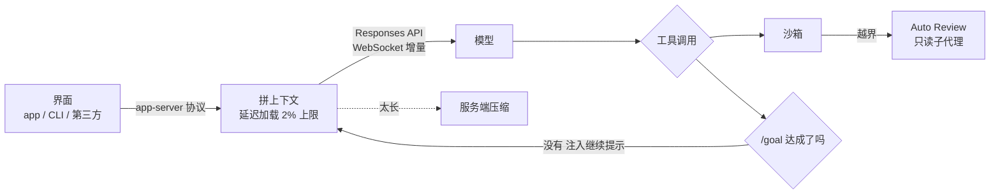
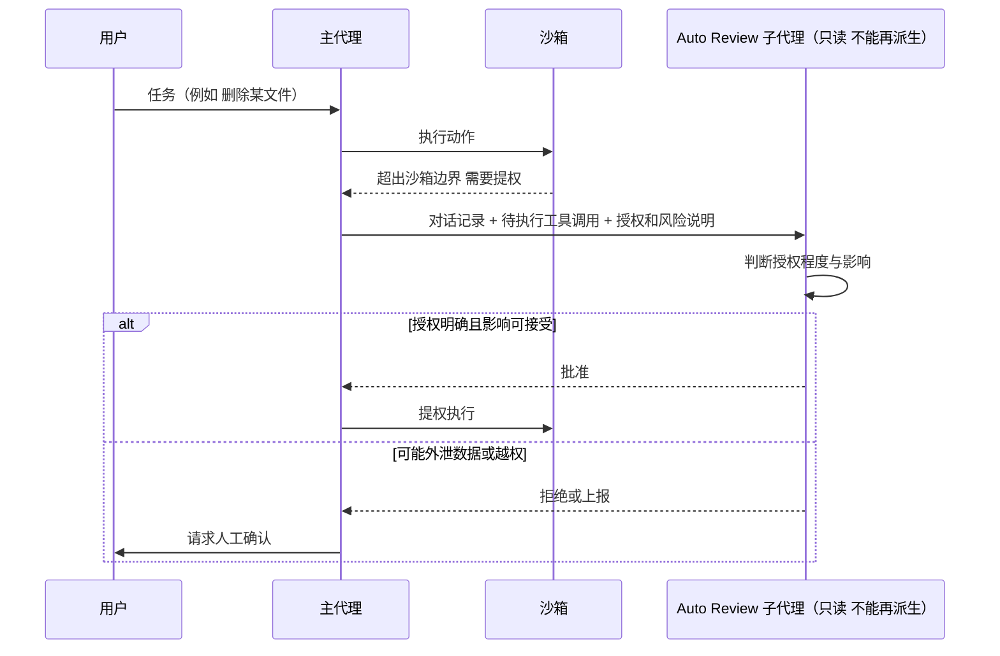

# How Codex Works：同一个模型，为什么放进 Codex 就能长时间干活

Codex

**一句话看懂**：OpenAI 的 Dominik Kundel 用 20 分钟，跟着一条消息走完 Codex harness 内部：上下文怎么拼，工具怎么设计，越权操作谁来批，网络怎么提速，长任务怎么跑完。讲到的每一项都是开源的，大部分还能通过 Responses API 直接用在你自己的代理里。

## 读完你能带走的 6 条收获

1. **上下文不是越多越好。** 内容越多，越容易互相矛盾。Codex 把不常用的工具设成延迟加载，并把 skills 列表限制在上下文窗口的 2% 以内（见 3.2）。
2. **工具要贴近模型训练时的习惯。** 编辑文件用 `apply_patch` 写 diff；模型习惯用 ripgrep，harness 就直接自带一份（见 3.3）。
3. **浏览器操作改成“写代码”。** 先看清一个页面的结构，再写脚本批量处理后面的页面，比一步一步点快得多（见 3.3）。
4. **审批交给一个只读子代理。** 它看完整对话，判断“用户有没有授权、后果有多大”，比全开权限或频繁弹窗都好（见 3.4）。
5. **推理变快以后，瓶颈在网络。** 用持久连接，每次只发变化的部分（见 3.5）。
6. **`/goal` 要写具体、可验证的目标。** harness 会一直推它继续，直到模型自己宣布完成（见 3.6）。

::: tip 小白先懂这几个词
- [Harness](/glossary#harness)：包在模型外面的运行框架，Codex CLI 就是一个 harness。
- [Responses API / app-server](/glossary#responses-api)：模型调用接口 / 界面与 harness 之间的协议。
- [Deferred Tools](/glossary#deferred-tools)：不预先加载、需要时再搜索的工具。
- [Sandbox](/glossary#sandbox)：限制代理读写和联网范围的隔离环境。
- [Auto Review](/glossary#auto-review)：遇到越权操作时，由只读子代理判断是否放行。
- [/goal](/glossary#goal)：给代理一个可验证的目标，直到达成才停。
- [Compaction](/glossary#compaction)：上下文过长时压缩成摘要。
:::

## 1. 基本信息

<YouTube id="shRR1e2HXMk" title="How Codex Works" />

| 项目 | 内容 |
|---|---|
| 讲者 / 频道 | Dominik Kundel（OpenAI Developer Experience）／ **AI Engineer**（AI Engineer World's Fair 2026） |
| 发布日期 | 2026-08-10 |
| 时长 | 20:54 |
| 使用工具 | Codex harness（开源，Rust，Apache-2.0）、app-server 协议、Responses API（tool search、`apply_patch`、WebSocket mode、server-side compaction）、Auto Review、`/goal` |
| 代码 | https://github.com/openai/codex |
| 分析依据 | AI Engineer 官方讲稿页（ai.engineer/talks/shRR1e2HXMk，含完整时间戳文字稿，2026-10-14 重新抓取核对）+ 幻灯片截图。英文引号内容均为文字稿原话；讲稿页里的 Playwright 示例代码是讲稿页作者写的示意，本文没有引用。“我觉得”开头的段落是本站评论。 |

## 2. 这场演讲在回答什么

假设你想自己写一个编码代理。最简单的版本只要几十行：把用户的话和一堆工具说明发给模型，模型说调哪个工具，你就去执行，再把结果发回去，循环。

这个版本能跑，但很快会碰到几个问题：

- 接了十几个 MCP 以后，工具说明就把上下文塞满了。
- 每个危险操作都弹窗问你，你烦了，干脆开全权限。
- 任务跑到一半，上下文满了。
- 代理说“做完了”，其实没做完。

Codex 是怎么处理这些问题的？Dominik 把公开仓库的代码改写成一个 TypeScript 版的 “nano Codex”，用它把过程可视化，跟着一条消息从发出到完成走了一遍。

他开头就提醒：<Trans zh="这是当前的状况">“this is a current state of affairs”</Trans>。新模型一出，API 和 harness 都可能改。想知道最新情况，可以直接问 Codex。

## 3. 怎么做

### 3.1 两个协议：界面和推理都可以换

一条消息要经过两个协议：

- **app-server**：连接界面和 harness。Codex 官方应用用的就是它，社区项目（Theo 的 T3 Code、RemoteX）也基于它。Dominik 还用它<Trans zh="把 Codex 放进了 Claude Code">“put Codex into Claude Code”</Trans>，前一天的演讲里甚至把 Codex 塞进了游戏 Doom。
- **Responses API**：连接 harness 和模型推理。它是去年为代理场景重新设计的 Chat Completions，内置了网页搜索、图片生成等能力。OpenAI 还和 Ollama、LM Studio、NVIDIA 等一起制定了 Open Responses 规范，兼容这个规范的模型提供方都能接进 Codex harness。

<figure class="shot"><figcaption>📷 视频截图 · <a href="https://www.youtube.com/watch?v=shRR1e2HXMk&t=156s" target="_blank" rel="noopener">2:36</a> · 2:36 幻灯片“App server”：左边是官方产品（Codex Desktop App、Codex TUI/CLI 等），右边是第三方集成（JetBrains IDEs、VS Code 等），中间的 Codex harness 通过 app server 用 JSON-RPC 和两边通信。</figcaption></figure>

也就是说，界面可以换成你自己的，模型也可以换成别家的，中间的 harness 照样能用。

### 3.2 拼上下文：越少越好

Dominik 说，harness 第一步、也是最重要的一步，是拼上下文。拼的时候要兼顾三件事：体积、灵活性（不管你装了多少 skills 和 MCP 都好用）、可缓存（省钱）。

为什么要在意体积？不只是费 token：

::: tr 你的上下文里内容越多……出现相互矛盾信息的可能性就越高，而这会让模型困惑。
> "the more context you have in your … context … the higher it is that you have contradicting information and … it causes confusion for the model."
:::

上下文里有些部分是固定的，比如模型指令，大小不变，也不影响缓存。难控制的是会膨胀的部分：你装了多少 skills，接了多少 MCP 工具。Codex 用两个办法压住它们：

**延迟加载工具。** 一部分工具标成 deferred，它们<Trans zh="不直接放进上下文窗口，而是之后通过工具搜索来获取">“are not added directly to the context window, but instead are available through tool search later on”</Trans>。模型需要时先搜索，再加载。从 GPT-5.4 开始，Responses API 里的任何工具都可以这样标；搜索工具可以用官方内置的，也可以自己实现。

**给 skills 列表封顶。** <Trans zh="我们把可用 skills 列表的上限设为最大上下文窗口的 2%">“we actually cap the available skills list at two percent of your context … maximum context window”</Trans>。skills 多了，就逐步缩短每条的描述。

我觉得这一条对任何代理都适用。如果你在 Claude Code 或别的工具里接了一堆 MCP，先数一数它们的说明占了多少 token。

### 3.3 动作：工具要贴近模型的习惯

代理要做事，Dominik 讲了三类动作。

**异步动作：子代理和后台终端。** harness 给模型一个 `spawn_agent` 工具来创建新代理，再用 `send_input` 给它发新内容、等它完成，或者关掉它。后台终端是同一个思路：开一个终端，通过 stdin 继续给它输入，或者等一段时间看结果。这样主代理不用干等。

**浏览器：从“一步一步点”变成“写代码”。** 去年 Responses API 里的 computer use 一次只能做一个动作。现在改成了代码执行：Codex 在一个跨轮次持续存在的 Node REPL 里写 JavaScript（基本就是 Playwright 代码）来操作浏览器。好处是，它看清一个页面的结构以后，可以写一段脚本批量处理后面的页面，比如抓取数据，快得多。

**文件系统：用模型熟悉的工具。**

- 改文件：GPT-5 以后的模型训练时都用过 `apply_patch` 工具，给一个 diff 来改文件，新建文件也用它。
- 找文件：走 shell。模型在训练里习惯了用 ripgrep，所以<Trans zh="我们其实在 Codex harness 里直接内置了 ripgrep">“we're actually in the Codex harness shipping ripgrep”</Trans>，你没装也能用。
- Windows：模型也训练过直接写 PowerShell。

所有文件操作都经过沙箱：macOS 用 Seatbelt，Linux 用 Bubblewrap，Windows 上用他们自己写的开源沙箱（为什么要自己写，他推荐去读同事 David 的文章）。

<figure class="shot"><figcaption>📷 视频截图 · <a href="https://www.youtube.com/watch?v=shRR1e2HXMk&t=679s" target="_blank" rel="noopener">11:19</a> · 11:19 幻灯片“Sandbox first”：macOS 用内置的 Seatbelt，Linux 安装 Bubblewrap，Windows 用自研开源沙箱。</figcaption></figure>

我觉得“自带 ripgrep”这个细节最有启发：与其教模型用你的工具，不如把它已经会用的工具准备好。

### 3.4 Auto Review：让一个只读子代理替你审批

有沙箱，就会有审批弹窗。Dominik 现场问了两个问题：有多少人被审批弹窗烦到干脆开全权限？又有多少人知道 IT 和安全部门很讨厌你这么做？

全权限为什么危险？模型变强了，但如果你在提示词里一直要它“自主一点”，它可能会用你想不到的办法完成任务。他举了两个例子：让代理把文件发邮件，它发现附件加不上，就<Trans zh="把它上传到文件共享">“uploads it to a file share”</Trans>；或者转义写错，删掉了太多数据。

Auto Review 的思路是：可预测的危险操作照常拦，难以预料的越界请求先交给另一个代理判断，不用都来问你；但像数据外泄这类，不在自动批准的范围内。

::: tr 它会启动一个 Auto Review 子代理，这个子代理完全独立运行，不能再派生其他子代理……它只有读权限。
> "it spins up an Auto Review sub-agent, and this sub-agent runs entirely separate. It can't spin up other sub-agents. … It has read permissions only."
:::

审批子代理拿到四样东西：什么算用户授权的说明、风险分类方法、对话记录、准备执行的工具调用。它要回答三个问题：用户授权到什么程度？这个动作的影响有多大？该怎么办？

为什么要看对话记录？因为同一个动作，放在不同的上下文里意义不同。Dominik 的例子：你让它删 `.git` 文件夹，那没问题；你没让它删，它就不该碰，否则你的提交历史就没了。网络请求也一样：`curl` 一下 Google 测网络没问题，上传文件就不一定了。

<figure class="shot"><figcaption>📷 视频截图 · <a href="https://www.youtube.com/watch?v=shRR1e2HXMk&t=783s" target="_blank" rel="noopener">13:03</a> · 13:03 幻灯片<Trans zh="可能会出什么问题？">“What could go wrong?”</Trans>，引出 Auto Review 要解决的风险。</figcaption></figure>

现场演示里，因为用户明确要求删除那个文件，审批子代理判定为高授权。

Dominik 自己说，这只是<Trans zh="严重简化">“a gross oversimplification”</Trans>，细节可以看官方关于 Auto Review 的博客。本站也有一篇 Cursor 做类似分类器的文章：[[39]]。

### 3.5 速度：推理快了，瓶颈变成网络

GPT-5.3-Codex-Spark 在 Cerebras 上跑到<Trans zh="每秒一千个 token">“a thousand tokens per second”</Trans>以后，他们发现推理已经不是瓶颈了，网络才是。代理一次任务要调很多次工具，每次都把整个上下文来回传一遍，太慢。

解决办法是 WebSocket mode：Responses API 不再走 HTTP 加 server-sent events，而是用一个持久的 WebSocket 连接，并且服务端记住状态，只传变化的部分：

::: tr 我们只回传工具调用的结果，而不是把所有条目都重新发回去。
> "we only send back the result of the tool call rather than sending all of the items back"
:::

演示时他的服务器当场崩了，只好用备份：一边每次只发 1 项，另一边要发 9 项。他说时间长了，这能明显提速，但没给具体数字。

### 3.6 `/goal`：harness 推着模型跑完

代理最常见的毛病之一，是没做完就说做完了。`/goal` 的做法很直接：

::: tr 在它完成之前，harness 会自动注入这条“继续”提示。
> "until it's done with that, um, it will actually automatically, the harness will inject this continuation prompt."
:::

这条继续提示里包括你设定的目标。循环会一直进行，直到模型自己调用 `update_goal` 工具，宣布目标达成。现场演示是让它猜一个数字，猜中才算达成。

这个机制决定了目标该怎么写。既然结束与否由模型自己判断，目标就别写成长篇大论，而要：

::: tr 写非常具体、可验证的 prompt，这样才容易判断事情是否已经完成。
> "have very concrete and verifiable, um, prompts so that, uh, it's easy to detect when things are done."
:::

比如“`npm test` 全部通过”，就比“把代码质量提高”好判断得多。

### 3.7 Compaction：上下文满了怎么办

任务一跑就是几小时、几天，上下文迟早会满。从去年年底起，Codex 会在服务端自动触发压缩。模型训练时就学过这种压缩方式，所以压缩后表现不会下降。

做法是把之前的上下文窗口换成一个新的，里面放一个 compaction item，带上后续需要的信息。可以手动触发，也可以自动触发。

## 4. 结果与局限

- **演示**：nano Codex 展示了上下文的各个组成部分；Auto Review 对“明确要求删除文件”判为高授权；`/goal` 猜数字达成；WebSocket 的演示服务器崩溃，改用备份。
- **数据**：每秒 1000 个 token 是生成速度，不是端到端提速；WebSocket 的提速没有给出数字；skills 2% 上限是实现参数。

<figure class="shot"><figcaption>📷 视频截图 · <a href="https://www.youtube.com/watch?v=shRR1e2HXMk&t=1201s" target="_blank" rel="noopener">20:01</a> · 20:01 结论幻灯片“Conclusion”：01 把开源的 Codex app server 当作现成的代理 harness 或蓝本；02 Codex 的大部分代理能力可以通过 Responses API 获得（tool search、apply patch、shell、websockets 等）；03 模型在进化，你的代理也应该跟着进化。</figcaption></figure>

::: warning 局限与注意
- 讲的是演讲时（2026 年年中）的实现，模型和 API 更新后可能已经变了。
- Auto Review 是降低风险的手段，不是确定性的安全保证；讲者自己说讲解是“严重简化”。
- 20 分钟讲了七个主题，每个都只讲到原理，没有讲实现细节和效果评测。
:::

## 5. 结论

Dominik 最后给了三条结论：harness 和 app-server 是开源的，可以当蓝本学，也可以直接拿来用；Codex 的大部分特色能力都在 Responses API 里，<Trans zh="不管你用的是哪个 harness">“regardless of what harness you're using”</Trans>都能用；模型在进化，你的代理也要跟着改。

我觉得，这场演讲真正的价值是给了一张“harness 要解决哪些问题”的清单：上下文膨胀、工具设计、审批疲劳、网络延迟、提前收工、上下文用尽。你自己写代理时，可以拿这张清单逐项对照，看看哪一项还没处理。

### 你可以这样试

- [ ] clone `openai/codex`，让代理回答：“skills 列表的 2% 上限是在哪段代码里实现的？”
- [ ] 数一数你接了多少个 MCP，它们的工具说明一共占多少 token，删掉不常用的。
- [ ] 给一个长任务写 `/goal`，目标要能用一条命令验证（例如“`npm test` 全部通过”）。
- [ ] 写一段给审批代理的说明：哪些操作必须用户明确授权才能做（删除、外发数据、改权限）。

::: details 读完自测（点开看答案）
1. **为什么上下文不是越多越好？** 内容越多，越可能出现互相矛盾的信息，让模型困惑。
2. **为什么 Codex 要自带 ripgrep？** 模型训练时习惯用它，工具贴近习惯，模型用得更顺。
3. **Auto Review 子代理有哪些限制？** 完全独立运行、不能再派生子代理、只有读权限。
4. **`/goal` 怎样判断任务结束？** 模型调用 `update_goal` 才结束；没结束时 harness 会自动注入继续提示。
:::
