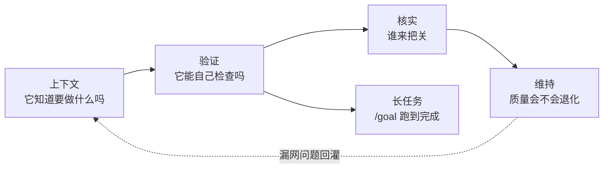
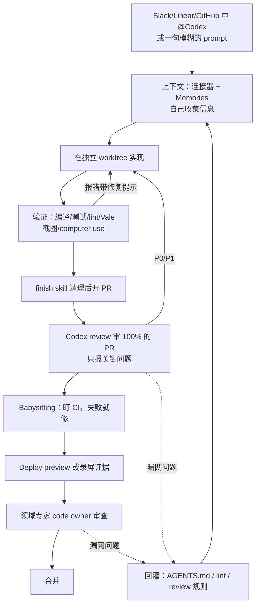

# How OpenAI Uses Codex：代码不再稀缺以后，怎么保证交付的是好软件

<div class="meta-tags"><span class="tool-tag tool-codex">Codex</span></div>

<div class="hook">

**一句话看懂**：OpenAI 的 Dominik Kundel 讲他们内部怎么用 Codex 守住质量。办法分三层：让代理自己拿到上下文，让它用编译器、测试、lint 验证自己，再让 Codex review、CI 看护和 deploy preview 把关。每次有问题漏过去，就写回规则和工具里，形成一个飞轮。

</div>

## 读完你能带走的 7 条收获

1. **先做“新同事测试”。** 一个新人只看仓库和你们的工具，能不能写出合格的代码？不能，就补信息和连接器，而不是每次往 prompt 里粘贴（见 3.1）。
2. **lint 的范围可以很宽。** 任何能让代理确定性地判断“做对没有”的东西都算，比如用 Vale 检查文档风格（见 3.2）。
3. **报错信息要写给代理看。** 报错里带上怎么修，代理就能自己改到通过（见 3.2）。
4. **review 先给代理做，没过不找同事。** 默认审查没报的问题，在 AGENTS.md 里写成你们自己的审查标准（见 3.3）。
5. **PR 推上去后，让代理盯 CI，失败就修。** 能上 deploy preview 就上；上不了，UI 改动要附录屏（见 3.3）。
6. **同类问题漏网两次，就写进规则或检查工具。** 代码可以丢弃，约束才是资产（见 3.4）。
7. **AGENTS.md 宁短勿乱。** 讲者说上下文最大的风险不是太少，而是互相冲突（见 3.6、第 4 节）。

::: tip 小白先懂这几个词
- [AGENTS.md](/glossary#agents-md)：Codex 读取的项目说明文件。
- [Lint](/glossary#lint)：只读代码就能发现问题的检查工具。
- [Worktree](/glossary#worktree)：一个仓库开多个工作目录，给并行代理用。
- [Code Review](/glossary#code-review)：合并前的代码审查。
- [PR Babysitting](/glossary#babysitting)：让代理盯着 CI，失败就修到通过。
- [Deploy Preview](/glossary#deploy-preview)：每个 PR 自动部署的临时预览网址。
- [/goal](/glossary#goal)：给代理一个可验证目标的长任务模式。
:::

## 1. 基本信息

<YouTube id="NjaX4qt-O1Y" title="How OpenAI Uses Codex to Change How We Build" />

| 项目 | 内容 |
|---|---|
| 讲者 / 频道 | Dominik Kundel（OpenAI Developer Experience Lead）／ **Temporal**（Replay 2026 大会） |
| 发布日期 | 2026-05-28 |
| 时长 | 47:03（演讲约 32 分钟 + 问答约 15 分钟） |
| 使用工具 | Codex app / Cloud / CLI、GitHub 上的 Codex review、Slack/Linear/GitHub 中 @Codex、Memories、Chronicle、in-app browser、computer use、Chrome 扩展、`/goal`、babysitting skills、deploy previews |
| 分析依据 | YouTube 自动字幕全文（yt-dlp android 客户端获取，2026-10-14 重新核对）+ 幻灯片截图。英文引号内容是字幕原话，逐字照录；自动字幕常把 Codex 识别成 “codecs / codeex”，所以引文尽量避开这些词，避不开时用中文转述。“我觉得”开头的段落是本站评论，不是讲者观点。 |

## 2. 这篇在回答什么

演讲一开始，讲者先让全场举手：还有谁至少一半代码是手写的？举手的人很少。再问：谁已经完全不手写代码了？举手的人不少。

于是他抛出全场的前提：

<Trans zh="代码已经不是瓶颈了">“code is no longer the bottleneck”</Trans>

代码能写得又多又快，问题就变成了：**怎么确定写出来的东西是好的？**

讲者的回答是从第一性原理出发：你不会招一个人进来，然后让他自己摸索；你会先给他配齐干活需要的东西。对代理也一样。他把要配的东西分成三类：上下文（context）、验证（validation）、核实（verification）。再加上“质量不退化”和“长任务”，就是本文的五个问题：



背景数字：讲者说 OpenAI 有 80% 的员工每周使用 Codex，不只是工程师，还有销售、市场、财务、公关。

## 3. 怎么做

### 3.1 上下文：让代理自己去拿，而不是你拼一个大 prompt

讲者先说清楚，他讲的不是“上下文工程”，不是

<Trans zh="费尽心思生成一个巨大的 prompt">“meticulously generating a giant prompt”</Trans>

理由很简单：你对同事也不会这样。你不会把每个细节、去哪里找都念给他听，而是希望他自己知道去哪里拿信息。

**为什么代理能自己拿？** 讲者说 Codex 从一开始就重点做“在大代码库里找路”。你给它任务后，它会先花不少时间读文件、看结构，然后才写第一行代码。这和新工程师进一个新代码库时做的事一样：有哪些文件、有哪些现成功能、代码该放在哪。

由此他给出一个检验方法，我把它叫做“新同事测试”：

<Trans zh="如果有个新工程师加入团队，他光靠钻进代码库，能不能写出符合你们标准的代码？">“if you have a new engineer join the team, would they actually be able to write code up to your standards um purely by like jumping into the codebase?”</Trans>

**代码库之外的信息也要接上。** 讲者说工程师现在花在编辑器外的时间比编辑器里还多。所以他的 Codex 接了 Linear、Sentry、CI，也接了 Figma、Gmail、日历、Slack、Notion。

他现场演示了一句很模糊的话：

::: tr 把明天那场活动我需要知道的事情都给我梳理一遍。
> "give me a rundown of everything I need to know about tomorrow's event"
:::

他没说是哪个活动。Codex 从邮件、日历和 Slack 里推断出活动、地点，还找到了邮件里的门票，以及他和主办方聊过“要带什么东西”。

讲者管这种用法叫“vague prompt”。另一个例子：同事提醒他欠一篇博客。他只说了个大概：去 Slack 找那条，结合我在 X 上发过的内容和最近的工作，用我的文风写。Codex 通过 Slack 找到了对应的表格，查了他本地的仓库，写出了一份能用的草稿。

**再往前一步：在对话现场 @Codex。** OpenAI 让 Codex 可以在 Slack、Linear、GitHub 里直接被 @。同事在线程里指出文档有问题，他回一句让 Codex 去看，上下文全在线程里，他自己不用先读一遍。

**最后是记忆。** Memories（当时是实验功能）让 Codex 记住上次是怎么解决的，下次知道

<Trans zh="该去哪里找、或者该怎么调试">“where to look or how to debug”</Trans>

但仍然去 CI、Slack、邮件里拉最新信息。Chronicle 更进一步，可以选择性地观察屏幕，学会你还在用哪些工具。比如它知道你正在 Google Doc 里写文档草稿，也知道你说的“Roman”是哪个 Roman、该用 Slack 联系。

<figure class="shot"><figcaption>📷 视频截图 · <a href="https://www.youtube.com/watch?v=NjaX4qt-O1Y&t=352s" target="_blank" rel="noopener">5:52</a> · 幻灯片<Trans zh="Codex 很擅长收集上下文">“Codex is great at context gathering”</Trans>。</figcaption></figure>

我觉得这一节对普通团队最实用的是“新同事测试”。接 Gmail、日历这类连接器要看公司政策，但“代码库里有没有写清用什么库、代码放哪”是任何团队都能先补的。

### 3.2 验证：让代理用你已有的工具检查自己

讲者说，代理和聊天机器人最大的区别，是它能执行任务、并且检查自己的结果。好消息是，如果你以前在开发者体验上下过功夫，现在终于有回报了：Codex 会用你本来就在用的工具来验证自己的工作。

**最基本的一层**：编译器、格式化工具、测试、linter。讲者特别说明 linter 不必是传统意义上的：

<Trans zh="……可以是任何能帮代理以确定性方式验证工作是否做对的东西">“can really be anything that helps the agent in a deterministic way to verify whether the work is done correctly”</Trans>

例子是开发者文档。他们用一个叫 Vale 的检查器，把风格指南变成规则。Codex 写新文档时，可以自己跑一遍，确认符合风格指南。

**第二层：工具要快。** 以前把工具换成稍快一点的版本，算“可有可无”。现在代理会在循环里一遍遍跑这些工具，慢一点会累积起来，

<Trans zh="速度会更重要">“speed will matter more”</Trans>

所以他们把 Prettier 换成了 Rust 写的 oxfmt，又从 TypeScript 6 换到 Go 写的 TypeScript 7 早期版本。

**第三层：并行代理需要并行环境。** 你不会坐在那等一个代理，会同时给好几个代理派活。每个代理都要能验证自己的工作，所以每个 worktree 或 checkout 都要能独立起完整环境。讲者举的例子是 Temporal 的场景：每个代理起自己的 worker 和 dev server，互不冲突。

<figure class="shot"><figcaption>📷 视频截图 · <a href="https://www.youtube.com/watch?v=NjaX4qt-O1Y&t=823s" target="_blank" rel="noopener">13:43</a> · 幻灯片<Trans zh="并行代理需要并行的环境">“Parallel agents need parallel environments”</Trans>。</figcaption></figure>

**第四层：界面验证。** 做 UI 时，要让代理能截图、读无障碍树，甚至用 computer use 点一遍界面。Codex 为此内置了 in-app browser 和 computer use；讲者还说演讲后 10 分钟会发布 Chrome 扩展，让 Codex 在后台开标签页测试，不打扰你自己用浏览器。

**最后，也最容易被忽略：报错要有用。** 讲者说验证不只是“有错就一直跑到没错”，它是教代理的机会：

::: tr 如果你有 linter 或其他 CI 工具在检查工作，确保它们真的把有用的信息反馈给代理。
> "make sure that they're actually providing helpful information back to that agent."
:::

我觉得这一条最便宜也最有效。把自定义 lint 规则的报错从“不允许”改成“不允许，改用 X，见 docs/Y.md”，代理下一轮就能自己修好。

### 3.3 核实：PR 越来越多，谁来把关

代理写的代码多了，PR 也就多了。怎么审才不会让质量一点点下滑？讲者说，这听起来有点讽刺，但第一步是让 Codex 自己审。

**100% 的 PR 先过 Codex review。** 讲者说他们所有 PR 都在 GitHub 上过 Codex 的审查。原则是：

<Trans zh="在 PR 通过所有审查检查之前，你不会去请同事审">“you're not going to ask your colleague to review a pull request until it's actually passing all of the review checks”</Trans>

Codex review 被有意做得

<Trans zh="不吵">“intentionally not noisy”</Trans>

它不挑一百个小毛病，只报关键问题。它从空白状态开始，有自己的环境，可以动手验证审查时产生的怀疑。

**默认标准不够，就自己定。** 文档仓库发现 Codex review 不报错别字。对代码库来说这很合理：能编译、测试通过，typo 一般不算大事。但文档在乎这个。讲者说：

<Trans zh="你随时可以设定自己的审查标准">“you can always set your own review bar”</Trans>

幻灯片上给的 AGENTS.md 写法是：

::: tr 代码审查准则：在任何 .mdx 文件里，拼写错误或语法问题都应标记为 P0 和 P1。
```markdown
## Code review guidelines

In any .mdx file spelling mistakes or grammar issues should be flagged as P0 and P1.
```
:::

<figure class="shot"><figcaption>📷 视频截图 · <a href="https://www.youtube.com/watch?v=NjaX4qt-O1Y&t=1058s" target="_blank" rel="noopener">17:38</a> · 幻灯片<Trans zh="在 AGENTS.md 里设定你自己的审查标准">“Set your own review bar in AGENTS.md”</Trans>，右侧即上面的配置。</figcaption></figure>

**CI 要完整，快慢反而次要。** 讲者认为以前 CI 追求快，现在更该追求覆盖全，线上漏过的问题就补测试。快慢不那么要紧，因为 CI 可以让代理去盯。

**Babysitting skill：让代理盯 PR。** Codex 写完 PR 推上去后，让它继续盯着：CI 失败就修，修完再看，直到全部通过；他还让它接着处理 review 意见。

**Deploy preview 是“没得商量”的。** 讲者说，对前端和 Web 应用，deploy preview 已经是他的

<Trans zh="没得商量的标配">“non-negotiable”</Trans>

有了它，整条链路可以在手机上走完：在 Slack 发现问题 → @Codex 修 → Codex 推 PR → 他看 PR → 打开预览 → 请同事审 → 合并，

<Trans zh="全在手机上，根本不用拿笔记本">“all from my phone without ever having to like grab my laptop”</Trans>

**没有预览环境怎么办？** Codex app 本身就没法做 deploy preview。他们的规矩是：凡是 UI 改动，PR 里必须附视频或至少截图。这件事通常也交给 Codex：有一个 skill 会启动应用、点一遍、边点边录屏。最后仍由懂这个应用的领域专家，通过 code owner 关卡审代码。

演讲后半段的演示把这一节串了起来。同事在 Slack 里提了一个需求，他只说了句“Codex，你搞定一下”。Codex 找到对应私信里的 Google Doc，读完，改了一个 MDX 文件，推 PR，盯着 CI 通过、等 deploy preview 出来，最后回到 Slack 线程里回复。界面显示

<Trans zh="工作了 23 分钟">“worked for 23 minutes”</Trans>

讲者特意说明，这不是模型想了 23 分钟，其中至少六七分钟是在等 CI。

我觉得这一节有个顺序值得照抄：**机器先审，人后审；人审的时候手边要有证据**（预览链接或录屏）。人的时间只花在机器判断不了的地方。

### 3.4 维持：质量怎么不随时间退化

前面几步能提高每个 PR 的质量。但讲者说，还有一个更难的问题：东西太容易做出来了，功能会越堆越多。他说他们最难的挑战是

<Trans zh="克制">“the hardest challenge being restrained”</Trans>

**先做、试、再辩论，并且敢删。** 他们常常先把功能做出来，内部试用，甚至试几种做法；有把握了，再讨论这是不是正确的做法。上线后也不怕再删掉。

**重构变便宜了。** Codex app 上线才 3 个月，每周都在发版，期间做过好几次大重构，比如状态管理。一两个人就能做，不用冻结代码两三周，其他功能照常开发。

**飞轮：把漏网的问题写回去。** 讲者在讲审查时就说过：如果某类问题经常漏过 Codex review，或者 Codex 一再犯同一个错，就把它写进 review 规则，甚至写进验证工具，让 Codex 过不了这一关。

**收尾 skill。** 文档有一个 docs editor skill，按风格指南收尾；Codex app 有一个 finish skill，在开 PR 前按最佳实践重构一遍。他们先专注把功能做出来，快上线时再让 Codex 清理。

由此讲者得出这一节的结论：

<Trans zh="越来越把代码当作可丢弃的东西……把精力放在约束上">“treat code as disposable … instead really focus on constraints”</Trans>

某一行代码长什么样不重要，重要的是有没有约束保证它正确、能被验证，并且一直在让 Codex 没法再犯同样的错。



我觉得“代码可丢弃”这句话要和后面问答一起读（见 3.6）。讲者并不是说代码不重要，而是说**长期积累的应该是测试、CI 和 spec**，代码可以照着它们随时重写。

### 3.5 长任务：用 `/goal` 跑到完成

这个功能是讲者在问答里被问到大规模语言迁移时才演示的。

**先把目标说清楚。** 有人问：三四万行 Python 想迁到更快的语言，怎么拆？讲者说，第一件事是把目标讲清楚。如果原代码有很好的测试覆盖，测试就能当作“怎样算对”的标准。还可以先用 plan mode 和 Codex 讨论，生成**和语言无关的验收测试**。比如 Web 服务，就先写针对 HTTP 端点的测试，两种语言的实现都拿它来测。

**再交给 `/goal`。** `/goal` 当时是 Codex CLI 里的实验功能。你给它一个具体目标，它会一直做到目标完成：

::: tr 你的目标写得越具体，它就会在上面持续工作越久。
> "the more specific you are with that goal the longer it will work on it"
:::

他的例子是：让开发者文档的 Vercel 构建快至少 50%。这个目标可以量化。Codex 自己改、自己部署到 Vercel、自己量是不是变快、快了多少，结果

<Trans zh="只用了两个小时">“only needed two hours”</Trans>

讲者说这类任务能跑 20 个小时，他还听说有人飞回家又飞回旧金山，Codex 三天后还在跑。前提都一样：**目标要清楚、要能量化。**

**往后看：三个趋势。** 讲者没透露路线图，但说了三个方向：

- **主动性（Proactivity）**：代理不用你开口也做事，比如定时检查、或在 Sentry 报错时自动开 PR。
- **独立性（Independence）**：靠 Chronicle 和 computer use，代理能更长时间、更少盯梢地把事情做完。
- **并行化（Parallelization）**：本机资源会不够，更多工作会挪到云端环境或 dev box 上。

<figure class="shot"><figcaption>📷 视频截图 · <a href="https://www.youtube.com/watch?v=NjaX4qt-O1Y&t=1529s" target="_blank" rel="noopener">25:29</a> · 幻灯片“Where are we going?”：主动性、独立性、并行化。</figcaption></figure>

### 3.6 问答：真相源、人的角色、token 和冲突的上下文

问答有约 15 分钟，五个问题都很实在。

**代码可丢弃，那什么才是真相源？** 讲者说，代码仍然代表“实际实现了什么”；至于“应该实现什么”，spec 越来越重要。例子是 OpenAI 开源的 Symphony：团队让 Codex 把内部实现蒸馏成一份 spec，再让 Codex 用几种语言实现它，反复迭代，直到 spec 成为真相源。公开发布的 Elixir 版本只是其中一个实现。他的总结是：测试、CI 和 spec 越来越成为真相源。

**不同模型适合不同任务吗？** 讲者说没有硬规则，每代模型的沟通方式都略有不同。他举的例子：GPT-5.5 很注重细节，配合 GPT image 先生成界面图，就能更忠实地还原 UI；但从零设计 UI，不一定比 5.4 强。

**实际丢弃过什么？** Codex app 的自动化页面上线前后改过好几版；更大的是 worktree 的处理方式，上线后就整套推倒重来了两三次。

**任务一跑二十多分钟，人怎么安排时间？** 讲者说，个人贡献者会越来越需要

<Trans zh="技术负责人或工程经理的能力">“tech lead or engineering manager skills”</Trans>

也就是想清楚怎么拆功能、怎么安排才能并行，然后像经理一样，不守在旁边盯着。他的侧栏常钉着八九件事，有的放一两天才回来看。他还发现一个好处：做一件事变容易了，过一天觉得想法不好就扔掉，因为你没有花四周投入感情。

**token 怎么省？** 讲者很坦白：

<Trans zh="我的 token 不限量">“I have unlimited tokens”</Trans>

他通常用 extra high 推理，尽量异步，派完就去做别的。他建议普通团队关注结果，并让 Codex 回顾自己之前是怎么解决问题的，好让下次更快。比如 Codex app 仓库的 AGENTS.md 不长，内容主要来自 Codex 过去踩过的坑、或需要反复解释的地方。

**很多人同时往里加上下文，怎么管？** 讲者说 GPT-5.4 到 5.5 token 用量明显下降，因为模型更会找上下文了。但他们仍然有意控制上下文量，因为

::: tr 更大的问题其实不是上下文的多少，而是上下文之间的冲突。
> "the bigger issue is actually not the amount of context it is conflicting context"
:::

Codex 很擅长遵循指令，可如果指令之间互相矛盾，就很容易跑偏。所以他们的 AGENTS.md

<Trans zh="并不长">“is not that long”</Trans>

而且通常在具体的项目目录里打开 Codex，而不是在整个 monorepo 的根目录。

我觉得这一段和 3.1 并不矛盾。3.1 说“让代理能拿到所有信息”，这里说“写给它的指令要少而一致”。前者是**可查的资料**，后者是**必须遵守的规则**。资料可以多，规则要少。

## 4. 结果与局限

讲者给出的数字（都是口述，没有展示数据来源）：

- OpenAI 80% 的员工每周使用 Codex。
- 100% 的 PR 都过 Codex review。
- 一次 Slack 驱动的修复用了 23 分钟，其中至少六七分钟在等 CI。
- 他常同时跑<Trans zh="五六七个代理">“five, six, seven agents”</Trans>。
- `/goal` 优化构建速度用了两小时。

现场演示能看到的：Slack → PR → 回帖的完整链路；从 Codex Cloud 拉 PR 到本地修好并盯 CI；用 GPT image 2 和 GPT-5.5 做的 Windows 3.1 克隆，Codex 在 in-app browser 里自己玩扫雷。

::: warning 局限与注意
- **成本前提不同。** 讲者 token 不限量，常用 extra high 推理异步工作。普通团队照搬要先算账。
- **上下文的主要风险是冲突，而不是数量。** <Trans zh="更大的问题不是上下文的多少，而是上下文之间的冲突">“the bigger issue is actually not the amount of context it is conflicting context”</Trans>。所以 AGENTS.md 要短、要一致，并从具体项目目录启动。
- **很多功能当时是实验性的。** Memories、`/goal`、Chronicle 都需要手动开启，行为可能已经变化。
- **讲者是 OpenAI 员工**，演讲本身也在介绍自家产品；“80% 员工每周使用”等数字无法独立核实。
- 连接 Gmail、日历、Slack 等个人数据源，需要先看公司的数据政策。
:::

## 5. 结论

这场演讲的核心可以用讲者自己的话概括：给代理的配置，应该和给团队的一样——

<Trans zh="和你给团队的一样的便利条件">“the same affordances that you give your team”</Trans>

落到做法上，是三个问题，外加一个飞轮：

1. **上下文**：代理需要的信息它自己拿得到吗？你多久要往 prompt 里粘一次东西？
2. **验证**：它能自己检查吗？出错时，报错能告诉它怎么修吗？
3. **核实**：机器先审、人后审；人审的时候有预览或录屏作证据。
4. **飞轮**：每次漏网的问题，都改到上下文或检查工具里，让同样的错不再发生。

还有一条容易被忽略：**AGENTS.md 宁短勿乱**。消除互相矛盾的指令，比堆更多内容更重要。

我觉得最值得从明天就开始做的是第 2 条里的“报错写给代理看”和第 3 条里的“review 标准写进 AGENTS.md”。这两件事都不用买新工具。

### 你可以这样试

- [ ] 做一次“新同事测试”：假设新人只看仓库，列出他会卡住的三个地方，补进文档。
- [ ] 在 AGENTS.md 加一节 `## Code review guidelines`，写一条你们最在意、但默认审查不会报的问题，标上 P0/P1。
- [ ] 挑一条自定义 lint 规则，把报错改成“错在哪 + 该怎么改 + 参考哪个文件”。
- [ ] PR 推上去后，让代理“盯 CI、失败就修、直到通过”，记录它花了多久、修了什么。
- [ ] 给项目接上 deploy preview，在手机上走一遍“看预览 → 合并”。
- [ ] 检查 AGENTS.md 里有没有互相矛盾的两条规则，删掉一条。

::: details 读完自测（点开看答案）
1. **讲者说上下文最大的风险是什么？** 互相冲突的上下文，而不是上下文太少或太多。
2. **为什么工具速度在代理时代更重要？** 代理会在循环里反复运行这些工具，慢一点会被放大很多倍。
3. **文档仓库怎样让 Codex review 报拼写错误？** 在 AGENTS.md 的 Code review guidelines 里写明 .mdx 的拼写和语法问题标为 P0/P1。
4. **没有 deploy preview 的应用怎么让人快速审 UI 改动？** PR 附视频或截图，通常由 Codex 用 skill 启动应用、点一遍并录屏。
5. **`/goal` 什么情况下最有效？** 目标具体、可量化，比如“构建至少快 50%”。
:::
