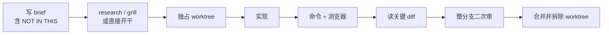

# 先写清楚 brief，再用命令证明做完

Claude Code

**一句话看懂**：Patryk Reba 的日常不是“更聪明的 prompt”，而是：**开工前写承包商级 brief（尤其写清 NOT IN THIS）、长任务各自进 worktree、做完用命令与浏览器证明、贵错只读关键 diff，并用整分支二次审查补单票审查的盲区**。

## 读完你能带走的 7 条收获

1. **好会话的最佳预测因子是第一条消息里的完整 brief**，不是中途补丁式追问（见 3.1）。
2. **NOT IN THIS 名单比看起来更重要**：没有它，代理会“顺手修相关问题”，diff 翻倍且一半未审（见 3.1）。
3. **设计不明才跑 research / grill；两行修复不要仪式**（见 3.2）。
4. **超过几分钟的任务独占 worktree**；建树失败就停，不要回落到主 checkout（见 3.3）。
5. **子代理适合去读二十个文件再只带回结论**，主会话保留决策与关键写入（见 3.3）。
6. **Done = 检查通过，不是摘要**：`check` 若会起 triage 服务器，就不是检查（见 3.4）。
7. **单票审查 ≠ 整分支审查**：跨条目才暴露的问题需要独立只读审稿人（见 3.5）。

::: tip 小白先懂这几个词
- [Worktree（工作树）](/glossary#worktree)：同一仓库的第二份工作目录，分支隔离。
- [Skill（技能）](/glossary#skills)：可按需加载的流程包（如 research、yolo、verify）。
- [Subagent（子代理）](/glossary#subagent)：主会话派出去读或干一块活的隔离工人。
- [完成标准](/glossary#definition-of-done)：brief 里 DONE 一节写清的检查与报告。
- Brief：交给代理的首条任务说明，按承包商交接来写。
:::

## 1. 基本信息

<SourceCard type="文章" title="How I use Claude Code every day" author="Patryk Reba" date="2026-10-02" url="https://patrykreba.com/blog/how-i-use-claude-code" />

| 项目 | 内容 |
|---|---|
| 链接 | https://patrykreba.com/blog/how-i-use-claude-code |
| 类型 | 个人工程博客（约 5–8 分钟阅读） |
| 作者 | Patryk Reba（Senior Full-Stack & AI Engineer） |
| 发布日期 | 2026-10-02 |
| 使用工具 | Claude Code、git worktree、Playwright MCP / Claude in Chrome、自建 skills |
| 分析依据 | 原文全文，2026-10-27 抓取（页面为前端渲染，正文自公开页面核对）。文中 4,070 commits、71% co-author、8,769 transcripts 等为作者自述统计；产品名 LoveStack / Headwind / BBC Marble 仅作场景。“我觉得”开头的段落是本站评论。 |

## 2. 这篇在回答什么

你已经会开 Claude Code，但一天开几条并行任务时，最容易坏在两头：开头 brief 含糊，代理把范围扩到你没打算审的地方；结尾它写了一段“我做完了”，你却没有可跑的证据。

作者跨三个产品自称有 4,070 次提交，其中 2,893 次（71%）带 Claude Code co-author；本机 44 个项目里有 8,769 份会话记录。他的主张很平：

<Trans zh="Claude Code 不是我用来对付难题的工具。它是工作发生的地方。">“Claude Code is not the tool I open for hard problems. It is where the work happens.”</Trans>

主线是一条可并行多份的日环：**写 brief →（必要时）研究/拷问 → worktree 里构建 → 用命令与浏览器验收 → 读关键 diff → 必要时整分支再审 → 合并并拆掉 worktree**。

## 3. 怎么做

### 3.1 第一条消息写成承包商 brief

任务大于单文件时，他按“交给一个三小时不能问你的承包商”来写。BBC Marble 二期 brief 大致六块：

| 块 | 写什么 |
|---|---|
| READ FIRST | 依赖的页面与决策文件 |
| CONTEXT | 业务现在怎么跑，几行即可 |
| SCOPE | 编号条目，一条一 commit，测试先行 |
| NOT IN THIS | 看起来相关但**不属于**本单的事 |
| HOW TO WORK | 绝不能跑什么、怎么起环境、怎么开分支 |
| DONE | 精确检查，以及结束时要写的报告 |

他强调：

<Trans zh="「不在本次范围内」名单比看起来更管用。没有它，代理一旦发现相关问题就会去修，于是 diff 大了一倍，其中一半是未审查的范围。">“The "not in this" list does more work than it looks. Without it, an agent that notices a related problem will fix it, and now the diff is twice the size and half of it is unreviewed scope.”</Trans>

长 brief 他先口述（Wispr Flow / superwhisper），再改成上表结构——口述容易跑题，要人工收束。

我觉得这和 [[96]] 的规格边界、[[84]] 的“没说出口的假设”同一类问题：范围膨胀往往不是模型蠢，是你没写禁区。

### 3.2 何时计划，何时直接问

设计题先跑只读 `research` skill（`~/.claude/skills`，各仓共用）：并行派出五六个代理（扫代码库、最佳实践、对标应用与库、提架构），再让一个批评者跟它们辩；产出一页纸，结尾两三个选项加推荐。选定方向后，LoveStack 的 `yolo` 构建 skill 会去 `research/` 找这份 brief，跳过它本来会重复的战略调研。

不确定的计划用 `grill-me`：一次只问一个问题，并给出推荐答案，直到设计树合拢。小改动直接问——两行修复上做规划仪式是浪费。

### 3.3 worktree 并行，子代理只带回结论

超过几分钟的活独占 git worktree 与分支。`yolo` 会**先**建 worktree；失败则停下报告，**不**回落到主 checkout——这才能并排跑多个长任务而不共用工作目录。两个应用仓还写死一条：发现别的代理在改你正在改的文件，就停并标出来；一行规则把静默覆盖变成问题。

LoveStack 有六个自定义子代理（多数 Opus，渲染器用 Sonnet 并自检，浏览器调试用 Haiku）。他更看重的模式更简单：

<Trans zh="派一个子代理去读二十个文件，只把答案带回来，这样主对话里留下的是结论，而不是文件倾倒。">“send a subagent to read twenty files and come back with the answer, so the main conversation keeps the conclusion instead of the file dumps.”</Trans>

主会话保留决策、关键写入，以及和人的对话。

### 3.4 Done 是检查，不是摘要

<Trans zh="代理的摘要说的是它打算做什么。命令说的是实际发生了什么。">“An agent's summary says what it intended. Commands say what happened.”</Trans>

BBC Marble 按改动类型列检查：跨 app / backend / MCP 的 typecheck、测试套件、skill 测试、必须 exit 0 的 wiki linter。他特意写了一句：名叫 `check` 的 npm 脚本会起 triage 服务器——**那不是检查**。

`verify` skill 更严：检查过、改过的屏幕在浏览器里被驱动并亲眼看见可用、测试时写入的东西已撤销。驱动用 Playwright MCP 或 Claude in Chrome 打本地应用。

每次跑完固定三个标题，**Blocked on me 放第一**：

::: tr 三次汇报标题：阻塞在我、改了什么、发现了什么。
> **Blocked on me**  decisions or approvals only I can give, or "nothing"
> **Changed**        files, rows, deploys
> **Found**          what the run learned
:::

### 3.5 哪些 diff 必须人读；单票审不够

他不逐行读代理写的一切，但总是读：

1. **已上线应用的公共契约**（他们把 web bundle 打进 iOS 二进制，旧安装会继续打后端数周）。公共函数参数/返回值或 schema 变更必须自带裁决：safe / shimmed / needs a minimum-build bump；他亲自对照 diff 核裁决。
2. **发送、删除、部署路径**——守卫最容易被“好心重构”拆掉。
3. **与被测代码同一 commit 改的测试**——冲绿的代理会让测试同意 bug。
4. **远大于任务的 diff**：该次发布里有一条膨胀到约 2,300 行、90 个文件的“测试便利”，审查发现它可能在缺少两个新凭据时静默跳过入站业务消息；他直接丢掉。

然后换一个代理通读。该次发布里每条都过了本票审查；两个独立只读审稿人再读整分支，其中一个对**只存在于跨条目之间**的重大问题给出 NO-SHIP；修好并再审后才合并。

<Trans zh="按条目审查是作用域内的裁决。它不能替代整分支审查。">“A per-item review is a scoped verdict. It does not replace a whole-branch one.”</Trans>

### 3.6 一天的形状

写 brief → 长任务各自进 worktree → 主会话做小事 → 回来审查、跑检查、合并、拆 worktree。收束句：

<Trans zh="本事不在任何单一步骤。本事在于知道哪一步需要我。">“The skill is not in any single step. It is knowing which step needs me.”</Trans>

我觉得这句话几乎是对 [[87]]「塑形—构建—审查」和 [[79]]「人只做解阻塞决定」的个人版摘要：工具会换，**人该出手的闸门**要先钉死。

## 4. 结果与局限

- **证明了什么**：一套可复述的个人日环；brief 六块、汇报三标题、必须人读的 diff 类别都很具体；有自述的提交 / 会话规模。
- **没证明什么**：71% co-author、NO-SHIP 案例等均为个人日志，无对照实验；未给出 skill 源码全文。
- **局限**：强依赖作者自建 skills 与产品形态（Capacitor iOS 契约）；并行 worktree 在重型 monorepo 上的成本见 [[102]]。

## 5. 结论

代理日环的杠杆在两端：开头用禁区收住范围，结尾用命令和关键 diff 收住信任；中间用 worktree 换并行。

**你可以这样试**：下一条非琐碎任务，按六块写 brief（必须含 NOT IN THIS 与 DONE）；长任务强制新 worktree；收工报告把 Blocked on me 放第一；合并前另开只读会话看整分支。

**读完自测**：你现在的“做完了”是摘要还是命令输出？上一次范围膨胀，是不是缺了 NOT IN THIS？
