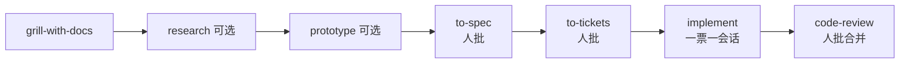

# 每道决策闸门停在人这里：一票一会话

Claude Code

**一句话看懂**：Ahmed Saad 用仓库内规则 + 固定 Skill 顺序（grill → research → prototype → to-spec → to-tickets → implement → code-review）造船：**代理负责打字，凡是只能由他拍板的地方一律停闸**；一票一新会话，事实只认 facts 文件，生产库变更只给人看 dry-run。

## 读完你能带走的 6 条收获

1. **CLAUDE.md 要短，只指向“冲突时谁赢”的文档**，并把整条工作流写成一行（见 3.1）。
2. **关于作者本人的事实只认 facts 文件**；没有就写 `TBD`，禁止猜（见 3.1）。
3. **Skill 管道在每个 owner gate 停下**：规格、票列表、合并与部署都要人 OK（见 3.2）。
4. **一票一会话、开工前一次问完所有未决问题并附推荐答案**（见 3.3）。
5. **连着生产库时：只经 migration 文件改 schema，dry-run 给人看，真人 push**（见 3.4）。
6. **可抛原型便宜到可以全盘否决**；组件行为以已安装库为准，不靠模型记忆（见 3.5）。

::: tip 小白先懂这几个词
- [CLAUDE.md](/glossary#claude-md)：会话开始时读的项目说明书。
- [Skill（技能）](/glossary#skills)：斜杠命令式流程（文中多用 Matt Pocock 合集）。
- Owner gate：只有人能过的决策点（批规格、批票、推送、合并、部署）。
- ADR：架构决策记录，grill 阶段落盘的决定。
- TBD：facts 里没有的事实，代理不得编造。
:::

## 1. 基本信息

<SourceCard type="文章" title="How I ship with Claude Code: my spec-driven workflow" author="Ahmed Saad" date="2026-10-13" url="https://amdsaad.com/lab/ship-with-claude-code" />

| 项目 | 内容 |
|---|---|
| 链接 | https://amdsaad.com/lab/ship-with-claude-code |
| 类型 | 个人工程博客（Lab 笔记） |
| 作者 | Ahmed Saad |
| 发布日期 | 2026-10-13 |
| 使用工具 | Claude Code、GitHub Issues、Supabase、Nuxt UI；Skills 来自 Matt Pocock 合集 |
| 分析依据 | 原文全文，2026-10-27 抓取。流程与命令来自原文；无团队对照数据。文中站点即作者用该流程建成的 Lab。“我觉得”开头的段落是本站评论。 |

## 2. 这篇在回答什么

编码代理又快又会填空：关于你的事实、组件 props、甚至对线上库的改动，缺口都会被猜满。作者自己的站点上，猜错就会公开丢人。他要的是：

<Trans zh="我想让 Claude Code 做大部分打字，同时每一件真正重要的决定留在我手里。">“I wanted Claude Code to do most of the typing while every decision that matters stays with me.”</Trans>

答案不是更长的 prompt，而是**仓库里的规则 + 固定顺序的 Skills，并在每个主人闸门停下**。

## 3. 怎么做

### 3.1 规则住在仓库里

Claude Code 每会话读 `CLAUDE.md`。他的很短：指向冲突时优先的文档——项目规则、facts 文件、文风指南——并把工作流压成一行：

::: tr 工作流：grill → research → prototype → to-spec → to-tickets → implement → code-review；在 PROJECT-RULES §3 的每个主人闸门停下。
> **Workflow:** `/grill-with-docs` → `/research` (if needed) → `/prototype` (UI questions) → `/to-spec` → `/to-tickets` → `/implement` (one ticket per session) → `/code-review`. Stop at every owner gate in `PROJECT-RULES.md` §3.
:::

facts 文件是关于他本人的**唯一**来源：角色、日期、项目、数字。不在文件里就写 `TBD`，不许猜。

我觉得这和 [[20]] 写好 CLAUDE.md、[[92]] 按通道投放指令同一轴：短入口 + 权威文档，比把一切塞进总说明更稳。

### 3.2 步骤与停点

| Skill | 做什么 | 谁拍板 |
|---|---|---|
| `/grill-with-docs` | 把模糊计划问到决策，落成 ADR 与术语 | 人回答 |
| `/research` | 外部事实对一手来源，存带引用笔记 | 人决定要不要 |
| `/prototype` | UI 不定时在独立分支做可丢弃变体 | 人挑选；**永不合并** |
| `/to-spec` | 规格写成一条 GitHub issue | **人批准规格** |
| `/to-tickets` | 拆成带依赖、一会话能做完的票 | **人批准列表** |
| `/implement` | 新聊天做一票，在功能分支上一个 commit | 人不推送/合并/部署 |
| `/code-review` | 对照仓库标准与规格审改动 | **人批准合并** |

原文写死：没有任何推送、合并或部署可以绕过他的同意。

### 3.3 一票一会话，问题一次问完

每张票写清：建什么、依据哪些文档、怎样算做完。Lab RSS 那张票的验收标准示例：

::: tr 验收：事实可追溯到 brand-facts；typecheck/lint 过；跑过 code-review；功能分支一个 commit，不推送不合并不部署。
> - [ ] Every fact traces to `brand-facts.md`; anything unknown is `TBD` and listed in the report.
> - [ ] Typecheck and lint pass.
> - [ ] `/code-review` has run; findings fixed or recorded.
> - [ ] One commit on `feature/lab`. No push, merge or deploy.
:::

写代码前，Claude Code 读票后**用一条消息问完所有未决问题，并附每题推荐答案**；他答一轮再开干。收工报告列：对不上的、仍是 `TBD` 的。只有他能做的事（托管面板里的密钥、看线上）进一张 launch checklist issue。

作者学到的第一课：

<Trans zh="一条消息里问完所有问题，好过问题冒出来再问。">“One message of questions beats questions as they come up.”</Trans>

### 3.4 数据库就是生产库

站点的 Supabase 项目挂在仓库上，而且是**线上库**。因此 schema 只经 migration 文件改；Claude Code 在应用前先给他看 dry-run：

::: tr 新建 migration，然后 dry-run 推送。
> npx supabase migration new my_migration
> npx supabase db push --dry-run
:::

真正的 push 他自己跑。Claude Code 读结果；**从不往生产写测试行**——需要数据的页面用 mock 验收。

### 3.5 他学到的另外两课

- **可抛原型便宜到可以全否**：首页第一轮四个变体全否，第二轮从他挑的参考站重开；主分支上没有要拆的东西。
- **查已装组件库，不查模型记忆**：规则要求对照已安装版本的 Nuxt UI。做 Lab 注册表单时发现：文本输入在宽屏会掉到 14px，除非设 `fixed`；已批的原型里就有这个 bug。

## 4. 结果与局限

- **证明了什么**：个人站点可运行的闸门流水线；验收清单与 dry-run 命令可抄。
- **没证明什么**：无吞吐、缺陷率或与“无闸门”对照；Skills 依赖 Matt Pocock 合集与作者仓库约定。
- **局限**：生产库直连提高风险，换团队需更强隔离；一票一会话对极碎改动可能过重。

我觉得它和 [[87]] 同属“一人闭环”，差别是 Ahmed 把**闸门写进 Skill 顺序**，并把 facts 与 TBD 当成防幻觉硬约束；规划阶段的 [[64]] / [[96]] 更谈规格长什么样，这篇更谈**规格批准之后怎么不把决定交给代理**。

## 5. 结论

代理可以打字；人必须守住事实来源、规格、票切分、推送与库变更。闸门要进流程，不能只靠临场自觉。

**你可以这样试**：给自己的仓加短 `CLAUDE.md` 指向 facts + 规则；把下一张票写成“一会话可做完 + 验收四条”；开工前要求代理一条消息问完问题并给推荐答案；任何 migration 先 dry-run 再人手 push。

**读完自测**：代理上一次猜错的“关于你的事实”，是否其实不在任何文件里？合并前有没有一道不可跳过的人批？
