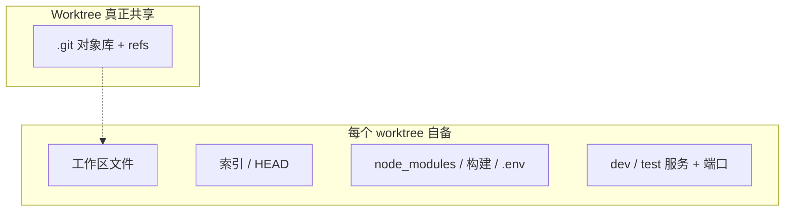

# Worktree 不是并行代理的万灵药

通用（不限工具）

**一句话看懂**：Vasisht Sankar 说 git worktree **只隔离工作区、索引和 HEAD，真正贵的依赖与服务要重建**；大仓上“一代理一 worktree”可能比多开终端更亏。他改用**冷 clone 干活 + 一台常温验证机拉分支验收**。

## 读完你能带走的 5 条收获

1. **Worktree 共享的是对象库与 refs**；工作区、索引、未跟踪的 `node_modules` / 构建产物 / `.env` 都要新建或复制（见 3.1）。
2. **同一分支不能同时被两个 worktree checkout**（见 3.1）。
3. **环境才是成本**：大前端安装、起服务、抢固定端口——worktree 省下的那点 git 历史相对可忽略（见 3.2）。
4. **轻仓或热修仍适合 worktree**；环境昂贵时形状就反了（见 3.3）。
5. **替代：每代理一个冷 clone 推分支；一台暖 checkout 跑 dev/test，人按自己的节奏拉下来验**（见 3.4）。

::: tip 小白先懂这几个词
- [Worktree（工作树）](/glossary#worktree)：同仓第二工作目录；共享 `.git` 对象库。
- 对象库：commits / trees / blobs；通常比 `node_modules` 小。
- 冷 clone：只检出代码、不安依赖、不起服务的副本。
- 暖 checkout：一直装着依赖、跑着 dev/test 的那一份。
- 端口冲突：多环境抢同一配置端口。
:::

## 1. 基本信息

<SourceCard type="文章" title="Git Worktrees Aren't a Magic Bullet for Parallel Agents" author="Vasisht Sankar" date="2026-05-30" url="https://dryrun.blog/blog/worktrees-arent-a-magic-bullet/" />

| 项目 | 内容 |
|---|---|
| 链接 | https://dryrun.blog/blog/worktrees-arent-a-magic-bullet/ |
| 类型 | 个人工程博客（约 3 分钟阅读） |
| 作者 | Vasisht Sankar（dryrun） |
| 发布日期 | 2026-05-30（页面日期；JSON-LD 为 2026-05-31T00:00:00.000Z） |
| 使用工具 | git worktree / 多 clone；文中对照 Claude Code 文档推荐 |
| 分析依据 | 原文全文，2026-10-27 抓取。仓体积与 GB 数为作者自述工作环境；无对照实验。“我觉得”开头的段落是本站评论。 |

## 2. 这篇在回答什么

Worktree 正在流行：官方文档也推荐，一代理一树、各开分支、互不撞车。作者认为卖点跳过了内部机制——在**重型应用**上，机制就是全部故事。不懂共享了什么、复制了什么，按教程做可能比开始更糟。

## 3. 怎么做

### 3.1 Worktree 实际共享什么

`git worktree add ../feature a-branch` 把分支检出到新目录，几乎瞬间，因为背后是已有仓库。每个 worktree 自有工作区、索引、`HEAD`；全体共享一份 `.git`。因为每个都把 `HEAD` 钉在某分支上，**两个 worktree 不能同时占用同一分支**（`fatal: 'branch' is already checked out at ...`）。

共享的只有对象库与 refs。未跟踪的一切——`node_modules`、构建输出、`.env`、缓存——要么缺失要么重做。

<Trans zh="它共享的那部分，也就是提交历史，从来不是昂贵的部分。它不共享的部分，才是让大型应用变慢的一切。">“The part it shares, your commit history, is the part that was never expensive. The part it doesn’t share is everything that makes a large app slow.”</Trans>

### 3.2 重量在哪里

新 worktree 里的代理不能靠现成环境验收：自己装依赖、起自己的 dev/test。对真实应用，这等于**整套工作环境再付一遍**。

他描述的仓：前端上百万行、盘上约 9.5GB（其中 `node_modules` 近 5GB）；背后服务各数十万行、数 GB；工作集近 10GB；服务要固定端口，第二环境要改映射才能并存。git 历史通常远不到 1GB——worktree 省的只有这块。

### 3.3 什么时候 worktree 仍值钱

依赖轻、安装秒级、没有长驻服务的小仓——多数教程默认的场景。或热修时不想动已暂存改动，比 `git stash` 干净。共同点：**环境便宜或可复用**。环境一旦变贵，worktree 就不回本。

### 3.4 他实际怎么并行

1. **每代理一个 clone**：只要代码，不安依赖、不起服务；便宜可扔。
2. 代理在 clone 里干活并**推分支到远端**。
3. **一台暖 checkout** 长期开着，dev/test 对着它跑。
4. 人按自己的节奏把各分支拉进来验证。

改用 clone 的理由之一：worktree **不能** checkout 暖副本已经占用的分支；分开的 clone 各自可以。原先觉得多余的远端往返，变成干净路径——活像同事一样经 git 到达。

收束：

<Trans zh="这并不表示 worktree 不好。它表示它是有形状的工具，而那个形状碰巧和我的工作方式打架。">“None of this makes worktrees bad. It makes them a tool with a shape, and that shape happens to fight mine.”</Trans>

我觉得这是对 [[23]]、[[89]]、[[100]] 的必要解毒剂：那些文默认“隔离工作区 = 并行成功”。在依赖和端口昂贵的仓里，先量环境成本，再选 worktree 还是冷 clone + 暖验证机。[[11]] 直接多 checkout 的路线，和这篇更近。

## 4. 结果与局限

- **证明了什么**：机制层面的取舍讲清楚；给出可操作的替代布局。
- **没证明什么**：无 A/B 数据；9.5GB 等为个人仓画像，换仓比例不同。
- **局限**：短文；未展开 monorepo 缓存、远程暖机、容器化复用等折中。

## 5. 结论

Worktree 防的是共享可变工作区的事故，不是免费复制整套运行环境。并行策略要贴着你的成本形状选。

**你可以这样试**：估一下「从空目录到测试绿」要几分钟、多少盘；若 > 数分钟或数 GB，试一代理一冷 clone + 一台暖机验收，对比一代理一 worktree 的墙钟时间。

**读完自测**：你的并行方案省下的是 git 历史，还是 `node_modules` 与端口？暖机上的分支会不会挡住 worktree？
