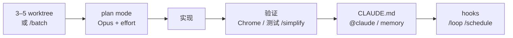

# 官方 power tips：验证优先与并行 worktree

<div class="meta-tags"><span class="tool-tag tool-claude">Claude Code</span></div>

<div class="hook">

**一句话看懂**：Claude Code 团队把自己的日用做法收成一份 tips：**若只学一件就学验证**；最大生产力解锁是 **3–5 个各自 worktree 的并行会话**，再用 `/batch`、`isolation: worktree`、`/simplify`、`/loop` / `/schedule` 把迁移、复盘与定时活接上。

</div>

## 读完你能带走的 7 条收获

1. **官方把验证标成整篇唯一的「必学一件」**：给 Claude 自查输出的手段，它才会自己迭代到对（见 3.3）。
2. **最大解锁是并行 3–5 个会话，每个独占 git worktree**；CLI 用 `claude --worktree`，可加 `--tmux`（见 3.1）。
3. **大迁移用 `/batch` 或子代理 `isolation: worktree`**：访谈后扇出，各测各的、各自开 PR（见 3.1）。
4. **复杂任务先 Shift+Tab 进 plan mode**；团队默认 Opus + thinking，复杂活把 `/effort` 调到 xhigh 或 max（见 3.2）。
5. **纠正立刻写回 CLAUDE.md**；PR 里 `@claude` 把 nit 固化成规则，叫 Compounding Engineering（见 3.4）。
6. **改完追加 `/simplify`**：并行代理按复用、质量、效率、CLAUDE.md 合规扫一遍（见 3.3）。
7. **本地 `/loop`（最长约 3 天）与云端 `/schedule` 分工**：笔记本合上也能跑的活进云（见 3.5）。

::: tip 小白先懂这几个词
- [Worktree（工作树）](/glossary#worktree)：同一仓库的第二份工作目录，分支与工作区隔离。
- [Subagent（子代理）](/glossary#subagent)：主会话派出去的隔离工人；可设 `isolation: worktree`。
- [Plan Mode（计划模式）](/glossary#plan-mode)：先写计划再改代码；Claude Code 用 Shift+Tab 切入。
- [Skills（技能包）](/glossary#skills)：`.claude/skills/` 下的可复用流程；`/simplify`、`/loop` 等为自带技能。
- [Hooks（钩子）](/glossary#hooks)：在工具调用前后等生命周期点确定性执行的脚本。
- [/loop（循环任务）](/glossary#loop)：按时间间隔本地重复跑同一提示或技能。
- 验证闭环：让代理自己用浏览器、测试或命令检查产出，而不是只写摘要。
:::

## 1. 基本信息

<SourceCard type="文章" title="Claude Code power user tips" author="Claude Code team（Anthropic Help Center）" date="2026-10-20" url="https://support.claude.com/en/articles/14554000-claude-code-power-user-tips" />

| 项目 | 内容 |
|---|---|
| 链接 | https://support.claude.com/en/articles/14554000-claude-code-power-user-tips |
| 类型 | Anthropic 官方 Help Center 文章（约 3,400 词） |
| 作者 | Claude Code team（Anthropic） |
| 发布日期 | 约 2026-10-20（页面显示 “Updated over a week ago”，无稳定 `datePublished`；抓取日据此标注） |
| 使用工具 | Claude Code CLI / Desktop / 移动端；git worktree；Chrome 扩展；官方插件市场 |
| 分析依据 | 原文全文，2026-10-28 抓取。文首声明多数命令为内置或随 CLI 附带技能；社区插件（如 ralph-wiggum）未经 Anthropic 审定；沙箱、远程、定时云任务、语音等可能被组织策略关闭。目录提到 auto-dream，正文只展开 `/memory`，附录列 `/dream`——本站不编造 dream 机制。“我觉得”开头的段落是本站评论。 |

## 2. 这篇在回答什么

你会用 Claude Code 改文件了，但一天开多条线时仍容易卡在两头：中间没有自检手段，代理写完就交卷；并行时共用一个工作目录，分支互相踩。

官方把答案说得很直：

<Trans zh="本指南里影响最大的一条，就是验证——给 Claude 一种检查自己产出的办法。如果你只采纳一种做法，就选这一条。">“The single most impactful tip in this guide is verification—giving Claude a way to check its own output. If you only adopt one practice, make it that one.”</Trans>

主线不是又一篇功能清单，而是一个人怎么把官方日用串成环：**并行隔离 → 计划与模型 → 验证闭环 → 记忆复利 → 钩子、定时与远程**。它和 [[100]] 的个人 brief、[[101]] 的票闸门、[[102]] 的环境成本警告互补：那边是「人怎么写任务」，这边是「产品已经为并行和验证准备了哪些开关」。



## 3. 怎么做

### 3.1 并行：worktree、isolation 与 /batch

团队写明最大生产力解锁是：**同时跑 3–5 个 Claude 会话，每个在自己的 git worktree 里**。Claude Code 自带 worktree：

- CLI：`claude --worktree` 或 `claude --worktree my_worktree`；加 `--tmux` 可进独立 Tmux。
- Desktop：Code 标签里勾 worktree。
- 非 git（Mercurial / Perforce / SVN）：在 `settings.json` 里定义 `WorktreeCreate` / `WorktreeRemove` hook。

定向技巧：给 worktree 起名、用 `za` / `zb` / `zc` 之类别名跳转、终端标签着色、开通知；许多人留一棵专用「分析」树只读日志和跑查询。

子代理也可以进隔离树。在 agent 的 frontmatter 写 `isolation: worktree`：

```
# .claude/agents/worktree-worker.md
---
name: worktree-worker
model: haiku
isolation: worktree
---
```

然后用自然语言扇出，例如：把同步 IO 迁到异步，批量改，起 10 个带 worktree 隔离的并行代理；每个端到端自测再开 PR。

更大的迁移用 `/batch`：它先访谈你，再按需扇出「几十、几百甚至更多」worktree 代理；各自隔离、自测、独立开 PR。示例：

```
> /batch migrate src/ from JavaScript to TypeScript
```

我觉得这是把 [[23]]、[[89]] 一类「一任务一树」收成官方原语；但 [[102]] 提醒过：worktree 只省对象库，不省 `node_modules` 与端口——大仓上先估环境成本，再决定扇出宽度。

### 3.2 先计划，再用够强的模型与 effort

复杂任务：Shift+Tab 切入 plan mode，把力气花在计划上，再切到自动接受编辑让 Claude 一次做完。团队几个习惯：

- 一个 Claude 写计划，再开第二个当 staff engineer 审计划。
- 一偏航就退回 plan mode 重规划，不要在半路硬拧。
- 计划结束后会话会按工作内容自动命名；也可 `claude --name "auth-refactor"`。

模型选择上，团队理由写得很干脆：

<Trans zh="这是我用过最好的编程模型；虽然比 Sonnet 更大更慢，但因为你要盯的更少、工具用得更好，最终几乎总是比用小模型更快。">“It's the best coding model I've ever used, and even though it's bigger & slower than Sonnet, since you have to steer it less and it's better at tool use, it is almost always faster than using a smaller model in the end.”</Trans>

账是：少 steering + 更好的工具使用 = 端到端更快。Effort 用 `/effort`：low / medium / high / xhigh / max / auto。复杂编程与代理活用 xhigh（比 high 更深、又不到 max 的全量 token）；难调试或架构用 max，且按会话开，因为更耗额度。

催产出的三句推回也很具体：

- <Trans zh="就这些改动拷问我，在我通过你的测验之前不要开 PR。">“Grill me on these changes and don't make a PR until I pass your test.”</Trans>
- <Trans zh="向我证明这能工作。">“Prove to me this works.”</Trans>（让 Claude 对比 `main` 与功能分支的行为）
- <Trans zh="以你现在知道的一切，推倒重来，实现那个优雅方案。">“Knowing everything you know now, scrap this and implement the elegant solution.”</Trans>

会话进行中的旁问用 `/btw`：单轮、不调工具、但仍有完整对话上下文，例如 `/btw what does the retry logic do?`。

### 3.3 验证是 #1：浏览器、Desktop 与 /simplify

原则：验证因领域而异（bash、测试套件、模拟器、浏览器），但都要投领域化闭环——Claude 能自己收口，才会迭代到对。

前端：装 Claude Code Chrome 扩展。原文类比：让人做网站却不给浏览器，成品大概不会好看；有浏览器就会改到好看为止。团队做网页代码时每次都用；文档入口在 `code.claude.com/docs/en/chrome`。Desktop 应用还自带：自动起 web 服务器并在内置浏览器里测。

改完后把 `/simplify` 接在提示末尾：并行代理审查变更的复用、质量、效率与 `CLAUDE.md` 合规。示例：`hey claude make this code change then run /simplify`。

这和 [[100]]「Done = 命令不是摘要」、[[95]] 的验收优先同向，只是官方把浏览器与 `/simplify` 写成了默认菜单，而不是个人 skill 名。

### 3.4 记忆复利：CLAUDE.md、@claude、auto-memory

仓库根放一份进 git 的共享 `CLAUDE.md`，全组共改。关键习惯：Claude 做错一次，就写进去，避免再犯。每次纠正结尾加：

<Trans zh="更新你的 CLAUDE.md，这样你不会再犯这个错。">“Update your CLAUDE.md so you don't make that mistake again.”</Trans>

原文说 Claude 很擅长给自己写规则。再装 GitHub Action（`/install-github-app`），在 PR 评论里 `@claude` 把 nit 固化进 `CLAUDE.md`，例如「永远别用 enum，用字面量联合」——文中称作 **Compounding Engineering**：每次纠正让未来所有会话更好。

`/memory` 打开内置记忆：自动保存偏好、纠正与模式到 `~/.claude/projects/<repo>/memory/`（按 git 根分目录），与手写的用户级 / 项目级 `CLAUDE.md` 分开；命名类比 REM 睡眠把短时记忆巩固成长时。有人还会让 Claude 维护任务/项目 notes 目录，每次 PR 后更新，再让 `CLAUDE.md` 指向它。

一天超过一次的流程做成 skill：`.claude/skills/<name>/SKILL.md`（旧路径 `.claude/commands/` 仍可用）。常见代理文件丢进 `.claude/agents/`（如 `build-validator`、`code-simplifier`、`verify-app`）；只读代理可用 `claude --agent=` 加载，tools 仅 `Read`。运行时可在请求末尾加 “use subagents”，或把权限请求经 hook 交给 Opus 扫描后再自动放行安全项。

### 3.5 钩子、权限、/loop 与 /schedule

Hooks 在生命周期点确定性跑逻辑。常用事件：`SessionStart` 动态加载上下文；`PreToolUse` 记 bash；`PostToolUse` 在 Write/Edit 后格式化防 CI 挂（示例 `bun run format || true`）；`PermissionRequest` 转到 Slack / WhatsApp / Opus；`Stop` 做确定性检查或催续跑；`PostCompact` 在压缩后再注入关键指令。

权限：用 `/permissions` 预放行安全命令并进团队 `.claude/settings.json`，支持 `"Bash(bun run *)"`、`"Edit(/docs/**)"` 等通配——官方推荐这比整段跳过权限更可审计。Auto mode 用分类器代做许可裁决；随时 Shift+Tab 切换。`/sandbox` 三档：沙箱 Bash + 自动放行 / 沙箱 Bash + 常规权限 / 无沙箱。长任务：做完用后台代理验证，或用 `Stop` hook（可审计时更推荐）；沙箱环境可用 `--permission-mode=dontAsk` 或 `--dangerously-skip-permissions`。社区 ralph-wiggum 插件文中有提，但开篇已声明未经 Anthropic 审定。

本地定时：`/loop` 最长约 3 天。团队例子：

```
/loop 5m /babysit         # auto-address review, rebase, shepherd PRs
/loop 30m /slack-feedback # auto put up PRs for Slack feedback
/loop 1h /pr-pruner       # close out stale PRs
```

云端：`/schedule` 在笔记本合上后仍跑，例如每日扫昨日起的 PR、更新文档、用 Slack MCP 发到 `#docs-update`。文末提示：把最常用工作流做成 **skill + loop** 很有用。

远程：`claude --teleport` / `/teleport` 把云会话接回本机；`/remote-control` 用手机或网页控本地；`claude remote-control` 从移动端起本地会话（Pro / Max / Team / Enterprise，CLI v2.1.51+）。SDK 非交互路径加 `--bare`，启动大约快 10×（文称早期设计疏忽，未来默认会翻成 bare）。多仓用 `--add-dir` 或 settings 里 `additionalDirectories`。

## 4. 结果与局限

- **证明了什么**：一份可核对的官方命令与模式目录；验证被明确标成 #1；并行、批量迁移、简化审查、本地/云定时都有可抄命令。
- **没证明什么**：无对照实验或团队吞吐数字（「产出显著增加、审查成瓶颈」为定性自述）；`/batch`「几百个代理」无公开规模案例。
- **局限**：Help Center 持续更新、无稳定发布元数据；能力受组织策略与 CLI 版本约束；社区插件需管理员许可；大仓并行仍受 [[102]] 环境成本约束。宣传性定制（spinner verbs、Ghostty）宜一笔带过。

## 5. 结论

官方 tips 的重心很清楚：先给代理自检手段，再用 worktree 换一人多线，其余是记忆复利与定时自动化。它不是另一套个人神话，而是产品已经暴露的开关表。

**你可以这样试**：下一周网页改动强制走 Chrome 扩展或 Desktop 内置浏览器验收；复杂任务 Shift+Tab 出计划后再干；收工固定跑一次 `/simplify`；试 `claude --worktree` 开第二条线；把重复的 babysit 收成 `/loop 5m` 技能。

**读完自测**：你现在的「做完了」有没有代理自己跑过的检查？并行会话是否各自独占工作区？上次纠正有没有写回 `CLAUDE.md`？
