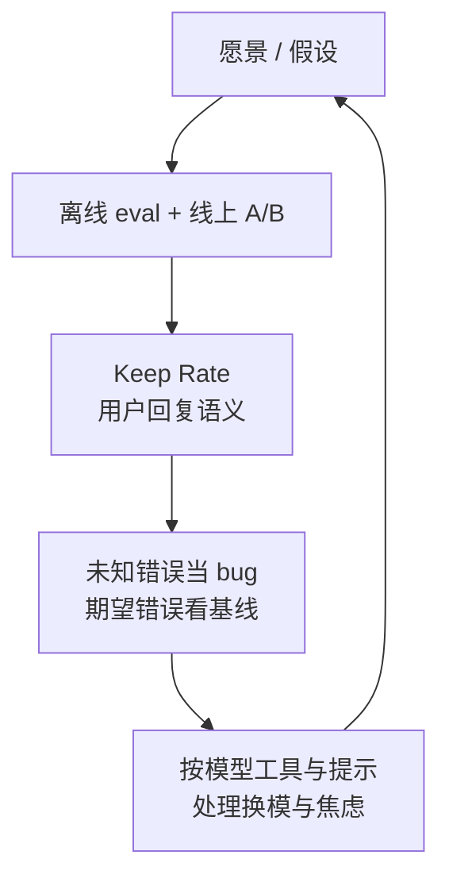

# 持续改进 harness：Keep Rate 与按模型定制

Cursor

**一句话看懂**：Cursor 把代理 harness 当产品迭代——用 **Keep Rate**（代理写出的代码过一段时间还留在仓里多少）和用户回复语义补评测缺口；把**未知工具错误当 bug** 清到数量级下降；并按模型配训练时的工具形状，处理 **context anxiety** 与中途换模。

## 读完你能带走的 6 条收获

1. **上下文组装已从「护栏 + 大量静态上下文」退到「少量静态 + 动态拉取」**（见 3.1）。
2. **评测不够时，用线上 A/B；质量信号用 Keep Rate + 读用户回复的语义满意度**（见 3.2）。
3. **未知工具错误 = harness bug**；期望错误按因分类，并按「每工具 × 每模型」建基线做异常告警（见 3.3）。
4. **一次冲刺把意外工具错误压低一个数量级**，靠日志技能、工单与 Cloud Agents 批量修（见 3.3）。
5. **按模型发放它训练时的编辑格式**（patch vs 字符串替换），否则多耗推理 token、更多错（见 3.4）。
6. **中途换模会撞上分布外历史与缓存未命中**；默认建议整段对话留在同一模型，或改派带新上下文的子代理（见 3.5）。

::: tip 小白先懂这几个词
- [Harness（代理外壳）](/glossary#harness)：包在模型外、拼请求、调工具、管上下文的程序。
- Keep Rate：代理提出的代码改动，在固定时间间隔后仍留在用户代码库中的比例。
- [Context Anxiety（上下文焦虑）](/glossary#context-anxiety)：窗口将满时模型拒活或改口说任务太大（本篇为 Cursor 观察；站内亦见长任务场景）。
- Context rot：失败工具调用留在上下文里，浪费 token 并拖累后续决策。
- CursorBench：Cursor 自有的标准化评测套件，与公开基准并列。
:::

## 1. 基本信息

<SourceCard type="文章" title="Continually improving our agent harness" author="Stefan Heule & Jediah Katz" date="2026-04-30" url="https://cursor.com/blog/continually-improving-agent-harness" />

| 项目 | 内容 |
|---|---|
| 链接 | https://cursor.com/blog/continually-improving-agent-harness |
| 类型 | Cursor 研究博客（页面标注约 11 分钟） |
| 作者 | Stefan Heule、Jediah Katz |
| 发布日期 | 2026-04-30 |
| 使用工具 | Cursor 代理 harness；CursorBench；线上 A/B；Cloud Agents；Linear |
| 分析依据 | 原文全文，2026-10-28 抓取。Keep Rate 的具体时间间隔与阈值、数量级冲刺的绝对前后值原文未给出。文中 “context anxiety” 与站内 [[16]] 长任务场景同名、场景不同，成稿分开表述。“我觉得”开头的段落是本站评论。 |

## 2. 这篇在回答什么

模型换代很快，但「同一个模型在不同外壳里」手感可以差一截。Cursor 的做法不是押一次大重构，而是：

愿景驱动 → 形成假设 → 做实验 → 用评测与真实用量的定量、定性信号迭代；拿到新模型早期访问时，花数周按该模型的长处与怪癖改 harness，直到「同一模型 + 特调外壳」明显更快、更聪明、更省。

偶有阶跃，更多时候是把小优化叠上去。主线四个问题：**窗口怎么装、怎么量好坏、错误怎么清、模型怎么特供**。相对 [[54]] 的 token 五项、[[33]] 的 Bugbot、[[93]] 的用户侧 guides/sensors，这篇独特在 Keep Rate、错误分类工厂、按模型定制与中途换模。

## 3. 怎么做

### 3.1 上下文窗口：护栏退场，动态进场

和模型交互的核心是上下文窗口：系统提示与工具描述 → 当前对话状态 → 用户请求。Cursor 说，填充与管理这扇窗的方式，在产品史上已经大幅演进。

2024 年末做编码代理时，模型还不擅长自己选上下文，于是投入大量 context engineering 做护栏——例如每次编辑后把 lint / 类型错误喂回代理、文件读得太少就改写其读取、甚至限制单轮最多能调多少工具。会话开头还塞大量**静态**上下文：仓库目录树、与查询语义匹配的片段、用户附加文件的压缩版。

然后：

<Trans zh="这些大多已经不复存在了。">“That is mostly long gone.”</Trans>

现在仍留一点有用的静态信息（操作系统、git 状态、当前与最近打开的文件），但方向是：模型变强后拆掉护栏，提供更多**可在工作中动态拉取**的上下文。更早一篇博文写过动态上下文技术（文称已被其他编码代理采纳）；当前工作重点是给代理更多动态取上下文、与世界交互的方式。

我觉得这和 [[54]]「系统提示可删、工具可延迟加载」是同一趋势的两面：外壳从「替模型决定」退到「让模型来取」，但取什么、何时取，仍是 harness 的产品选择。

### 3.2 两套评估：Keep Rate 与用户回复语义

Harness 与模型 jointly 决定代理好不好，但「好」难钉死。Cursor 叠了几层测量：

- 公开基准 + 自有 **CursorBench**：快、可跨时间比；但仍只是真实用量的近似。
- 线上：并排部署两种以上 harness 变体做 A/B。延迟、token 效率、工具调用次数、缓存命中率有方向意义，却答不好「是不是真干好了」。

于是补两条更贴「干没干好」的信号：

**Keep Rate**：对代理提出的一组代码改动，在固定时间间隔后，还留在用户代码库里的比例。用户手工改掉，或再叫代理修，说明首轮质量偏低。

<Trans zh="对代理提出的一组代码改动，我们跟踪在固定时间间隔之后，其中还有多大比例仍留在用户的代码库里。">“For a given set of code changes that the agent proposed, we track what fraction of those remain in the user’s codebase after fixed intervals of time.”</Trans>

**语义满意度**：用语言模型读用户对代理首轮产出的回复——继续做下一功能是强正面信号；粘贴 stack trace 是可靠负面信号。

线上实验也会叫停看起来很美的主意：他们试过更贵的模型做上下文摘要，代理质量几乎没差，不值成本。

我觉得 Keep Rate 是少见的「代码是否留下」产品指标。个人做不到同规模遥测，但可以给自己定一个粗糙版：合并一周后，代理那次 diff 还剩多少——用来校正「当时觉得不错」的错觉。

### 3.3 错误分类与「软件工厂」式修复

模型与能力变多，harness 状态空间变大，许多 bug 只能在规模上看到。工具调用是最宽的错误面：代理常能自纠，但错误仍留在上下文里，浪费 token，并造成 **context rot**——累积失误拖累后续决策；有时一次失败就会卡住或完全跑偏。调用量与错误率不直接等于「干好了」，却是指向系统问题的指示器。

原则写得很硬：

<Trans zh="任何未知错误都代表 harness 里的 bug，我们也按这个标准对待。">“Any unknown error represents a bug in the harness, and we treat it accordingly.”</Trans>

分类原则：

| 类型 | 含义 | 处置 |
|---|---|---|
| Unknown | 一律视为 harness bug | 任一工具的未知错误率超固定阈值就告警 |
| Expected | 如错误编辑、读不存在的文件 | 按因归类，用相对基线的异常检测 |

期望错误的标签包括：`InvalidArguments`、`UnexpectedEnvironment`（模型失误或上下文自相矛盾）、`ProviderError`（如 `GenerateImage` / `WebSearch` 供应商故障），以及 `UserAborted`、`Timeout` 等，合起来覆盖大多数期望错误。

难点在期望错误也可能是 harness 真 bug：grep 超时可能是工具性能，也可能是仓太大 + 模型查询低效。对策是**按工具、按模型**算基线，期望错误显著高于基线才告警——因为不同模型搞砸工具调用的频率不同。

运维闭环：每周一次 Automation，挂上教模型翻日志的 skill，挖出新出现或近期飙升的问题，在 backlog 里建/更新带调查的工单；大量修复交给 Cloud Agents，也可从 Linear 直接触发。文称这是在给 harness 实例化自动化「软件工厂」：

<Trans zh="在今年早些时候一次集中冲刺里，我们把意外的工具调用错误压低了一个数量级。">“Over the course of a focused sprint earlier this year, we drove unexpected tool call errors down by an order of magnitude.”</Trans>

这比 [[09]] 讲 Codex 内部循环更偏生产运维，也比 [[33]] 的审查机器人更贴近「外壳自身的缺陷分类」。

### 3.4 按模型定制：训练时见过的工具形状

Harness 抽象对模型无关，但可对每个支持的模型深度定制。例子：OpenAI 模型按 **patch** 格式训练改文件，Anthropic 模型按**字符串替换**训练；两种都能用对方的工具，但给陌生格式会多耗推理 token、更容易错。所以 Cursor 给每个模型发放**它训练时用过的**工具格式。

定制还包括按提供商、甚至按模型版本的提示：OpenAI 更字面、更精确跟指令；Claude 更直觉、更能容忍不精确指令。新模型早期访问时，从最接近的现有模型 harness 起步，离线 eval 找困惑点、团队自用暴露问题，再改到愿意上线为止。

有时要对付真怪癖。他们观察到一种后来称为 **context anxiety** 的行为：

<Trans zh="随着上下文窗口被填满，它会开始拒绝干活，并含糊其辞说任务看起来太大了。">“As its context window filled up, it would start refusing work, hedging that the task seemed too big.”</Trans>

通过调整提示减轻了这一行为。（站内 [[16]] 也在长任务里讨论过同名现象；场景与缓解手段不同，不要混成同一篇实验。）

### 3.5 中途换模型：分布外历史与缓存

用户在一段对话中途换模型时特别难：行为、提示、工具形状都不同。Cursor 会自动切到该模型的 harness（定制提示与工具），但模型仍要把工具用在**另一模型产生的、相对其训练分布外的**对话历史上。

缓解：注入定制说明，告诉模型自己是中途接管，并引导它不要去调历史上出现、却不在自己工具集里的工具。其次，缓存按提供商与模型隔离，换模意味着缓存未命中，第一轮更慢更贵。他们试过换模时先摘要对话以减轻惩罚；但若用户已深入复杂任务，摘要会丢掉重要细节。因此原文一般建议：

<Trans zh="我们通常建议在整段对话里留在同一个模型，除非你有理由要切换。">“We generally recommend staying with one model for the duration of a conversation unless you have a reason to switch.”</Trans>

另一条绕开路径：改用**新上下文**的子代理，并直接指定模型——harness 近期已支持用户这样要求。

我觉得这条和「开多个并行会话」不打架：并行是多会话、多工作区；这里警告的是**同一条对话时间线里换脑**。需要不同模型特长时，派子代理比中途热切换更干净。

## 4. 结果与局限

- **证明了什么**：一套可叙述的 harness 改进环；Keep Rate 与语义满意度的定义清楚；错误分类名与 per-tool/per-model 基线可借鉴；编辑格式按训练发放的理由具体；中途换模的代价与建议明确。
- **没证明什么**：Keep Rate 间隔与曲线未公开；「数量级」无绝对前后错误率；贵摘要模型实验无具体数字；context anxiety 未指明是哪一个模型。
- **局限**：厂商自述；读者很难复现同规模线上工厂；未来多代理编排一节偏展望。相对 [[93]] 的用户侧词汇表，这篇更偏平台工程内部。

## 5. 结论

Harness 改进靠仪表与分类，不靠一次换模型。量「代码留下多少」和「用户下一句说什么」，比只看 benchmark 更贴日常；清未知工具错误、按模型发对工具，是平台方能做、自建者也该缩小版模仿的事。

**你可以这样试**：若自建或深度定制外壳——给工具错误打 unknown / expected 标签，并按模型分基线；记录代理 diff 在 1 天 / 7 天后的保留比例当私人 Keep Rate；对话中途换模前，改派指定模型的子代理，对比第一轮是否还要重讲上下文。

**读完自测**：你判断「代理变好了」靠的是感觉、benchmark，还是代码留下率？工具失败是当噪声，还是分成未知 bug 与期望失误？你最近一次中途换模，付的是缓存未命中还是丢细节？
