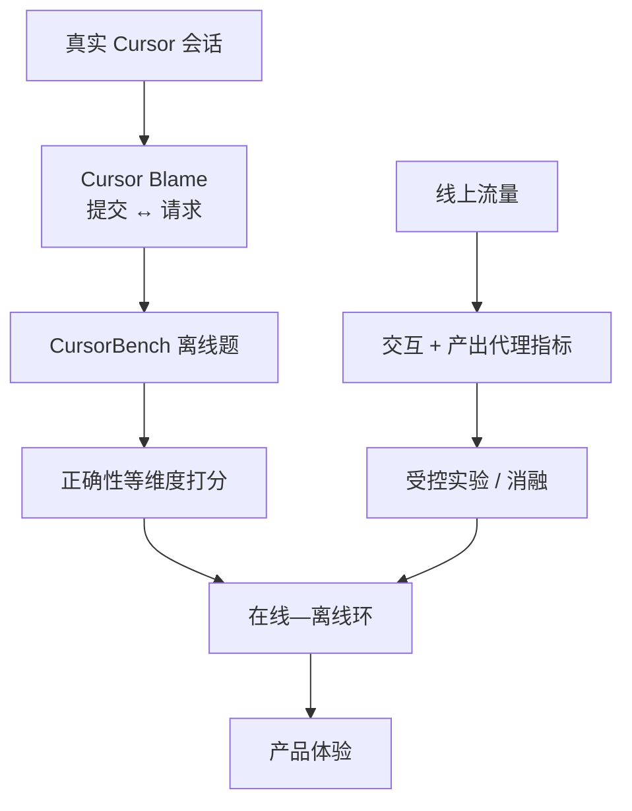

# CursorBench：离线评测要对齐真实用法

Cursor

**一句话看懂**：Cursor 的 Naman Jain 说明他们怎么用 **CursorBench（真实会话离线题）+ 线上受控分析** 组成在线—离线环：公开基准在对齐、打分、污染三处失灵；题从 Cursor Blame 回溯提交，故意写短、用 agentic grader 打分，并跟线上体验对齐。

## 读完你能带走的 7 条收获

1. **好基准要同时做到两件事**：能分开实践中表现不同的模型，又要对齐开发者真实感受（见 3.1）。
2. **公开离线评测常在三处失灵**：测错任务（对齐）、假定唯一正解（打分）、公开仓进训练集（污染）（见 3.1）。
3. **CursorBench 的题来自 Cursor Blame**：把已提交代码回溯到产生它的那次代理请求，得到「提问 ↔ 金标解」自然配对（见 3.2）。
4. **任务描述故意写短**，贴近开发者欠规格的说法，再用 **agentic graders** 可靠打分（见 3.2）。
5. **从初版到 CursorBench-3，正确性评测的题规模大约翻倍**（代码行数与平均文件数），并高于若干 SWE-bench 变体（见 3.2）。
6. **线上看一组代理结果指标的同向变化**，而不是优化单一分数；能抓住「离线 grader 觉得对、人用起来更差」的回归（见 3.3）。
7. **分数只在同一评测版本内比**：2026 年 5 月起生产版是 CursorBench 3.1，题分布变了就不能跟本文旧图横比（见 3.4）。

::: tip 小白先懂这几个词
- [Eval（评测）](/glossary#evals)：用固定或滚动的任务集给代理打分。
- [Benchmark（基准测试）](/glossary#benchmark)：可横向比较的题集；公开仓题容易污染。
- [Harness（外壳）](/glossary#harness)：评测或产品里代理能用的工具与环境。
- Cursor Blame：把提交里的代码追溯回当时那条代理请求的内部工具。
- Agentic grader：再用一个代理（或代理流水线）给欠规格任务打分，而不是只靠唯一补丁比对。
- Online-offline loop：离线题库与线上流量指标互相校准的闭环。
:::

## 1. 基本信息

<SourceCard type="文章" title="How we compare model quality in Cursor" author="Naman Jain" date="2026-03-11" url="https://cursor.com/blog/cursorbench" />

| 项目 | 内容 |
|---|---|
| 链接 | https://cursor.com/blog/cursorbench |
| 类型 | Cursor 研究博客（约 7 分钟阅读） |
| 作者 | Naman Jain（Cursor） |
| 发布日期 | 2026-03-11（文内另有 2026 年 5 月关于 CursorBench 3.1 的更新说明） |
| 使用工具 | Cursor 代理；CursorBench / Cursor Blame；线上受控实验 |
| 分析依据 | 原文全文，2026-10-28 抓取；页面注明 CursorBench 持续更新、当时生产版为 3.1。抓取文本正文重复一份，按单篇处理。文中图表的具体分数点原文未列表给出，故不编造。同作者稍后的 [[86]] 讲公开仓「查答案」，论题不同可对照。“我觉得”开头的段落是本站评论。 |

## 2. 这篇在回答什么

你在公开榜上看模型 A 略高于模型 B，但在自己的 IDE 里体感完全反过来——该信榜，还是信手感？

Cursor 的答案是：把「模型质量」钉在**开发者真实在 Cursor 里做的事**上。离线用基于真实会话的 CursorBench；线上用活流量上的受控分析；两者互相校验。

作者开宗明义：

<Trans zh="在 Cursor，我们用混合的在线—离线评测流程，让我们对模型质量的理解与开发者实际在做的事保持对齐。">“At Cursor, we use a hybrid online-offline eval process to keep our understanding of model quality aligned with what developers actually do.”</Trans>

主线不是再发一张 SWE-bench 表，而是：**公开基准为何不够 → 题怎么造 → 为何更能分开模型并贴合线上 → 下一步要评长时代理**。

## 3. 怎么做

### 3.1 公开基准的三种失灵

作者认为，好基准必须：在实践中表现不同的模型上**拉出差距**，并且和开发者**实际体验**对齐。公开离线评测两边都吃力。

**对齐（alignment）**：代理已经在做跨文件、多工具、多步骤的活，静态或错位的题却还在测别的东西。多数 SWE 基准仍偏重修 bug；Terminal-Bench 则强调偏谜题的任务，例如「从棋盘局面找最佳棋步」。作者觉得这些都**不太对齐**开发者让代理做的编码工作。

**打分（grading）**：许多公开题假定正解集合很窄，而真实需求往往欠规格、允许多种合法做法。于是基准要么惩罚另一种正确路径，要么硬塞合成要求去掉欠规格——两者都测不准真实表现。

**污染（contamination）**：SWE-bench Verified、Pro、Multilingual 的题都来自最终会进训练数据的公开仓库，分数被抬高。文中写到：OpenAI 在发现前沿模型能凭记忆复现金补丁、且未解问题里近 60% 测试有缺陷后，**已完全停止汇报 SWE-bench Verified 结果**。

结果是：到了前沿档位，这些基准再也分不开对开发者效用差很多的模型。

我觉得这和 [[86]] 是同一条问题链上的两环：#86 量的是**运行时查答案**；这里讲的是题本身是否测错、是否被记住、是否打分过窄。只收紧网络或删 `.git` 救不了「题就不像真实用法」。

### 3.2 用 Cursor Blame 造题，故意写短

CursorBench 的任务来自 **Cursor Blame**：把已提交代码追溯到产生它的那次代理请求，于是自然得到「开发者提问 + 地面真值解」。许多题来自内部代码库与受控来源，降低模型在训练里见过它们的风险；题库每隔几个月刷新，以跟上用法变化。

难度在涨：正确性评测的题规模从初版到当时的 **CursorBench-3**，按代码行数与平均文件数计大约**翻倍**；CursorBench-3 的题涉及的行数也明显高于 SWE-bench Verified / Pro / Multilingual。作者承认行数是粗糙难度代理，但增长反映他们纳入了更难的场景——多 workspace 的 monorepo、查生产日志、做长时实验等。

另一点刻意为之：任务描述**故意写短**，对照公开基准里那种详细 GitHub issue；打分则靠 **agentic graders**，以便在欠规格设定下仍能可靠评分。

<Trans zh="我们的任务描述故意写得很短，与公开基准里那些详细的 GitHub issue 形成对照，并且我们用 agentic graders 来可靠地给它们打分。">“Our task descriptions are intentionally short, in contrast with the detailed GitHub issues sourced in public benchmarks, and we use agentic graders to reliably score them.”</Trans>

套件还覆盖正确性以外的维度：代码质量、效率、交互行为；本文图表焦点是正确性。

### 3.3 拉开差距，并跟线上对齐

题更复杂、规格更像真人之后，基准才「有用」：在公开基准日益饱和的前沿档，CursorBench 能拉出更大分离度；有时像 Haiku 这类模型也能在题上追平甚至超过 GPT-5。作者强调：它能稳定区分开发者体感上就不同的模型。

线上评测问的是：改代理是否**真的帮到人**。他们跟踪一组代理结果的高层次代理指标（含交互与产出质量），看**多项是否同向动**，而不是死磕单一指标。聚合之后，才能抓住「离线 grader 给高分、产品里却更差」的回归。

归因靠受控实验。例如迭代语义搜索 / 检索时，他们做过**整段去掉语义搜索工具**的消融，从而定位它最关键的场景——更大代码库上的仓库接地问答。

作者的结论是：CursorBench 排名也更贴近他们用线上指标测到的、开发者在 Cursor 里的模型质量体验。

### 3.4 版本更迭与下一套题

文首与文内更新写明：CursorBench 随能力持续改版；抓取时生产版是 **CursorBench 3.1**。2026 年 5 月更新说 3.1 换了更难的题分布，**分数可能相对本文图表偏移，只应在同一评测版本内比较**。

图表纵轴是正确性、横轴是中位 completion tokens，用来同时看效果与算力 / 延迟；右上角代表「高表现、低成本」的理想区。文中没有给出可逐点抄写的坐标表，这里只保留解读方式。

局限也写清楚了：即便 CursorBench-3 比公开基准更长，题仍在**单会话**内结束。作者预期未来一年，绝大部分开发工作会转到在自己电脑上跑的长时代理，并计划相应改造 CursorBench——需要更便宜的打分、解决与外部服务交互时的可复现性，并继续缩小离线评估与真实体验的缝。

## 4. 结果与局限

**文中真正立住的主张**：

- 公开基准在对齐、打分、污染上的三类失灵，以及 OpenAI 停报 SWE-bench Verified 的转述理由（含近 60% 未解项测试有缺陷）。
- Cursor Blame 题源、短描述 + agentic grader、题规模约翻倍到 CursorBench-3。
- 离线分离度与线上代理指标 / 消融示例构成的在线—离线环。
- 3.1 版本不可与旧图横比；下一阶段要面向长时代理。

**注意**：

- CursorBench 是内部套件，读者不能直接跑同一题库；能带走的是方法，不是排行榜数字。
- 正确性以外的维度本文几乎没给数据。
- 「Haiku 有时匹敌或超过 GPT-5」是作者对分离度的举例，不是一张可复现的公开表。
- 与 [[86]] 同作者、同厂商叙事，读时分开论题，避免合成一条未写出的因果链。

## 5. 结论

公开榜饱和之后，再卷同一个修 bug 题集，分不出你产品里该上的模型。Cursor 的做法是：题从真实提交回溯、规格故意像人话、离线与线上互相找对方的盲区，并且**分数跟着题库版本走**。

**你可以这样试**

1. 选 20～50 条自己仓库里「代理改过并已合并」的请求，做成迷你 Blame 题（提问 + 最终 diff）。
2. 任务说明只保留人当时那句话，不要事后写成完美 issue；另设独立验收或人工 / 代理 grader。
3. 上线改动时固定看 3～5 个体验代理指标是否同向，而不是只看离线正确率。
4. 换题库难度或分布时，旧分与新分分开存，不画在同一条趋势上。

**读完自测**

1. 公开基准的对齐、打分、污染分别指什么？各举一例。
2. Cursor Blame 如何得到「提问 ↔ 金标」配对？
3. 为什么故意把任务写短，还要上 agentic grader？
4. 线上评测要抓哪类离线抓不住的回归？
5. 为什么 CursorBench 3.1 的分不能直接和本文旧图比？

