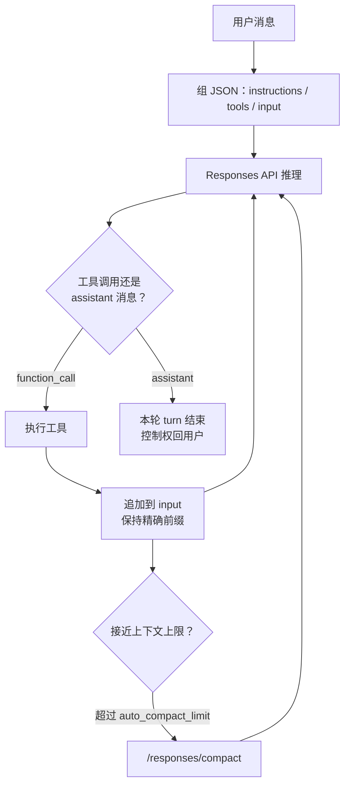

# 拆开 Codex 的 agent loop：提示、缓存与压缩

Codex

**一句话看懂**：OpenAI 的 Michael Bolin 从客户端把 Codex harness 的 **agent loop** 拆开：Responses API 上怎么拼 `instructions` / `tools` / `input`、为什么历史必须是精确前缀才能吃到 **prompt caching**、为何不用 `previous_response_id`（无状态 + ZDR），以及上下文满了以后 `/responses/compact` 怎么自动压一轮。

## 读完你能带走的 8 条收获

1. **一轮 turn = 用户输入到一条 assistant 消息**：中间可以有很多次「推理 ↔ 工具」；软件代理的主产出常常是磁盘上的代码，但循环仍以 assistant 消息收束（见 3.1）。
2. **你几乎从不手写最终 prompt**：客户端交 `instructions`、`tools`、`input`，Responses 服务端决定如何排成模型吃的「条目列表」（见 3.2）。
3. **首轮 `input` 在用户话之前先塞四类东西**：shell 沙箱说明（developer）、可选 `developer_instructions`、聚合的 AGENTS / skills「用户指令」、以及 cwd + shell 的环境上下文（见 3.2）。
4. **Codex 自带 shell 的沙箱说明只管 shell**；MCP 等其它工具不由 Codex 沙箱，须自带护栏（见 3.2）。
5. **旧 prompt 必须是新 prompt 的精确前缀**，后续请求才能命中 prompt caching；采样成本才能接近线性而非二次（见 3.3）。
6. **故意不用 `previous_response_id`**：请求保持无状态，并兼容 Zero Data Retention；推理的 `encrypted_content` 仍可在服务端解密（见 3.4）。
7. **缓存未命中的常见凶手**：对话中途改 `tools`、换 `model`、改沙箱 / 审批 / cwd；MCP 工具列表顺序不稳或中途 `tools/list_changed` 也会很贵（见 3.4）。
8. **超阈值就 compact**：早年靠手动 `/compact` 摘要；现在走 `/responses/compact`，返回含 `type=compaction` 与不透明 `encrypted_content` 的条目，并在超过 `auto_compact_limit` 时自动调用（见 3.5）。

::: tip 小白先懂这几个词
- [Harness](/glossary#harness)：包在模型外、负责组提示、跑工具、管上下文的运行框架；Codex CLI 就是。
- [Agent loop](/glossary#harness)：用户 ↔ 模型推理 ↔ 工具执行，直到产出 assistant 消息的主循环。
- [Responses API](/glossary#responses-api)：Codex 用来做模型推理的 HTTP API（可换端点）。
- [Prompt Caching（提示缓存）](/glossary#prompt-caching)：精确前缀命中时复用已算过的 prompt 前缀，降低后续采样成本。
- [Compaction（上下文压缩）](/glossary#compaction)：上下文将满时把 `input` 换成更短但仍代表对话的条目列表。
- ZDR（Zero Data Retention）：提供方不保留客户请求数据的配置；与「服务端记住 previous_response_id」冲突。
:::

## 1. 基本信息

<SourceCard type="文章" title="Unrolling the Codex agent loop" author="Michael Bolin" date="2026-01-23" url="https://openai.com/index/unrolling-the-codex-agent-loop/" />

| 项目 | 内容 |
|---|---|
| 链接 | https://openai.com/index/unrolling-the-codex-agent-loop/ |
| 类型 | OpenAI 工程博客（系列首篇；约 3,400+ 词） |
| 作者 | Michael Bolin（Member of Technical Staff） |
| 发布日期 | 2026-01-23 |
| 使用工具 | Codex CLI / Codex harness、Responses API、MCP、`~/.codex/config.toml`、AGENTS.md |
| 代码 | https://github.com/openai/codex（文中亦指向相关 PR，如 #642、#1641） |
| 分析依据 | 原文全文，2026-10-28 抓取。HTML 抓取时部分代码块行号与正文穿插，**引语与结构只采用可逐字核对的叙述段落与文内文档摘录**；不把残缺代码「整理」成伪原文。文末相关推荐条可能被截进同一文件，不视为正文。“我觉得”开头的段落是本站评论。 |

## 2. 这篇在回答什么

你已经会用 Codex 改代码，但未必说得清：每一轮请求里到底塞了什么？为什么换了个 MCP 或改了工作目录，模型突然又慢又「健忘」？上下文满了时，harness 默默做了什么？

Bolin 把问题收成一句：agent（或他们口中的 harness）在 LLM 之外到底扮演什么角色。本文是 Codex 系列的第一篇，专门拆 **agent loop**。

术语上，「Codex」涵盖 CLI、Cloud、VS Code 扩展；正文聚焦**为所有体验垫底的 harness 与执行逻辑**，并约定下文里「Codex」与「Codex CLI」可互换。

和 [[09]] 的演讲鸟瞰相比，这篇更偏**客户端组包与性能纪律**；和 [[43]] 的 app-server 相比，这篇站在 Responses 这一侧。

## 3. 怎么做

### 3.1 agent loop：推理、工具，直到 assistant 消息

每个 AI 代理心里都有一个 **agent loop**。简化版是：

1. 收下用户输入，写进即将送给模型的文本指令（prompt）；
2. **推理（inference）**：prompt 变成 input tokens → 采样 → output tokens 再变回文本（常边生成边流式展示）；
3. 模型要么给出对用户的最终回复，要么请求一次工具调用（例如「跑 `ls` 并回报」）；
4. 若是工具：agent 执行，把输出追加进 prompt，再问模型；
5. 重复，直到模型不再发工具调用，而是发出一条给用户的消息（在 OpenAI 模型里叫 **assistant message**）——它可能直接作答，也可能是反问。

因为工具能改本机环境，软件代理的「主产出」常常是写下或改过的代码；尽管如此，**每一轮 turn 仍以一条 assistant 消息结束**，用来标记循环终止、把控制权交回用户。

从用户输入到 agent 回复，叫对话的一轮 **turn**（Codex 里是 thread 的一截）。一轮里可以夹很多次推理↔工具。你往已有对话再丢新消息时，**历史（含先前消息与工具调用）会进入新一轮的 prompt**。对话越长，prompt 越长；而每个模型都有 **context window**（单次推理的 input+output token 上限）。代理一轮里理论上可打出上百次工具调用，所以**管上下文是 harness 的职责之一**。

### 3.2 第一轮 prompt：instructions、tools、input

Codex CLI 用 HTTP 调 **Responses API** 做推理；端点可配：

| 登录 / 模式 | 端点 |
|---|---|
| ChatGPT 登录 | `https://chatgpt.com/backend-api/codex/responses` |
| API key（OpenAI 托管模型） | `https://api.openai.com/v1/responses` |
| `--oss` + gpt-oss（ollama 0.13.4+ 或 LM Studio 0.3.39+） | 默认 `http://localhost:11434/v1/responses` |
| 云厂商（如 Azure）托管的 Responses | 按配置 |

终端用户**不会**把最终采样用的 prompt 一字不差写进请求；你提供若干输入类型，由 Responses 服务端决定如何排成模型设计要吃的「条目列表」。

条目带 **role**，权重大致从高到低：`system`、`developer`、`user`、`assistant`。

Bolin 聚焦 JSON 里三项：

- **`instructions`**：插入模型上下文的 system（或 developer）消息。Codex 若在 `~/.codex/config.toml` 配了 `model_instructions_file` 就读它，否则用该模型的 `base_instructions`（仓库里按模型打包，例如 `gpt-5.2-codex_prompt.md`）。
- **`tools`**：符合 Responses schema 的工具列表——CLI 自带的（如 `shell`、`update_plan`）、Responses 侧提供给 Codex 的（如网页搜索）、以及用户经 MCP 挂上的。
- **`input`**：文本 / 图像 / 文件输入列表。

在用户那句话之前，Codex 会先往 `input` 里塞：

1. **`role=developer` 的沙箱说明**——**只作用于 Codex 提供的 `shell` 工具**。MCP 等其它工具不由 Codex 沙箱，要自己执行护栏。内容来自 CLI 打包的 Markdown 片段（如 `workspace_write.md`、`on_request.md`）：沙箱与网络、何时向用户要权限、可写目录列表等。
2. **可选** `developer_instructions`（来自用户 `config.toml`）。
3. **可选「用户指令」**：不是单文件，而是多层聚合，**更具体的更靠后**——`$CODEX_HOME` 下的 `AGENTS.override.md` / `AGENTS.md`；再从 Git/项目根走到 `cwd`（默认总限约 32 KiB）收集 `AGENTS.override.md`、`AGENTS.md` 或 `project_doc_fallback_filenames`；若配置了 skills，再追加简短前言、各 skill 元数据、以及「怎么用 skills」一节。
4. **`role=user` 的环境上下文**：当前工作目录与用户的 shell。

然后才追加真正的用户消息。服务端用整包 JSON 派生最终 prompt 时：前三项的**顺序**由服务端定；其中只有 **system 文本**也由服务端控，`tools` 与 `instructions` 的内容仍来自客户端；再接上客户端的 `input`。

我觉得这和「把一切塞进一个巨大 system prompt」的直觉相反：角色分层 + 服务端固定前缀，既是产品安全边界，也是后面缓存策略的地基。

### 3.3 多轮如何长：SSE、工具结果、精确前缀

首轮请求后，服务端以 **SSE** 流式返回，`data` 里是带 `"type"` 且以 `"response"` 开头的事件（推理摘要 delta、`output_item.added`、`output_text.delta`、`response.completed` 等）。Codex 消费后转成内部事件：delta 喂 UI 流式；`output_item.added` 一类则变成对象，**追加进下一次** Responses 调用的 `input`。

若第一次响应里有 `type=reasoning` 与 `type=function_call`，下一次带着工具结果再问模型时，这些条目必须出现在 `input` 里，并配上对应的 `function_call_output`。

关键纪律：

<Trans zh="请特别注意：旧的 prompt 是新 prompt 的精确前缀。这是有意为之，好让后续请求高效得多，因为这样我们才能利用 prompt caching。">“In particular, note how the old prompt is an exact prefix of the new prompt. This is intentional, as this makes subsequent requests much more efficient because it enables us to take advantage of prompt caching”</Trans>

一轮在收到 assistant 消息时结束；用户若继续，则把上一条 assistant 消息与新的 user 消息再追加进 `input`，开启新 turn——`input` 继续变长。

### 3.4 性能：为什么不用 previous_response_id，什么会打穿缓存

整段对话若每次都重发完整 JSON，流量确实接近二次。Responses API 有可选参数 **`previous_response_id`** 可缓解，但：

<Trans zh="Codex 今天不用它，主要是为了让请求完全保持无状态，并支持 Zero Data Retention（ZDR）配置。">“Codex does not use it today, primarily to keep requests fully stateless and to support Zero Data Retention (ZDR) configurations.”</Trans>

无状态也减轻提供方负担。ZDR 客户若要服务端存「上一响应」会与 ZDR 冲突；他们仍能受益于先前轮次的专有推理内容，因为相关 **`encrypted_content` 可在服务端解密**（OpenAI 保留 ZDR 客户的解密密钥，但不保留其数据）。相关改动见 PR #642、#1641。

采样成本通常远高于网络，所以优化盯在 **prompt caching**：命中时后续采样更接近线性。文中引用官方缓存文档的要点：

::: tr 缓存命中只可能发生在 prompt 的精确前缀匹配上。要把指令与示例等静态内容放在前面，用户相关等可变内容放在后面；图像与工具在请求间也必须完全一致。
> "Cache hits are only possible for exact prefix matches within a prompt. To realize caching benefits, place static content like instructions and examples at the beginning of your prompt, and put variable content, such as user-specific information, at the end. This also applies to images and tools, which must be identical between requests."
:::

Codex 里典型的 **cache miss** 来源：

- 对话中途改模型可用的 **`tools`**；
- 换 Responses 请求的目标 **`model`**（实际会改到原始 prompt 里带模型专用 instructions 的那一项）；
- 改 **沙箱配置、审批模式或当前工作目录**。

作者举例：早期 MCP 支持曾因**工具枚举顺序不稳定**导致未命中。MCP 还可能在长对话中途通过 `notifications/tools/list_changed` 改工具列表——若立刻遵从，可能触发一次昂贵的 cache miss。

能追加就追加：沙箱 / 审批变更时插入一条格式与原先沙箱说明相同的新 `role=developer` 消息；cwd 变更时插入一条与原先 `<environment_context>` 同格式的新 `role=user` 消息——**不要改写更早的条目**，以免打断前缀。

### 3.5 上下文满了：从手动 /compact 到 auto compact

总策略：token 数超过阈值就 **compact**——用更短、但仍代表对话的新 `input` 列表替换旧列表，让代理带着迄今为止的理解继续。

早期实现要用户手动 `/compact`：在对现有对话加上摘要用自定义指令后再问 Responses，把得到的摘要 assistant 消息当作后续 `input`。

之后 Responses 提供专用 **`/responses/compact`** 端点，更高效；返回的条目可直接替换旧 `input`，其中包含特殊的 **`type=compaction`** 项和不透明的 **`encrypted_content`**，用来保留模型对原对话的潜在理解。现在当超过 **`auto_compact_limit`** 时，Codex 会**自动**走该端点。

系列预告还会写 CLI 架构、工具实现与沙箱模型——那些留给后续篇，不在本文展开。

## 4. 结果与局限

**文中立住的工程事实**：

- agent loop / turn 的终止条件与上下文管理职责；
- 可配置 Responses 端点与首轮 `instructions` / `tools` / `input` 组装顺序；
- 精确前缀 ↔ prompt caching，以及不用 `previous_response_id` 的 ZDR / 无状态理由；
- 三类（加 MCP）缓存未命中与「追加消息吸收配置变更」；
- compact 从手动摘要到 `/responses/compact` + `auto_compact_limit`。

**局限与注意**：

- 抓取文本里工具 JSON 示例有行号噪声，本文不以「干净代码块」冒充原文；要抄字段请回官方文或仓库。
- 未给缓存命中率、平均 turn 长度、auto compact 触发频率等生产数字。
- `previous_response_id`「今天不用」是发文时状态，实现可能演进，以仓库与文档为准。
- 与 [[09]] 互补：那边有 skills 占比、Auto Review、`/goal`；这边有组包与缓存纪律。

## 5. 结论

Codex 的「聪明」有一半不在模型里，而在 harness：把角色与工具排对、把历史当成**不可破坏的前缀**、在 ZDR 约束下用重传换无状态、在窗口边缘用官方 compact 续命。你自己做代理时，把「中途改工具列表」当成性能事故来设计，往往比再调一句 system prompt 更管用。

**你可以这样试**

1. 读一次自己代理客户端组装的首轮 messages：静态块是否永远在前、用户话是否在最后。
2. 给「改 cwd / 改权限」做测试：是追加说明，还是重写了第 1 条 system——后者多半打穿缓存。
3. 固定 MCP 工具排序；对 `tools/list_changed` 决定是立即生效还是延后到新 thread。
4. 为上下文使用设阈值，并确认有自动 compact 或等价摘要路径，而不是静默截断。

**读完自测**

1. 为什么软件代理每轮仍要以 assistant 消息结束？
2. `input` 里用户话之前固定有哪几类条目？沙箱说明管哪些工具？
3. 精确前缀与 prompt caching 什么关系？
4. Codex 不用 `previous_response_id` 的两个主要理由是什么？
5. `auto_compact_limit` 触发后，服务端返回里特殊的 `compaction` 项起什么作用？

