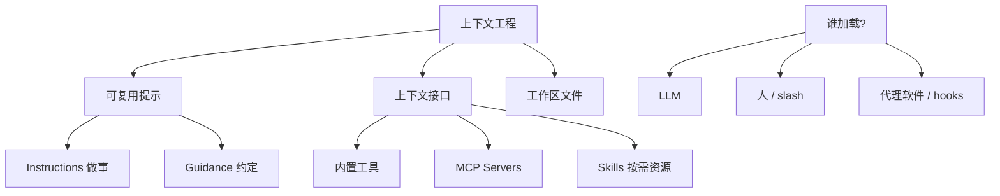

# 编码代理的上下文工程：配置面地图

Claude Code

**一句话看懂**：Böckeler 把编码代理「上下文工程」收成一张配置面地图——可复用提示（指令 vs 指引）、上下文接口（工具 / MCP / Skills）、谁决定加载、以及如何刻意做小；再用 Claude Code 的 CLAUDE.md / Rules / Skills / Hooks 等做对照，并提醒：这提高概率，不是确定性控制。

## 读完你能带走的 7 条收获

1. **上下文工程 = 策展模型看见什么**，编码场景落在配置特性 + 你怎么用它们（见 3.1）。
2. **可复用提示可分两类意图**：叫它做事的 Instructions，与通用约定的 Guidance（见 3.1）。
3. **上下文接口告诉模型「还能去哪取」**：工具、MCP、Skills；配得越多，常驻占用越大（见 3.2）。
4. **加载者有三类**：LLM 自决、人触发、代理软件在确定性时点注入（见 3.3）。
5. **上下文要渐进做小**：半年来模型变强，旧规则未必还要塞；工具侧也有压缩与 Tool Search（见 3.4）。
6. **Claude Code 特性可落到「是什么 / 谁加载 / 何时用」表上**；slash 已 deprecated，作者预期 Skills 还会吸收 rules（见 3.5）。
7. **别把配置面当成「确保 / 防幻觉」**：仍要想概率，并选对人工监督强度（见 3.6）。

::: tip 小白先懂这几个词
- [Context Engineering](/glossary#context-engineering)：策展模型看见什么，以换更好结果。
- [CLAUDE.md](/glossary#claude-md)：会话常驻的主规则文件。
- [Skills](/glossary#skills)：按需加载的说明 / 脚本 / 资源包。
- [MCP](/glossary#mcp)：把数据源与动作以结构化工具暴露给代理。
- [Hooks](/glossary#hooks)：挂在生命周期事件上的确定性脚本。
- [Subagent](/glossary#subagent)：独立上下文窗口里跑的侧任务。
:::

## 1. 基本信息

<SourceCard type="文章" title="Context Engineering for Coding Agents" author="Birgitta Böckeler" date="2026-02-05" url="https://martinfowler.com/articles/exploring-gen-ai/context-engineering-coding-agents.html" />

| 项目 | 内容 |
|---|---|
| 链接 | https://martinfowler.com/articles/exploring-gen-ai/context-engineering-coding-agents.html |
| 类型 | Thoughtworks / Martin Fowler 站工程文章（Exploring Gen AI 系列备忘） |
| 作者 | Birgitta Böckeler（Thoughtworks Distinguished Engineer） |
| 发布日期 | 2026-02-05 |
| 使用工具 | 以 Claude Code 为示例；对照 Cursor、GitHub Copilot、Roo 等 |
| 分析依据 | 原文全文，2026-10-29 抓取。“我觉得”开头的段落是本站评论。系列前后文导航不计入论据。 |

## 2. 这篇在回答什么

配置编码代理的旋钮越来越多：规则文件、Skills、MCP、Hooks、子代理、插件……人容易要么全塞进一个巨大 `CLAUDE.md`，要么从网上下一堆配置却说不清「谁在什么时候读了什么」。

Böckeler 给的是一张**配置面地图**：先分清「塞进模型的文本」意图是什么、哪些是「告诉模型还能去哪取更多」、谁决定加载、体量怎么控；再用 2026 年 1 月前后的 Claude Code 特性做对照。

主线与 [[92]] 互补：[[92]] 教「七种通道怎么选」；本篇先建 taxonomy，并强调加载者与体量。和 [[93]] 的引导/传感器词汇不同，本篇仍落在**打地基的配置面**，不进看原理。

## 3. 怎么做

### 3.1 策展看见什么：指令 vs 指引

同事 Bharani 的定义被直接引用：

::: tr 上下文工程就是策展模型看见什么，好让你得到更好的结果。
> "Context engineering is curating what the model sees so that you get a better result."
:::

对编码代理，地基是工具提供的配置特性（如 rules、skills），「脏活」是概念上怎么用（specs、工作流）。几乎所有上下文工程最终都是一堆带提示的 Markdown。作者把意图粗分成两类：

- **Instructions**：叫代理做一件事，例如「按如下方式写 E2E 测试」。
- **Guidance**（亦称 rules / guardrails）：通用约定，例如「测试之间要彼此独立」。

两类常会掺在一起，但分开想仍有用：一个是「这次任务剧本」，一个是「项目宪法」。

### 3.2 上下文接口与工作区文件

作者找不到现成词，自造了 **context interfaces**：告诉 LLM「它若决定要更多，该怎么取」。三类：

- **Tools**：内置能力（bash、搜文件等）。
- **MCP Servers**：本机或远端程序，结构化暴露数据源与动作。
- **Skills**：最新一批；描述可按需加载的资源、说明、脚本等——模型认为相关时再拉。

配得越多，它们本身就越占上下文；要按任务战略性地选。最基本也最强的接口仍是读文件与搜索——所以「代码库对 AI 友好」本身就是上下文工程的一部分。

我觉得这把「多挂几个 MCP 就更强」的直觉拧回来了：每个接口描述都是税，不是免费保险。

### 3.3 谁决定加载

三维里的「何时」拆成三类决策者：

| 决策者 | 含义 | 例子 |
|---|---|---|
| LLM | 无人值守的前提；但「会不会在我们期望时加载」仍有不确定性 | Skills |
| Human | 可控，自动化程度下降 | Slash commands |
| Agent software | 在确定性时点由软件触发 | Claude Code hooks |

无监督代理依赖「LLM 自决」；硬约束则倾向 hooks 一类由软件保证发生的路径——这与 [[92§3.4]]「必须发生的别靠提示词」同向。

### 3.4 刻意做小

目标是平衡：太少不行，太多也不行。窗口变大 ≠ 可以无差别倾倒。代理在上下文过载时效果下降，成本也上升。

开发者侧：配置建多少、每份写多长。建议**渐进**堆规则，一上来别灌太多；半年来模型变强，旧内容可能已不必要。工具侧：会话历史压缩、工具表示优化（如 Claude Code 的 Tool Search Tool）。透明度——上下文多满、谁占多少——是导航这平衡的关键功能。

### 3.5 Claude Code 配置面对照

文中以 2026 年 1 月左右的 Claude Code 为例，把特性落进「是什么 / 谁加载 / 何时用」：

| 特性 | 意图 | 谁加载 | 何时用（摘要） |
|---|---|---|---|
| CLAUDE.md | Guidance | 软件：会话起始终用 | 全项目最常重复的约定（如用 yarn 不用 npm） |
| Rules | Guidance | 软件：配置路径的文件被加载时 | 模块化指引、按路径收窄（如 `**/*.sh`） |
| Slash commands | Instructions | 人 | 人想在主上下文触发的长提示任务；**已 deprecated，由 Skills 取代** |
| Skills | 指引 / 指令 / 文档 / 脚本… | LLM（按描述）或人 | 懒加载相关约定；文件夹里可挂更多资源 |
| Subagents | 指令 + 模型/工具配置；独立上下文 | LLM 或人 | 值得隔离上下文、换模型、或只要特定 MCP 的任务 |
| MCP | 结构化数据源与动作 | LLM | 访问 API / 本机工具；趋势是部分能力被「描述如何用 CLI」的 Skills 取代 |
| Hooks | 脚本 | 生命周期事件 | 每次编辑/命令/MCP 后必须发生的事（如 prettier） |
| Plugins | 分发上述任意组合 | — | 组织内分发公共 commands / skills / hooks |

列表很长。作者认为仍在「storming」阶段，会收敛；并预期 Skills **不仅吸收 slash，也会吸收 rules**，从而少掉两行。这是作者预期，不是成稿时的已定事实。

分享配置时：分享者与接收者上下文越像越好（团队内远好过网上陌生人）；别一上来复制粘贴过度工程；不同经验水平要不同规则；低意识复制会重复或自相矛盾，却怪代理「没用」——它其实在执行**你的**指令。

### 3.6 控制的幻觉

名字叫 engineering，执行仍取决于 LLM 怎么解释。上下文工程能提高有效结果的概率，但人们常说「ensure it does X」「prevent hallucinations」——只要有 LLM，就没有确定性：

::: tr 我们仍然需要按概率思考，并为这项工作选择合适的人工监督强度。
> "we still need to think in probabilities"
:::

（完整句：as long as LLMs are involved, we can never be certain of anything, we still need to think in probabilities and choose the right level of human oversight for the job.）

## 4. 结果与局限

- **真正给出的**：配置面 taxonomy + Claude Code 对照表 + 分享与监督边界；不是对照实验。
- **局限**：特性以 2026-01 前后 Claude Code 为锚，其他工具「也有类似物」是点到为止；Skills 吸收 rules 是预期；无「多少 token 最优」的数字。
- **注意**：与 [[93]] 同作者系列相邻文讲 harness 成本，本篇刻意停在配置面入门。

## 5. 结论

编码代理的上下文工程，先画地图再填内容：分清指令与指引、接口税、加载者，渐进做小；用 Claude Code 表做落地清单；最后接受——配置提高概率，不消灭不确定性。

**你可以这样试**

1. 打开现有 `CLAUDE.md`，标出哪些是 Guidance、哪些其实是 Instructions（后者更适合 Skills / 命令）。
2. 列一张「已挂 MCP / Skills」表，删掉本周任务用不到的常驻项。
3. 把「每次编辑后必须跑」的事从提示词挪到 hook（对照 [[28]]）。
4. 团队分享配置前，先对齐技术栈与经验水平，避免陌生人配置整包粘贴。

**读完自测**

1. Instructions 与 Guidance 各举一个你项目里的例子。
2. Skills 与 Hooks 的加载者分别是谁？
3. 为什么「窗口变大了」仍不能无差别倾倒上下文？
4. 「ensure / prevent hallucinations」说法错在哪？
