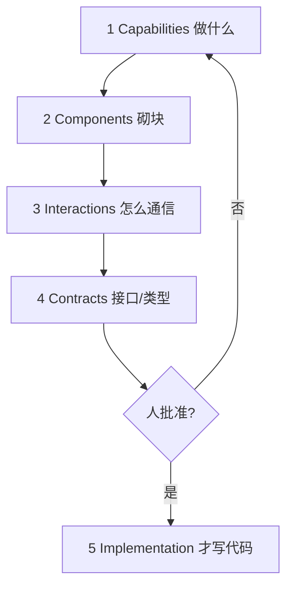

# 先设计再写代码：五级对齐

通用（不限工具）

**一句话看懂**：Rahul Garg 把人机结对里「先白板再键盘」重建成五级设计对话——Capabilities → Components → Interactions → Contracts → Implementation；硬约束是 **Level 5 批准前不写代码**，用来躲开 AI 默认跳进实现、把设计决策埋进 diff 的 Implementation Trap。

## 读完你能带走的 7 条收获

1. **Implementation Trap**：AI 把「做什么」和「怎么做」压成一步，设计决策静默嵌在实现里（见 3.1）。
2. **审查累，是因为一次要同时判范围 / 架构 / 集成 / 合约 / 代码质量**——大脑不是为此造的（见 3.1）。
3. **技术债注入**：未请求的限流、分析、webhook 等看起来合理，却扩大你必须维护的面（见 3.1）。
4. **五级从抽象到具体；硬规则：no code until Level 5 is approved**（见 3.2）。
5. **Components 层就能拦住错误抽象**（如多余的 RetryQueue 包住 BullMQ）（见 3.3）。
6. **Contracts 批准后可先生成测试再实现**——顺带走上 TDD 坡道（见 3.3）。
7. **按复杂度裁剪起点**；一句开场 prompt 可立起顺序纪律与项目约束（见 3.4）。

::: tip 小白先懂这几个词
- [Plan Mode](/glossary#plan-mode)：先对齐计划再改代码的工作方式；本篇用五级对话落实。
- [Spec](/glossary#spec)：可审查的规格；本篇的 Contracts 是其接口层形态。
- [Non-goals](/glossary#non-goals)：明确不做的范围；Capabilities 层就要对齐。
- Design-First：白板式分层对齐后再实现的协作模式（见正文）。
- Implementation Trap：AI 跳过设计检查点、把决策埋进代码的陷阱。
:::

## 1. 基本信息

<SourceCard type="文章" title="Design-First Collaboration" author="Rahul Garg" date="2026-03-03" url="https://www.martinfowler.com/articles/reduce-friction-ai/design-first-collaboration.html" />

| 项目 | 内容 |
|---|---|
| 链接 | https://www.martinfowler.com/articles/reduce-friction-ai/design-first-collaboration.html |
| 类型 | Thoughtworks / Martin Fowler 站文章（Patterns for Reducing Friction in AI-Assisted Development 系列） |
| 作者 | Rahul Garg（Thoughtworks Principal Engineer） |
| 发布日期 | 2026-03-03 |
| 使用工具 | 通用（任意编码助手）；文末 Lattice 产品侧栏一笔带过 |
| 分析依据 | 原文全文，2026-10-29 抓取。“我觉得”开头的段落是本站评论。Lattice 安装说明不展开。 |

## 2. 这篇在回答什么

和同事做复杂功能时，你们很少一上来敲键盘：先白板画组件、争数据流、定边界，对齐「系统要做什么」再谈「怎么建」。原则很简单：

::: tr 先白板，再键盘。
> "whiteboard before keyboard"
:::

换成 AI，这条原则整段消失。速度很诱人：描述功能，几秒拿到几百行实现。AI 可能完全懂「要做什么」（比如带重试的邮件通知），但**理解需求**和**一起设计怎么建**是两件事——AI 把它们压成一步，组件划分、是否复用现有设施、接口长什么样，全在沉默中决定。

主线：用五级检查点重建白板对话，让审查从「在 400 行里同时判五维」变成「每层只判一类决策」。

## 3. 怎么做

### 3.1 Implementation Trap 与看不见的设计成本

作者称之为 **Implementation Trap**：输出来得太快，思考设计与写代码之间的自然检查点消失。后果不只是代码不对齐，还有认知负担——你要在从未参与的设计决策缠成的实现里，一行行拆。

AI 其实**做了**设计（范围、边界、数据流、接口、错误处理），但决策沉默地嵌在实现里。你第一次看见它的设计思考，是在读代码——这是发现分歧最贵、最耗认知的地方。

这也解释了为何审 AI 代码比审同事更累：同事白板过后，你是在已知设计上审实现；AI 单提示生成时，你要同时评范围、架构、集成、合约与代码质量。Barry Boehm 的变更成本曲线同样适用：两分钟设计对话里抓住范围错位，远便宜于在 400 行生成代码里发现。

另有常被忽视的成本：AI 爱加功能。通知服务请求可能带回限流、分析钩子、webhook——作者称为 **technical debt injection**：你没要、却要审、测、维护；而且看起来干净合理，容易不假思索收下。

### 3.2 五级：从能力到实现

解法是重建人机白板：让隐含设计显式、可协作。五级由抽象到具体：

1. **Capabilities**——系统要做什么？只要核心需求，不要实现细节。
2. **Components**——砌块是什么？服务、模块、主要抽象。
3. **Interactions**——组件怎么通信？数据流、API、事件。
4. **Contracts**——接口是什么？函数签名、类型、schema。
5. **Implementation**——现在才写代码。

硬约束：

::: tr 在 Level 5 获批之前，不要写代码。
> "no code until Level 5 is approved."
:::

Level 1 是共享词汇检查：确认谈的是同一功能、同一范围。更深价值从 Level 2 起：边界 → 交互 → 合约。每层只想一类决策，认知负载被管住；心智模型像白板一样增量对齐。

没有这结构，AI 不像结对伙伴，更像进了隔壁房间独自做完全部决定、再捧着成品回来的同事。

### 3.3 实践：通知服务与 BullMQ

作者做通知服务时：故事范围是 v1 仅邮件、带重试与基本状态跟踪，栈里已有 BullMQ。Capabilities 先确认范围与明确不做的事。

Components 层 AI 提出五个组件，包括包住 BullMQ 的 **RetryQueue** 抽象——纸面干净，但不必要：BullMQ 自带指数退避重试。作者打回：直接用 BullMQ，不要包装。几秒内解决，因为还没有代码。这不是上下文缺口（AI 已知 BullMQ），而是「要不要在现有设施上再抽象」的设计分歧。

Interactions 随之更直：handler 入队 → worker 处理 → 重试原生处理。Contracts 层签好 `NotificationPayload`、`NotificationResult`、`EmailProvider`、`DeliveryTracker` 后，可以**先让 AI 写测试再写实现**——设计对话几乎副作用地创造了 TDD 前提。到 Level 5，范围已确认、架构贴合现有设施、合约已测：AI 在实现约定设计，而不是猜。

### 3.4 纪律、裁剪与开场 prompt

AI 被训成「快点交出可见产出」，会跳级：组件图里夹代码、合约旁附实现。纪律是说：

「停——我们还在 Level 2，只给我组件结构。」

不是每项任务都要五级。按复杂度裁剪：

| 复杂度 | 起点 | 例子 |
|---|---|---|
| 简单工具函数 | Level 4 Contracts | 日期格式化、字符串助手 |
| 单组件 | Level 2 Components | 校验服务、API 端点 |
| 多组件功能 | Level 1 Capabilities | 通知系统、支付集成 |
| 新系统集成 | Level 1 + 深挖 Level 3 | 第三方 API、事件管道 |

它与作者另文的 **Knowledge Priming**（开工前喂技术栈、约定、架构决策）相乘：Priming 给词汇，Design-First 给结构。今日不展开 Priming 全文。

一则开场 prompt 往往够用（括号填你的约束）：

开场 prompt 的关键纪律句：

::: tr 每一级分开呈现。进入下一级之前先等我批准。
> "Present each level separately. Wait for my approval before moving to the next."
:::

::: tr 合约谈妥之前不要代码。
> "No code until the contracts are agreed."
:::

完整开场模板在原文，把 Capabilities / Components / Interactions / Contracts 四行括号换成你的项目约束即可。

真价值在括号里的项目约束（「v1 仅邮件」「用现有 BullMQ」「函数式、不用 class」）——它们会贯穿每一级。团队可再编码成可复用指令。

文末 Lattice 的 design-first skill / design-blueprint 分子是产品封装，**一笔带过**：模式本身不依赖该产品。

代价：设计对话比直接要代码久；琐事不值；有学习曲线；deadline 下「直接要代码」的诱惑大。作者认为投资主要回在非琐碎工作——误解以小时计、架构要对齐、代码会长期维护的那种。

## 4. 结果与局限

- **证明的**：叙事案例（通知服务）与成本论证；无 A/B 吞吐数字。
- **局限**：依赖人维持「停在当前级」的纪律；与 priming 搭配效果更好，但 priming 是系列另文；Lattice 侧栏勿当成必须依赖。
- **边界**：简单工具函数从 L4 起即可，不必仪式性走满五级。

## 5. 结论

白板的价值从不是那张图，而是一层层对齐出来的共享理解。Design-First 把同一原则用到 AI：同范围、同组件、同交互、同合约之后，认知从「精疲力尽的警戒」转向「协作打磨」。最简版整套方法就一条约束——**设计谈妥前不写代码**。

**你可以这样试**

1. 下次非琐碎功能，把文中开场 prompt 填上你的四条约束再发出。
2. AI 一露代码就打回当前级；只在 L5 批准后允许实现。
3. Contracts 批准后先要测试再要实现，对照 [[25]]。
4. 琐事从 L4 起；对照 [[96]] 的规格块与 [[88]] 的 plan mode，选你团队的载体。

**读完自测**

1. Implementation Trap 指的是什么消失了？
2. 五级各拦哪类决策？硬约束原文是哪句？
3. 为何 RetryQueue 包装是设计分歧而不是「AI 不知道 BullMQ」？
4. 什么任务应从 Level 4 起步？
