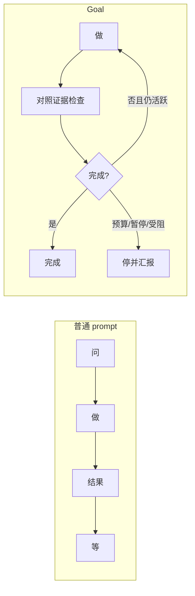

# Codex Goals：跨轮次的完成合约

<div class="meta-tags"><span class="tool-tag tool-codex">Codex</span></div>

<div class="hook">

**一句话看懂**：OpenAI Cookbook 介绍 Codex 的 **Goals**：给线程挂上持久目标——要达成什么、用什么证据验收、哪些约束不能破；Codex 在空闲且未超预算时可续跑，但**只有证据支持才能标完成**。适合路径不确定的长任务，不适合一句话改完的琐事。

</div>

## 读完你能带走的 8 条收获

1. **Goal = 作用域内、用户可控的完成合约**，不是无边界后台自治（见 3.1）。
2. **普通 prompt 说「下一步做这个」；Goal 说「一直做到该结果为真」**（见 3.2）。
3. **强 Goal 通常写清六件事**：结果、验证面、约束、边界、迭代策略、受阻停机条件（见 3.3）。
4. **生命周期命令**：`/goal`、`pause`、`resume`、`clear`；需 Codex **0.128.0+**（见 3.1）。
5. **激活后三变**：目标常可见；仅在线程空闲时续跑；完成必须基于证据（见 3.4）。
6. **Goal 是线程持久状态**，不是全局记忆或项目级指令（见 3.4）。
7. **研究类 Goal 要先定证据标准**，最终账本分开「已确认 / 近似 / 受阻 / 不确定」（见 3.5）。
8. **琐事、模糊终点、用 Goal 藏不确定性——都不要用**（见 3.6）。

::: tip 小白先懂这几个词
- [Goal](/glossary#codex-goal)：Codex 线程内的持久完成合约（本站术语）。
- [Agent Loop](/glossary#agent-loop)：推理与工具循环；Goal 在其上加续跑与完成审计。
- [Harness](/glossary#harness)：Codex CLI 等包在模型外的运行框架。
- Completion contract：结果 + 验证面 + 约束的可审计约定。
:::

## 1. 基本信息

<SourceCard type="指南" title="Using Goals in Codex: Persistent Objectives for Long-Running Work" author="OpenAI Cookbook" date="未标注稳定发布日（Cookbook）" url="https://developers.openai.com/cookbook/examples/codex/using_goals_in_codex" />

| 项目 | 内容 |
|---|---|
| 链接 | https://developers.openai.com/cookbook/examples/codex/using_goals_in_codex |
| 类型 | OpenAI Developers Cookbook 指南（Codex 示例） |
| 作者 | OpenAI Cookbook / Codex 文档（无具名 byline） |
| 发布日期 | 原文未给出稳定 `datePublished`；登记为空白，阶段内排末 |
| 使用工具 | Codex CLI（Goals 自 0.128.0）；`/goal` 命令面 |
| 分析依据 | 原文 Markdown 全文，2026-10-29 抓取。插图仅作结构理解，不把图注数字当实验数据。“我觉得”开头是本站评论。 |

## 2. 这篇在回答什么

Codex 已经擅长边界清楚的活：看仓、修 bug、加测试、解释失败。但有一类活——性能剖析、修了再测、复现 flaky、把研究问题变成有证据的审计——**下一步取决于刚学到的东西**。这类活缺的不是更大 prompt，而是**跨轮次仍盯着的目标**。



主线：把「Keep going / 再跑一遍 benchmark」变成显式完成合约；续跑可以，完成权仍在证据。

## 3. 怎么做

### 3.1 什么是 Goal，怎么启动

::: tr Goals 是 Codex 里的持久目标，让线程跨多轮仍朝既定结果工作。
> "Goals are persistent objectives in Codex that keep a thread working toward a defined outcome across turns."
:::

它给出完成条件：什么应为真、如何检查成功、哪些约束必须保持。它**不是**无边界后台自治，而是 scoped、用户可控的完成合约：可暂停、恢复、清除、完成，或被预算拦住。

候选：性能优化、flaky 调查、依赖迁移、需复现的排错、多步重构、benchmark 驱动调优、要最终产物的研究。一锤子编辑仍用普通 prompt。

```text
/goal Reduce p95 latency below 120 ms without regressing correctness tests
/goal          查看当前 Goal
/goal pause    暂停
/goal resume   恢复
/goal clear    清除
```

停机可能是：成功、暂停、清除、打断、预算、或需要用户输入的阻塞。若你发现自己每轮都在说 Keep going / Try the next likely fix / Run the benchmark again——该换成 Goal。

### 3.2 Goal 相对 prompt

普通请求：做完眼前指令 → 汇报 → 等。Goal：线程挂着耐久目标；一轮结束后对照证据，未满足且仍活跃、未超预算则可从最新状态继续。

文中心理模型：

::: tr Prompt：问 → 做 → 结果 → 等。Goal：做 → 检查 → 继续或完成。
> "Prompt:  ask -> work -> result -> wait"
:::

（同行还有 `Goal:    work -> check -> continue or complete`。）

### 3.3 怎么写强 Goal

强 Goal 通常定义六件事：

1. **Outcome**——结束时什么为真  
2. **Verification surface**——测试、benchmark、报告、产物、命令输出等证据  
3. **Constraints**——工作中什么不能回退  
4. **Boundaries**——可用文件、工具、数据、仓  
5. **Iteration policy**——每轮之后如何选下一步  
6. **Blocked stop condition**——无路可走时报告什么、缺什么输入

薄版本 vs 强版本（性能例）：

薄：`/goal Reduce p95 checkout latency below 120 ms without regressing correctness tests`

强：加上 verified by checkout benchmark、只用 checkout 服务与相关测试、迭代间记录变更与下一实验、benchmark 跑不了或无路时停并汇报尝试路径 / 证据 / 阻塞 / 下一输入。

写不清时可以两步：先用白话描述，让 Codex 起草 `/goal`，你再收紧成功条件与受阻条款。

### 3.4 激活后行为与架构边界

三件变化：

1. **目标保持可见**——测试红了、benchmark 进步但未达标、研究缺数据，都不丢原目标。  
2. **仅在空闲线程续跑**——另一轮进行中、已有用户输入排队、或其他线程工作未完时不续。  
3. **完成必须基于证据**——不能因为模型「觉得大概好了」就标完成。

架构上 Goal 是**持久的线程作用域状态**，不是全局记忆，也不是项目级指令。状态可 active / paused / complete / budget-limited。续跑是事件驱动、偏保守：仅 plan 的工作不触发续跑；打断会暂停目标；若续跑轮次未发工具调用，会抑制下一次自动续跑以免空转。预算触顶应停止实质性工作、总结进度与阻塞——**触顶 ≠ 完成**。模型可启动 Goal，并在证据支持时标完成；暂停 / 恢复 / 清除 / 预算转换仍由用户或系统掌控。

我觉得这和「让代理自己 while true」相反：产品把续跑权关在合约里，完成权关在证据里。

### 3.5 研究例：证据账本

弱研究 Goal：`/goal Reproduce Buehler et al., "Deep Hedging"`——没说哪节、什么叫复现、缺训练状态怎么办。

强版本要求：用可得材料做最强有证据的复现；尝试标题结果；最终报告分开 reproduced mechanics / approximate trained results / blocked exact replay / remaining uncertainty。

案例演示：可重建的机制与部分数值对照做成「接近的近似复现」；缺 seed / 训练路径 / checkpoint 的声称保持 blocked。账本条目示例字段：Claim / Route / Evidence surface / Status / Remaining uncertainty——避免把「像样的产物」说成「精确重放原实验」。

### 3.6 何时不用

- 一行编辑、简单解释、短审查、要一答即停 → 普通 prompt  
- 终点模糊（Make this better / 无测试与约束的 Refactor）  
- 用 Goal **藏**不确定性——数据可能缺失、benchmark 可能 flaky、是否允许代理证据，都要写进 Goal 并规定如何标注  

最强场景三者齐备：**耐久目标 + 基于证据的终点 + 可能需要多轮调查的路径**。

## 4. 结果与局限

- **给出的**：命令面、写作模板、架构边界、研究账本方法；Cookbook 叙事，无独立吞吐实验。  
- **局限**：需 0.128.0+；续跑策略随版本可能变；Deep Hedging 是方法演示，不是你领域的保证。  
- **与 [[110]]**：Goals 管「目标持久与完成审计」；修复环管「审查→修复→验证」相位——可组合，勿混成同一原语。

## 5. 结论

Goals 把线程从一串孤立 prompt，变成围着既定结果的有状态工作环。目标可持久，**是否完成仍由证据说了算**。

**你可以这样试**

1. 升级到 Codex 0.128.0+，对一个有 benchmark/测试的性能或 flaky 任务写一条含验证面与约束的 `/goal`。  
2. 故意写一条弱 Goal，再按六要素改强，对比续跑行为。  
3. 预算触顶时看它是否总结阻塞而非谎称完成。  
4. 研究任务先写证据分级，再激活 Goal。

**读完自测**

1. Prompt 与 Goal 的四步心理模型各是什么？  
2. 六要素里「Blocked stop condition」解决什么？  
3. 为什么 Goal 不能做成全局记忆？  
4. 举一个不该用 Goal 的任务。
