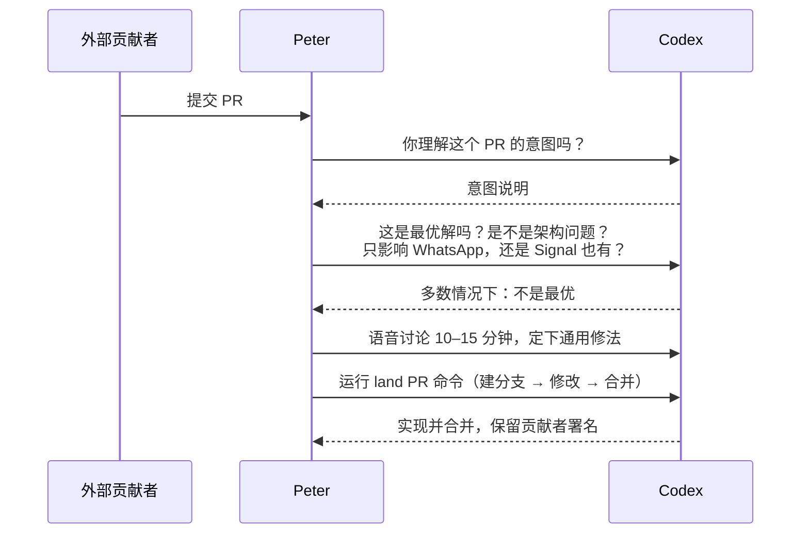

# Builders Unscripted Ep.1：Peter Steinberger 一个人怎么用代理撑起 OpenClaw

Codex

**一句话看懂**：OpenClaw 爆红时，作者 Peter Steinberger 基本是一个人在写，仓库里同时挂着 2000 个 PR。他的办法很朴素：设置保持简单，开 10 份 checkout 并行；每个任务先问代理“你有什么问题吗？”；审外部 PR 时先让代理讲清意图，再决定怎么修。他也坦白了公开部署时踩过的安全坑。

## 读完你能带走的 6 条收获

1. **代理第一次真正能用，是因为它能检查自己。** Peter 接上 Playwright 让代理边做边测，一小时后项目才跑起来（见 3.1）。
2. **别掉进“代理陷阱”。** 花时间打磨工具链感觉很高效，其实不然；他连 worktree 都不用，直接开 checkout 1 到 10（见 3.2）。
3. **每个任务都问一句 “Do you have any questions?”** 模型默认会自己做假设，而且每个新会话都对代码库一无所知（见 3.3）。
4. **不逐行读代码，但要对得上心智模型。** 他看代理的输出流，确认和脑子里的设计大致一致；性能有问题再集中处理（见 3.4）。
5. **外部 PR 先审意图，再审代码。** 先问代理“你理解这个 PR 想解决什么吗？这是最优解吗？”多数时候答案是“不是”（见 3.5）。
6. **给代理权限之前，先想清楚谁能跟它说话。** prompt injection 还没解决；他的 bot 被人暴露到公网，被评为 CVSS 10.0（见 3.6）。

::: tip 小白先懂这几个词
- [Codex](/glossary#codex)：OpenAI 的编码代理。
- [Playwright](/glossary#playwright)：能用代码操作浏览器的工具，接成 MCP 后代理能自己点测。
- [Worktree](/glossary#worktree)：一个仓库同时开多个工作目录；Peter 用的是更朴素的多份 checkout。
- [PR](/glossary#pr)：合并请求，Peter 戏称为 “Prompt Request”。
- [Slash Command](/glossary#slash-command)：以 / 开头的自定义命令。
- [Prompt Injection](/glossary#prompt-injection)：恶意指令藏在外部内容里，代理读到后可能照做。
:::

## 1. 基本信息

<YouTube id="9jgcT0Fqt7U" title="Builders Unscripted Ep.1" />

| 项目 | 内容 |
|---|---|
| 讲者 / 频道 | Peter Steinberger（PSPDFKit 创始人、OpenClaw 作者；录制于加入 OpenAI 之前），主持 Romain Huet（OpenAI Head of Developer Experience）／ 官方频道 **OpenAI** |
| 发布日期 | 2026-02-24 |
| 时长 | 31:28 |
| 形式 | 访谈，没有现场编码，但讲了大量真实工作流 |
| 使用工具 | Codex（GPT-5.2）、早期用 Claude Code、Playwright MCP、语音输入、自定义 slash command |
| 分析依据 | YouTube 人工英文字幕全文（yt-dlp android 客户端获取，2026-10-14）+ 官方章节 + 视频截图。英文引号内容是字幕原话，逐字照录；“我觉得”开头的段落是本站评论，不是讲者观点。 |

官方章节：0:00 OpenClaw 现象 → 4:24 第一次 AI 突破 → 7:58 构建代理 → 10:45 自主解决问题 → 12:58 Discord bot 与安全 → 18:09 新的编码方式 → 21:45 不读代码就发布 → 24:03 管理开源 → 29:14 给开发者的建议。

## 2. 这篇在回答什么

先看两个数字。主持人说，Peter 过去一年在 GitHub 上有

<Trans zh="在 120 多个项目上有 9 万次贡献">“90,000 contributions on more than 120 projects”</Trans>

而他的开源个人代理 OpenClaw，几周前还不存在，录制时已经有上千人来参加社区活动 ClawCon，仓库里挂着约 2000 个开放的 PR。Peter 说：

<Trans zh="就是我一个人在洞里写代码">“It's just me hacking from my cave.”</Trans>

<figure class="shot"><figcaption>📷 视频截图 · <a href="https://www.youtube.com/watch?v=9jgcT0Fqt7U&t=78s" target="_blank" rel="noopener">1:18</a> · 访谈从 ClawCon 聊起：几周前还不存在的项目，社区活动来了上千人。</figcaption></figure>

一个人怎么做到？这期访谈零零散散讲了很多，我把它整理成五个问题：

贯穿这五个问题的是一个分工：**执行交给代理，人守住全局**——系统全貌、真实意图、安全边界。

## 3. 怎么做

### 3.1 代理第一次真正能用：让它边做边检查

Peter 以前做了十几年 Apple 平台开发，卖掉 PSPDFKit 后倦怠休息了一段时间。回来时他手上有一个做到一半的项目，想用新技术重写。

他的第一次尝试是这样的：

1. 把整个项目的所有文件塞进一个约 1.5MB 的 Markdown 文件；
2. 拖进 Gemini Studio 2.5，说“write me a spec”，得到一份约 400 行的 spec；
3. 把 spec 拖进 Claude Code，只写一个词：build；
4. 让它在副屏上跑了几个小时。

最后代理告诉他：

<Trans zh="我已经百分之百可以上生产了">“I'm 100% production ready.”</Trans>

他一运行，崩了。

转折点是接上 Playwright：

::: tr 我觉得这是我真正会用的少数几个 MCP 之一。我让它去做登录相关的功能，并且一边做一边检查自己的工作。
> "I think one of the few MCP that I would actually use and told it to, like, build the login stuff. And check the work along the way."
:::

一个小时后，东西真的跑起来了。Peter 说结果很粗糙，但他从那一刻起兴奋得睡不着觉，因为流程通了。

我觉得这个故事的重点不是 spec 写得多好，而是**同一个代理，加上“能自己检查”这一步，结果就完全不一样**。这和站内很多篇的结论一致：先给代理一个能自测的工具，再给任务。

### 3.2 设置刻意保持简单

很多人问 Peter 现在的设置是什么。他说自己也走过弯路：

::: tr 我也曾把自己的设置搞得过于复杂。我管这叫“代理陷阱”。
> "I also over complicated my setup. I call it, “the agentic trap”."
:::

他的解释是：很多人从接触新技术到真正用好之间，卡在不停地优化设置上。这并不让你更高效，只是感觉更高效。

他现在的做法有三点。

**第一，把它当对话。** 他说这不是结对编程，是别的东西：

<Trans zh="这是一场对话。我基本上就是告诉它我想要什么。">“it's a conversation. I basically tell it what I want.”</Trans>

**第二，用语音。** 讨论一个 PR 可能要说十几分钟，语音比打字轻松得多，就像和一个很聪明的同事说话。

**第三，多份 checkout，不用 worktree。**

<Trans zh="我连 worktree 都不用，基本上就是 checkout 1 到 10。">“I don't even use the worktrees. I just have, Check out 1 to 10, basically.”</Trans>

他说这样他能专注在问题本身，不用操心分支和 worktree。前提是每份 checkout 处理的问题<Trans zh="互不打架">“don't fight each other so much”</Trans>。

我觉得“checkout 1 到 10”看起来土，其实是个很好的起点：不需要学新命令，每个目录就是一个独立的仓库，冲突也只在推送时才出现。等真的遇到端口、数据库冲突，再考虑更复杂的隔离。

### 3.3 提需求：先让模型提问

这是整期访谈里最好抄的一句：

::: tr “你有什么问题吗？”是一个非常重要的问题。
> "“Do you have any questions?” is like a very important question."
:::

为什么？Peter 给了两个理由。

第一，模型默认会直接做假设：

<Trans zh="模型默认被训练成直接解决你的问题，然后就会自己做假设">“the model by default is trained to just solve your problem and then would just make assumptions”</Trans>

而且默认的假设不一定好，因为它是用大量代码、包括大量旧代码训练出来的。

第二，模型每次都从零开始：

<Trans zh="每个新会话都像是：我对这个代码库一无所知">“every new session is like, I know nothing about this codebase”</Trans>

它只会去搜你提到的那一小块，看不到全局。所以你脑子里要有全貌，并引导它“看这里、看那里”。他觉得 Codex 在这点上更好，因为它

<Trans zh="更擅长先大范围地看一遍">“is just much better at taking a broad look first”</Trans>

Peter 说他每次问，代理几乎总会提出问题。这说明问题本来就在那里，只是你不问，它就自己猜了。

### 3.4 不读代码就发布，凭什么

主持人问：你说你现在发布的代码自己都不读，这是怎么回事？Peter 的回答是：

::: tr 大多数代码都很无聊，大多数代码只是把一种形状的数据转换成另一种形状的数据。
> "Most code is boring. Like most code just transforms one shape of data into another shape of data"
:::

他不是完全不看。他看代理的输出流，确认

<Trans zh="我脑子里对它要写什么的心智模型，和它实际写的大致一致">“the mental model I have in my head of what it creates is approximately what it creates”</Trans>

他拿带团队类比：以前手下有很多工程师，你也得接受他们写的代码和你想的不完全一样。同一件事往往有很多种结构，大多数时候哪种都行；真成了性能问题，再集中优化。

他还提出一个更大的观点：

<Trans zh="你应该优化代码库，让代理能做出最好的工作——这不一定等同于让人做出最好的工作">“you should optimize a code base so agents can do the best work, which is not always the same as humans can do the best work”</Trans>

我觉得这一节的边界要看清：Peter 能这样做，是因为 OpenClaw 是他自己设计的，**全貌在他脑子里**。心智模型就是他的审查标准。如果你对系统还不熟，就不能跳过读代码这一步。下一节里，面对外部贡献者的代码，他自己也慢了下来。

### 3.5 2000 个 PR 怎么审：先审意图

AI 时代开源项目的 PR 变了味。主持人说 Peter 管它叫 “prompt request”：PR 里重要的是背后的想法，而不是代码本身。

**外部 PR 反而更慢。** Peter 说，审外部 PR 有时比他自己做还慢，因为他对模型“不会作恶”的信任，远高于对一个从没打过交道的陌生贡献者。所以要多审一层。

**第一个问题永远是意图：**

::: tr 我问模型的第一个问题是：你理解这个 PR 的意图吗？因为我其实不太在乎代码本身。
> "my first question to the model is do you understand the intent of the PR? Because I don't really care about the code."
:::

他把外部 PR 看成“一个问题 + 一次尝试的解法”。贡献者通常

<Trans zh="脑子里没有整个系统">“don't have the full system in their head”</Trans>

所以交上来的往往是很局部的修补。难点在于：这个小修复放到整个系统里对不对？是不是一个架构问题的症状？

**接着问：这是最优解吗？** Peter 说，有时代理答“是”，但

<Trans zh="大多数时候它会说不是">“most often it will say no”</Trans>

然后他和代理一起讨论更好的修法。比如消息处理的 bug：只影响 WhatsApp，还是 Signal 也有？要不要用更通用的方式解决？这到底是不是一个新功能？我们要不要这个功能？这种讨论常常持续 10 到 15 分钟，全程语音。

**最后一键落地。** 他满意之后，运行一个叫 land PR 的 slash command，里面写好了整套流程：建分支、改代码、合并。他特意保留原贡献者的署名，因为想建立社区，哪怕这比自己从头写更花时间。

<figure class="shot"><figcaption>📷 视频截图 · <a href="https://www.youtube.com/watch?v=9jgcT0Fqt7U&t=1494s" target="_blank" rel="noopener">24:54</a> · 讲到审外部 PR：先问意图、再问是不是最优解。</figcaption></figure>

我觉得 3.3 和 3.5 其实是同一个动作的两面：**动手之前，先确认意图**。对自己的任务，是让代理问你；对别人的 PR，是你让代理先讲清楚别人想要什么。

### 3.6 给代理全权限：惊喜和代价

**惊喜：代理的“资源性”。** OpenClaw 原本不支持语音消息。有一次 Peter 随手发了一条语音，代理居然回复了。他问它怎么做到的，代理说：文件没有后缀，它读了文件头，发现是 Opus 音频；用电脑上的 FFmpeg 转码；想转写却没装 Whisper，于是找到环境里的 OpenAI key，用 cURL 调了 OpenAI 的接口。

有人听了惊呼“它居然用了你的 key”。Peter 的回应是：key 本来就是放在那给它用的，

<Trans zh="这不是坏事，这正是我想要的">“This is not bad. This is exactly what I wanted.”</Trans>

还有一次，他把代理关进一个几乎空的 Alpine Docker 容器，让它访问一个网站。代理说这里连 curl 都没有；他说“发挥创意”，代理就用 TCP socket 和容器里的 C 编译器，自己写了一个简陋的 curl。

**代价：安全。** 为了让大家看到它有多好用，Peter 建了个 Discord，把 bot 直接放进去公开调试，当时连沙箱都没有。他说自己很快就在盯着它，因为

<Trans zh="提示词注入还没有解决">“prompt injection is unsolved”</Trans>

他放了一个金丝雀文件 soul.md，写着自己的价值观，看有没有人能套出来。有人贴大段代码试图注入，模型不理。第一晚之后他关掉 bot 去睡觉，醒来发现有 800 条消息，bot 每条都回了。原来他忘了 macOS 的 launch daemon 会在进程被杀后 5 秒内自动重启它。

后来又出了一件事。OpenClaw 自带的 Web 服务器本来只打算在可信网络里用，为了方便各种反向代理设置，留了配置项。结果有人把它直接暴露到公网，安全研究者指出它没有登录限制等防护，按可配置性算

<Trans zh="完全够得上 CVSS 10.0">“it totally counts as a, as a CVSS 10.0”</Trans>

Peter 后来请了一位安全专家。他的结论是：没法阻止别人以非预期的方式使用，所以现在的重点是

<Trans zh="帮大家别搬起石头砸自己的脚">“help people not shoot themselves in the foot”</Trans>

<figure class="shot"><figcaption>📷 视频截图 · <a href="https://www.youtube.com/watch?v=9jgcT0Fqt7U&t=865s" target="_blank" rel="noopener">14:25</a> · 讲到把 bot 不加任何安全措施地放进 Discord 公开调试。</figcaption></figure>

我觉得这两个故事要放在一起看。代理会主动找到并使用环境里的一切——这正是它好用的原因，也正是它危险的原因。你放进环境的每一把 key、每一个能和它说话的人，都是它能力的一部分，也都是风险的一部分。Peter 自己也建议：把它拉进群聊时，

<Trans zh="挑你信任的人">“pick someone that you trust”</Trans>

### 3.7 想开始的人怎么开始

**这是技能，不是开关。** Peter 对“vibe coding”这个词很不满：

<Trans zh="我觉得 vibe coding 是个贬义词">“I think vibe coding is a slur.”</Trans>

他说很多人用老办法写了多年代码，试一次 AI，体验不好就下结论说不行。可这和学吉他一样，第一天不可能弹好。他现在对“哪种 prompt 要跑多久”有了直觉；如果比预期久，他会反思：是不是我的架构错了、思路错了？

**为什么选 Codex。** 他说试过很多工具，对 Codex 的信任最高，

<Trans zh="直接就能用的东西非常多">“the number of things that just work is really high”</Trans>

他把 GitHub 活跃度在 10、11 月的跳升归因于

<Trans zh="我换成了 Codex">“I switched to Codex.”</Trans>

但他也说，不只是代理变好了，harness 变好了，他自己的理解和工作流也变好了。

**给新人的建议：玩着学。** 造一个你一直想造的东西。他的创意来源也很简单：现在做东西太容易了，哪怕找到一个能解决 70% 问题的开源项目，他也会自己做一个。

## 4. 结果与局限

讲者和主持人给出的数字（都是口述）：

- 过去一年在 120 多个项目上 9 万次贡献；GitHub 活跃度在 10–11 月明显变深。
- OpenClaw 当时约 2000 个开放 PR；ClawCon 来了上千人，越南的活动已报名约 300 人。
- 早期用 Claude Code 时，代理做对的概率大约 30%–40%。
- 第一个 OpenClaw 原型花了约 1 小时。

::: warning 局限与注意
- **访谈形式**，没有现场演示，也没有可复制的配置文件。land PR 命令的具体内容没有公开。
- **“不读代码”有前提**：系统是他自己设计的，全貌在他脑子里。审外部 PR 时他反而更慢、更谨慎。
- **安全故事是反例**：公网暴露、无沙箱调试都是真实的教训，不要照搬“全权限”的做法。
- 录制于 Peter 加入 OpenAI 之前，但访谈在 OpenAI 官方频道发布，对 Codex 的评价可以打一点折扣。
:::

## 5. 结论

Peter 的方法可以概括成一句话：**执行交给代理，全局留给自己。**

具体是四条：

1. **先让代理能检查自己**，再给它任务。
2. **设置保持简单**：对话、语音、多份 checkout，别掉进“代理陷阱”。
3. **动手之前先确认意图**：自己的任务，让代理先问问题；别人的 PR，先让代理讲清楚对方想解决什么，再问是不是最优解。
4. **权限要和信任匹配**：环境里的每把 key、每个能和代理说话的人，都会变成代理的能力和风险。

我觉得最值得从今天就开始做的是第 3 条，它只需要在 prompt 末尾多打一句话。

### 你可以这样试

- [ ] 下一个任务的 prompt 末尾加上 “Do you have any questions?”，看代理会问出什么。
- [ ] 把仓库 clone 成 2–3 份，各开一个代理处理互不相关的小问题。
- [ ] 找一个别人提的 PR，先问代理：“Do you understand the intent of the PR? Is this the most optimal solution?”
- [ ] 把你合并 PR 的步骤写成一个 slash command，包括“保留原作者署名”。
- [ ] 列出你的代理能读到的所有密钥，以及谁能给它发消息，去掉用不到的。

::: details 读完自测（点开看答案）
1. **Peter 的第一次成功靠的是什么？** 接上 Playwright，让代理边做边检查自己的工作。
2. **“agentic trap” 指什么？** 不停优化代理工具链，感觉高效、实际不然。
3. **为什么要先问 “Do you have any questions?”** 模型默认直接做假设，而且每个新会话都对代码库一无所知。
4. **他审外部 PR 的头两个问题是什么？** “你理解这个 PR 的意图吗？”“这是最优解吗？”
5. **为什么 Web 服务器被评为 CVSS 10.0？** 它本来只给可信网络用，但可配置成公网访问，有人这样做了，而它没有登录限制等防护。
:::
