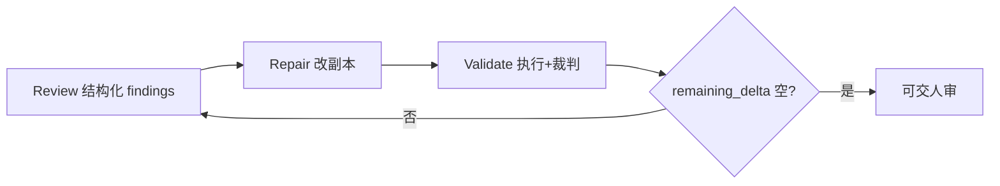

# 审查→修复→验证：闭环修复环

Codex

**一句话看懂**：OpenAI Cookbook 用 Codex 无头模式演示闭环维护——**Review** 只出结构化发现、**Repair** 只改副本并摘要、**Validate** 真跑并给出剩余 delta；笔记本是载体，模式适用于任何「改完必须用可信反馈再测」的产物。

## 读完你能带走的 7 条收获

1. **三相闭环**：Review → Repair → Validate；验证把剩余问题变成下一轮修复输入（见 3.1）。
2. **笔记本任务只是例子**；模式通用于可用可信反馈度量的代理产出（见 3.1）。
3. **先给共享业务规则与问题分类**，别让模型每次从零猜「什么算好」（见 3.2）。
4. **每相用 JSON schema 交接**：findings / changes / remaining_delta，便于调试与换产物类型（见 3.2）。
5. **Review 不改文件、不跑验证**；Repair 做最小有用编辑且不自称已通过验证（见 3.3）。
6. **Validate 像小型 eval**：先执行，再按量表打分；失败写入下一轮 delta（见 3.4）。
7. **生产环要自带停机条件与 audit trail**（`record.json`）（见 3.5）。

::: tip 小白先懂这几个词
- Repair loop（修复环）：审查→修复→验证的迭代闭环。
- [Agent Loop](/glossary#agent-loop)：单次代理推理-工具循环；本篇是外层维护环。
- Structured handoff：相位之间用 schema 传 findings / delta，而非散文。
- remaining_delta：验证后仍待修的具体条目，作为下一轮 Repair 输入。
:::

## 1. 基本信息

<SourceCard type="指南" title="Build iterative repair loops with Codex" author="OpenAI Cookbook" date="未标注稳定发布日（Cookbook）" url="https://developers.openai.com/cookbook/examples/codex/build_iterative_repair_loops_with_codex" />

| 项目 | 内容 |
|---|---|
| 链接 | https://developers.openai.com/cookbook/examples/codex/build_iterative_repair_loops_with_codex |
| 类型 | OpenAI Developers Cookbook 指南（可运行 notebook 示例） |
| 作者 | OpenAI Cookbook（无具名 byline） |
| 发布日期 | 原文未给出稳定 `datePublished`；登记为空白，阶段内排末 |
| 使用工具 | Codex CLI `codex exec`（文中钉 `@openai/codex@0.130.0` 示例）、`--output-schema`、jupyter nbconvert |
| 分析依据 | 原文 Markdown 全文，2026-10-29 抓取。示例输出为 Cookbook 演示轨迹，不把它当成你仓的保证数字。“我觉得”开头是本站评论。 |

## 2. 这篇在回答什么

维护过时 API 示例、损坏的 SDK 片段时，单次「请修好」常以漂亮 diff 结束，却在读者环境里炸掉。本文要的是**闭环**：代理产出 → 验证 → 用反馈改进下一轮。

三相：

- **Review**：检查当前产物，返回结构化发现，**不编辑文件**。  
- **Repair**：按发现与最新验证反馈，对**副本**做聚焦修改。  
- **Validate**：跑相关检查，报告还缺什么。

::: tr 笔记本任务只是例子。凡是代理产出可用可信反馈度量的地方，模式都适用。
> "The notebook task is only the example. The pattern applies wherever agent output can be measured with trustworthy feedback."
:::

与 [[95]] 的自验证、[[59]] 的独立完成标准同轴：这里把相位拆开，并用 schema 把交接变可审计。

## 3. 怎么做

### 3.1 为什么拆三相

混在一轮里时，模型容易边找问题边改边「觉得通过了」。拆开之后：

- Review 专注识别可能问题；  
- Repair 专注最小有用编辑；  
- Validate 用观察行为（执行失败、量表未过）决定是否继续。

示例用三份故意过时的 Cookbook 同伴笔记本，深度不同：有的一回合清，有的要两到三回合——用来展示**收敛形状**，不是刷分榜。

### 3.2 业务规则与结构化输出

开工前给一小份共享合约（示例里的 `business_rules`）：偏好模型名、现代化映射（如 `chat.completions` → `responses.create`）、读者体验（显式 setup、本地可跑、保留原教学目标）。换领域时，这份合约换成该领域的真相源。

三相 schema 大意：

| 相 | 关键字段 |
|---|---|
| Review | `findings[]`：artifact、issue_type、severity、description、suggested_fix_direction |
| Repair | iteration、`changes_made`、`unresolved_items`、`updated_artifact_path` |
| Validate | `overall_passed`、`cases[]`、`remaining_delta` |

有了结构化交接，环更易调试、重跑、移植到其他产物类型。实现上对 `codex exec` 使用 `--output-schema` 与 `--output-last-message`，把回答收成 JSON，而不是从散文里刮。

### 3.3 Review 与 Repair

Review prompt 约束：找会让笔记本过时、难跑或让读者困惑的问题；**不执行、不改文件**；`issue_type` 用简洁标签（如 `stale_model`、`deprecated_api`）；三条强发现优于长清单。

Repair：复制到迭代目录再改；prompt 随环变具体——带上 findings、business rules、上一轮 `remaining_delta`；要求最小有用编辑、保留教学流、**不要声称已通过验证**。分期样例则本回合只盯最重要剩余问题，而不是一次重写全部。

### 3.4 Validate：执行 + 裁判

验证像小型 eval：先定义想要的行为，跑检查，再让裁判按量表打分。文档例里**执行优先**——许多问题只在运行时出现（缺 import、旧路径、依赖过期 API 响应）。

量表例：`api_modernization`、`setup_reproducibility`、`artifact_integrity`。执行失败必须进入 `remaining_delta`。演示轨迹（Cookbook 给出的示意）大致是：第 1 轮最浅样例过、中深未过；第 2 轮中深过、最深仍有 delta；第 3 轮最深过——**重要信号是剩余 delta 变小**，不是「Codex 有改动」。

每轮写 `record.json`：review findings、repair 摘要与路径、validation 是否通过与 remaining_delta。维护者不必从 diff 与终端日志反推整次运行。

### 3.5 停机、泛化与可组合性

教学可用固定三回合；生产环应自决何时停。文中四点：验证通过、达到最大尝试次数、remaining delta 不再变化、下一步需要人审。停机条件与修复 prompt 同等重要。

同一架构可落到：协议优化、监管内容修订、支持知识刷新、代码现代化——共同点是**改动事关重大，且每轮需要证据**。

我觉得这和 [[109]] 的 Goals 很合得来：Goal 钉住「何时算完成」，修复环提供「如何用证据迭代到那里」；也可以不用 Goal，只在 CI/脚本里跑环。

## 4. 结果与局限

- **演示结果**：三份样例按设计的 1/2/3 回合收敛；属 Cookbook 教学轨迹。  
- **局限**：依赖可执行检查与诚实裁判；无检查就退化成「模型自评」；钉死的 CLI 版本与模型名需按环境更新；分期 fixture 用 `target_iteration` 人为拉长深度——生产中应换成真实失败信号。  
- **注意**：无头 `codex exec` + API key；沙箱与审批配置示例偏演示（`--ask-for-approval never`），接到真仓库要收紧。

## 5. 结论

迭代修复环让代理式维护更好审、更好运：判断（Review）与证明（Validate）分开，中间只做有界修复。相位交换结构化输出后，工作流可检查、可重复、可改编。

::: tr 与其依赖单次通过，不如让工作流能从产物学习、做有界修复，并对真实验证反馈作出反应。
> "instead of relying on a single pass, give the workflow a way to learn from the artifact, make a bounded repair, and react to real validation feedback."
:::

**你可以这样试**

1. 选一类有自动检查的产物（测试、schema、笔记本），写一页 business rules。  
2. 三份 schema 先跑通 Review-only，确认 findings 可机器读取。  
3. Repair 只碰副本；Validate 必须真跑。  
4. 给环加上 max iterations 与「delta 不变则停」。

**读完自测**

1. 为什么 Review 阶段禁止编辑？  
2. `remaining_delta` 在环里扮演什么角色？  
3. 生产环四类停机条件是什么？  
4. 笔记本例子换成「代码现代化」时，Validate 应换成什么？
