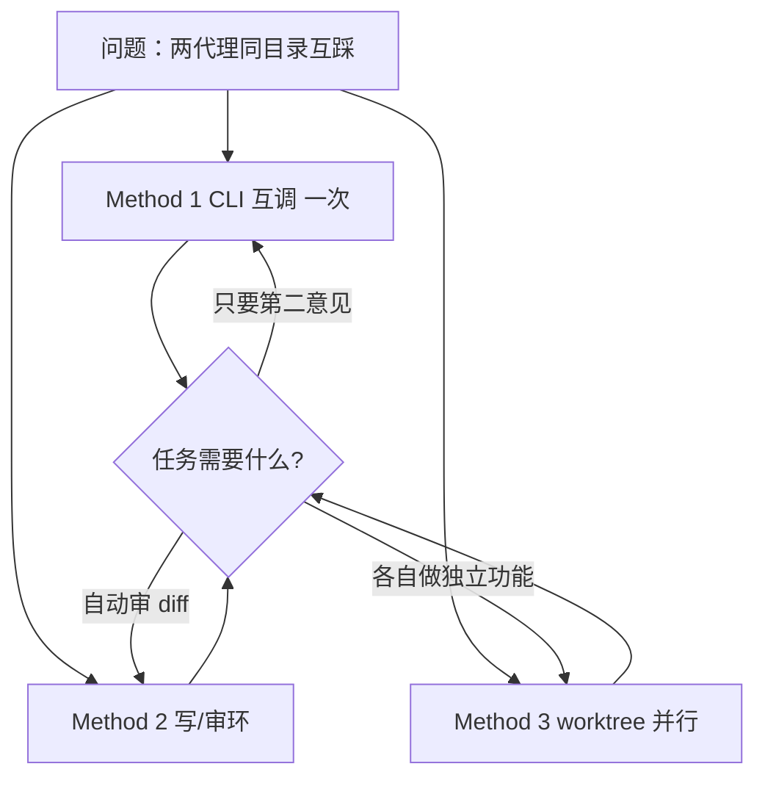

# 让 Claude Code 与 Codex 真正协作：三种方法

<div class="meta-tags"><span class="tool-tag tool-general">通用（不限工具）</span></div>

<div class="hook">

**一句话看懂**：并排开两个终端不等于协作——需要**通信通道、任务所有权、合并与验证**；从 CLI 互调、写/审环到 worktree 并行，按任务复杂度从低往高选。

</div>

## 读完你能带走的 7 条收获

1. **并排跑 ≠ 协作**：两边互不知晓时，会覆盖同一文件、做相反架构决定（见 3.1）。
2. **协作三件套**：通道（stdout / Markdown / PR）、所有权（谁改哪些文件）、合并与验证（见 3.1）。
3. **Method 1**：用 `codex exec` / `claude -p` 让一方调另一方，并检查 exit code、加 `timeout`（见 3.2）。
4. **别默认开危险开关**：`--dangerously-bypass-approvals-and-sandbox` 与 `bypassPermissions` 只给理解清楚的特例（见 3.2）。
5. **Method 2**：一写一审 + `reviews/*.md` 结构化表；停机靠无阻塞项、测试过、最多约 3 轮或人批（见 3.3）。
6. **审查是建议不是判决**：表里要有 Verification Status；盲跟建议会引入测试抓不到的 bug（见 3.3）。
7. **Method 3**：独立 worktree/分支 + 共享 AGENTS.md 所有权；合入前逐支审查、冲突手解再测（见 3.4）。

::: tip 小白先懂这几个词
- [Worktree](/glossary#worktree)：同一仓库的第二份检出，独立目录与分支。
- CLI 互调：一个代理用 shell 跑另一个 CLI（`codex exec` / `claude -p`）并读回输出。
- Write/review loop：一代理写代码，另一代理审 diff，再回写修复。
- [Orchestrator](/glossary#orchestration)：有明确角色层级的编排者，而非两个对等自由写手。
:::

## 1. 基本信息

<SourceCard type="文章" title="How to Make Claude Code and Codex Work Together (3 Practical Methods)" author="Cowrie Dev @ Bswen" date="2026-10-19" url="https://docs.bswen.com/blog/2026-10-19-claude-code-codex-together/" />

| 项目 | 内容 |
|---|---|
| 链接 | https://docs.bswen.com/blog/2026-10-19-claude-code-codex-together/ |
| 类型 | 工程博客（实践方法） |
| 作者 | Cowrie Dev @ Bswen |
| 发布日期 | 2026-10-19 |
| 使用工具 | Claude Code CLI（`-p`）、OpenAI Codex CLI（`codex exec`）、Git worktree |
| 分析依据 | 原文全文，2026-10-30 抓取。“我觉得”开头的段落是本站评论。 |

## 2. 这篇在回答什么

作者想要「第二意见」，于是一个终端开 Claude Code、另一个开 Codex，都指着同一仓库说「清理 auth 模块」。十分钟后 `git status` 一片狼藉：两边都改了 `src/auth.js`，一个删了 token 过期检查，另一个在同一函数加日志——谁都不知道对方存在。

::: tr 那一刻我才明白：并排跑两个编码代理，不等于让它们协作。
> "That is the moment I understood: running two coding agents side by side is not the same as making them work together."
:::

真正的「协作」至少要有三样：通信通道、清晰的任务所有权、合并并验证结果。文中给出从简到繁的三档，多数人停在 Method 1 或 2 就够。



与 [[23]] / [[102]] 的一人多线、[[110]] 的审查→修复→验证同轴：本稿焦点是**异构 CLI 之间**怎么接通道。

## 3. 怎么做

### 3.1 为什么并排会炸，协作要什么

无通道、无所有权时：它们会覆盖彼此编辑、朝不同架构漂移、重复做同一件事。作者归纳的失败模式还包括：反复审查环、互相覆盖对方修复、接受彼此未核验的假设、快速烧 token 却几乎没有可合产物。

Reddit 上常见建议是编排者 / 子代理层级，而不是两个对等写手——这正是 Method 2 的形状：一个驱动、一个窄角色。

::: tr 协作意味着有定义的角色与通道；不受控的并行执行只是两个代理在同一目录里赛跑。
> "Collaboration means a defined role and channel; uncontrolled parallel execution is just two agents racing in the same directory."
:::

### 3.2 Method 1：让一方从 shell 调用另一方

思路：别在两个聊天窗之间复制粘贴，让一个代理把另一个当 shell 命令，读回输出。

Codex 无头会话示例：

```bash
codex exec --json -o codex-review.md \
  --sandbox workspace-write \
  "Review src/auth.js and list concrete bugs."
```

- `exec`：非交互；`--json`：事件 JSONL；`-o`：末条消息写入文件；`--sandbox workspace-write`：只许改工作区。

Claude Code 无头：

```bash
claude -p "Summarize the diff in this repo." \
  --output-format stream-json
```

两处踩坑：失败不能当成功——先查 exit code；防止递归互调——不要给代理启动「自己那家」CLI 的权限，并用 `timeout 600 ...` 封顶。

更危险的是把绕过当默认：

```bash
# 勿作默认
codex exec --dangerously-bypass-approvals-and-sandbox "..."
claude -p "..." --permission-mode bypassPermissions
```

::: tr 不要把其中任何一个设成你的默认。它们会拿掉防止代理删文件或跑任意命令的护栏。
> "Do not make either of these your default. They remove the guardrails that keep an agent from deleting files or running arbitrary commands."
:::

先从受限姿态开始（`workspace-write`、默认权限模式），只对理解清楚的特例放宽。

### 3.3 Method 2：一写一审环

Method 1 是按需第二意见；Method 2 做成环：Claude 写 → Codex 审 diff → Claude 修已确认问题 → 跑测试 → 人批准。

自由散文难下手，作者让审查方交固定表格（存 `reviews/codex-review.md`）：File / Line / Severity / Explanation / Suggested Fix / Verification Status。人能读，写方也能当下轮上下文。

停机条件（满足其一即可）：无阻塞发现、测试通过、审查迭代上限（作者用 3）、人或批准结果。

关键：反馈是建议不是判决。`Unverified` 要对照代码或测试核成 `Verified` 再改。Reddit 上有人说独立 Codex 审 Claude 产出抓到了重要问题——作者标明这是**轶事**，不是保证。

我觉得这和 [[110]] 的三相环很像：这里审查方换成另一家模型，交接文件换成 Markdown 表；生产上仍应把「验证」做成真跑命令，而不是模型互夸。

### 3.4 Method 3：worktree 并行 + 人审合入

要两边同时实现**不同功能**，就必须让它们碰不到同一文件。Git worktree：

```bash
git worktree add ../project-claude -b feature/claude
git worktree add ../project-codex -b feature/codex
```

共享 `AGENTS.md` 写清分支所有者、禁止改他人分支、审查写到 `reviews/*.md`、合入前 `npm test`、每分支开 PR 由人批。注意：`AGENTS.md` 是约定，Claude 可能还要 `CLAUDE.md`——以各工具文档为准。

合入时一次一支：`merge` 后冲突必须手解再测，不要为了「树干净」硬合未解冲突。

通道选型：CLI stdout 适合一次性；共享 Markdown 适合审查报告；Git/PR 适合交接成品；MCP / 专用编排适合更重的结构化消息——只在 Method 1 不够时再上。Herdr、T3 Code、talking-stick 等只解决特定协调问题；没有具体痛点就不要为编排平台买单。

### 3.5 怎么选、FAQ 要点

| 场景 | 建议 |
|---|---|
| 只要第二意见 | Method 1 |
| Claude 自动要 Codex 审 | Method 2 |
| 两边各做独立功能 | Method 3 |
| 多代理全自动 | 有角色定义的编排器 |
| 想最少设置 | Method 1，或需要环时 Method 2 |

FAQ 要点：Claude 可跑 `codex exec`、Codex 可跑 `claude -p`；不必上 MCP；同仓可以，但别同时改同一文件；会话历史默认不共享，靠文件/提交/审查传递；最简多代理 = Method 1 + 审查文件。

## 4. 结果与局限

- **证明了什么**：给出可操作的三档协调，而不是「开两个窗口」。  
- **局限**：无对照实验；Reddit / 第三方工具描述可能过时；`AGENTS.md` 并非全工具统一标准。  
- **注意**：危险 flag、递归互调、未核验的审查建议都是实坑。

## 5. 结论

让 Claude Code 与 Codex「一起干活」，关键是匹配协调级别，并永远别把权限绕过或同文件双写当默认。

**你可以这样试**

1. 对当前 diff 跑一次 `codex exec -o reviews/once.md "Review ..."`，人读完再决定是否修。  
2. 若要环：固定审查表头，上限 3 轮，测试不过不准合。  
3. 两功能并行：先 worktree，再写所有权进 AGENTS.md；合入前 `merge-tree` 或逐支审。

**读完自测**

1. 协作三件套是什么？  
2. 为什么不能把 bypass 当默认？  
3. Method 2 的四类停机条件？  
4. Method 3 与 Method 2 分别解决什么并行问题？
