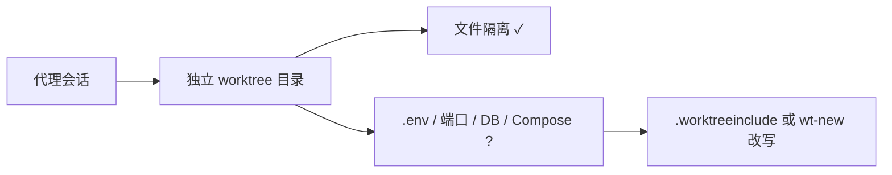

# Claude Worktree 实战：三工具并行与环境隔离

<div class="meta-tags"><span class="tool-tag tool-general">通用（不限工具）</span></div>

<div class="hook">

**一句话看懂**：git worktree（或各家 `--worktree`）只隔离**文件**；`.env`、端口、数据库和 Docker Compose 项目名仍会撞——要用 `.worktreeinclude` / `worktrees.json` / `wt-new` 把环境也拆开。

</div>

## 读完你能带走的 8 条收获

1. **Worktree 修文件，不修环境**：同一 checkout 里两代理共享草稿；`--worktree` 分开目录与分支，但不复制 gitignore 文件，也不拆端口 / DB / Compose（见 3.1）。
2. **三工具对照**：Claude 落在 `.claude/worktrees/` 且默认从**远端**默认分支开；Codex CLI 落在 `~/.codex/worktrees/`、**detached HEAD**、从不自动清；Cursor 落在 `~/.cursor/worktrees`、保留最近 25 个（见 3.2）。
3. **Claude 两坑**：`baseRef: "fresh"` 看不到未推送提交——改 `"head"`；`.env` 靠 `.worktreeinclude` 复制，且 Vitest/ESLint 要显式排除嵌套 worktree（见 3.3）。
4. **Codex Compose 同名陷阱**：路径常叫 `…/a1b2/myapp`，Compose 项目名会与主仓撞车，`docker compose down -v` 可能拆掉主仓容器（见 3.4）。
5. **Cursor 用 `worktrees.json`**：`setup-worktree` 里 `npm ci`、`cp $ROOT_WORKTREE_PATH/.env .env`、迁移（见 3.4）。
6. **`wt-new` 模式**：按 `.worktreeinclude` 复制忽略文件，再改写 `PORT` / `DATABASE_URL` / `COMPOSE_PROJECT_NAME`（见 3.5）。
7. **磁盘**：同套依赖下 npm 每树再拷一份，pnpm hardlink 第二棵几乎不占；Cursor 默认 25 树时 npm 小工具链也可到约 2.1 GB（见 3.5）。
8. **边界**：worktree 不是 jail、不是子代理；重叠任务仍会冲突——合并前用 `git merge-tree` 两两预览（见 3.6）。

::: tip 小白先懂这几个词
- [Worktree](/glossary#worktree)：共享 `.git`、独立工作目录与 HEAD 的第二份检出。
- `.worktreeinclude`：Claude Code / Codex 应用用来把 gitignore 文件拷进新 worktree 的清单。
- `COMPOSE_PROJECT_NAME`：Docker Compose 项目名；不设时往往等于目录名。
- Detached HEAD：有检出无分支名；Codex CLI 的 `--worktree` 默认如此，推送前需 `git switch -c`。
:::

## 1. 基本信息

<SourceCard type="文章" title="Claude Worktree Guide: Parallel Agents in Claude Code, Codex and Cursor" author="Don Karter" date="2026-10-29" url="https://octomind.run/blog/claude-code-worktrees" />

| 项目 | 内容 |
|---|---|
| 链接 | https://octomind.run/blog/claude-code-worktrees |
| 类型 | 工程指南（含可运行命令与对照表） |
| 作者 | Don Karter（Octomind；页面 byline / JSON-LD） |
| 发布日期 | 2026-10-29（`datePublished` / `article:published_time`）；文内工具细节标注 “checked in October 2026” |
| 使用工具 | Claude Code 2.1.287、Codex CLI 0.160.0、Cursor CLI/IDE、git 2.55.0（作者实测） |
| 分析依据 | 原文全文，2026-10-30 抓取。文末有 Octomind 产品 CTA，不计入论据。“我觉得”开头是本站评论。 |

## 2. 这篇在回答什么

两个代理开在同一份检出里，等于共用草稿纸：A 写到一半的文件成了 B 的输入，谁最后 `git switch` 谁赢。

::: tr Worktree 修好了文件。它修不好没跟过来的 .env、都想要 3000 端口的两个开发服务器，或是一下找到四套测试的跑测器。
> "A Claude worktree — Claude Code's `--worktree` flag, or any git worktree — fixes the files. It does not fix the `.env` that didn't come along, the two dev servers that both want port 3000, or the test runner that now finds your suite four times."
:::

本稿覆盖 Claude Code / Codex / Cursor 三家怎么建 worktree，以及如何把环境拆开；与 [[23]]（演示并行）和 [[102]]（成本形状）区分：这里补**三工具差异 + .env/端口/Compose/`wt-new`**。



## 3. 怎么做

### 3.1 Worktree 共享什么、缺什么

新建 worktree 会有：起始提交的跟踪文件、共享的分支/提交/stash、自己的 HEAD 与 index。不会自动有：`.env`、`node_modules`、构建产物；主仓未提交改动（Codex **应用**会带上；CLI / 纯 git / Claude 默认不带）。端口、数据库、Docker 守护进程仍是一台机器上一份。

作者实测：在 `feature-a` 做的 stash，在 `feature-b` 的 `git stash list` 里也看得到——`refs/` 共享，`HEAD` 等伪引用按树独立。

### 3.2 三工具一张表（咬人的两行）

| | Claude Code | Codex CLI | Codex 应用 | Cursor |
|---|---|---|---|---|
| 启动 | `claude -w <name>` | `codex --worktree` 或 `/worktree` | Composer 下 Worktree | Agents Window、`/worktree`、`agent -w` |
| 落点 | `.claude/worktrees/` | `~/.codex/worktrees/<4hex>/` | 同根可改 | `~/.cursor/worktrees`（硬编码） |
| 起点 | 远端默认分支（`baseRef: "fresh"`） | 当前 HEAD 提交 | 你选的分支 + 未提交改动 | 文档未写死 |
| 分支 | 新 `worktree-<name>` | 无（detached） | 无，直到 Create branch | 文档未写死 |
| 忽略文件 | `.worktreeinclude` | 不复制 | `.worktreeinclude` | `setup-worktree` 命令 |
| 清理 | 退出时；子代理周期清扫 | **从不** | 保留最新 15 | 每机最新 25 |

两行最咬人：Claude 从远端开，本地未推送提交不在；Codex 从本地 HEAD 开但无分支，推送前要自己命名。

### 3.3 Claude Code：baseRef、include、排除套件

`claude --worktree feature-auth`（短 `-w`）建在 `.claude/worktrees/<name>/`，分支 `worktree-<name>`。可加 `--tmux`；`"#1234"` 可检出 PR。旗标自 2.1.49（2026-02-19）起。

未推送提交缺失：在 `settings.json` 设 `{ "worktree": { "baseRef": "head" } }`（2.1.133+；取值只有 `fresh` / `head`）。

`.env` 缺失：仓库根放 `.worktreeinclude`（gitignore 语法）；只有**匹配且被 gitignore** 的文件才复制，跟踪文件不会被复制一份。

测试翻倍：`.claude/worktrees/` 在仓内，gitignore 挡不住 Vitest。一文 PR 测到 2,888 个测试文件对 374 个真实文件，全量从 400–570 s 降到 94 s。ESLint 也会加载各树配置报 `No tsconfigRootDir was set`。在 `vitest.config.ts` / `eslint.config.js` 显式 `**/.claude/worktrees/**` 排除；spread `configDefaults.exclude`，别整表替换。

另：Git LFS `--local` 安装时新树只有指针，需在树内 `git lfs pull`。手建 worktree 别塞进 `.claude/worktrees/`——issue #89199（2026-08）报告清扫删掉约 13 GB 手建树；changelog 称 2.1.246 起应放过，旧版请放仓外。

### 3.4 Codex 与 Cursor

Codex CLI：`--worktree` 实验于 0.154.0（2026-09-09），0.156.0（2026-09-22）默认开。`git worktree add --detach` 在当前 HEAD；未提交改动留在原处。应用侧读 `.worktreeinclude`、可永久钉住、根路径可配置。作者在 CLI 源码中未找到 `.env` 复制步骤——CLI 要自己带。

Cursor：`.cursor/worktrees.json` 的 `setup-worktree`（可分 unix/windows）在新树里跑；`$ROOT_WORKTREE_PATH` 指向主检出。清理按 `cursor.worktreeMaxCount`（默认 25）与间隔小时数。文档建议别把依赖 symlink 进 worktree，改用 pnpm / bun / uv。

### 3.5 给每棵树自己的 .env、端口、库、Compose

作者给出 `wt-new`：在**仓外** sibling 目录建树（避免测试扫描），按 `.worktreeinclude` 复制忽略文件，再选未被其它树占用的最低 `PORT`，把 `DATABASE_URL` 后缀成 `_<slug>`，设 `COMPOSE_PROJECT_NAME=<repo>_<slug>`。

Compose 实测（Compose 5.1.2）：主仓 `myapp`→端口 3000；`wt-new` 两树各自项目名与 3001/3002；**Codex 风格 `…/a1b2/myapp` 且无 .env → 项目名仍是 `myapp`，与主仓撞**；Claude 嵌套树项目名变了但仍可能抢 3000。

`node_modules`：每树安装，不要跨树 symlink。作者冷数据：七个前端开发依赖，npm `ci` 暖缓存约 0.7 s、每树约 87 MB；pnpm hardlink 第二树额外仅约 0.24 MB。大 monorepo 可用 Claude 的 `worktree.sparsePaths`（2.1.76+）。

### 3.6 合并、错误与边界

合并前：

```bash
for b in feature-a feature-b; do
  git merge-tree --write-tree --quiet main "$b" && echo "$b: clean" || echo "$b: CONFLICT"
done
git merge-tree --write-tree --name-only feature-a feature-b
```

作者跑例：两支对 main 都干净，彼此对 `app.js` 冲突——成对预览才抓得到。先合一支，再在第二棵树里 `rebase main`，让写那支的代理解冲突。

常见错误：`is already used by worktree`（分支已被另一树占用）、删目录后仍 `prunable`（`git worktree prune`）、沙箱写不了主仓 `.git` 的 `index.lock`（Codex 可用 `--add-dir $(git rev-parse --path-format=absolute --git-common-dir)`）。

::: tr Worktree 是目录，不是监狱。
> "A worktree is a directory, not a jail."
:::

::: tr Worktree 不是子代理。
> "Worktrees aren't sub-agents."
:::

它们是独立分支上的独立会话；要把一件事拆给会话内助手，用子代理。

重叠任务仍会冲突；机器仍共享 CPU/DB；子模块多检出仍属实验区。任务彼此独立、协调靠人 → 归本站 [单代理推进与一人多线](/guide/solo)。

我觉得：[[102]] 讲清「环境贵时 worktree 不一定赢」；本文把三工具默认行为钉死，并给了 Compose 同名这种会删主仓卷的硬坑——并行前先跑一遍 `docker compose config` 看项目名。

## 4. 结果与局限

- **证明**：命令输出与对照表来自作者 scratch 仓与文档交叉核对（标注 October 2026）。  
- **局限**：Cursor 若干字段「文档未写」；版本会变；`wt-new` 假设 `DATABASE_URL` 末尾是库名、无 query，且只避开其它 worktree 占用的端口。  
- **注意**：文内 Octomind 推广不计入方法论据。

## 5. 结论

并行代理先把文件隔开，再把环境变量与 Compose 项目名隔开；选工具时先看起点提交、分支模型和清理策略是否符合你的习惯。

**你可以这样试**

1. 对照表选一家：Claude 改 `baseRef` 或接受远端起点；Codex 推送前先建分支。  
2. 加 `.worktreeinclude` 或 Cursor `setup-worktree`；嵌套树则排除 Vitest/ESLint。  
3. 跑 `wt-new`（或等价脚本），确认每树 `PORT` 与 `COMPOSE_PROJECT_NAME` 不同。  
4. 合入前 `merge-tree` 对 main 与两两预览。

**读完自测**

1. Claude 默认 `baseRef` 是什么？缺未推送提交怎么改？  
2. 为什么 Codex 风格路径特别危险？  
3. `.worktreeinclude` 会复制跟踪文件吗？  
4. Worktree 与子代理差在哪？
