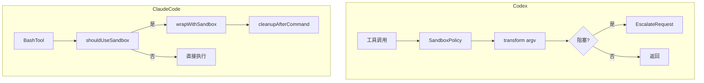

# Claude Code 与 Codex 的沙箱：同原语，不同信任

通用（不限工具）

**一句话看懂**：两家都用 bubblewrap / seccomp / Seatbelt 挡住「LLM 代你执行命令」的风险；Codex 默认 **sandbox-first** 加升级协议，Claude Code 默认 **可配置隔离** 加违规可见与事后清理。

## 读完你能带走的 7 条收获

1. **同一风险**：能 `npm install` 就能 `curl | bash`；答案落在 OS 级进程沙箱（见 3.1）。
2. **共享原语**：Linux 上 bwrap 命名空间 + seccomp（两家都拦 `io_uring_*`）；macOS 上 Seatbelt `(deny default)`（见 3.1）。
3. **Codex**：四变体 `SandboxPolicy` 枚举 → 总会评估是否需要平台沙箱 → 改写 argv → 阻塞走 `EscalateRequest` 给人批（见 3.2）。
4. **Claude Code**：五层 settings 合并 → 每条 Bash 命令 `shouldUseSandbox()` → wrap → 事后 `cleanupAfterCommand` 清裸仓标记（见 3.3）。
5. **同原语不同控制面**：Codex 把控制放进运行时类型与升级环；Claude 放在开发者可调 settings 与违规日志（见 3.4）。
6. **网络**：Codex 偏内核 socket 过滤；Claude 偏应用层域名代理白名单（见 3.4）。
7. **企业**：Claude 需显式锁 `allowUnsandboxedCommands: false` 等；Codex 默认已严，再靠 `Require` 与策略文件（见 3.5）。

::: tip 小白先懂这几个词
- [Sandbox](/glossary#sandbox)：限制进程可见文件系统、网络与系统调用的隔离层。
- Bubblewrap（`bwrap`）：用 Linux 命名空间做假文件系统视图。
- Seccomp/BPF：内核里按系统调用过滤（防火墙对 syscall）。
- Seatbelt：macOS 内核强制访问控制；常用 `sandbox-exec` 加载 SBPL 策略。
:::

## 1. 基本信息

<SourceCard type="文章" title="How Claude Code & Codex approach sandboxing" author="Abhishek" date="2026-04-05" url="https://instavm.io/blog/how-claude-code-and-codex-approach-sandboxing" />

| 项目 | 内容 |
|---|---|
| 链接 | https://instavm.io/blog/how-claude-code-and-codex-approach-sandboxing |
| 类型 | 深度技术拆解（源码级对照） |
| 作者 | Abhishek（InstaVM） |
| 发布日期 | 2026-04-05 |
| 使用工具 | OpenAI Codex、Anthropic Claude Code（沙箱实现对照） |
| 分析依据 | 原文全文，2026-10-30 抓取。实现细节以作者阅读当时源码为准，版本会变。“我觉得”开头是本站评论。 |

## 2. 这篇在回答什么

当模型要替你跑 `rm -rf /`，什么拦住它？两家都让模型在你机器上执行 shell；也都摸到同一套 OS 原语——但嵌进了不同的信任架构。

::: tr 相同的操作系统原语，不同的信任架构。
> "Same OS primitives, different trust architectures."
:::

Codex 把沙箱当成强制遏制边界（sandbox-first；策略也可以解析成「不需要沙箱」）。Claude Code 把沙箱当成可调隔离层：可按项目启用、按命令放宽或覆盖。

与 [[91]]（出口注入凭据）、[[70]]（每任务 VM）、[[99]]（默认拒绝角色沙箱）同属「代理在哪里跑 / 边界在哪」；本稿拆的是**本机 CLI 沙箱实现差在哪**。

## 3. 怎么做

### 3.1 背景：三件 OS 积木

**Bubblewrap**：给进程一套假文件系统。常用 `--ro-bind / /`（整盘只读）、再 `--bind` 放出可写路径、`--unshare-net` 断主机网络。两家调同一个 `bwrap`；Codex 在 Rust 拼参数，Claude 在 TypeScript。

**Seccomp/BPF**：拦「能做什么」。关键共识：两家都拦 `io_uring_setup/enter/register`——因为 Linux 5.19+ 的 `IORING_OP_SOCKET` 可在内核上下文建 socket，绕过对 `socket()` 的过滤。装过滤器前要 `prctl(PR_SET_NO_NEW_PRIVS)`。

**Seatbelt（macOS）**：`(version 1)(deny default)` 再显式 allow；用 `-D KEY=VALUE` 注入路径防注入。`sandbox-exec` 在 10.15 起弃用，但内核强制仍在；Chromium、VS Code 与两家都在生产用。

### 3.2 Codex：策略枚举 → 改写 → 升级

默认姿态：总会走 `should_require_platform_sandbox()`；策略语义不要求时，可解析为无沙箱。

四变体：`DangerFullAccess`、`ReadOnly`、`WorkspaceWrite`、`ExternalSandbox`（已在外部容器则跳过自建沙箱但仍管网络）。文件系统与网络是独立维度，避免组合爆炸。Rust 穷尽匹配强迫每条路径处理「无沙箱」情形。

后端：macOS Seatbelt、Linux Seccomp（`codex-linux-sandbox` 助手）、Windows Restricted Token。`transform()` 把原命令改成 `sandbox-exec -p ...` 或助手二进制的尾部参数。

Linux 三阶段：外层助手解析策略并准备代理桥 → bwrap 叠挂载 → 内层再进助手，设 no-new-privs、装 BPF、激活代理路由，再 `execvp`。

阻塞时：经打过补丁的 shell 截获，发 `EscalateRequest`；用户选 `Run` / `Escalate`（更宽权限）/ `Deny`。

### 3.3 Claude Code：五层合并 → 每命令门闩 → 事后清理

配置优先级：`policySettings`（企业 MDM，最高）→ `flagSettings` → `localSettings` → `projectSettings` → `userSettings`。顶层有 `sandbox.enabled`、`failIfUnavailable`、`allowUnsandboxedCommands`；嵌套 `filesystem` 四列表（deny 优先）与 `network`。

`shouldUseSandbox()`：全局关则否；`dangerouslyDisableSandbox` 仅当允许无沙箱命令时生效；`containsExcludedCommand` 会拆 `&&` 复合命令——防止 `docker ps && curl evil.com` 因 docker 在排除列表而整串逃出。

始终拒绝写入：`.claude/settings.json`、`.claude/settings.local.json`、`.claude/skills`（防改配置逃逸与注入特权技能）。Edit/Read 工具目标会自动流入 allowWrite / allowRead。

事后 `cleanupAfterCommand`：清可能被种下的裸 git 仓标记（`HEAD`/`objects`/`refs`/`hooks`/`config`）——否则后续无沙箱 git 可能把工作区当裸仓，再配 `core.fsmonitor` 成逃逸。违规进 `SandboxViolationStore`（约 100 条环形缓冲）。

### 3.4 同原语，不同信任哲学

| 维度 | Codex | Claude Code |
|---|---|---|
| 何时生效 | 策略驱动，总会评估 | 设置驱动，默认可选 |
| 范围 | 会话/回合共享 | 每条命令 |
| 阻塞时 | 升级协议 | 违规透明 |
| 策略形态 | Rust 四变体枚举 | JSON 五层合并 |
| 网络 | 内核级 socket 过滤 | 应用层域名白名单 |
| 事后 | 无专门清理 | 裸仓擦除 + ghost 清理 |

产品语境：Codex 是多表面运行时（CLI/IDE/桌面/云），强制沙箱统一保护各表面；Claude Code 是开发者直接控环境的一体工具，可配置匹配单表面模型。

::: tr 两家达成同一安全目标：防止 LLM 在开发者机器上执行任意操作。
> "Both systems achieve the same security goal: preventing an LLM from executing arbitrary operations on the developer's machine."
:::

我觉得：选型别停在「谁更安全」口号——问你要的是**默认不可关的遏制**，还是**可观察、可按命令放宽的开发流**。无人值守 CI 更像 Codex 取向；本机结对编程更常要 Claude 那种粒度。

### 3.5 企业控件与取舍

Claude 因默认偏可选，企业要显式：`allowManagedDomainsOnly`、`allowManagedReadPathsOnly`、`allowUnsandboxedCommands: false`、`failIfUnavailable`、`enabledPlatforms`；`policySettings` 最高不可被下级覆盖。

Codex 默认已严：`SandboxablePreference::Require`、Windows 拒宽松策略、`requirements.toml` / MDM `ConfigRequirements` 做按命令允许/拒绝。

取舍一句话：Codex 优化保证遏制与一致性；Claude 优化开发者控制与可见性，并加深度防御清理。

## 4. 结果与局限

- **证明**：对照来自作者对两家实现路径的源码阅读与架构复述；含具体枚举/函数名。  
- **局限**：非官方文档；版本漂移后细节可能过时；Windows 路径对 Claude 未覆盖。  
- **注意**：这是本机进程沙箱，不是云端每任务 VM（那是 [[70]] / [[91]] 轴）。

## 5. 结论

沙箱争论的实质是控制面放在哪：运行时强制，还是开发者配置。原语已趋同（含独立发现的 io_uring 坑）；差别在默认姿态、作用域与阻塞后的人机协议。

**你可以这样试**

1. 列本机默认：Codex 当前 `SandboxPolicy`、Claude `sandbox.enabled` 与企业层是否锁定。  
2. 故意跑一条应被拦的写路径，看是升级对话框还是违规日志。  
3. 检查复合命令排除列表是否按段拆分。  
4. 若上 CI 无人值守：优先 `Require` / `failIfUnavailable`，而不是靠模型自觉。

**读完自测**

1. 为什么两家都要拦 io_uring 相关 syscall？  
2. Codex 阻塞后三种 EscalateAction？  
3. Claude 为什么要事后 scrub 裸仓标记？  
4. 网络控制在两家各落在哪一层？
