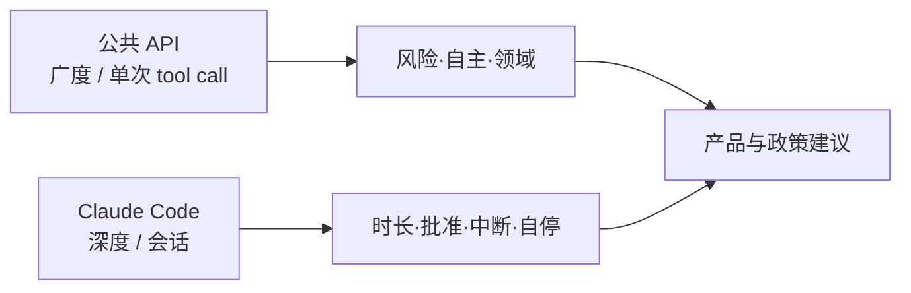

# 实测代理自主性：部署里的自主如何共构

Claude Code

**一句话看懂**：Anthropic 用隐私保护基础设施看百万级交互——Claude Code 最长回合自主时长近翻倍、老手更爱 auto-approve 也更爱中断、代理自停澄清往往多于人打断；能力评测上的「能做多久」≠ 实践里「被允许多久」。

## 读完你能带走的 8 条收获

1. **双数据源**：公共 API 看 tool call 广度；Claude Code 看完整会话深度（自主时长、中断）（见 3.1）。
2. **尾部长回合**：99.9 百分位回合时长约从不足 25 分钟到超过 45 分钟（约 2025-10 至 2026-01），跨模型发布较平滑（见 3.2）。
3. **部署 overhang**：模型能扛的自主 > 实践中行使的自主；METR 理想任务时长不可与回合墙钟直接比（见 3.2）。
4. **经验改变监管策略**：新用户约 20% 会话全 auto-approve，约 750 会话后超过 40%；同时打断率约 5%→9%（见 3.3）。
5. **有效监督 ≠ 逐步批准**：老手改为「放跑 + 关键时介入」（见 3.3）。
6. **代理自停是监督的一环**：最复杂任务上，Claude 请求澄清多于人打断两倍以上（相对最小复杂度）（见 3.4）。
7. **风险域**：约 80% tool call 看似有护栏、73% 有某种人在环、仅 0.8% 看似不可逆；软件工程约占 API 代理活动近 50%（见 3.5）。
8. **政策启示**：别急着强制「每步人批」；投资事后监测、不确定时自停、可干预的产品面（见 3.6）。

::: tip 小白先懂这几个词
- Autonomy（自主性）：代理少依赖逐步人指令、自行决定做什么怎么做的程度；是部署涌现属性，不是模型固定标签。
- Auto-approve：产品设置里不再逐步批准每个动作。
- Turn duration：Claude 开始工作到停下（完成 / 提问 / 被打断）的墙钟时间。
- Post-deployment monitoring：上线后观测真实用法，而非只靠预发布评测。
:::

## 1. 基本信息

<SourceCard type="文章" title="Measuring AI agent autonomy in practice" author="Miles McCain, Thomas Millar, Saffron Huang 等（Anthropic Societal Impacts）" date="2026-02-18" url="https://www.anthropic.com/research/measuring-agent-autonomy" />

| 项目 | 内容 |
|---|---|
| 链接 | https://www.anthropic.com/research/measuring-agent-autonomy |
| 类型 | Anthropic 研究报告 |
| 作者 | Miles McCain、Thomas Millar、Saffron Huang、Jake Eaton、Kunal Handa 等（完整贡献者列表见原文；通讯式引用见文末 BibTeX） |
| 发布日期 | 2026-02-18 |
| 使用工具 | Claude Code、Anthropic 公共 API；隐私保护分析工具 |
| 分析依据 | 原文全文，2026-10-30 抓取。附录细节在 PDF；分类由 Claude 生成并有内部校验说明。“我觉得”开头是本站评论。 |

## 2. 这篇在回答什么

代理已出现在邮件分拣到高后果领域的光谱上，但我们几乎不知道人们在真实世界里怎么用它们、给了多少自主、动作有多险。

作者采用可操作定义：带工具、能采取行动的 AI 系统。公共 API 以**单次 tool call** 为分析单元（无法可靠拼会话）；Claude Code 则可串起整段工作流。两者用隐私保护基础设施互补。

与 [[19]]（Agent Evals 入门）、[[56]] / [[39]]（权限分类器）同属评测与把关轴；本文测的是**部署行为**，不是基准 cap。

## 3. 怎么做

### 3.1 怎么测：广度与深度的折中

代理难研究：定义不一、形态速变、厂商对客户架构可见性有限。本文不以推断客户编排为前置，而看工具在干什么。

Claude Code 侧可直接量：回合时长、auto-approve、人打断、代理澄清。API 侧用 Claude 估每条 tool call 的风险与自主（1–10），再聚类。局限写得很清楚：单厂商、分类器误差、时间窗（约 2025 末–2026 初）、按 call 抽样会放大多步工作流。

### 3.2 Claude Code 自主工作更久

多数回合很短：中位约 45 秒，多数百分位几个月内相对稳——符合用户基数暴涨、新手偏多。

信号在尾部：交互式会话中，**99.9 百分位回合时长**近乎翻倍——从不足 25 分钟到超过 45 分钟（图 1；7 日滚动）。增长跨模型发布较平滑：若自主纯由能力跳变驱动，更预期锯齿；作者解读为信任积累、任务变难、产品改进等合力。

内部用法：最难任务成功率翻倍的同时，每会话平均人工干预从 5.4 降到 3.3（2025-08 至 12）。指向 **deployment overhang**：模型可承载的自主大于实践中用到的。

对比 METR「长任务能力」：Opus 4.5 一类评估里 50% 成功率任务可达近 5 小时**人类难度**；Claude Code 99.9%ile 墙钟约 42 分钟量级、中位更短。两者不可直接换算——评测无真实后果与人机互动，本文测的是有提问与打断的实践。

### 3.3 老手：更常 auto-approve，也更常打断

注册后会话数增加：全 auto-approve 从约 20%（&lt;50 会话）升到超过 40%（约 750 会话）。默认产品仍是逐步批准，部分迁移也是配置偏好。

打断率：约 10 会话时约 5% 回合，更资深约 9%。矛盾只是表象：新手逐步批所以很少中途插；老手放跑，在跑偏时插。API 侧也见：最小复杂度约 87% tool call 有某种人类介入痕迹，高复杂度约 67%——复杂任务更难逐步批，也可能更多来自老手。

::: tr 有效监督不要求批准每一个动作，而要求能在要紧时介入。
> "effective oversight doesn’t require approving every action but being in a position to intervene when it matters."
:::

### 3.4 代理自停往往多于人打断

任务越复杂，Claude 越常请求澄清，且增速高于人打断。最复杂档上，澄清相对最小复杂度超过两倍。作者提醒：不一定停在对的时刻，也可能多余提问，并受 Plan Mode 等产品功能影响。

停止原因聚类（Claude 标注样本）：代理侧常见「在方案间给用户选择」「补技术上下文」「要诊断/测试结果」「要凭据」「行动前确认」等；人打断常见「慢/挂/过度」「已够自己继续」「想亲手做下一步」「中途改需求」等。

训练模型识别不确定并主动浮现，是与权限系统互补的安全属性。

### 3.5 风险域：有危险用法，但尚未规模化

高风险或高自主聚类示例存在（含看似密钥窃取、医疗记录、加密货币交易等）——作者强调许多可能是评测/红队，且可见性不足以判断是否真执行。

总量：约 80% tool call 来自看似至少有一种护栏的代理；约 73% 看似某种人在环；约 0.8% 看似不可逆（如对客户发信）。风险-自主平面右上角稀疏但非空。领域上软件工程约占近 50%；其它业务域各仅几个百分点。

### 3.6 局限与建议

局限：单厂商；API 无会话拼接；分类器；时间窗；按 call 抽样偏差；无法区分生产与评测。

建议：模型与产品方投**事后监测**基础设施；训**自知不确定**；产品设计**可信可见性 + 简单干预**（实时转向、遥测）；政策上**过早强制特定交互形态（如每步批准）可能制造摩擦却不必然更安全**——应看人是否处于可监测、可介入的位置。

::: tr 实践中代理行使的自主，是由模型、用户与产品共同构造的。
> "the autonomy agents exercise in practice is co-constructed by the model, the user, and the product."
:::

我觉得：知识库里 [[56]] / [[39]] 讲「动作怎么拦」，本文补「人长大以后还会不会拦、怎么拦」——评测代理本身时，除了 pass@k，还要量部署里的批准与中断曲线。

## 4. 结果与局限

- **结果**：给出可复核的部署统计与明确方法边界；中心结论是需要事后监测与新的人机共管范式。  
- **局限**：作者清单见 3.6；人类介入率可能偏高估；最高风险簇可能是评测流量。  
- **注意**：数字来自 Anthropic 流量窗，外推其它厂商需谨慎。

## 5. 结论

自主性不是单点模型分数：它在真实产品里被拉长、被批准设置调节、被代理自停与人打断共同塑形。预发布评测必要但不充分。

**你可以这样试**

1. 对自己的编码代理日志：画回合时长分布与 auto-approve 占比随「使用周数」的曲线。  
2. 区分「逐步批准」与「可中断监控」两种模式，看老手落在哪。  
3. 记录代理主动提问 vs 人打断的比例；复杂任务是否提问更多。  
4. 高风险动作单独审计不可逆比例，而不是只看均值。

**读完自测**

1. 为什么 API 与 Claude Code 要互补使用？  
2. 99.9%ile 时长变长却跨模型平滑，作者如何解释？  
3. auto-approve 与 interrupt 同时上升说明什么？  
4. 为什么不宜急着立法要求逐步人批？
