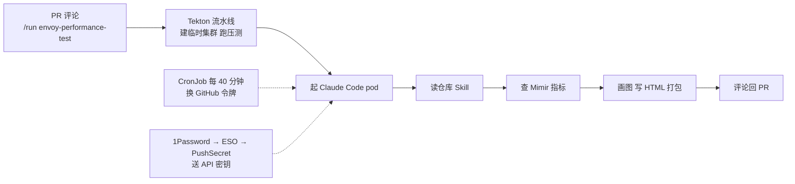

# 把 Claude Code 放进 CI 流水线：难的不是代理，是凭据

Claude Code

**一句话看懂**：Giant Swarm 让 Claude Code 在 Tekton 流水线末尾自动写压测报告。代理只用了一个 Skill 就写好了报告；真正花掉好几天的，是把 GitHub 令牌和 LLM 密钥**安全、可轮换地**送进一个临时 pod，以及想清楚这个代理拿着凭据能做什么。

## 读完你能带走的 7 条收获

1. **先想清楚代理“欠你什么”**：查询来的数据、图表、一个能直接转发的文件。代理不做任何决定，这种窄职责后来成了权限设计的最大优点（见 3.1）。
2. **托管 Action 还是自己起 pod，是取舍，不是对错**：流水线已在自家集群、想自己掌控持有真凭据的容器，就自建；代价是 Action 替你做的认证全得自己做（见 3.2）。
3. **报告的“写法”放进仓库 Skill**：查哪些指标、画什么图、HTML 怎么排，全在 Skill 里；流水线只负责把代理拉起来（见 3.2）。
4. **GitHub 侧用 GitHub App + 定时换令牌**：安装令牌 1 小时过期，CronJob 每 40 分钟换一次，令牌生命周期不绑在流水线上（见 3.3）。
5. **LLM 密钥的目标是“轮换只需一个动作”**：为此放弃“SOPS 加密直接提交”的简单方案，用 External Secrets Operator 链路，跨集群只靠一个 PushSecret（见 3.4）。
6. **权限只是爆炸半径的一半，另一半是触发器**：PR 评论属于提示注入的入口；缓解是固定命令触发、prompt 硬编码在 GitOps 流水线定义里（见 3.5）。
7. **如果你的代理要读 diff，凭据还是同一份**：窄职责是这套设计的安全前提，改造时要重新评估（见 3.5、4）。

::: tip 小白先懂这几个词
- [CI/CD](/glossary#ci-cd)：代码提交后自动构建、测试、部署的流水线。
- [Skills](/glossary#skills)：放在仓库里、代理按需读取的做事说明。
- [GitHub App 安装令牌](/glossary#github-app-token)：GitHub App 以组织 / 仓库身份调用 API 用的短期令牌，1 小时过期。
- [External Secrets Operator](/glossary#external-secrets)：Kubernetes 里把外部密钥库同步成集群 secret 的组件；PushSecret 反向把 secret 推到别处。
- [提示注入](/glossary#prompt-injection)：把指令藏在代理会读到的文本里，让它做原本不该做的事。
- [最小权限](/glossary#least-privilege)：只给完成任务所需的最少权限。
:::

## 1. 基本信息

<SourceCard type="文章" title="Running an AI agent in a CI/CD pipeline: a how-to guide" author="Thibaud Vaisseau" date="2026-10-15" url="https://www.giantswarm.io/blog/running-an-ai-agent-in-a-ci-cd-pipeline" />

| 项目 | 内容 |
|---|---|
| 链接 | https://www.giantswarm.io/blog/running-an-ai-agent-in-a-ci-cd-pipeline |
| 类型 | 工程博客（Envoy Gateway 压测系列第二部分） |
| 作者 | Thibaud Vaisseau（Giant Swarm） |
| 发布日期 | 2026-10-15 |
| 使用工具 | Claude Code（自建 Alpine 镜像）、Tekton、GitHub App、External Secrets Operator、1Password、SOPS、Mimir |
| 分析依据 | 原文全文（约 2,400 词，含 FAQ），2026-10-31 抓取。原文里的报告截图本站未转载。文中没有公开 Skill 和 prompt 原文。“我觉得”开头的段落是本站评论。 |

## 2. 这篇在回答什么

Giant Swarm 给客户做 Envoy Gateway 和 NGINX Ingress Controller / Kong 的压测对比。压测本身早就全自动了：临时集群拉起来，压测打完，指标进 Mimir。然后流水线就把活还给了人。有人打开 Grafana，按同样的顺序看同样的六七个面板，截同样的图，拼同样的对比表，再写几句解读发给客户。每次大约一小时。

<Trans zh="这一个小时，就是这篇文章存在的全部理由。">“That hour is the whole reason this post exists.”</Trans>

作者说，一小时本身不算多，真正的代价是这种手工收尾会让人把测试攒成一批、往后拖。于是他们让 Claude Code 来写报告。结论有点出人意料：

<Trans zh="代理是容易的部分。时间都花在了凭据上。">“The agent was the easy part. Days went into credentials.”</Trans>

文章围绕四个问题展开：

1. 代理该交付什么？该放在 CI 的哪一层？
2. 一个临时 pod 怎么拿到往 PR 写东西的权限？
3. LLM API 密钥怎么送进去，又怎么做到一键轮换？
4. 代理拿着这些凭据，实际能做什么？触发它的入口安全吗？

## 3. 怎么做

### 3.1 先定交付物：代理“欠你”三样东西，而且什么都不决定

作者先列出一次跑完后代理应该交回的东西：

- **查询来的数据**：直接向 Mimir 查询压测时间窗内的序列，而不是截面板图。
- **图和对比表**：和手工做的形状一样，读者一眼能看出两个代理服务器各自表现。
- **一个可以直接发出去的文件**：自包含的 HTML，本地打开，转给提需求的客户。

更值得注意的是清单里**没有**的东西：

::: tr 代理不做任何决定。它不卡合并、不判构建通过与否，也不碰测试本身。它只读指标、写文档。
> "The agent decides nothing. It does not gate a merge, pass a build, or touch the test itself. It reads metrics and writes a document."
:::

作者说，这种窄职责写下来的时候像是局限，到了设计权限时却成了整套设计最有用的性质（<Trans zh="写下来时看着像局限，到了权限这一步，结果成了整个设计里最有用的性质。">“That narrowness looked like a limitation when we wrote it down. It turned out to be the most useful property of the whole design once we got to permissions.”</Trans>）。

我觉得这是全文最值得照抄的一步：在写任何 YAML 之前，先用一句话写下“代理产出什么工件、不做什么决定”。后面权限给多大、触发器开多宽，都从这句话推出来。

### 3.2 代理放在哪：托管 Action 还是自家流水线里的 pod

现实的选项有两个：

| 选项 | 好处 | 代价 |
|---|---|---|
| Claude Code GitHub Action | GitHub 的 runner 托管代理，Action 替你处理 GitHub 认证，省掉大块管道活 | 代理跑在别人那里，和现有流水线是两套系统 |
| 在已有的 Tekton 流水线里起一个 pod | 压测已经在自家 CI/CD 集群上跑，报告只是多一个 task，测完就开始，不用同步两套系统；持有真凭据的容器跑在自己运维的集群、自己划定的命名空间里 | Action 能替你做的认证，全要自己搭 |

他们选了 pod，并且直说：<Trans zh="这是一个取舍，不是定论。">“That’s a trade-off, not a verdict.”</Trans>

从外面看，整件事只是 PR 里的一条评论：`/run envoy-performance-test`。这条评论触发 Tekton：建临时工作负载集群、装好依赖、跑压测；测完再起最后一个 pod，也就是装了 Claude Code 的 Alpine 镜像。

报告“怎么写”不在流水线里，而在仓库的 Skill 里：

::: tr 那个 pod 启动代理，代理拉取仓库自己的 skill 并照着做。报告的真正内容在 skill 里：它告诉代理要对 Mimir 跑哪些查询、画什么、HTML 怎么排版。
> "That pod launches the agent, which pulls the repository's own skill and follows it. The skill is where the report actually lives: it tells the agent which queries to run against Mimir, what to plot, and how to lay the HTML out."
:::

代理查询管理集群上的 Mimir，生成图表，把观察写进 HTML，打成 tar 包，作为评论贴到 PR。读者下载、解包、打开文件，这就是全部用户界面。

作者紧接着指出，这段描述里没说的才是真正的工作量：CI 集群上的一个 pod 凭什么能往 GitHub PR 里写东西？Anthropic API 密钥怎么进去，又不能提交到任何地方？他把“代理需要权限”拆成两件完全不同的事：

- **GitHub 侧**：读 Skill、评论 PR、推 tar 包，由 GitHub 和 CI/CD 集群之间协商。
- **LLM 密钥侧**：代理能工作的前提，由管理集群和 CI/CD 集群之间协商，交给 External Secrets Operator。

### 3.3 GitHub 侧：每小时过期的令牌，由 CronJob 每 40 分钟换一次

做法：

1. 在组织里建一个 GitHub App，授予代理需要的权限。
2. App 的私钥（PEM）存成 Kubernetes secret，和他们其他所有 secret 一样，定义在 GitOps 仓库里并用 SOPS 加密。
3. PEM 不是令牌。GitHub App 的安装令牌只有一小时有效期，所以需要有东西不停地签发。
4. 这个东西是一个 **refresh-token CronJob**，每 40 分钟触发一次。每个 Job 做四件事：从 secret 读 PEM；用它签一个 JWT；拿 JWT 到 `api.github.com/app/installations/<app_installation_id>/access_tokens` 换安装令牌；把令牌写进自己的 secret。
5. 代理 pod 挂载这个 secret，以环境变量 `GITHUB_TOKEN` 读取。

两个细节说明了设计意图：

- <Trans zh="六十分钟的令牌，四十分钟换一次，是故意的。">“Forty minutes for a sixty-minute token is deliberate.”</Trans>留出余量，而且令牌总是已经在那里。
- **为什么是 CronJob，而不是流水线里的一步**：在流水线里签发，会把凭据的生命周期和某次流水线运行绑在一起；而令牌必须一直有效、一直是新的，不管当下有没有东西在跑。所以它按自己的节奏轮换，pod 只管读。

作者的评价是：GitHub 这一半确实简单，另一半不是。

### 3.4 LLM 密钥侧：为了“一键轮换”选了复杂方案

Anthropic API 密钥放在他们自己的 1Password 保险库里。最简单的办法是：用 SOPS 加密密钥，提交到 GitOps 仓库，随其他东西一起同步到 CI/CD 集群。一个资源，不用 operator。

否决它的标准是**轮换**：

::: tr 我们希望轮换是一个动作：在 1Password 里换掉密钥，下游一切自动跟上。
> "We wanted rotation to be one action: roll the key in 1Password and let everything downstream follow."
:::

用 SOPS 的话，换密钥意味着在 1Password 换、重新加密、提交、等同步，而且密钥存在的每个地方都要来一遍。于是他们搭了更长的链。

**两枚引导用的 secret：**

- **1Password service account token**：存成管理集群上的 secret，同样在 GitOps 仓库里用 SOPS 加密。它只能访问存放 API 密钥的那个保险库；那个保险库只用来存信息，所以这枚 token 几乎不会轮换。
- **反方向的写权限**：在代理 pod 将要运行的命名空间里建一个 Kubernetes service account，绑定一个只能在该命名空间创建 secret 的 Role，为它生成 `kubernetes.io/service-account-token` 类型的 secret，再把这个 token 拷到管理集群。拿到它的东西只能写 CI/CD 集群上这一个命名空间。

**四个 ESO 资源，把密钥一路传下去：**

| 资源 | 作用 |
|---|---|
| 1Password SecretStore | 指向保险库，用 service account token 认证 |
| CI/CD 集群 SecretStore | 指向 CI/CD 集群，用拷过来的 service account token 认证 |
| ExternalSecret | 经第一个 SecretStore 从保险库取密钥，落成管理集群上的 secret |
| PushSecret | 读这个 secret，经第二个 SecretStore 在代理所在命名空间建一个新 secret |

作者特别点出最该弄懂的一环：

::: tr PushSecret 是这条链里唯一跨越集群边界的资源，如果你要照着搭，它最值得弄懂：它之前都是普通的取密钥，它之后就是一个 pod 挂载 secret。
> "The PushSecret is the only resource in the chain that reaches across the cluster boundary, and it is the one worth understanding if you build this: everything before it is ordinary secret fetching, and everything after it is a pod mounting a secret."
:::

最后，代理 pod 读入 API 密钥和 `GITHUB_TOKEN`，执行它的 prompt。

我觉得这一节的价值不在 ESO 本身，而在决策标准：把“轮换要几步”当成选方案的第一标准。很多团队给 CI 里的代理塞一个长期 key 了事，等到要换 key 时才发现散落在五个地方。

### 3.5 代理拿着凭据能做什么：权限清单和触发器

作者认为比“怎么拿到凭据”更重要的问题是“拿着凭据能做什么”，并给了“老实的回答”：

- GitHub App 在**组织级**拥有以下读写权限：Contents、Commit statuses、Checks、Pull Requests。
- Contents 写权限用来推 tar 包；Pull Requests 用来评论；Commit statuses 和 Checks 用来让流水线回报状态。

权限只是爆炸半径的一半，另一半是**触发器**。`/run envoy-performance-test` 是 PR 里的一条评论，而 PR 是人写的文本，属于 OWASP 归为提示注入的那一类问题。他们的缓解措施有两条：

- Tekton 流水线只被这一条特定命令触发；
- 给 Claude Code 的 prompt 硬编码在 GitOps 仓库的流水线定义里，PR 里的文字改不了代理的指令。

真正限制暴露面的，还是职责窄：查 Mimir、画图、写一个 HTML 文件。<Trans zh="它没有任何理由去碰 diff。">“It has no reason to go near the diff.”</Trans>作者同时提醒，如果你把这个模式改造成会读 diff 的代理，要记住：

<Trans zh="因为 pod 里放着的凭据，不管哪种情况都是同一份。">“because the credentials sitting in that pod are the same either way.”</Trans>

我觉得组织级的 Contents 写权限，对一个只负责发报告的代理来说偏宽。作者没解释为什么不按仓库安装 App，也没说为什么不把报告作为流水线 artifact 发出、改成只要评论权限。照搬前值得先收窄这一步。

### 3.6 问答：原文 FAQ 补充的边界

原文末尾的 FAQ 基本是正文的复述，有三点值得单列：

- **为什么不用 Claude Code GitHub Action？** 压测已在 Tekton，加一步就不用同步第二套系统；持有凭据的容器要跑在自己运维的集群上。代价是认证得自己搭。
- **PR 里的文字能不能改代理的指令？** 不能：只有特定命令会启动流水线，prompt 硬编码在流水线定义里；代理也从不读代码改动。改造成读改动的代理时，pod 里的凭据还是同一份。
- **省了多少？** 每次压测约一小时，也就是原来看面板、截图、做对比表的时间。

## 4. 结果与局限

**文中给出的结果**

- 一条 PR 评论，就能跑完 Envoy Gateway 与 NGINX Ingress Controller 或 Kong 的整套对比，并得到一份带图表的可下载报告。
- 每次压测省下约一小时人工。这是全文唯一的量化数字，也是团队自述。

**作者自己承认的未完成部分**

- 报告还没有“整体解读”：两者差异在哪、可能来自哪里、测试本身可能有什么偏差。<Trans zh="解读仍然是人做的部分，也是下一步值得自动化的部分。">“Interpretation is still the part a human does, and it is the part worth automating next.”</Trans>

**局限与注意**

- 单团队、单用例，没有失败案例，没有成本数据，没有对报告质量的评价。
- Skill 和 prompt 原文都没有公开，本站无法核对报告“写对了没有”是怎么保证的。
- GitHub App 的权限是组织级读写（见 3.5），比这个任务所需更宽；作者把“窄职责”当成主要防线，这是设计上的假设，不是强制机制。
- 提示注入的缓解依赖“固定命令 + 硬编码 prompt + 不读 diff”。一旦代理要读 PR 内容，这三条里至少有一条失效。

## 5. 结论

把代理接进 CI，代理本身往往是最简单的部分。真正的工程量在三件事：凭据的生命周期独立于流水线、密钥轮换只需一个动作、代理拿着凭据时能做什么被职责和触发器同时限住。Giant Swarm 这篇的价值，是把这三件事在 Kubernetes 上一步步搭出来，并诚实地标出了权限偏宽和“读 diff 就不一样了”的边界。

**你可以这样试**

1. 给你想接进 CI 的代理写一句话：“它产出 ___，它不决定 ___。”写不出来就先别接。
2. 盘点它要的凭据：每一个都写下“过期时间、谁来续、轮换要几步”。超过一步的，考虑像 3.4 那样集中到一个密钥库。
3. 用 GitHub App 代替个人 PAT；令牌刷新放在独立的定时任务里，不绑在流水线运行上。
4. 检查触发器：能触发代理的文本是谁写的？prompt 能不能被 PR 内容改写？
5. 对照 [[98]] 的开 PR 护栏和 [[22]] 的“密钥与写权限分离”，看你的布局缺哪一块。

**读完自测**

1. 为什么令牌刷新放在 CronJob 里，而不是流水线的一个步骤？
2. 他们为什么不用“SOPS 加密 API 密钥直接提交”这个更简单的方案？
3. 这条 ESO 链里，哪个资源跨越了集群边界？
4. 作者认为这套设计里限制暴露面的主要因素是什么？改造成读 diff 的代理后，什么没变？
