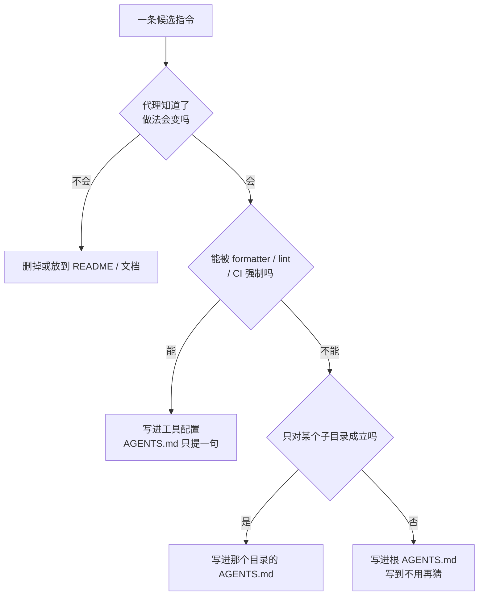

# AGENTS.md 写什么：只写会改变代理动作的事

<div class="meta-tags"><span class="tool-tag tool-general">通用（不限工具）</span></div>

<div class="hook">

**一句话看懂**：AGENTS.md 规范的维护方 AAIF 给出一条判据：每写一条指令，先问“代理知道了它，做法会不会变”。不会变的就不写。三份研究的证据并不一致，所以它的立场是收窄的：人写的、具体的、维护着的文件有用；自动生成、面面俱到的文件可能只是加成本。

</div>

## 读完你能带走的 7 条收获

1. **唯一判据**：每条指令都问一句“知道它会不会改变代理做的事”，不会就放到别处去（见 3.1）。
2. **证据并不一致，要读清楚边界**：一项研究说中位运行时间降 28.64%（只测效率）；另一项说成功率没有显著提升、步骤和成本增加，人写的文件显著好于 LLM 生成的（见 3.1）。
3. **写结构背后的“含义”，不写目录列表**：哪个包负责什么、能否独立部署、共享代码放哪（见 3.2）。
4. **命令写到“不用再猜”**：在哪个目录、跑哪个文件、完成前跑什么；像 Kubo 那样写明“用 `make build`，别用 `go build`”以及为什么（见 3.2）。
5. **例外和边界要点名**：生成文件写出路径和“该改哪里、跑什么”；依赖方向写成“谁不能 import 谁”；需要人批准的动作单独列（见 3.3）。
6. **完成标准随改动大小缩放**：迭代时跑单个测试，完成前跑包级测试，只有动了共享包才跑全量（见 3.4）。
7. **能被工具强制的规则移出散文，代理反复犯的错才是补文件的信号**；不再影响决策的指令要删，过时的路径警告比没有更糟（见 3.5、3.7）。

::: tip 小白先懂这几个词
- [AGENTS.md](/glossary#agents-md)：放在仓库里、写给编码代理看的说明文件，多家工具都会读。
- [嵌套 AGENTS.md](/glossary#nested-agents-md)：放在子目录里的 AGENTS.md，离被改文件最近的那份优先。
- [Monorepo](/glossary#monorepo)：多个应用和包放在同一个仓库里。
- [Lint](/glossary#lint)：静态检查代码风格和常见错误的工具。
- [Definition of Done](/glossary#definition-of-done)：什么条件满足了才算“做完”。
:::

## 1. 基本信息

<SourceCard type="文章" title="Writing an Effective AGENTS.md for Coding Agents" author="Steve Kearns" date="2026-08-13" url="https://aaif.io/blog/writing-an-effective-agents-md" />

| 项目 | 内容 |
|---|---|
| 链接 | https://aaif.io/blog/writing-an-effective-agents-md |
| 类型 | 规范维护方的写作指南（附研究综述和完整示例） |
| 作者 | Steve Kearns（Agentic AI Foundation 技术写作者） |
| 发布日期 | 2026-08-13 |
| 使用工具 | 通用（AGENTS.md 规范，不限具体代理） |
| 分析依据 | 原文全文（约 3,000 词，含 11 段代码 / 模板原文），2026-10-31 抓取。文中引用的三项研究本站未逐篇复核，数字以原文转述为准。“我觉得”开头的段落是本站评论。 |

## 2. 这篇在回答什么

假设你的仓库里已经有一份 AGENTS.md，内容都对：项目简介、目录结构、“请写干净的代码”“提交前跑测试”。代理每次都读了，却还是跑错测试命令、改了生成文件、在不该依赖的包之间加了 import。问题出在哪？

AAIF 的回答是：格式本身很轻，没有必填章节，也没有固定 schema；真正难的是另一件事——

::: tr 一个仓库很容易就有一份满是准确信息、却对代理的工作没什么帮助的 AGENTS.md。
> "A repository can easily end up with an AGENTS.md full of accurate information that does little to improve an agent's work."
:::

于是全文只有一个判据：

<Trans zh="对每一条指令，问：知道它，会不会改变代理做的事。">“For each instruction, ask whether knowing it would change what the agent does.”</Trans>

文章围绕五个问题展开：

1. AGENTS.md 到底有没有用？证据怎么说？
2. 该写什么：结构、命令、边界、完成标准。
3. 不该写什么？
4. 一个文件还是多个？
5. 怎么维护？



## 3. 怎么做

### 3.1 AGENTS.md 解决什么问题，证据怎么说

**它补的是“推不出来的仓库知识”。** 代理能自己看源码、配置、包清单、测试和文档，能认出语言、命名习惯、测试目录。但是：

<Trans zh="它没法可靠推断的，是这些文件背后的仓库知识。">“What it cannot reliably infer is the repository knowledge behind those files.”</Trans>

原文举了四种情况：显而易见的构建命令可能产出不完整的二进制；某个目录是生成代码，不该直接改；两个包看起来可以互相依赖，架构却禁止；一个小改动需要某条测试套件里看不出来的验证命令。这也是它和 README、贡献指南的分界：那些文档讲项目、安装、贡献流程和设计；AGENTS.md 可以指向它们，不必复制。

**三份证据，结论并不一致：**

| 来源 | 设计 | 结果 | 边界 |
|---|---|---|---|
| AAIF 五次运行实验 | 同一仓库两份副本，一份有简短 AGENTS.md | 较复杂任务上，无文件组 5 次里有 2 次花时间重新摸索仓库或跑了没要求的生产构建；有文件组 0 次 | 一个仓库、一个代理 |
| Lulla 等 | 10 个仓库、124 个 PR 任务 | 有 AGENTS.md 时中位运行时间低 28.64%，中位输出 token 少 16.58% | 只测运行效率，不全面评估补丁正确性 |
| Gloaguen 等 | 四个编码代理；SWE-bench Lite + 用自带上下文文件的仓库建的新基准 | 总体成功率没有显著提升，步骤和成本一致增加；LLM 生成的略负，人写的略正，两者与“没有文件”的差异都不显著；但人写的显著好于 LLM 生成的 | 代理基本照做具体指令；仓库概览没帮它更快找到相关代码 |

AAIF 对自家实验的定位很克制：<Trans zh="实验只覆盖一个仓库、一个代理，所以它是有用的证据，而不是通用基准。">“The experiment covered one repository and one agent, so it is useful evidence rather than a general benchmark.”</Trans>

Gloaguen 研究里还有一个消融：把代码库里其他文档全删掉后，LLM 生成的上下文文件平均提升 2.7%，反而超过了人写的。作者认为这可能解释了“加了上下文文件后代理变好”的说法——很多不太热门的仓库本来就没什么文档。

综合起来，AAIF 的立论是收窄的：认真维护的文件有帮助；把能从仓库里发现的一切自动塞进去，可能只是制造额外工作。

我觉得这一段比全文的写作建议更重要。它说明“写 AGENTS.md”不是默认正确的动作：如果你的仓库文档本来就齐全，一份自动生成的 AGENTS.md 很可能只在花钱。和 [[20]] 的“少即是多”是同一个方向，这里多了数字。

### 3.2 写进去：有含义的结构和不用再猜的命令

**结构：写含义，不写目录。** 仓库结构只有在“文件名看不出含义”时才值得写。比如在 monorepo 里，哪个包负责某个功能、应用能不能独立部署、共享代码应该放哪。原文举了 Cloudflare Agents 仓库（说明核心包、示例、指南、站点和文档各自的角色）和 Google Workspace 的 Go 示例仓库（开门先说明：这是一堆互相独立的示例，不是一个整体应用）。

<Trans zh="把目录列表抄进 AGENTS.md 作用小得多。有用的是结构背后的含义。">“A directory listing copied into AGENTS.md adds much less. The useful information is the meaning behind the structure.”</Trans>

**命令：写到代理不用再做决定。** 对比这两种写法。第一种：“Run the tests before submitting.” 代理还得自己决定跑哪些测试、在哪个目录跑、要不要先做什么。第二种（原文）：

```text
From `services/api`, run the affected test file while iterating:

pytest tests/<affected_test>.py

Before completing a change to the API, run:

pytest tests/
ruff check .
```

<Trans zh="第二种写法去掉了原本需要探索或猜测的决定。">“The second version removes decisions that would otherwise require exploration or guessing.”</Trans>

最有价值的命令说明，是那种“有经验的人也会选错”的。原文举 Kubo：它的 AGENTS.md 明确要求用 `make build` 而不是 `go build`，因为 Makefile 会带上必需的链接参数；也要求用仓库的 `make mod_tidy` 而不是直接 `go mod tidy`，因为三个 Go 模块必须保持同步。

### 3.3 写进去：例外、边界和需要人批准的事

**生成文件：点名路径，并说该改哪里。** “不要改生成文件”只有在代理能认出哪些是生成文件时才有用。原文的写法：

```text
Files under `packages/client/generated/` are generated from
`schemas/openapi.yaml`. Do not edit them directly.

After changing the schema, regenerate the client from the repository root:

pnpm generate:client
```

**架构：写成具体的依赖方向。** “Follow the existing architecture.” 没有说出任何一条规则。有用的写法是：`packages/ui` 可以依赖 `packages/core`；`packages/core` 不能从 `packages/ui` import；两者共用的代码放在 `packages/core`。原文举 Gutenberg：编辑器的包分三层，从 `block-editor` 到 `editor` 再到 `edit-post` 和 `edit-site`，低层不能依赖高层。这是代理写出一个“看起来合理”的实现之后才可能发现的约束。

**其他边界**：公开 API、兼容性、依赖管理、数据库迁移，以及需要人批准的动作。Azure SDK for Go 的 AGENTS.md 标出了生成的 SDK 代码，并列出代理未经人批准不能做的事，包括批准发布和变更许可证。

但 AGENTS.md 只是“告诉”，不是“强制”：

<Trans zh="这些指令不应该试图替代访问控制、CI 检查或其他强制机制。">“They should not attempt to replace access controls, CI checks or other enforcement mechanisms.”</Trans>

### 3.4 写进去：按改动大小缩放的完成标准

“跑一下测试”“确保一切正常”是很弱的完成定义。仓库通常有几层验证：开发时跑单个测试，完成前跑包级测试，格式和 lint，再加 CI 跑的大套件。原文以 Rails 为例：它提供跑某个组件、某个文件、某个测试或某一行，以及按数据库区分的 Active Record 套件的命令。有用的不是命令本身，而是“代理该怎么按改动选验证”。

原文给的写法（转述其结构）：改 `apps/web` 时，迭代中跑相关的 Vitest 文件；完成前跑 `pnpm --filter web test` 和 `pnpm --filter web lint`；只有动了 `packages/` 下的共享包才跑全工作区测试。

<Trans zh="它告诉代理，验证的投入应该怎样随改动缩放。">“It tells the agent how validation effort should scale with the change.”</Trans>

**一张可以当审稿清单的对照表**（原文表格，本站翻译）：

| 模糊写法 | 缺了什么 | 更可用的写法 |
|---|---|---|
| Run the tests. | 哪些测试、在哪、什么时候？ | 在 `services/api` 下迭代时跑受影响的 pytest 文件；完成 API 改动前跑 `pytest tests/`。 |
| Don't edit generated code. | 哪些是生成代码？ | 不要改 `packages/client/generated/`；改 `schemas/openapi.yaml`，再跑 `pnpm generate:client`。 |
| Follow existing patterns. | 哪个实现是范本？ | 新的 HTTP handler 照 `services/api/routes/users.py` 写，包括校验和错误处理。 |
| Follow the architecture. | 要守住哪条边界？ | `packages/core` 不能从 `packages/ui` import，共享代码放 `packages/core`。 |
| Use the standard build process. | 这里的“标准”是什么？ | 在仓库根目录跑 `make build`，不要用 `go build`，包装脚本会带上必需的构建元数据。 |

### 3.5 不该写什么

- **仓库里一眼能看出来的。** 证据上，Gloaguen 的轨迹分析显示仓库概览没有帮代理更快找到相关代码，而上下文文件整体增加了步骤和成本。`package.json`、`tsconfig.json` 和源码树已经说明这是 TypeScript 项目，就不用再写一段。
- **通用的软件建议。** 比如“写干净的代码、用有意义的变量名、遵循最佳实践、认真测试”。<Trans zh="这些指令没有一条告诉代理，这个仓库要求什么。">“None of these instructions tells the agent what this repository requires.”</Trans>
- **大段复制已有文档。** VS Code 的 AGENTS.md 故意写得很小，把架构、编码和验证的细节指向项目已有的 Copilot instructions，避免两份说明悄悄不一致。原文也承认，各家代理是否同样处理这种引用，是实现层面的问题。
- **能交给工具强制的规则。** 格式交给 formatter 配置；依赖边界能被静态分析强制，就加检查。<Trans zh="AGENTS.md 可以告诉代理有这些系统，但不应该是阻止无效改动的唯一一道防线。">“AGENTS.md can tell an agent about those systems, but it should not be the only thing preventing an invalid change.”</Trans>
- **密钥和私密运维细节。** 不要为了省得代理开口问，就把凭据写进去。

### 3.6 一个文件还是多个，以及一份完整的前后对比

**嵌套文件。** 小仓库根目录一份就够。大仓库可以在靠近代码的地方再放。官方指南支持嵌套，规则是：指令冲突时离被改文件最近的 AGENTS.md 优先；用户的显式指令高于仓库说明。根目录写处处适用的（用 pnpm、别提交生成产物、跨包改动前跑 `pnpm lint`）；`services/api/` 下写只在那里成立的（Python 3.13、在本目录跑 `pytest tests/`、改表结构要在 `migrations/` 下加新迁移、不要改已经应用过的迁移）。前端代理没必要读一遍迁移规则。

嵌套最适合“仓库本身有真实边界”的地方：不同语言、构建系统、验证流程、架构或归属规则。原文提醒，各家代理发现和合并这些文件的方式可能不同，用了嵌套就要实测你依赖的那些代理，而不是假定它们都按同一层级处理。

**完整例子。** 一个含 web 应用、Python API 和生成的 TypeScript 客户端的 `acme-platform` 仓库。第一版 AGENTS.md 只有五句：这是 Acme Platform 仓库、遵循现有风格、提交前跑测试、不要改生成文件、改动保持聚焦。原文评价：没有一句不合理，但重要的决定都没解决——哪些文件是生成的、怎么重新生成、前端和 API 各跑什么测试、API 改动从哪开始、改 schema 要不要同步客户端。

改进版（原文逐字，节选关键段落）：

```text
## Generated client

Do not edit `packages/client/generated/` directly.

When an API change affects the public schema:

1. Update `schemas/openapi.yaml`.
2. From the repository root, run `pnpm generate:client`.
3. Include the resulting generated client changes.

## Validation

Changes confined to one application do not require the full workspace
test suite.

Run `pnpm test` from the repository root when changing shared packages
or behavior used by both the web application and API.
```

::: tr 每一处补充都在解决一个具体的歧义。
> "Each addition addresses a specific ambiguity."
:::

原文逐条解释：布局部分只点名 schema 文件和生成目录，其余从仓库和后面的命令就能看出；包管理规则防止一条看似合理却会和工作区冲突的命令（在单个包里 `npm install`）；测试说明告诉代理验证做到多少合适；生成客户端那节同时标出受保护的路径和该改的源头。文件变长了，是因为这个仓库确实有好几条会影响代理行为的知识；别的项目可能需要少得多。

原文还给了一份五节空模板（Repository layout / Setup and commands / Repository-specific rules / Generated or restricted files / Validation，每节带一句注释说明该填什么），并强调：

<Trans zh="不要只因为模板里有这个标题，就把每一节都填满。">“Do not fill every heading simply because the template contains it.”</Trans>

### 3.7 怎么维护

- **跟着仓库变。** 构建从 npm 换到 pnpm，命令要改；CI 开始自动强制某条规则，文件里可能不用再细讲；生成目录搬了家，<Trans zh="关于旧路径的过时警告，比没有警告更糟。">“an old warning about its previous path is worse than no warning.”</Trans>
- **代理的行为就是维护信号。** 代理反复花时间找同一个子系统、选错验证命令、需要审查者重复做同一个纠正时，看看是不是一条小指令就能消除这个歧义。
- **反过来也要删。** <Trans zh="不再影响决策的指令应该删掉。">“Instructions that no longer affect decisions should be removed.”</Trans>

我觉得“代理反复犯同一个错”是最可靠的补写触发器，和 [[07]]“把团队规范变成 lint 和测试”、[[107]] 的配置面地图正好接上：先看这条规则能不能交给工具强制，不能，再写进最近的那份 AGENTS.md。

## 4. 结果与局限

**这篇真正给出的东西**

- 一个可执行的判据（“会不会改变代理的动作”），一张模糊 → 可用的对照表，一份完整的前后对比和空模板。
- 对三项研究的转述，并且把各自的边界写在了数字旁边。

**局限与注意**

- AAIF 是 AGENTS.md 规范的维护方，文章天然站在“这个格式有用”的一边；不过它没有回避 Gloaguen 研究里不利的结果。
- 自家实验只有一个仓库、一个代理、五次运行；Lulla 研究只测效率不测正确性；Gloaguen 研究里人写与 LLM 生成文件相对“无文件”的差异都不显著。三者都不能证明“写了 AGENTS.md 代码就更好”。
- 本站没有逐篇核对三篇论文，数字以 AAIF 原文转述为准。
- 嵌套文件在各代理里的实际行为，文中只提醒要实测，没有给出对照。
- 示例仓库 `acme-platform` 是构造的教学例子，不是真实项目。

## 5. 结论

AGENTS.md 不是越全越好，也不是写了就有用。它该装的只有一类东西：代理从仓库里推不出来、但会改变它下一步动作的知识——有含义的结构、不用再猜的命令、点了名的例外和边界、随改动缩放的完成标准。能交给工具强制的交给工具，不再影响决策的删掉。

**你可以这样试**

1. 把你仓库现有的 AGENTS.md / CLAUDE.md 逐条过一遍判据：“代理知道了会不会做得不一样？”不会的划掉。
2. 用 3.4 的对照表审一遍：找出所有“Run the tests”式的句子，改写到“在哪个目录、跑哪个文件、完成前跑什么”。
3. 列出仓库里所有生成目录，每个写清“源头在哪、重新生成的命令是什么”。
4. 找一条现在只写在 AGENTS.md 里的架构规则，试着用 lint 或依赖检查强制它。
5. 下次审查代理的 PR 时，记下你重复给出的纠正；出现第二次就补一条指令。

**读完自测**

1. AAIF 判断一条指令该不该写的唯一问题是什么？
2. Gloaguen 等的研究里，人写和 LLM 生成的上下文文件分别是什么结果？什么条件下 LLM 生成的反而更好？
3. 为什么“把目录列表抄进去”帮助不大？什么样的结构信息才值得写？
4. 嵌套 AGENTS.md 冲突时谁优先？为什么还要实测？
