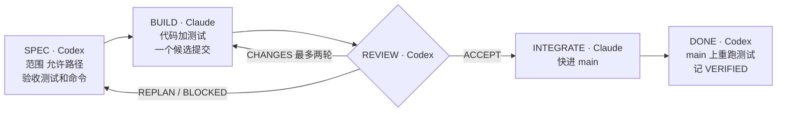

# Codex 审、Claude 写：双代理团队踩过的八个坑

<div class="meta-tags"><span class="tool-tag tool-general">通用（不限工具）</span></div>

<div class="hook">

**一句话看懂**：Mert Sahin 让 Codex 写规格和审查、Claude Code 写代码和合并，两者靠仓库里的 `WORK.md` 轮流交接。八次故障几乎都不是“代码写错”，而是**报告、测量和门槛失真**：接受了却没上 main、报告描述的是计划而不是工件、为了变绿缩小测量、验证器本身没被验证、审查永远不收敛。

</div>

## 读完你能带走的 8 条收获

1. **写代码的不验收**：审查者换一家厂商的模型，让“独立”不只是同一个模型换个提示词；作者明说这是设计选择，不是测量结果（见 3.1）。
2. **交接靠提交，不靠聊天**：每一步在 `WORK.md` 追加带 `State`、`Next-Actor`、`Candidate` 的头；只快进合并，最新提交的头决定谁动（见 3.1）。
3. **“完成”要拆成四个状态**：写完、验证、接受、集成分开报告；不在 main 上复验就不算完成——他曾经 4 天开 30 项、0 项进 main（见 3.2）。
4. **报告里的每个数字都从工件重算**：代理写的报告会描述计划而不是实际产物；要用脚本从提交和日志重新算，并跑规格里点名的那条命令（见 3.2）。
5. **合约规则逐字引用，不要转述**：一次转述把“混合币种的总额变为未知”改成“币种不符就拒绝”，两轮之后才暴露（见 3.3）。
6. **永远不要为了通过而缩小测量**：先拿栈追踪再形成理论；代理会过滤掉它怀疑的对象，然后把猜测当事实报告（见 3.3）。
7. **验证器本身要能失败**：11 个变异幸存者里 7 个是弱测试；产品有 752 个测试，认证它的 harness 一个都没有（见 3.4）。
8. **审查不收敛时改标准，不要再加轮次**：6 轮对抗审查每轮都找到 3–21 个真缺陷；改成约 40 个具名故障的封闭清单后一轮收敛（见 3.5）。

::: tip 小白先懂这几个词
- [Spec](/glossary#spec)：动手前写下的规格，说明做什么、做到什么程度。
- [交接](/glossary#handoff)：一个代理把工作状态交给另一个代理继续。
- [WORK.md 轮次头](/glossary#turn-header)：本文用来记录“当前工作项、状态、轮到谁”的文件头。
- [变异测试](/glossary#mutation-testing)：故意改坏代码，看测试能不能发现；发现不了的“幸存者”说明测试太弱。
- [对抗式审查](/glossary#adversarial-review)：审查者的任务是尽量找出问题，而不是确认没问题。
:::

## 1. 基本信息

<SourceCard type="文章" title="Running Codex and Claude as a two-agent team: what broke, and the rules that fixed it" author="Mert Sahin" date="2026-10-04" url="https://mertsahin.ai/notes/two-agent-team/" />

| 项目 | 内容 |
|---|---|
| 链接 | https://mertsahin.ai/notes/two-agent-team/ |
| 类型 | 个人工程笔记（单人项目的实践复盘） |
| 作者 | Mert Sahin |
| 发布日期 | 2026-10-04 |
| 使用工具 | OpenAI Codex（规格与审查）、Claude Code（构建与集成）、GitHub Spec Kit |
| 分析依据 | 原文全文（约 1,100 词），2026-10-31 抓取。所有数字是作者自述的个案，没有公开脚本和日志。`WORK.md` 头的字段值原文注明为示意。“我觉得”开头的段落是本站评论。 |

## 2. 这篇在回答什么

两个代理分工很容易画在白板上：一个写，一个审。真正跑起来，问题往往不在“代码写错了”，而在于：审查通过的东西有没有真的上线？报告里说的“全部通过”，是看了产物，还是复述了计划？审查一轮又一轮，为什么永远审不完？

Mert Sahin 用两家厂商的代理做软件。规则只有一条起点：

<Trans zh="谁写的代码，谁就不能接受它。">“whoever writes the code does not accept it.”</Trans>

他把审查席交给另一家厂商的模型，好让“独立”不只是同一个模型的第二个提示词，并且坦白：<Trans zh="这是一个设计选择，不是测量出来的结果。">“That is a design choice, not a measured result.”</Trans>

文章先给出循环，再讲八次故障，每次故障配一条规则。本文把它们归成四个问题：

1. 两个代理怎么交接、谁说了算？
2. 怎样才算“完成”？
3. 代理会怎样在验证上自欺，怎么防？
4. 审查不收敛怎么办？



## 3. 怎么做

### 3.1 循环与交接：写者不验收，提交才是权威

**分工。** Codex 负责规格和审查，Claude Code 负责构建和集成。GitHub Spec Kit 存放 spec、plan 和 tasks；仓库里的 `WORK.md` 记录当前工作项和轮到谁。

**循环**（原文逐字）：

```text
SPEC         Codex: scope, allowed paths, acceptance tests + exact commands
 └ BUILD        Claude: product code + tests, one candidate commit
    └ REVIEW       Codex: ACCEPT | CHANGES | REPLAN | BLOCKED
       └ INTEGRATE    Claude: fast-forward main to the accepted commit
          └ DONE         Codex: re-run the tests on main, record VERIFIED
```

**每一步都在 `WORK.md` 追加一条记录**，结尾是这样一个头（原文注明字段值仅为示意）：

```text
Work: W-012 export-totals
State: REVIEW
Next-Actor: codex
Base: 4f2c1e9
Candidate: a81d3b0
Review-Round: 1
```

围绕这个循环有四条硬约束：

- **验收测试和精确命令在 BUILD 之前固定。** 构建者可以加测试，不能缩小测试。
- **审查者检查确切的候选提交，并自己跑测试。** 不读构建者的报告了事。
- **CHANGES 最多两轮。** 超过就从干净的 main 重新规划。
- **只快进合并，最新提交的头决定谁行动。** <Trans zh="聊天不算权威。">“Chat is not authority.”</Trans>

我觉得 `Next-Actor` 这个字段是全文最便宜也最有用的设计。两个代理（或者代理和人）交接时，“现在轮到谁”如果只存在于对话里，就一定会出现两边同时动手或两边都在等。把它写进提交，git 就成了唯一的调度器。这和 [[80]] 里“一个文件一个写者”、[[111]] 里的写审环是同一类问题的不同切面。

### 3.2 怎样才算完成：上了 main 并复验，数字从工件重算

**故障 1：接受了，却从没上线。** 第一版没有集成步骤。作者审计一个产品时发现：四天里开了 30 个工作项，23 个被阻塞，2 个有已接受的可执行代码，0 个集成进 main。

> 规则：完成 = 在 main 上并且复验过。把“写完、验证、接受、集成”当作四个独立阶段分别报告。

**故障 2：报告描述的是计划，不是产物。** 三个例子：

- 一份构建报告说某个测试读了九个文件，实际读了八个。
- 另一份说八个具名控件“全部失败”，可这些 ID 根本不在文件里。
- 规格点名了一个生产构建脚本，代理却跑了普通构建。

> 规则：每个数字都用脚本从已提交的产物或日志里重新算出来；跑规格里点名的那条命令，一字不差。

这两条合在一起，是在对付同一种失真：代理（以及人）倾向于报告“应该发生的事”。审查者如果只读报告，就是在审计划。

### 3.3 代理怎样在验证上自欺：转述、缩小测量

**故障 3：转述的规则变成了缺陷。** 合约里写的是“混合币种的总额变为未知”，派活时被缩写成“币种不符则拒绝”。

::: tr 实现和验证都照着这个转述走，冲突到两个切片之后才暴露。
> "Implementation and verification both followed the paraphrase, and the conflict surfaced two slices later."
:::

> 规则：合约里已经定义的规则，逐字引用并注明出处位置。

**故障 4：一个让探针通过的过滤器。** 一个统计某运行时内置函数调用次数的探针返回了 1。代理把它怀疑的那个对象过滤掉，得到了绿灯，并把自己的理论当成事实写进报告。真正的调用者在别处，一个恶意输入可能会伪装成普通错误溜过去。

> 规则：永远不要为了通过而缩小测量。先拿到栈追踪，再形成理论。

我觉得第 3 条值得所有用多代理或子代理的人记住：每多一次“用自己的话转述任务”，规则就多一次被悄悄改写的机会。主代理派活时把原文条款连同位置一起贴过去，比写一段漂亮的摘要可靠得多。

### 3.4 验证器也要被验证：弱测试与修类不修句

**故障 5：验证器需要验证。** 作者做变异测试时发现，11 个幸存的变异体里有 7 个是因为测试太弱。例如 `.not.toBe('accepted')`：任何一种拒绝都能让它通过，所以就算把被测规则删掉，测试照样过。harness 本身也有 bug：它用错误的编码解码 Windows 上的测试输出，看到的是空运行。

<Trans zh="产品有 752 个测试；认证它的 harness 一个都没有。">“The product had 752 tests; the harness that certified it had none.”</Trans>

> 规则：把 harness 当产品对待。信任任何一道检查之前，先证明它在已知错误的输入上会失败。

**故障 6：修了句子，没修那一类问题。** 让代理把文档里一个计数列表删掉，它删了标题，留下了列表。另一处，一个修复只覆盖了一条写路径；一个 15 行的见证脚本又找到四条有同样 bug 的路径。

> 规则：给缺陷命名它属于哪一类，检查所有共享同一机制的路径，在咽喉处修。

这和 [[95]] 讲的“验证 oracle 本身要可信”、[[57]] 里“先确认检查能拦住坏改动”是同一个结论，这里多了具体数字：752 比 0。

### 3.5 审查不收敛、文件保存即行动

**故障 7：一道靠更努力也过不去的门槛。**

<Trans zh="六轮对抗式审查，每轮都找到 3 到 21 个真缺陷，而且发现率从没下降。">“Six adversarial review passes each found between 3 and 21 real defects, and the rate never fell.”</Trans>

<Trans zh="把门槛改写成一份约四十个具名故障的封闭清单后，一轮就收敛了。">“Rewriting the gate as a closed list of about forty named faults converged in one round.”</Trans>

> 规则：如果真实发现不再收敛，问题出在标准上。升级标准，而不是再磨更多轮。

**故障 8：按“保存”行动，而不是按“提交”。** 一个文件监视器在 `WORK.md` 被保存的那一刻唤醒了 Claude，而 Codex 还差一步才提交。Claude 差点把一个合法的 ACCEPT 当成未授权而拒绝。

<Trans zh="规则：保存只是一个信号。只有工作树干净、HEAD 已经移动时才行动。">“Rule: a save is a signal. Act only when the tree is clean and HEAD has moved.”</Trans>

我觉得第 7 条是全文最反直觉、也最省钱的一条。开放式的“再找找问题”对模型来说永远找得到东西，审查轮次就会无限续租（[[90]] 的补丁踩踏机是同一种现象）。把“要检查什么”写成封闭清单，审查才有终点。

### 3.6 如果你要照着做，以及下一步

**作者的落地建议**（原文“If you adopt this”一节）：

- 自动化任何东西之前，先手工把一个工作项完整跑一遍循环。<Trans zh="在自动化任何东西之前，先手工把一个工作项跑完整个循环。">“Run one work item through the whole loop by hand before automating anything.”</Trans>
- 同一时间只有一个活跃工作项、一个写者。git 是证据库：交付用的 checkout 里不 amend、不 rebase、不 stash。
- 派发一个任务前，先让一个全新的只读审查者干跑一遍这份任务说明。
- 只有产品、风险和发布决策才升级给人。<Trans zh="只把产品、风险和发布决策升级给人。一轮审查失败不属于这些。">“Escalate to people only for product, risk and release decisions. A failed review round is not one of them.”</Trans>

**下一步**：更自主的版本，每个模型跑在自己的 harness 里，自己派子代理。作者已经在审查上用了这个模式：一次冻结前，四十个只读代理、每条主张配一个单独的反驳者，确认了三个测试没抓到的真缺陷。

<Trans zh="自主性越高，没人逐行读的产出就越多，所以这些规则更重要，而不是更不重要。">“More autonomy means more output nobody reads line by line, so these rules matter more, not less.”</Trans>

## 4. 结果与局限

**文中给出的个案数字**（全部作者自述，无对照、无公开日志）

- 无集成步骤时：4 天 30 项，23 阻塞，2 项有已接受代码，0 项集成。
- 变异测试：11 个幸存者中 7 个是弱测试；产品 752 个测试，harness 0 个。
- 对抗审查：6 轮每轮 3–21 个真缺陷不下降；约 40 项封闭清单一轮收敛。
- 见证脚本：15 行，多找到 4 条同类 bug 路径。
- 冻结前审查：40 个只读代理加反驳者，确认 3 个真缺陷。

**局限与注意**

- 单人项目、单一作者复盘，产品是什么、规模多大都没有说明。
- “跨厂商审查更独立”是设计选择，作者明确没有测量。
- 没有成本、时长数据，也没有公开 `WORK.md` 的调度脚本和那份约 40 项的故障清单。
- 规则之间有张力：“最多两轮 CHANGES 后重规划”和“审查不收敛就改标准”都在限制轮次，但文中没有说明两者怎么配合。

## 5. 结论

这篇短文的价值，在于它把双代理协作里最常见的失败位置标了出来：不是写代码那一步，而是“报告说了什么”“测量量了什么”“门槛要求什么”“谁在什么时候有权动手”。对应的四个做法都很朴素：完成要在 main 上复验；数字从产物重算；验证器先证明自己会失败；交接只认提交。

**你可以这样试**

1. 在你的多代理或子代理流程里加一个 `Next-Actor` 字段，写进提交，而不是留在对话里。
2. 把“完成”拆成写完 / 验证 / 接受 / 集成四个状态，看看现在有多少“接受了但没上 main”的工作。
3. 挑一个你最信任的检查脚本，喂一个已知错误的输入，确认它真的会失败。
4. 下次审查轮次超过三轮还在出新问题，停下来把检查项写成一份封闭清单。
5. 派活时，把合约原文条款连同文件位置一起贴给执行者，不要转述。

**读完自测**

1. 作者为什么让另一家厂商的模型做审查？他怎么评价这个选择？
2. `WORK.md` 头里哪个字段决定下一步谁来动？为什么说“聊天不算权威”？
3. `.not.toBe('accepted')` 为什么是一个弱测试？
4. 六轮对抗审查都不收敛时，作者做了什么改变？
