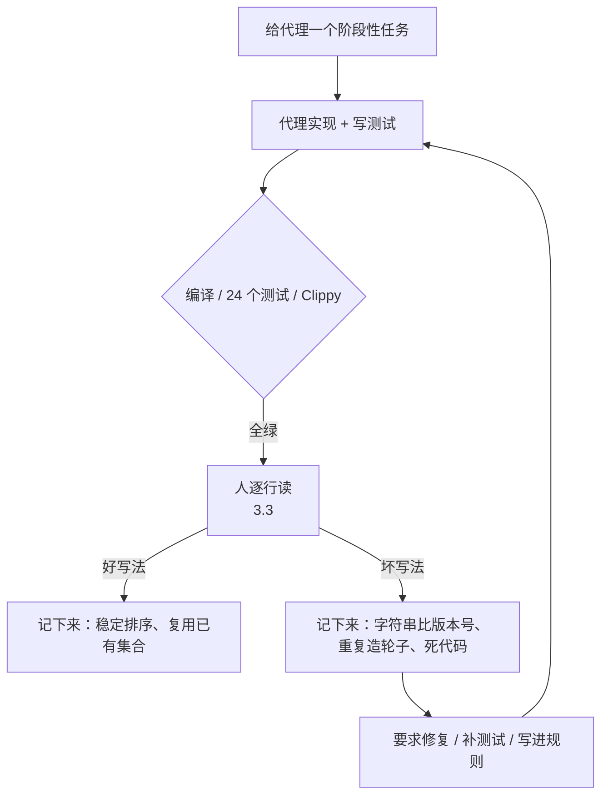

# 24 个测试全绿，代码就没问题吗：ForrestKnight 逐行审 Grok 4.5 写的代码

Cursor + Grok 4.5

**一句话看懂**：ForrestKnight 在三个真实项目里用 Cursor + Grok 4.5 写代码，然后一行行读。结论是：它快、便宜，修好了另一个模型连试六七次都没修好的 bug；但在 24 个测试全绿、Clippy 无警告的代码里，照样藏着“按字符串比较版本号”和“无视已有依赖、重写一遍”这种错误。

## 读完你能带走的 6 条收获

1. **对基准打折**：连 Cursor 自己都因训练数据污染，没公布 Grok 4.5 的 CursorBench 成绩（见 3.1）。
2. **换个模型，可能就修好了卡住的 bug**：但“能出预览”不等于“修得完美”（见 3.2）。
3. **测试全绿也要读代码**：代理自己写的测试，只测它想到的情况（见 3.3）。
4. **两个 AI 高频坏习惯可以直接进审查清单**：用字符串比较数字；无视项目里已有的工具，自己再写一份（见 3.3、3.4）。
5. **好代码也值得记下来**：为不保证顺序的 API 加稳定排序，并在注释里写明原因；302 不能用在 API 路径上（见 3.3、3.4）。
6. **快模型适合做被委派的执行者**：长时循环型模型做编排，把批量执行交给它（见 3.6）。

::: tip 小白先懂这几个词
- [Cursor](/glossary#cursor)：集成 AI 代理的代码编辑器。
- [Benchmark](/glossary#benchmark)：用固定题目给模型打分排名，可能失真。
- [Lint（Clippy）](/glossary#lint)：Rust 的静态检查工具叫 Clippy。
- [Vibe Coding](/glossary#vibe-coding)：只看能不能跑、不读代码的写法。
- [子代理](/glossary#subagent)：被派出去干具体小活的代理“分身”。
- [模型名称](/glossary#model-names)：Fable、Opus、GPT-5.x、Grok 4.x 分属不同厂商。
:::

## 1. 基本信息

<YouTube id="5J6HCDEkg64" title="Coding with Grok 4.5 is surprisingly good…" />

| 项目 | 内容 |
|---|---|
| 讲者 / 频道 | ForrestKnight（软件工程师、开发者 YouTuber）／ **ForrestKnight** |
| 发布日期 | 2026-07-10 |
| 时长 | 27:02 |
| 使用工具 | Cursor + Grok 4.5（对照 Fable 5、Opus 4.8、GPT-5.5） |
| 形式 | 单人实测：真实项目 diff 讲解 + 人工代码审查 |
| 分析依据 | YouTube 自动英文字幕全文（yt-dlp，2026-10-14 重新抓取，引语逐字核对）+ 视频真实画面截图。视频 1:04–2:43 是 PostHog 赞助段落，本文不涉及；讲者声明 Cursor 没有付费。讲者说这是约 24 小时的个人使用体验；价格是视频发布时的数字。“我觉得”开头的段落是本站评论，不是讲者观点。 |

## 2. 这篇在回答什么

代理写完了，跑测试：24 个，全部通过。第一次就编译成功，静态检查一个警告都没有。你会合并吗？

讲者的话是：如果你不看代码，只看 CI 输出，<Trans zh="你在 vibe coding，那你就没问题">“you vibe coding, you're good”</Trans>。然后他做了一件他说“很流行”的事：读代码。

这期视频借 Grok 4.5 发布，回答了六个问题：

1. 模型榜单能信多少？（3.1）
2. 换个模型，能修好卡住的 bug 吗？（3.2）
3. 测试全绿之后，人读代码能发现什么？（3.3）
4. AI 代码里有哪些值得夸、哪些常见的坏写法？（3.4）
5. 模型会不会擅自改掉你的约束？（3.5）
6. 一个又快又便宜的模型，该放在工作流的哪里？（3.6）

## 3. 怎么做

### 3.1 先对基准打个折

讲者一直认为基准测试<Trans zh="大多是胡扯">“mostly mostly nonsense”</Trans>，尤其是近来的 SWE-bench：可以被刷，也可能有无意或有意的误导，甚至数据污染。

Grok 4.5 的发布正好给了一个例子。Grok 4.5 High 在 CursorBench 上比 Fable 5 表现更好、也便宜得多，可发布页上没有这个成绩。原因是 Cursor 自己说明的：

::: tr Grok 4.5 在 CursorBench 上有优势，因为训练里意外包含了 Cursor 代码库的一个早期快照。
> "Grok 4.5 has an advantage on Cursor Bench because an earlier snapshot of the Cursor code base was accidentally included in training."
:::

Cursor 说不知道这具体帮了多少，相关数据已从未来模型里移除，CursorBench 也在做更大的更新。

讲者唯一看得上的是 Artificial Analysis，而且看的不是数字本身，而是从 Grok 4.3 到 4.5 的跳跃：从几项榜单的末尾，跳到和 Opus 4.8、GPT-5.5 同一档。他说用了 24 小时左右，同意这个排位，但只限编码能力。

**价格**（视频发布时，每百万 token，输入 / 输出）：

| 模型 | 价格 |
|---|---|
| Grok 4.5 | $2 / $6 |
| Opus 4.8 | $5 / $25 |
| GPT-5.5 | $5 / $30 |

他补充说，GPT-5.5 纸面上更贵，但 Opus 4.8 更费 token，实际未必。厂商还说 Grok 4.5 的 token 效率大约是同类模型的两倍，讲者用的词是 “supposedly”（据说）。

为什么跳得这么快？讲者引用发布博客：训练用了万亿级 token 的 Cursor 数据，包括开发者和代理交互的记录（除非你选择退出），加上 SpaceX AI 数万块 Nvidia GB300 GPU。

我觉得这一节最有用的不是价格表，而是那个反例：一家公司主动撤下了对自己有利的榜单成绩。榜单只能当线索，最后要拿你自己的仓库来试。

### 3.2 案例一：另一个模型连试六七次都没修好的 bug

项目是讲者朋友 OrcDev 写的录屏工具，Rust + Electron，讲者想把它从 macOS 移植到 Linux。问题是：预览画面是一片彩虹色的花屏。他说 Fable 5 <Trans zh="连续六七次">“six or seven times in a row”</Trans>都没修好。

Grok 4.5 的判断是：彩虹预览是接线 bug，不是采集缺失，采集本身没问题。它的改法（讲者照着说明念的）：

- 把软件预览指向 `live.jpg`，以 15 FPS 轮询；
- Linux 上跳过 preview live start，免得 FFmpeg 覆盖合成器的帧；
- 重命名 portal source；
- 懒加载 electron updater，免得应用就绪前崩溃；
- Rust 侧把一张 JPEG 发布到最新帧槽位，让 live JPEG 和 live MJPEG 保持同步。

讲者的评价很克制：

::: tr 是完美的修复吗？不是。但它确实让预览显示出来了，而 Fable 5 就是做不到。
> "So, is it a perfect fix? No. But it was able to actually get a preview shown, whereas Fable 5 it just simply wasn't."
:::

他说 Grok 4.5 几分钟就做完了，而 Fable 5 要一轮又一轮。但他也强调这不是常态，只是一个特别的例子。

这里有个讲者自己的口误。他先说这是 Rust 改动，又改口说 GitHub 上的提交只有 TypeScript，骂自己“是个骗子”；最后发现 Rust 改动还在本地没提交。两部分都有。

### 3.3 案例二：Rust 写的 “UV for Java”，测试全绿也要读代码

讲者在用 Rust 写一个 Java 工具：一个静态二进制，管理 JDK、原生解析 Maven 依赖。他的说法是 <Trans zh="我在做 Java 版的 UV">“I'm building UV for Java.”</Trans>

他让 Grok 4.5 完成第二阶段，工具链管理器：从 API 找 JDK、下载、校验 checksum、安装、按项目 pin 版本、在 shell 里激活。他也承认，一次全丢给它，可能不是 Grok 4.5 最好的用法。

结果看起来无可挑剔：

::: tr 它写了 24 个测试，24 个全部通过。第一次就编译成功，Clippy 完全没有警告。
> "it had 24 tests, and all 24 tests passed. It compiles first time, Clippy is completely clean"
:::

<figure class="shot"><figcaption>📷 视频截图 · <a href="https://www.youtube.com/watch?v=5J6HCDEkg64&t=900s" target="_blank" rel="noopener">15:00</a> · 15:00 Cursor 里 Grok 4.5 完成工具链管理器阶段后的汇总，底部模型选择显示“Cursor Grok 4.5 High Fast”。</figcaption></figure>

然后，<Trans zh="我读了代码">“I read the code.”</Trans>几千行没法全看，他挑了几处。

**做得好的地方**：有个函数从 API 返回的结果里挑一个 JDK 包来装。它先排序，并在第 79 行按 package ID 做了稳定的 tie-break。为什么重要？这个 API 不保证返回顺序。没有这一行，同一条安装命令跑两次，可能装出两个不同的包；而这个工具存在的意义就是可复现。而且这是有意的：代码注释里写着 API 自己的顺序不稳定。

另一个好地方是选择策略：libc、归档格式、取最新版，全编码成一个 tuple，没有 AI 一向爱写的层层嵌套 if。

**做得不好的地方**：另一个函数要为一个版本规格挑出已安装的最佳 JDK，比如你 pin 了 Java 21，它就挑已装的最新匹配版本。问题是它**按字符串比较版本号**。所以装了 `.9` 和 `.11` 两个版本时，它会选 `.9`，以为那是更新的版本。

<figure class="shot"><figcaption>📷 视频截图 · <a href="https://www.youtube.com/watch?v=5J6HCDEkg64&t=1070s" target="_blank" rel="noopener">17:50</a> · 17:50 讲者在输入框里打出“2.09.9 | 2.09.11”，演示按字符串比较时 .9 会被误判为比 .11 大；上方汇总写着 24 个 toolchain 测试。</figcaption></figure>

讲者说这还不是最傻的部分。项目里已经引入了一个专门比较版本号的 crate，模型却没用它，自己重写了一份，还写错了。

::: warning AI 代码的两个高频坏习惯
1. **用字符串比较本该按数字比较的东西**，比如版本号。
2. **无视项目里已有的依赖或工具函数，自己再写一份**。讲者说他经常看到 AI 这么做（见 3.4）。
:::

我觉得这个案例的意义在于：24 个测试是代理自己写的，它只会测自己想到的情况。它没想到 `.9` 和 `.11` 的比较，测试里自然也没有。人读代码的价值，就在于补上代理想不到的那部分。

### 3.4 案例三：TypeScript 短链平台

这是讲者自用的短链和链接分析平台，接了 Stripe 和 Clerk。改动不大，<Trans zh="新增 93 行、删除 3 行">“plus 93 minus three”</Trans>。

**好的一行**：保留路径（reserved slugs）通常要重定向，但 API 路径不行：

::: tr 因为 302 会让大多数客户端把 POST 请求重放成 GET。
> "Because a 302 makes most clients replay a post as a get"
:::

讲者说他自己就遇到过：这会破坏 Stripe、Clerk 等服务的 webhook。

<figure class="shot"><figcaption>📷 视频截图 · <a href="https://www.youtube.com/watch?v=5J6HCDEkg64&t=1170s" target="_blank" rel="noopener">19:30</a> · 19:30 短链平台的改动：“fix: redirect app UI routes off short/custom domains to APP_URL”，讲者正在解释为什么 API 路径不能用 302 重定向。</figcaption></figure>

它还复用了已有的 reserved slugs 集合，没有另建一份平行的。讲者特意夸了这点，因为他常看到 AI 不用已有的东西，<Trans zh="新写一个，要么一模一样，要么是错的">“create something new that's either just the same or wrong”</Trans>，就像 3.3 里的版本比较。

**坏的地方**：一个接口里声明了 `short domain` 字段，却哪里都没用。看起来它本来打算检测短域名，后来改成检测应用主机名。换了设计也许更好，但旧设计留下的死代码没清理。讲者说这不是 Grok 4.5 独有的，Fable 5 也会（少一些），GPT-5.5 和 Opus 4.8 也会。

### 3.5 守约束：Rust + Wasm 割草游戏

讲者平时不做一次性生成，但试了一个：用 Rust 编译到 WebAssembly，做一个割草游戏。Grok 4.5 做出来了，而且<Trans zh="忠于提示词，完全是 Rust">“it stayed true to the prompt where it is completely Rust”</Trans>。

他也让 Fable 5 做了同一题（本来想用 Opus 4.8，没注意到当前选的是 Fable 5）。Fable 5 的版本好看得多，他读代码后也承认架构更好。但它擅自引入了 JavaScript 和 CSS 来做界面和随机数，而提示词里完全没提这些。

讲者的结论是：架构更好，却没按要求做；Grok 4.5 守住了约束。

我觉得这个例子可以变成一个很便宜的模型对比方法：给一个带硬约束的小任务（“只用标准库”“只用 Rust”），看谁会擅自改架构。

### 3.6 放进工作流：快模型做执行，循环型模型做编排

讲者把模型分成两类：

- **循环型**：Fable 5（他说 GPT-5.6 Sol 听起来也是）。给足信息、给个方向，让它在后台跑很久，派出一堆子代理。
- **交互型**：Opus 4.8、GPT-5.5，以及 Grok 4.5。Grok 4.5 最快：

::: tr 你不用切去做别的事，因为一分钟后它就会把这个任务做完。
> "you don't go and work on something else, because a minute later it's going to be complete with that task."
:::

他以前一直说：宁可模型慢而对，也不要快而错，因为错了来回改反而更慢。但他认为 Grok 4.5 质量和那两个同档，所以快就是净收益。

他打算这样用：

1. 直接替代 GPT-5.5 或 Opus 4.8，更便宜也更快；
2. 给 Fable 5 这类模型当子代理：让贵的模型做高层编排，<Trans zh="把所有批量执行的工作分给其他模型">“route all of that bulk execution work to other models”</Trans>；
3. 和另一个模型结对编程，就像他平时让 Opus 4.8 和 GPT-5.5 搭档那样。

## 4. 结果与局限

| 案例 | 结果 |
|---|---|
| 录屏工具 Linux 预览 | 修到能出预览，不完美；几分钟完成 |
| Java 工具链管理器 | 24/24 测试、首次编译、Clippy 无警告；人工审查发现版本比较 bug 和重复实现 |
| 短链平台 | +93 −3，大体可用；有一处死代码 |
| Rust + Wasm 割草游戏 | 守住纯 Rust 约束；画面不如 Fable 5 |

::: warning 局限与注意
- **一个人、24 小时**：讲者自己说 <Trans zh="这只是一个人的体验">“this is just one man's experience”</Trans>，也说不知道之后会不会被限速或变化。
- **没有系统数据**：没有缺陷率、成本或耗时的测量；Fable 5 失败六七次是口述。
- **价格和效率**：价格是发布时的；“两倍 token 效率”是厂商说法。
- **讲者口误**：对录屏工具的改动先说 Rust、又说只有 TypeScript，最后才确认两者都有。
- **赞助**：视频有 PostHog 赞助段落；讲者声明 Cursor 没有付费。
- **Cursor 配置没展开**：规则文件、子代理等设置没有讲。
:::

## 5. 结论

Grok 4.5 在讲者的项目里又快又便宜，质量和第一梯队同档。但这期视频真正教的是另一件事：**测试全绿之后，还要读代码**。代理写的测试只覆盖它想到的情况，人要找的正是它没想到的。

我觉得最实用的是把讲者发现的问题变成固定的检查：字符串比较数字、重复实现已有工具、设计变更后留下的死代码。这三条可以直接写进审查清单，也可以写进给代理的规则文件。

### 你可以这样试

- [ ] 挑一个代理最近写的、测试全绿的 PR，专门找三类问题：字符串比较数字、重复实现已有工具、没用到的字段或函数。
- [ ] 在规则文件里加一条：“新增工具函数前，先搜索仓库里是否已有同类实现或依赖。”
- [ ] 要求代理在处理外部 API 的不确定行为（如返回顺序）时，在注释里写明原因。
- [ ] 给两个模型同一个带硬约束的小任务，对比谁更守规矩。

::: details 读完自测（点开看答案）
1. **24 个测试全通过，为什么还有 bug？** 测试是代理自己写的，没覆盖到版本号按字符串比较的情况。
2. **为什么 API 路径不能用 302 重定向？** 302 会让多数客户端把 POST 重放成 GET，破坏 Stripe、Clerk 的 webhook。
3. **为什么 CursorBench 成绩没有公布？** 训练里意外包含了 Cursor 代码库的早期快照，成绩被污染了。
4. **讲者设想的多模型分工是什么？** 循环型模型做高层编排，快模型做被委派的批量执行。
:::
