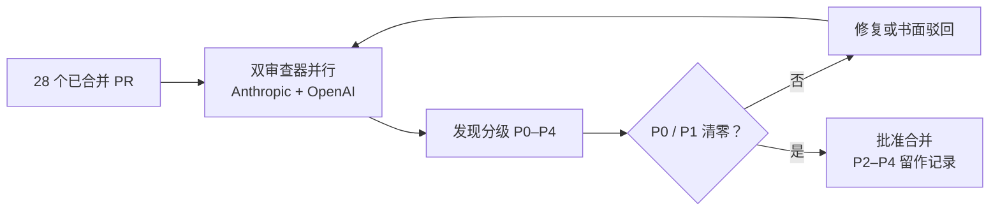

# 把 AI 审查器先跑在已合并的 PR 上：28 个 PR 的回放

通用（不限工具）

**一句话看懂**：Faros 把 28 个已经被人批准并合并的 PR 交给新的双模型 AI 审查系统重审，每个都找出 3 到 14 个人工审查没提的关键问题，大多数原审查只写了一个 LGTM。但 AI 审查也有反方向的失败：只要每条发现都去修，循环就停不下来。他们的解法是让“合并闸门”和“停止条件”变成同一件事：P0 / P1 清零就批准。

## 读完你能带走的 6 条收获

1. **先在历史 PR 上回放审查器，再让它上线**：28 个已合并 PR 的回放，把“我们的审查没问题”从假设变成数字（见 3.1、3.4）。
2. **两个审查器要真独立**：不同模型家族、并行运行、第一轮不共享上下文（见 3.1、3.4）。
3. **AI 审查器永远能找到东西**：如果每条发现都触发修复和重审，循环不收敛；Faros 有一次审查跑了一整夜，一个文档 PR 审了 13 轮（见 3.2）。
4. **闸门和循环必须是同一个条件**：P0 / P1 清零就批准；低严重度发现和作者的处置意见留在 PR 上作记录，不再延长循环（见 3.2）。
5. **循环要能停、失败要响**：人可以随时叫停；基础设施报错直接结束运行，不要重试到天亮（见 3.4）。
6. **还没解决的边界**：人仍然可以带着未关闭的 P1 合并；审查成本随轮次之间代码改动量增长，本质上反映的是写代码的质量（见 3.5）。

::: tip 小白先懂这几个词
- [P0 / P1 / P2（严重度分级）](/glossary#severity)：按严重程度给审查发现排级，P0 最严重。
- [审查回放](/glossary#review-replay)：把审查器跑在已经合并的历史 PR 上，看它会发现什么，再决定要不要信它。
- [LGTM](/glossary#lgtm)：“Looks Good To Me”，审查者表示同意合并的惯用语。
- [Fix Treadmill（补丁踩踏机）](/glossary#fix-treadmill)：修一个问题引入的新改动，在下一轮审查里又变成新问题，审查停不下来。
- [Code Review（代码审查）](/glossary#code-review)：合并前由人或模型阅读改动、提出意见。
:::

## 1. 基本信息

<SourceCard type="文章" title="What AI caught in PRs our human reviewers had approved" author="Thierry Donneau-Golencer" date="2026-10-28" url="https://www.faros.ai/blog/what-ai-caught-in-prs-our-human-reviewers-had-approved" />

| 项目 | 内容 |
|---|---|
| 链接 | https://www.faros.ai/blog/what-ai-caught-in-prs-our-human-reviewers-had-approved |
| 类型 | 公司工程博客（Faros 团队审查自己代码的实验） |
| 作者 | Thierry Donneau-Golencer（Faros Head of Product） |
| 发布日期 | 2026-10-28（页面元数据 datePublished） |
| 使用工具 | 基于 Open Code Review（OCR）搭的审查 harness；一个审查器用 Anthropic 模型，一个用 OpenAI 模型（具体模型未给出） |
| 分析依据 | 原文全文（正文约 800 词），2026-11-01 抓取。Faros 卖工程效能分析产品，文中穿插自家“Speed Trap”报告的数字，本站作为背景转述并标注来源。没有公开 prompt 和配置。“我觉得”开头的段落是本站评论。 |

## 2. 这篇在回答什么

你的团队每个 PR 都有人批准。问题是：这些批准真的在检查东西吗？

Faros 换了个问法。他们没有拿新 PR 去试 AI 审查器，而是把 **28 个已经被人批准、已经合并**的 PR 交给它重审。结果让他们重新看待自己的审查流程：

<Trans zh="28 个里没有一个是干净的。">“Not one of the 28 came back clean.”</Trans>

但故事还有另一半。AI 审查器接进日常后，出现了反方向的问题：审查停不下来。

文章回答四个问题：

1. 人工审查漏掉了什么？怎么量出来？
2. AI 审查为什么会无限循环？怎么让它收敛？
3. 一个审查 harness 应该怎么搭？
4. 还有哪些没解决？

## 3. 怎么做

### 3.1 先量现状：28 个已批准 PR 的回放

**背景**：作者先摆出“代码来得比检查快”的证据。Linux Foundation 调查里，维护者估计进来的 PR 有四分之一是“AI slop”；Faros 自家的 Speed Trap 报告（覆盖 22,000 名开发者）显示，未经审查的合并增加 76.3%、PR 体积增加 71.8%、QA 时间增加 300.6%。这些是 Faros 自己的报告数字，文章用来引出实验。

**审查 harness 的设计**：

::: tr 我们的审查 harness 基于 Open Code Review（OCR），并行运行两个独立的审查器，一个用 Anthropic 的模型，一个用 OpenAI 的模型。发现按 P0 到 P4 分级。批准之前，每个 P0 和 P1 都必须修掉或被明确驳回。
> "Our review harness, built on Open Code Review (OCR), runs two independent reviewers in parallel, one on an Anthropic model and one on an OpenAI model. Findings are rated P0 to P4. Before approval, every P0 and P1 must be fixed or explicitly dismissed."
:::

**结果**：

- 28 个历史 PR，每个都找出 3 到 14 个人工审查没提出的关键问题。
- <Trans zh="多数原始的人工审查只有一个词：LGTM。">“Most of the original human reviews were a single word: LGTM.”</Trans>
- 作者强调这些不是风格挑刺。在一个路由决策后端的线上 PR 里，审查器抓到缓存输入被重复计算，报出的节省是 5.15 美元，实际是 1.15 美元；还标出一个连接处理错误，可能跳过清理并触发整次重试。

最后一个例子的结局值得注意：<Trans zh="一个人在这个 P1 仍未关闭的情况下合并了 PR。">“A human merged the PR with that P1 still open.”</Trans>几天后修复才落地，原因是这个发现**写在了 PR 上**。

作者说，团队并不惊讶认真的审查者能发现问题；惊讶的是：

::: tr 让我们意外的是，我们一直对那些早已悄悄不再发现任何问题的审查抱有多大的信心。
> "What surprised us was how much confidence we had been placing in reviews that had quietly stopped catching anything."
:::

我觉得“在历史 PR 上回放”是全文最便宜、最该先做的一步。它不需要改任何流程，就能回答“我们的审查有没有在干活”。但要注意，文中没说这 3 到 14 个“关键问题”里有多少被人确认是真问题，也没给误报率。回放的数字只能说明审查器“说了很多”，要和 [[31]] 那样的精确率数据一起看。

### 3.2 反方向的失败：审查停不下来

**现象**：

::: tr AI 审查器总能找到点什么。让它找 P0 和 P1，它会顺路找到 P2 和 P3。如果循环把每一条发现都当作修复并重审的理由，它就不会收敛。
> "An AI reviewer will always find something. Ask it to look for P0s and P1s and it will find P2s and P3s on the way. If the loop treats every finding as a reason to fix and re-review, it does not converge."
:::

两个真实事故：

- 一位工程师的一次审查从晚上跑到第二天早上，直到 VPN 断开才停。
- 一个文档 PR 和同一个审查器来回了 13 轮，每一轮都只发现 P2 和 P3。

**原因**：流程里加了一个辅助 skill，会自动应用所有标为“fix now”的发现，包括低严重度的。每个小修复都改变了 diff，每个新 diff 都触发一次新审查，新审查又找出更多小问题。作者一句话点破：

<Trans zh="闸门仍然是 P0/P1，但循环不是。">“The gate was still P0/P1, but the loop was not.”</Trans>

**修复**：

::: tr 解决办法是让闸门和循环成为同一件事。一旦每个审查器都清掉了 P0 和 P1，PR 就被批准。低严重度的发现以及作者对每一条的处置留在 PR 上作为记录，不会延长流程。
> "The fix was to make the gate and the loop the same thing. Once every reviewer clears P0 and P1, the PR is approved. Lower-severity findings and the author's disposition on each stay on the PR as a record and do not extend it."
:::

作者的结论是：<Trans zh="没有严重度截止线，AI 审查器会一直找东西让你修，并一直向你收费。">“Without a severity cutoff, an AI reviewer will keep finding things to fix and keep charging you for it.”</Trans>

我觉得这个失败模式很普遍：大家通常只设计“什么情况下能合并”，没有单独设计“什么情况下停止审查”。两者不一致时，自动修复会把差距放大成无限循环。[[90]] 的六轮机器人审查和 [[110]] 修复环里的停机条件，讲的是同一类问题。

### 3.3 为什么值得做：Speed Trap 数字（背景）

这一节是 Faros 报告的数字，用来说明他们的 28 个 PR 并非个例：

- 未经审查的合并增加 76.3%，六个月前这个数字是 31.3%；PR 体积增加 71.8%。
- 每位开发者的“重启”（第一次做错、需要返工）增加 66.7%。
- Linux Foundation 调查：受访者估计 AI 把写代码的时间缩短 52%；59% 的维护者说贡献量在增长，大项目里是 69%。
- 报告里重度使用 agentic review 的团队，首次审查更快、变更失败率更低。作者自己注明**这是相关性**。

这些数字来自 Faros 的产品报告，本站无法核对其方法，只作为背景。

### 3.4 五步改法：他们按这个顺序做

原文列出的五件事，按顺序：

1. **先在历史上跑审查器，再信任它审线上 PR**：<Trans zh="28 个 PR 的回放，把“审查流程没问题”从一个假设变成了一个数字。">“The 28-PR replay turned "the review process is fine" from an assumption into a number.”</Trans>
2. **闸门按严重度设，不要求“完全干净”**：P0 和 P1 阻止合并；其他发现记录在案，由人驳回，并在 PR 上写明理由。
3. **两个审查器保持独立**：不同模型家族、并行运行、第一轮不共享上下文。
4. **循环可停、失败要响**：人可以叫停一次运行；基础设施报错直接结束运行，而不是<Trans zh="重试到深夜">“retrying into the night”</Trans>。
5. **度量审查本身**：每一轮、每条发现、每个修复和处置，连同成本，都记日志。

我觉得第 3 条“第一轮不共享上下文”容易被忽略。很多团队让第二个审查器读第一个的结论再补充，这样得到的是一个审查加一个附和，而不是两次独立审查。

### 3.5 还没解决的两件事

作者坦白说有两件事还没想清楚：

- **带着 P1 合并**：人仍然可以无视未关闭的发现直接批准合并。他们在讨论是完全禁止，还是只允许附书面驳回。
- **审查成本**：成本随每轮之间代码改动的多少而增长。作者说这其实反映的是写代码的质量：<Trans zh="长审查之所以长，是因为代码确实需要这些修改。">“The long reviews were long because the code needed the work.”</Trans>

结尾他把重点又推回写代码一侧：给写代码的代理更好的上下文，应该意味着更少的错误需要别人来抓。

## 4. 结果与局限

**文中真正证明的**

- 28 个已合并 PR 的回放：每个 3 到 14 个人工未提的关键发现，没有一个干净。
- 一个具体的线上 bug（5.15 美元 vs 1.15 美元的重复计数），因为发现留在 PR 上而在几天后修复。
- 两个失败事故：通宵运行、文档 PR 13 轮。

**口述或引用的数字**

- Speed Trap 报告的百分比、Linux Foundation 调查数字，都是转引，方法不在本文里。
- “重度 agentic review 团队变更失败率更低”是相关性。

**局限与注意**

- 样本只有 28 个 PR，来自一家公司。
- 没有给出发现的确认率或误报率，“关键问题”是审查器的分级，不是人工复核后的结论。
- 没有公开 prompt、OCR 配置和具体模型。
- Faros 售卖工程效能产品，文中多次导流到自家报告，自带立场。

## 5. 结论

AI 审查器能发现人工 LGTM 漏掉的东西，但它也会永远找下去。上线前先拿历史 PR 回放，量出现状；上线时让“能合并”和“停止审查”用同一个条件，低严重度的发现只记录、不循环；同时让两个审查器真正独立，并把每一轮的成本记下来。

**你可以这样试**

1. 挑 10 到 20 个最近合并的 PR，用你打算上线的审查器重审一遍，人工复核它的 P0 / P1 发现，算出真问题的比例。
2. 写下你的审查循环的**停止条件**，检查它和合并闸门是否一致；有自动修复的话，确认它只处理闸门内的严重度。
3. 给循环加一个硬上限（轮数或时间），基础设施报错直接失败，不要自动重试。
4. 如果用两个审查器，确认它们第一轮互相看不到对方的结论。

**读完自测**

1. Faros 为什么先拿已合并的 PR 测审查器，而不是直接上线？
2. 文档 PR 审了 13 轮的根本原因是什么？
3. “闸门和循环是同一件事”具体指什么规则？
4. 作者认为审查成本高，归根到底反映了什么？
