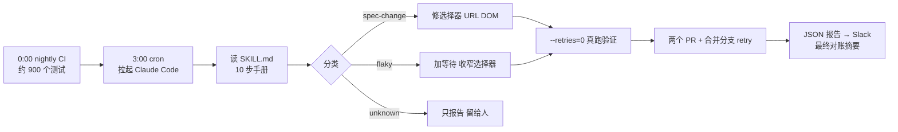

# 夜里 E2E 挂了，早上只剩审 PR：Claude Code 自动修测试的流水线

<div class="meta-tags"><span class="tool-tag tool-claude">Claude Code</span></div>

<div class="hook">

**一句话看懂**：kickflow 的 QA 团队每晚跑约 900 个 Playwright 测试。现在凌晨 3 点 GitHub Actions 拉起 Claude Code：读失败日志、对照产品仓库的改动，把失败分成“规格变更 / 不稳定 / 判断不了”三类，只修前两类，并且必须在 CI 上真跑通过才开 PR。拿不准的一律留给人。早上的人只需要审 PR、看一条“还剩几件要处理”的 Slack 摘要。

</div>

## 读完你能带走的 7 条收获

1. **先分类再修，拿不准就交给人**：spec-change（规格变更）和 flaky（不稳定）自动修，unknown（判断不了，可能是产品 bug）只报告；这条“迷了就交给人”是防止自动修复失控的安全阀（见 3.2）。
2. **修复范围要窄**：只改选择器、URL、等待这类“UI 表面”，不改测试逻辑，测试场景的意图不能动（见 3.3）。
3. **正确性靠验证门，不靠信任模型**：修完必须用 `--retries=0` 真跑通过才采用；三次修不好就降为 unknown（见 3.3）。
4. **两类修复分开开 PR**：规格变更和不稳定修复各一个分支、一个 PR，审的人一眼看清每个改动的意图（见 3.3）。
5. **代理只写 JSON 报告，通知交给后续的确定性步骤**：claude-code-action 沙箱里 Bash 看不到 `env:` 传入的变量，Slack Webhook 这类密钥别交给代理（见 3.4）。
6. **逻辑放进 SKILL.md 和脚本，别放进 workflow 文件**：claude-code-action 要求 workflow 文件和默认分支一致，改 workflow 只能先合进 main 才能测（见 3.5）。
7. **定时代理要防“处理旧数据”**：只处理 4 小时内完成的 nightly run，用分支差分而不是日期找改动，分支已存在就跳过（见 3.5）。

::: tip 小白先懂这几个词
- [Flaky Test（不稳定测试）](/glossary#flaky-test)：代码没变，有时过有时不过的测试。
- [Playwright](/glossary#playwright)：微软的浏览器自动化与端到端测试框架。
- [claude-code-action](/glossary#claude-code-action)：Anthropic 官方的 GitHub Action，在 Actions 里运行 Claude Code。
- [Skills](/glossary#skills)：放在仓库里、代理按需读取的做事说明。
- [Headless（无头模式）](/glossary#headless)：不开交互界面，在脚本或 CI 里直接跑代理。
:::

## 1. 基本信息

<SourceCard type="文章" title="深夜のE2Eテスト失敗をClaude Codeが自動修正してPRを作る仕組みの構築" author="川村（kickflow QA チーム）" date="2026-04-03" url="https://tech.kickflow.co.jp/entry/2026/04/03/113600" />

| 项目 | 内容 |
|---|---|
| 链接 | https://tech.kickflow.co.jp/entry/2026/04/03/113600 |
| 类型 | 公司技术博客（日文） |
| 作者 | kickflow QA 团队的川村（原文只署姓） |
| 发布日期 | 2026-04-03（页面元数据 datePublished 2026-04-03T11:36+09:00） |
| 使用工具 | Claude Code（claude-code-action@v1）、Claude Code Skill、GitHub Actions、Playwright、Slack、GCS |
| 分析依据 | 原文全文（日文），2026-11-01 抓取。引用保留日文原文、悬停看中文；配置和命令逐字摘自原文代码块。SKILL.md 全文没有公开。没有成功率或误修率统计，“每天早上 30 分钟以上”是作者自述。“我觉得”开头的段落是本站评论。 |

## 2. 这篇在回答什么

kickflow 每晚 0 点跑全部 E2E 测试，约 900 个 Playwright 测试分 12 个分片并行。测试仓库和产品仓库是分开的，产品那边一合并改动，第二天早上测试就可能挂。

挂的原因最常见的是产品规格变了：

| 原因 | 例子 |
|---|---|
| 选择器文字变了 | 按钮文字从「送信する」改成「申請する」 |
| URL 变了 | 路径从 `/requests/` 改成 `/applications/` |
| DOM 结构变了 | 表格改成列表 |
| 角色变了 | 链接改成按钮 |

于是每天早上：看 Slack 通知、打开 Actions 日志、判断是选择器变了还是不稳定、去产品仓库找前一天合并的 PR、读 diff、改测试、开 PR。测试少的时候无所谓：

<Trans zh="测试少的时候不是问题，但现在超过 900 个测试，有时每天早上要花 30 分钟以上。">“テスト数が少ないうちは問題になりませんでしたが、900テストを超えた今では毎朝30分以上かかることもあります。”</Trans>

而且这些活大部分是模式化的简单劳动。作者的问题是：能不能让 Claude Code 在夜里把分析、修复、开 PR 全做完？

文章回答四个问题：

1. 哪些失败可以交给代理修，哪些不行？
2. 怎么保证代理修得对？
3. 在 claude-code-action 里跑，会踩哪些工程上的坑？
4. 早上的人看到什么、还要做什么？



## 3. 怎么做

### 3.1 整体结构：一个 cron、一份 Skill、两个脚本

整套系统由四个文件组成：

| 文件 | 作用 |
|---|---|
| `.github/workflows/auto-fix-nightly.yml` | GitHub Actions workflow（cron 触发） |
| `.claude/skills/auto-fix-nightly/SKILL.md` | 给 Claude Code 的说明书（10 步手册） |
| `.github/scripts/slack-notify.sh` | 发送分析结果到 Slack（富通知 / 简单通知切换） |
| `scripts/nightly-final-summary.js` | 最终摘要通知（三份数据对账） |

触发器有三个（逐字摘自原文，2026-11-01 抓取）：

```yaml
name: Auto Fix Nightly Failures

on:
  workflow_dispatch:      # 手動実行
    inputs:
      nightly_run_id:
        description: '対象のnightly run ID（空欄の場合は最新を自動取得）'
        required: false
        type: string
  repository_dispatch:    # 外部トリガー
    types: [auto-fix-nightly]
  schedule:
    - cron: '0 18 * * 0-4'  # JST 3:00（月-金の早朝）
```

`schedule` 是主力，UTC 18 点即日本时间凌晨 3 点，周一到周五；`workflow_dispatch` 用于手动跑，可以指定某次 nightly run；`repository_dispatch` 留给外部系统以后扩展。

调用 Claude Code 的那一步：

```yaml
- name: Run Claude Code to analyze and fix
  id: claude
  timeout-minutes: 60
  uses: anthropics/claude-code-action@v1
  with:
    anthropic_api_key: ${{ secrets.ANTHROPIC_API_KEY }}
    claude_args: '--dangerously-skip-permissions'
    prompt: /auto-fix-nightly
    show_full_output: true
```

三点说明：

- `prompt` 只写斜杠命令 `/auto-fix-nightly`，Claude Code 自动读取仓库里的 `SKILL.md` 并照着执行。整套修复流程是写在 Markdown 里的自然语言，不是程序。
- `--dangerously-skip-permissions`：Claude Code 默认在执行 `gh` 之类外部命令前要求确认，CI 上没人能点确认，所以跳过权限检查。
- `show_full_output: true`：把 Claude Code 的内部日志（执行了哪些命令、怎么判断的）打到 Actions 日志里，作者说这是出问题时调试的必需品。

我觉得 `--dangerously-skip-permissions` 是整套方案里风险最大的一行，原文没有展开讨论。代理在 CI 里同时拿着 Anthropic 密钥和读产品仓库的令牌，又能执行任意命令。这里能接受，靠的是三件事：触发源只有定时任务和有权限的人，代理读的是自家仓库的日志和 diff，最终合并还要人审。照搬前建议对照 [[115]] 和 [[98]] 收窄权限。

### 3.2 分类：先判断失败属于哪一类，拿不准就交给人

为了提高自动修复的准确率，失败先被分成三类。

**spec-change（规格变更导致）**：去产品仓库取 `develop`（已部署）和 `main` 的差分，和测试失败的位置对照。

```bash
# develop と main の差分を取得（mainにまだ入っていない変更）
curl -s -H "Authorization: token ${PRODUCT_REPO_TOKEN}" \
  "https://api.github.com/repos/<org>/<product-repo>/compare/main...develop" \
  | jq '.files[] | {filename, status, patch}' | head -200
```

为什么看分支差分、不按日期找“昨天合并的 PR”？<Trans zh="不按日期而是看分支差分，就避免了周一运行时漏掉周五合并这类问题。">“日付ベースではなくブランチ差分を見ることで、月曜実行時に金曜のマージが漏れるといった問題を回避しています。”</Trans>

对照这一步没有写匹配规则：

<Trans zh="这里的“对照”不是程序化的匹配，而是交给 Claude Code 的自然语言推理。">“ここでの「突合」は、プログラム的なマッチングではなくClaude Codeの自然言語推論に委ねています。”</Trans>

例如测试在 `getByRole('button', { name: '送信する' })` 失败，而 develop 的 diff 里正好有把按钮文字改成「申請する」的补丁，Claude Code 就判为 spec-change。修复处会留下指向原因 PR 的注释，例如 `// 仕様変更対応: <org>/<product-repo>#1234`。

**flaky（不稳定）**：时序相关的失败，例如 `TimeoutError`、`strict mode violation`，重跑结果可能不同。这一类在**另一个分支、另一个 PR** 里修。

**unknown（判断不了）**：两类都对不上，可能是产品真的有 bug，需要人判断。

因为依赖的是模型推理而不是严格规则，模糊的情况会落进 unknown。作者认为这正是关键：

<Trans zh="这个“拿不准就交给人”的设计，是防止自动修复失控的安全阀。">“この「迷ったら人間に委ねる」設計が、自動修正の暴走を防ぐ安全弁になっています。”</Trans>

### 3.3 修复与验证：范围要窄，正确性看测试真跑

**修复范围**：只改“UI 表面的变化”，不动测试场景本身。

<Trans zh="重要的是“不改测试逻辑”这个原则。">“重要なのは、テストロジックは変更しないという原則です。”</Trans>

spec-change 的修法是跟着改选择器文字、URL 正则、DOM 角色（例如 `getByRole('table')` 改成 `getByRole('listitem')`）。flaky 的修法原则是：

<Trans zh="修复原则是“不改测试逻辑，只限于加等待处理或收窄选择器”。">“修正の原則は「テストロジックは変更せず、待機処理の追加やセレクタの限定化に留める」です。”</Trans>

能等到具体响应时优先用 `waitForResponse` 或 `waitForURL`，实在找不到要等的响应才用 `waitForLoadState('networkidle')`；`strict mode violation`（一个选择器匹配到多个元素）就把范围收窄到某一行再找按钮。

**验证门**：修完的测试在 CI 上真跑，关掉重试：

```bash
cd playwright && npx playwright test <修正ファイル> --project=chromium --retries=0
```

三次都修不过，就重新归为 unknown 并跳过。作者的理由：<Trans zh="与其硬修然后把坏掉的测试合并进去，交给人判断更安全。">“無理に修正して壊れたテストをマージするよりも、人間に判断を委ねる方が安全です。”</Trans>

这里有一个很坦白的细节：<Trans zh="这个“3 次”规则只是用自然语言写在 SKILL.md 里。">“この「3回」というルールはSKILL.mdに自然言語で記述しているだけです。”</Trans>模型的行为不确定，同一个测试每次可能尝试不同的修法。所以真正的保障不在这条规则上：

<Trans zh="稳定性的保障来自“修复后必须用 Playwright 验证，不通过就不采用”这道验证门。">“安定性の担保は「修正後に必ずPlaywrightで検証し、通らなければ採用しない」という検証ゲートで行っています。”</Trans>

**分开开 PR**：

| 分支 | 内容 |
|---|---|
| `fix/auto-nightly-spec-change-YYYYMMDD` | 规格变更导致的选择器、URL 修复 |
| `fix/auto-nightly-flaky-YYYYMMDD` | 加等待、调超时 |

每个 PR 带一张分类结果表（测试文件 / 分类 / 原因 / 关联 PR）。然后再建一个合并了两类修复的分支 `fix/auto-nightly-combined-YYYYMMDD`，从它触发重试 workflow。重试的对象不只是修过的测试，而是**这次 nightly 里所有失败的测试文件**，因为不稳定的测试重跑可能就过了。在“所有修复都打上”的状态下做最终验证，摘要里的判断才准。

我觉得“3 次规则写在自然语言里，但正确性不靠它”这段，是全文最值得抄的思路。给代理写的限制可能被遵守、也可能不被遵守；真正兜底的，应该是一个代理绕不过去的客观检查。

### 3.4 通知：代理只写 JSON，发消息交给后续步骤

最初的设计是 Claude Code 自己调 Slack Webhook 发通知。跑起来才发现：

<Trans zh="在 claude-code-action 的沙箱环境里，通过 env: 传入的环境变量（如 SLACK_WEBHOOK_URL）在 Claude Code 的 Bash 工具里是看不到的。">“claude-code-actionのサンドボックス環境では env: で渡した環境変数（SLACK_WEBHOOK_URL など）がClaude Codeの Bash ツールから見えない”</Trans>

于是改成：Skill 的最后一步让 Claude Code 把分析结果写到 `/tmp/auto-fix-report.json`，workflow 的后续 `Notify Slack` 步骤运行 `slack-notify.sh` 读这个 JSON、拼富通知。原文给的示例报告里写着“15 件失败测试已分析，4 件以修复 PR 处理”，并列出 spec_change、flaky、unknown 各自的文件和原因，以及两个 PR 编号。

两个细节：

- 没有报告文件（例如 Claude Code 本身失败）时，回退成只有 Nightly Run / Auto Fix Run / 结果的简单通知。
- <Trans zh="nightly CI 全部通过时不发通知。">“nightly CIが全テスト成功の場合は通知しません。”</Trans>只在失败时通知，避免变成噪音。

**最终摘要**：重试 workflow 跑完后，`nightly-summary` 任务调用 `nightly-final-summary.js`，对账三份数据：nightly 的失败列表（GCS 上的 `report-data.json`）、自动修复的分类结果（GitHub Artifacts）、重试结果。原文的示例是：nightly 失败 5 件，自动修复 2 件、重试通过 2 件，最终只剩 1 件 unknown 要人工调查。早上一看就知道“今天只要手动看 1 件”。

作者给出的建议是：<Trans zh="要把 Slack Webhook URL 这类机密交给 Claude Code 时，建议设计成由 Claude Code 之后的步骤来处理。">“Slack Webhook URLなどの秘匿情報をClaude Codeに渡す場合は、Claude Codeの後続ステップで処理する設計にすることを推奨します。”</Trans>

### 3.5 在 CI 里跑定时代理的四个坑

**1. 只处理最近 4 小时内完成的 nightly run。** 简单取“最新一次”会出问题：<Trans zh="例如周五停了 nightly CI，就会重新处理周四的旧失败。">“たとえば金曜にnightly CIを止めた場合、木曜の古い失敗を再処理してしまいます。”</Trans>nightly 0 点跑、修复 3 点跑，4 小时窗口刚好覆盖；那天没跑 nightly，就什么都不做直接结束。

**2. 浅克隆下建分支。** `actions/checkout` 默认 `fetch-depth: 1`，常规的 `git checkout main && git pull` 会出错，改为：

```bash
# shallow cloneでも動作するブランチ作成
git fetch origin main --depth=1
git checkout -B main origin/main
git checkout -b "fix/auto-nightly-spec-change-${DATE}"
```

**3. 分支重复守卫。** 同一天跑了多次时，先检查分支是否已存在：

```bash
if git ls-remote --exit-code --heads origin "${BRANCH}" > /dev/null 2>&1; then
  echo "${BRANCH} already exists. Skip."
  exit 0
fi
```

**4. workflow 文件必须和默认分支一致。** claude-code-action 取 OIDC 令牌时会校验 workflow 文件是否和默认分支（main）上的版本相同，在功能分支上改了 workflow，Claude Code 这一步就会报 `Workflow validation failed`。所以改 workflow 本身只能先合进 main 再验证；而脚本和 `SKILL.md` 不受这个限制。作者的建议是：<Trans zh="逻辑尽量拆到这些外部文件里，开发会顺畅很多。">“ロジックはなるべくこれらの外部ファイルに切り出しておくと開発がスムーズになります”</Trans>

### 3.6 跑起来是什么样，以及接下来

原文给了一次真实流程：0 点 nightly 有 3 个测试失败；3 点修复 workflow 启动；Claude Code 对照产品仓库差分，判 2 个 spec-change、1 个 flaky；修好 2 个 spec-change 并在 CI 上跑通；开两个 PR；建合并分支并带着 `nightly_run_id` 触发重试；写 JSON 报告；后续步骤发 Slack；重试跑完后发最终摘要。早上到公司，审 PR、合并，就结束了。

作者写的下一步：

- 现在仍有一定数量的失败落进 unknown，想把过去的分类结果反馈回去提高准确率；
- 修复模式目前集中在选择器、URL 和等待，想扩展到测试数据依赖、API 响应变化；
- 这个机制可能也适用于单元测试和集成测试。

## 4. 结果与局限

**文中给出的结果**

- 作者自述：每天早上 30 分钟以上的 CI 失败处理，变成只需审 PR、合并（<Trans zh="每天早上要花 30 分钟以上的 CI 失败处理，变成只要审 PR 和合并就能完成。">“毎朝30分以上かかっていたCI失敗対応が、PRのレビューとマージだけで完了するようになりました。”</Trans>）。
- 两个具体示例：示例报告“15 件分析、4 件修复”，最终摘要“5 件失败 → 1 件要处理”。

**没有给出的**

- 运行了多久、总共修了多少、误修了多少、PR 被拒的比例，都没有统计。
- SKILL.md 的 10 步全文没有公开，分类判断的 prompt 无法核对。

**局限与注意**

- 分类完全靠模型推理，作者也承认 unknown 仍有“一定数量”。
- “3 次上限”只是自然语言约束；兜底的是验证门和人工审 PR。
- `--dangerously-skip-permissions` + 仓库令牌的权限边界原文没讨论（见 3.1 本站评论）。
- 场景是 E2E 测试仓库与产品仓库分离、失败多为 UI 文本和结构变化，这类失败本来就适合机械修复；推广到单元测试或业务逻辑失败，难度不在一个量级。

## 5. 结论

让代理在 CI 里自动修测试，关键不是“它能不能修”，而是三道边界：分类时拿不准就交给人，修复只碰 UI 表面不碰测试逻辑，采用前必须真跑通过。再加上几个工程细节：密钥不进代理、通知交给确定性步骤，逻辑放进 Skill 和脚本，定时任务只处理新数据。kickflow 这套方案把早上的工作从“排查加修改”变成了“审 PR”。

**你可以这样试**

1. 先在本地让 Claude Code 修一次昨晚的失败，满意后让它把过程写成 Skill，再搬进 CI。
2. 在 Skill 里写死三分类和“不确定就归 unknown”，unknown 只报告、不修。
3. 修复步骤后加一道 `--retries=0` 的真跑验证，不过就不提交。
4. 让代理只产出一个 JSON 报告；通知、打标签、发消息都放在后续的普通步骤里做。
5. 给定时任务加“只处理 N 小时内的 run”和“分支已存在就跳过”两道守卫。

**读完自测**

1. 为什么找规格变更时看 `main...develop` 分支差分，而不是按日期找前一天合并的 PR？
2. flaky 修复的原则是什么？为什么要和 spec-change 分开开 PR？
3. 既然“3 次上限”只是写在 SKILL.md 里的自然语言，修复的正确性靠什么保证？
4. 为什么 Slack 通知从 Claude Code 挪到了 workflow 的后续步骤？
5. 为什么作者建议把逻辑放进 SKILL.md 和脚本，而不是 workflow 文件？
