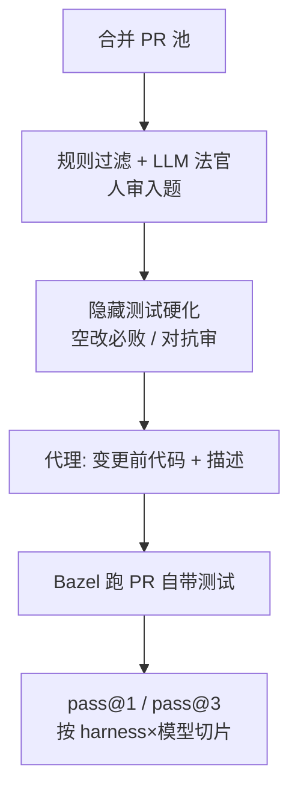

# 公共榜看不出你的 monorepo：Snowflake 用自己的 PR 做 SnowPR

通用（不限工具）

**一句话看懂**：SWE-bench 一类公开榜多来自几千文件的 Python 仓，说明不了 4300 万行、Java+C++、Bazel、还常起 FoundationDB 的 monorepo 上哪个代理更好。Snowflake 用 65 个已合并 PR 做成 SnowPR：代理只拿变更前代码和描述，用随 PR 的隐藏测试打分；顺带比较自研 Cortex Code 的 REM 模式与 Claude Code / Cursor / Codex。同模型下四家 harness 通过率几乎贴在一起，差的是成本和跨语言任务。

## 读完你能带走的 7 条收获

1. **公开基准与日常工作可以差一个数量级**：他们的 nontest 源码比平均 SWE-bench 仓多约 21× 文件、39× 行；参考修复平均 4.0 文件 / 262 行，对 1.7 / 33（见 3.1）。
2. **私有基准的任务要挖、更要硬化**：规则 + LLM 法官只做过滤，分数由隐藏测试定；真修必过、空改必败、11 项自动检查，对抗审查在发布前抓到 84 条发现、8 条阻断（见 3.2）。
3. **任务描述本身是测量的一部分**：同一套隐藏测试和修复，10 个代理在一份工程师写法上试次通过率 83%，换另一份只有 57%（见 3.2）。
4. **同模型比 harness，65 题分不出 1 个点的通过率差，却分得出成本**：opus-5 四家 harness 试次通过率 84.1%–85.1%；REM 每试次 $6.34，比自家 code mode 便宜 23%、新 token 少 14%，并解出 62/65 题（见 3.3）。
5. **模型定档，harness 调成本**：opus-5 各代理比 haiku-5.5 各代理高出 10–21 个试次百分点；便宜模型上 REM 70.8%@$0.24，仍可比 Claude Code 的 64.1%@$0.26（见 3.3）。
6. **真正难的是跨界，不是“会不会写 C++”**：跨 Java+C++ 的任务试次通过率 55%，纯 Java 80%；纯 C++ 76%，和 Java 差不多（见 3.4）。
7. **基准自己也要被测**：作者收尾写——基准需要的测试，不亚于它要衡量的代理（见 3.2、4）。

::: tip 小白先懂这几个词
- [pass@k / pass^k](/glossary#pass-at-k)：本文 pass@1 = 全部试次里通过的占比；pass@3 = 至少一次通过的任务占比（每题 3 次）。
- [Harness（代理外壳）](/glossary#harness)：模型之外负责工具、权限、循环与上下文的那一层。
- [SnowPR](/glossary#snowpr)：Snowflake 用自家已合并 PR 与隐藏测试做成的编码代理基准。
- [REM mode](/glossary#rem-mode)：Cortex Code 把文件 / shell / 搜索 / SQL 暴露成同一 REPL 里 Python 函数的模式（文中标明内部、尚未对客户开放）。
- SWE-bench：以公开 Python 仓真实 issue 为题、用隐藏测试判对错的主流编码代理基准。
- FoundationDB：文中 Snowflake 元数据用的数据库；39 个任务的评分测试会自己拉起它。
:::

## 1. 基本信息

<SourceCard type="文章" title="SnowPR: Benchmarking Coding Agents on Snowflake's 43-Million-Line Monorepo" author="Soyoung Yoon +5" date="2026-10-27" url="https://www.snowflake.com/en/blog/engineering/Benchmarking-coding-agents/" />

| 项目 | 内容 |
|---|---|
| 链接 | https://www.snowflake.com/en/blog/engineering/Benchmarking-coding-agents/ |
| 类型 | 文章（Snowflake Engineering Blog，约 13 分钟） |
| 作者 | Soyoung Yoon +5（页面 byline） |
| 发布日期 | 2026-10-27 |
| 使用工具 | 通用；文中比较 Cortex Code（REM / code mode）、Claude Code、Cursor、Codex，模型含 opus-5、haiku-5.5 |
| 分析依据 | 原文全文（WebFetch，2026-11-02；curl 遇 Cloudflare）。数字与引语以原文为准；图中未写出的坐标不补。Cortex Code / REM 为厂商自测且 REM 标明内部 only。“我觉得”开头的段落是本站评论。 |

## 2. 这篇在回答什么

公开榜上分很高的代理，换到你每天改的私有 monorepo，还好不好用？Snowflake 的答案是：别只盯 SWE-bench。

他们的仓大约 4300 万行，nontest 源就有约 6.3 万文件、1700 万行，主要是 Java 和 C++，挂在同一张 Bazel 图上，很多测试还会自己起 FoundationDB。SWE-bench 任务多来自大约 3000 个源文件的 Python 项目，而且模型越来越会为这类集合调参。作者写：

::: tr 那里的高分，几乎说明不了我们这套 4300 万行的 Java 与 C++ monorepo。
> "A high score there says little about our 43-million-line Java and C++ monorepo, built with Bazel, where many tests start their own FoundationDB."
:::

于是他们做了 SnowPR：65 个真实已合并 PR（11 个产品方向；62 个来自 monorepo，3 个来自独立 Go 工具仓）。代理拿到的是变更前的代码和一段描述；和 SWE-bench 一样，用随 PR 出货的隐藏测试判过不过，测试跑在自家 Bazel 与远程构建农场上。

SnowPR 还有第二份工作：给自研 Cortex Code 当试验台，在同一模型上比较 REM mode、code mode、Cursor、Codex、Claude Code。

这篇文章主要回答：

1. SnowPR 和公开基准差在规模与任务形态上的哪些地方？
2. 从海量合并 PR 到可用任务，怎么挖、怎么硬化？
3. 固定模型时，harness 差在通过率还是成本？
4. monorepo 的哪些特征真正预测失败？

## 3. 怎么做

### 3.1 任务长什么样：比公开题更大、更深、更“有状态”

**是什么**：65 题里，52 题改 Java 控制面（SQL 编译器与元数据层各 10 题领先），8 题改 C++ 执行引擎，2 题跨 Java+C++ 的 hybrid 表，3 题改 Go 工具。建造时预测 43 难 / 19 中 / 3 易。

相对 SWE-bench（按 nontest 源码计）：

- 文件约 21×、行数约 39×；中位改动文件深达九层目录。
- 参考修复平均 4.0 文件、262 行，对 SWE-bench 的 1.7 文件、33 行；34 题跨 ≥2 个模块。
- 单一 Bazel 图：一道 C++ 题在代理动手前大约跑 21,700 个构建动作，要 32 GB 内存。
- 33 题的评分测试住在共享测试树，代码却在别的模块；30 题评分穿过 ≥2 个 Bazel target。
- 39 题评分会拉起 FoundationDB；全部来自私有历史，不在公开训练数据里。

每题跑 3 次。pass@1 是全部试次的通过占比；pass@3 是至少成功一次的任务占比。文中强调：这里的“代理”= harness + 模型，并且带着他们仓库里给编码代理准备的上下文（含 skills）。

**为什么这样设计**：公开集合覆盖更多项目，SnowPR 往一家公司的代码里挖深——几乎全来自同一个私有 monorepo。判分方式仍与公开集相同：隐藏测试。

### 3.2 怎么挖题、怎么硬化：LLM 只过滤，测试说了算

**采矿**：最大一轮里，简单规则把一个月的控制面变更从 13,965 条收到 4,218（改 Java 源且至少加一条新行为用例）。自有 GPU 上的开源权法官再打“推理深度 / 可评分性”，并扔掉结构代理测、钉死措辞、或描述写不清的 PR。AI 代理再检视 384 个高排候选，84 个通过；之后**每道题都经人审**。

关键边界：

::: tr LLM 决定什么能进 SnowPR，但从不计算分数。
> "The LLM gates what enters SnowPR, but never computes a score."
:::

它是过滤器不是排序器：后来一轮里，法官预测的通过率与实测几乎对不上（51 题上 Spearman +0.18）。

**评分规则**：PR 新增用例必须从失败变通过，原有用例必须继续通过。新任务至少 1 条针对主变更的新用例，外加至少 10 条回归；不够就借“改前改后都过”的现成测试，或丢掉该 PR。代理停手后，评分器注入隐藏测试，用自家 `bazel test` 在远程农场跑。65 题合计 147 个 Bazel target、676 条新行为 + 2,890 条回归；**每条评分测试都过才算该试次通过**。

出题前还要：真修复必过、空变更必败；11 项自动检查（例如描述是否点名隐藏测试会调用的新类 / 方法）；对抗审查在发布前确认 49 题上 84 条发现，其中 8 条阻断。

描述敏感性写得很具体：

::: tr 描述原来也是测量的一部分。
> "Descriptions turned out to be part of the measurement too."
:::

同一套隐藏测试和修复，10 个代理在一位工程师写的说明上试次通过率 83%，换另一位的写法只有 57%。

他们也不拿 Bazel 的“受影响测试”查询当评分集：有一道真题，查询会返回控制面 24,028 个测试 target 里的 23,946 个——代理改过的树又打不中远程缓存，等于每试次全量重跑。SnowPR 因此**只用随 PR 出货的测试**评分。

采矿到任务的转换现已脚本化（描述除外），方便跟着 CI 刷新。

我觉得最可迁移的不是 65 这个数字，而是三道闸：空改必败、描述与测试交叉检查、对抗审查把“写得不清楚的题”当缺陷而不是当模型不行。

### 3.3 同模型比 harness：通过率贴在一起，成本拉开

Cortex Code 有两种模式。code mode 给分开的文件 / shell / 代码搜索工具；REM mode 把同类操作暴露成**同一个 REPL 工具里的 Python 函数**，模型可以一步串多个操作。文中标明 REM 目前仅内部、尚未对客户开放。

**opus-5**：四家 harness 试次通过率 84.1%–85.1%，作者认为对 65 题来说这个差距太小、测不出来。成本却清楚：每试次 REM $6.34、Claude Code $6.51、Cursor $6.93、code mode $8.19。相对 code mode，<Trans zh="REM mode 便宜 23%，并用了少 14% 的新 token">“REM mode was 23% cheaper and used 14% fewer new tokens”</Trans>（新 token = 未命中缓存的输入 + 输出）；REM 还以至少一次成功解出最多题：62/65。

**haiku-5.5**：REM 70.8%、每试次 $0.24；Claude Code 64.1%、$0.26；Codex 74.4%，成本约 9×——作者同样说 65 题分不出与 REM 的差距。档位仍由模型定：每个 opus-5 代理都比每个 haiku-5.5 代理多过 10–21 个试次百分点。

### 3.4 哪些 monorepo 特征预测失败

对图 1 里七个代理取平均：

| 切片 | 试次通过率 |
|---|---|
| 同时改 Java+C++（2 题） | 55% |
| 纯 Java | 80% |
| 纯 C++ | 76% |
| 改 ≥3 个源文件 | 70% |
| 改 1–2 个源文件 | 89% |
| 评分测会起 FoundationDB | 75% |
| 不起 FDB | 83% |
| 建造时标成 hard 的 43 题 | 仍有 74% |

两个意外：纯 C++ 并不比 Java 难多少——<Trans zh="难的是跨过语言边界，而不是语言本身。">“The hard part is crossing the language boundary, not the language.”</Trans>；人为预测的“难”能分开两头，但整体偏高估难度。

下一步他们点名：接 Snowfort 端到端环境、扩到约 200 题以便检出 7 个百分点（而不是 12 个点）的差距、REM 上跑开源模型、按题选模型、在测试旁加经人校准的 rubric LLM 法官，以及重构 / 写测 / 答库问题等尚未覆盖的工作种类。收尾句是：

::: tr 任何有合并 PR 与测试历史的团队，都可以做自己的 SnowPR 版本。我们学到的是：基准本身需要的测试，不亚于它要衡量的代理。
> "Any team with a history of merged PRs and tests can build their own SnowPR version. Ours taught us that the benchmark itself needs as much testing as the agents it measures."
:::

## 4. 结果与局限

**文中真正给出的结果**：

- 公开规模对照（21× / 39×、4.0 文件 / 262 行等）与任务组成数字。
- 采矿漏斗与 Spearman +0.18；评分用例规模；描述敏感性 83% vs 57%。
- opus-5 / haiku-5.5 下 harness 成本与通过率；跨语言与 FDB 等切片。

**局限与注意**：

- 私有代码与内部 Bazel / 远程农场，外人不被邀请“复现同一张榜”。
- 65 题分辨不了约 1 个百分点的 harness 差距——作者写明了；不要把 84.1 和 85.1 读成胜负。
- Cortex Code / REM 是厂商自测；REM 未对客户开放。
- 预测难度与实测仍有偏差；尚未覆盖 E2E 与非“修 PR”类工作。

## 5. 结论

SnowPR 想证明的不是“我们家代理第一”，而是：**你要选日常用的代理，就得在自己的变更分布、构建系统和测试形态上量**；公开榜最多帮你看清模型档位。硬化清单（空改必败、描述敏感、对抗审查）比任何单次百分比都更值得带走。

**你可以这样试**

1. 抽最近 20–50 个“带新行为测试”的已合并 PR，固定描述模板，做空改必败检查。
2. 同模型、同题，只换 harness，先看成本和失败切片（跨模块 / 跨语言 / 有状态测试），不要只看总分。
3. 对描述做 A/B：同一修复两套写法，看通过率差多少——差得多就先修题面。

**读完自测**

1. 为什么作者说 LLM 法官“进题但不打分”？
2. 83% vs 57% 比较的是什么被改了、什么没改？
3. 同模型四家 harness 通过率接近时，文中用什么指标区分它们？
