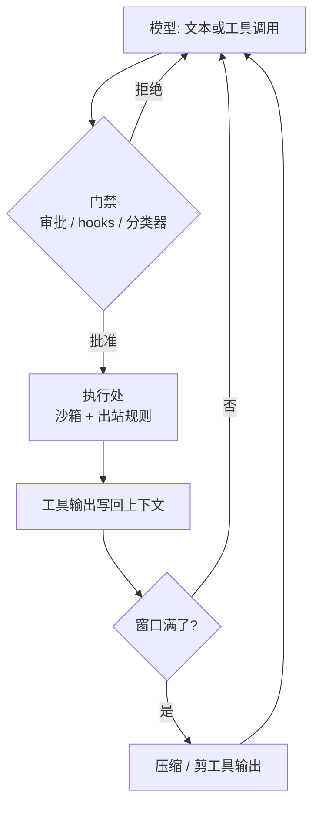

# 把八家编码代理外壳拆开：门、沙箱、压缩与编辑格式

通用（不限工具）

**一句话看懂**：编码代理 = 模型 + harness。模型只提议文本和工具调用；围绕那一圈循环的门禁、沙箱、压缩、编辑格式和撤销，才决定好不好用、安不安全。Dinakaran 只凭公开源码与文档，横向拆 Codex、Claude Code、Cursor、OpenCode、Aider、Goose、Cline（及已关停的 Roo）、T3 Code；后半介绍自家 Loams（实验向），正文以对照表为主。

## 读完你能带走的 7 条收获

1. **同一条循环，差在外围**：模型返回文本则结束本轮，返回工具调用则经 harness 的门 → 执行 → 结果写回上下文再问模型（见 3.1）。
2. **审批阶梯名字不同、梯子相似**；plan / 只读阶段，以及门里的第二模型（auto / Auto-review / auto_review）都在减打断——但各厂商都说**它不是安全边界**（见 3.2）。
3. **OS 沙箱在 mac/Linux 上收敛到 Seatbelt 与 namespaces+Landlock/seccomp**；Windows 分叉最大；网络出站决定数据能不能离开；有的工具文件操作根本不在沙箱里（见 3.3）。
4. **压缩有损，而且是安全面**：摘要里原样留下的内容（含文件里种下的指令）会进入之后每一轮（见 3.4）。
5. **编辑格式影响正确率**：精确旧串替换、patch 信封、搜索替换块、统一 diff / 整文件；共同教训是不要行号、锚点要够、匹配失败要让模型看得见（见 3.5）。
6. **撤销与 worktree 让坏回合便宜，并不阻止坏事**；沙箱和出站规则才限制“已批准的调用”够得到哪里（见 3.2、3.3）。
7. **失败模式对齐 lethal trifecta**；拒绝输出要可读，否则代理会把静默失败变成重试死循环（见 3.6）。

::: tip 小白先懂这几个词
- [Harness（代理外壳）](/glossary#harness)：模型之外的循环、工具、权限与上下文管理层。
- [Sandbox（沙箱）](/glossary#sandbox)：限制已批准命令能碰哪些文件、系统调用和网络的 OS 层隔离。
- [Compaction（上下文压缩）](/glossary#compaction)：窗口将满时 harness 丢掉或摘要旧上下文。
- [MCP](/glossary#mcp)：Model Context Protocol；文中各家几乎都是 MCP 客户端。
- [Lethal Trifecta（致命三要素）](/glossary#lethal-trifecta)：私有数据 + 不信任内容 + 外发通道同时具备。
- Seatbelt / Landlock / seccomp：macOS 与 Linux 上常见的沙箱原语（文中三家主流 harness 的用法）。
:::

## 1. 基本信息

<SourceCard type="文章" title="Coding-agent harnesses, taken apart: Codex, Claude Code, Cursor, OpenCode, Aider, Goose, Cline and T3 Code" author="Dinakaran" date="2026-10-18" url="https://loams.dev/blog/coding-agent-harnesses" />

| 项目 | 内容 |
|---|---|
| 链接 | https://loams.dev/blog/coding-agent-harnesses |
| 类型 | 文章（Loams 博客，页面约 18 分钟） |
| 作者 | Dinakaran（Loams） |
| 发布日期 | 2026-10-18（文中注明文档更新快，细节以链出页为准） |
| 使用工具 | 通用；对照 Codex、Claude Code、Cursor、OpenCode、Aider、Goose、Cline/Roo、T3 Code；后半涉及 Loams Studio / loams-agentd |
| 分析依据 | 原文全文（2026-11-02 抓取）。作者声明只依据公开 GitHub / 官方文档 / 工程博客；后半为自家产品且标 Experimental / Planned / Proposed。本站压缩产品路线图，利益关系见第 4 节。“我觉得”开头为本站评论。 |

## 2. 这篇在回答什么

选代理时人们常比模型。作者开口就改焦点：

::: tr 编码代理是两样东西：一个模型和一个 harness。
> "A coding agent is two things: a model and a harness."
:::

模型提议文本和工具调用；harness 负责组上下文、声明工具、决定哪些调用能跑、在哪里跑、把结果喂回去，并塞进上下文窗口。作者认为**让一家代理更好或更安全的东西，大多住在 harness 里**，而且多数已经开源或文档细到可读。

文章按层拆：循环 → 门禁 → 沙箱 → 压缩 → 编辑格式 → 撤销 → MCP/子代理 → 遥测 → 失败模式；最后才放 Loams，并写明今天有什么、没有什么。

核心问题：

1. 八家共用的循环是什么，工具声明差在哪？
2. 审批模式与“门里的模型”各自保证什么？
3. OS 沙箱与网络出站如何收敛、覆盖范围有何陷阱？
4. 压缩、编辑格式、撤销如何影响正确性与安全？
5. 注入与死循环时，harness 层对策是什么？

## 3. 怎么做

### 3.1 循环相同，工具声明曾分叉

Claude Code 文档把循环写成搜集上下文、采取行动、验证结果三阶段交织；人可随时打断。作者凝成一句：

::: tr 模型只提议工具调用；由 harness 决定每一个是否执行、在哪里执行，以及模型接下来能看见哪些输出。
> "The model only proposes tool calls; the harness decides whether each one runs, where it runs, and what of its output the model sees next."
:::

压缩则是窗口满时 harness **改写自己的记忆**。

工具声明：多数已改为 API 侧 JSON Schema，拿结构化调用。Cline 曾把工具写在系统提示里再解析类 XML；3.35 起改原生工具调用，团队称畸形回复下降、可并行、系统提示变短，并给不支持原生的模型保留文本路径。Aider 早年基准发现 OpenAI function calling 对编辑更差（整文件塞进参数、发明函数名），因此坚持文本编辑格式再解析。

核心工具集已收敛：读、按名/内容搜、编辑、写、跑 shell、拉 URL。差别更多在附加物：Claude 的权限词表与 hooks；Codex 的 `apply_patch`、plan、`request_permissions`、工具搜索与多代理 handlers；OpenCode 是带 HTTP / SSE 的服务器；T3 Code 自称不是代理，而是盖在多家 CLI 上的“harness of harnesses”控制面。

### 3.2 门禁：阶梯、plan、以及“门里的模型不是边界”

每家都有“不询问能做多少”的设置，名字不同、从紧到松的梯子相似。文中对照包括：Codex 的 sandbox 级别 + on-request/never + auto_review；Claude 的 plan / default / acceptEdits / auto / dontAsk / bypassPermissions（deny 规则全程生效）；Cursor 的 Auto-review / Allowlist / Run Everything；OpenCode 按工具 allow/ask/deny；Goose 从 Chat Only 到 Completely Autonomous（默认）；Cline 到 YOLO；T3 的 Supervised → Full access（新线程曾默认 Full access）。

两个趋势：一是 **plan / 只读阶段**（Cline Plan 不能改文件或跑命令；Aider architect 用一模型提案、另一模型落编辑）。二是 **门里再放一个模型** 挡掉例行打断。作者强调厂商自己的措辞：Codex 写明安全监控不替代沙箱；Cursor 称终端审批是 best-effort 而非硬边界。Hooks 是确定性对照物——Claude PreToolUse 可允许 / 拒绝 / 询问，也可改写工具输入，退出码 2 阻断。

收束句值得单独记住：

::: tr 审批和 hooks 决定调用跑不跑。只有沙箱和出站规则限制一个已批准的调用够得到哪里。检查点与 worktree 什么也防不住；它们只是让坏回合扔掉更便宜。
> "Approvals and hooks decide whether a call runs. Only the sandbox and the egress rules limit what an approved call can reach. Checkpoints and worktrees do not prevent anything; they make a bad turn cheap to throw away."
:::

### 3.3 沙箱：原语收敛，覆盖范围要读细

macOS 上 Codex、Claude Code、Cursor 都走 Apple Seatbelt（`sandbox-exec` + 生成 profile）。Linux 上 Codex 用 bubblewrap + seccomp（Landlock 作遗留路径）；Claude 用 bubblewrap（含 WSL2）；Cursor 用 Landlock + seccomp（需较新内核与无特权 user namespace，否则退回询问）。Windows 分叉最大：Codex 有自己的模式文档；Claude 原生 Windows 不上沙箱；Cursor 把 Linux 沙箱放进 WSL2。

网络：Codex 在 workspace-write 下默认关网除非打开；Claude 经宿主代理按域名白名单放行，并可对沙箱内命令用占位符换真凭据；Cursor 有从只认 sandbox.json 到全放行的档位。

覆盖范围的陷阱：Claude 的沙箱罩的是 shell；**文件工具、MCP、hooks 在沙箱外**；沙箱内失败的命令若权限允许可在沙箱外重试（可用设置关掉）。Codex 即使在可写根下也保持 `.git` 与自身配置只读。OpenCode / Aider / Goose / Cline **不附带 OS 沙箱**，靠门禁或你自己的容器 / VM。Roo 文档曾写明 ignore 文件“不是系统级沙箱”。

少打断也被写成安全属性：Anthropic 称内部权限提示少 84%；Cursor 称沙箱代理少问 40%——因为人读到第四十次就不读了。<Trans zh="更少的提示本身就是一种安全属性。">“Fewer prompts is a security property”</Trans>：人不读第 40 次。

### 3.4 压缩：先丢什么，决定模型还记得什么

各家策略不同：Claude 先清旧工具输出再摘要，若摘要后立刻又满，自动压缩会停并报错以免死循环；Codex 跑可替换的摘要 prompt；OpenCode 默认可剪旧工具输出并留 token 缓冲；Goose 在窗口 80% 或 225k token 较早者触发；Roo 曾留 30% 缓冲，溢出则砍 25% 重试；Aider 保留对话尾部原文、摘要头部并可递归三层，另用约一千 token 的 repo map（tree-sitter 依赖图上的符号）。

作者的安全提醒：压缩有损；摘要里原样保留的内容——包括代理读过的文件里种下的指令——会带进之后每一轮。

### 3.5 编辑格式与撤销

四类家族：

1. **精确字符串替换**（Claude Edit、OpenCode edit）：旧串必须精确且通常唯一，失败要响，避免改错地方。
2. **Patch 信封**（Codex `apply_patch`）：begin/end 标记，增删改分段，更新块用上下文锚而非行号；解析对标记旁空白故意宽松。
3. **文本里的 search/replace 块**（Aider diff 族）。
4. **统一 diff / 整文件**：Aider 称 udiff 在重构基准上把 GPT-4 Turbo 从 20% 拉到 61%，并把“懒占位注释”从 12 题降到 4；整文件最慢但最稳。

共同教训：不要行号、锚点要够、失败匹配要回给模型。

撤销：Claude 按 prompt 做 checkpoint（约 100 个），`/rewind` 可恢复代码 / 对话 / 两者，但 Bash 与多数子代理编辑不跟踪；Cursor 本地快照；Cline / Roo / OpenCode 用影子 git；T3 写隐藏 git ref 且若提供方不能回滚对话就拒绝还原；Aider 每次编辑真提交（弱模型写 message、author 带 `(aider)`），并先单独提交你的脏改动。Worktree 隔开编辑，**不隔离进程**。

### 3.6 MCP、失败模式，以及“说清缺什么”

MCP：几乎都是客户端；Goose 扩展即 MCP 服务；OpenCode 警告每个服务的工具都吃上下文；Claude 可按需加载定义、默认 MCP 输出封顶 25k token；规范要求人能否认调用、注解不可盲信。子代理是新鲜上下文、只回摘要：Claude 有 Explore/Plan/通用并限制嵌套三层；Goose 默认 25 轮且不能再派子代理。

失败模式：仓库内 prompt injection；OWASP 将其列首位。Simon Willison 的 lethal trifecta——私有数据、不信任内容、外发通道——三者勿凑齐。对策层与上文对齐：关/白名单出站拆掉第三腿；Claude WebFetch 用独立模型调用再只把答案给代理；规则文件（AGENTS.md 等）本身就是仓库内容进提示，**在仓里开代理等于信任该仓作者**。

死循环：OpenCode 对相同输入连打三次同工具有 doom_loop 权限（默认询问）；Goose 连续 1000 动作后询问；Cursor 曾发现代理重试被沙箱挡住的命令，修复是让 shell 输出**写明沙箱约束**（有时还建议升级权限）。通则：模型读得懂的拒绝，才能据此行动；静默失败会变成重试环。

后半 Loams Studio / loams-agentd 是“harness of harnesses”：按各家原生协议驱动 Claude/Codex/opencode 等，默认监督审批，隐藏 checkpoint，并行 run group 出多 worktree 变体。作者写明：**今天 daemon 不做 OS 级遏制**，靠监督；loams-sandbox / Places / Jailer 分别是 Planned / Proposed。本站不展开产品路线图。

作者自己的四条带走：

::: tr harness 就是产品。
> "The harness is the product."
:::

::: tr 门里的模型不是边界。
> "The model in the gate is not the boundary."
:::

沙箱必须罩住网络，否则 trifecta 第三腿仍开着。以及：

::: tr 说清缺什么。
> "Say what is not there."
:::

我觉得最后一条对读者比对厂商更有用：选代理时先找文档有没有写“文件工具在不在沙箱里”“默认出站开不开”“压缩会不会原样保留工具输出”——比看宣传页上的模型名靠谱。

## 4. 结果与局限

**文中可核对的“结果”**：横向机制对照与引用数字（如 Aider 编辑基准、Anthropic/Cursor 少打断比例、Goose 压缩阈值、OpenCode doom_loop 阈值等），而非统一跑分榜。

**局限**：

- 文档会变；作者写明以链出页为准，本站抓取日 2026-11-02。
- Roo 已于 2026-05 关停，仅作历史对照。
- **作者利益**：Loams 是其产品；Studio 在 0.1.0 标 Experimental，沙箱尚未交付。对照表主体来自公开源，但后半不可避免带产品叙事——阅读时把 takeaway 与路线图分开。
- 与 [[66]] 十一系统源码解剖互补：本文偏公开文档横向层，#66 偏源码深度；不必互相替代。

## 5. 结论

把代理当成“模型订阅”会买错东西。门禁、沙箱、出站、压缩和编辑格式才是日常体验与安全边界；而且它们是普通软件，可以读。

**你可以这样试**

1. 列一张表：你用的代理在“门禁默认档 / 有无 OS 沙箱 / 文件工具是否入沙箱 / 默认出站 / 压缩策略”五格各填一格，空着的去翻文档。
2. 故意让一次命令在沙箱内失败，看模型是否收到**可读**的拒绝原因。
3. 把“仓库规则文件 = 信任该仓作者”写进团队 onboarding。

**读完自测**

1. 为什么说 Auto-review / auto 模式“不是边界”？
2. checkpoints 和 sandbox 各解决哪一类问题？
3. lethal trifecta 的三条腿在 harness 层分别通常怎么拆？
