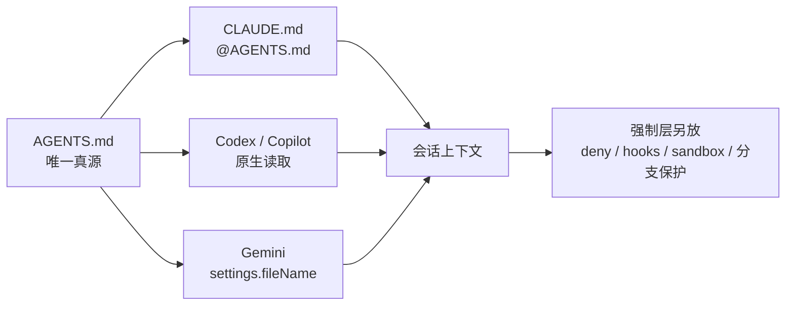

# 一份 AGENTS.md，多工具薄指针：别让指令文件各写各的

<div class="meta-tags"><span class="tool-tag tool-general">通用（不限工具）</span></div>

<div class="hook">

**一句话看懂**：Codex 读 AGENTS.md，Claude Code 读 CLAUDE.md，Gemini 要配，Copilot 几个都读却不定义谁优先。按工具各写一份，一定会漂。Johannes Millan 的做法：仓库根只维护一份 AGENTS.md，CLAUDE.md 用 `@AGENTS.md` 导入（或符号链接），Gemini 把文件名加进设置；并强调指令文件是指导不是强制，真正不能做的事要放进权限、hooks、沙箱和分支保护。

</div>

## 读完你能带走的 7 条收获

1. **按工具复制指令是错的**：三份文件一漂，你就会去查为什么只有一个代理还在用错的测试命令（见 3.1）。
2. **标准化文件名有制度背书**：AGENTS.md 由 Linux 基金会下的 AAIF 托管，被 Codex、Copilot、Cursor、Aider 等读取；Claude Code 是明确的例外，官方建议从 AGENTS.md 导入而不是复制（见 3.1）。
3. **接线很薄**：`CLAUDE.md` 首行 `@AGENTS.md`；Gemini `.gemini/settings.json` 的 `context.fileName` 列入 `AGENTS.md`；Codex / Copilot 原生已读（见 3.2）。
4. **按 Codex 的 32 KiB 合并上限来控体积**；宁短，因每次会话都进上下文，两家都把长度与遵从度联系起来（见 3.2、3.3）。
5. **只写会改变动作且代码里读不出来的东西**：精确命令、非常规约定、布局坑、勿碰清单；任务专用与偶发流程放到 prompt / Skill / 路径规则（见 3.3）。
6. **指导 ≠ 强制**：CLAUDE.md 内容是系统提示之后的用户消息，<Trans zh="不保证严格遵从">“no guarantee of strict compliance”</Trans>；“永不 / 必须”应落到 deny rules、hooks、sandbox、分支保护（见 3.4）。
7. **多 worktree 时指令跟 commit**：改 AGENTS.md 要当契约先单独合入再扇出；`CLAUDE.local.md` 默认不跟着走；Claude auto memory 却按仓库共享（见 3.5）。

::: tip 小白先懂这几个词
- [AGENTS.md](/glossary#agents-md)：给编码代理看的仓库级说明文件；Codex 等默认读取。
- [CLAUDE.md](/glossary#claude-md)：Claude Code 默认读取的项目记忆 / 规则文件。
- [嵌套 AGENTS.md](/glossary#nested-agents-md)：子目录指令；多数工具从根走到 cwd，靠近工作目录的后写、优先。
- [Skills](/glossary#skills)：按需加载的流程说明，适合偶发多步，不宜塞进每次都加载的 AGENTS.md。
- [Hooks](/glossary#hooks)：确定性钩子，用来强制“提交前必须跑什么”一类规则。
- [Worktree](/glossary#worktree)：同一仓库的并行检出；各自带着分支点那次提交上的文件。
:::

## 1. 基本信息

<SourceCard type="文章" title="AGENTS.md and CLAUDE.md: One Context File for Every Agent" author="Johannes Millan" date="2026-09-07" url="https://parallelcode.app/blog/agents-md-vs-claude-md/" />

| 项目 | 内容 |
|---|---|
| 链接 | https://parallelcode.app/blog/agents-md-vs-claude-md/ |
| 类型 | 文章（Parallel Code 博客） |
| 作者 | Johannes Millan |
| 发布日期 | 2026-09-07 |
| 使用工具 | 通用；涉及 Codex、Claude Code、Gemini CLI、Copilot CLI |
| 分析依据 | 原文全文（2026-11-02 抓取）。行为描述多援引各厂商文档；作者披露 Parallel Code 为其产品（见第 4 节）。与 [[116]]（AAIF：写什么）互补，本文侧重多工具共读。“我觉得”开头为本站评论。 |

## 2. 这篇在回答什么

仓库里开始跑第二家厂商的代理时，一个小问题会冒出来：它们默认读的不是同一个文件。

::: tr 按工具各写一份指令——这个“显然”的反应是错的。
> "The obvious response — write the instructions once per tool — is the wrong one."
:::

三份文件会漂移，你最后在查：为什么一个代理总用错测试命令，另一个却不会。

作者的稳定搭法：**AGENTS.md 当唯一真源**，每家工具只留一层指向它的薄文件。文章回答：

1. 今天各代理默认读什么、冲不冲突？
2. 怎么接线到一份真源？
3. 文件里写什么、不写什么？与强制层怎么分工？
4. 多个 worktree 并行时多出哪些坑？



## 3. 怎么做

### 3.1 先看清谁读什么

文中对照表（要点）：

| 代理 | 默认读 | 读 AGENTS.md？ | 体量提示 |
|---|---|---|---|
| Codex | `AGENTS.md`、`AGENTS.override.md` | 原生 | 合并上限默认 32 KiB（`project_doc_max_bytes`） |
| Claude Code | `CLAUDE.md`、`CLAUDE.local.md`、`.claude/rules/` | 否——需 import 或 symlink | 目标 <200 行；单文件 >4 MiB 跳过 |
| Gemini CLI | `GEMINI.md` | 要你把文件名加进设置 | 文中未写死上限 |
| Copilot CLI | `.github/copilot-instructions.md`、AGENTS.md、CLAUDE.md、GEMINI.md | 原生 | 未写死上限 |

三件值得单独抽出：

1. **AGENTS.md 有机构背书**：Agentic AI Foundation（Linux Foundation 下）托管，出自 OpenAI、Google、Cursor、Factory、Amp 等协作，被一长串工具读取。要标准化一个文件名，理由落在这里。
2. **Claude Code 是明确例外**：Anthropic 记忆文档写明它读 CLAUDE.md 而非 AGENTS.md，并建议从一份导入另一份，而不是复制。
3. **Copilot CLI 全读、不排序**：文档称会去重**相同**副本，但 <Trans zh="并不定义这些文件之间的一般优先级。">“does not define a general precedence order between these files.”</Trans> AGENTS.md 与 CLAUDE.md 若内容冲突，Copilot 没有“谁赢”的规则——这本身就是让它们永不冲突的理由。

### 3.2 接线：一份真源，三个指针

在仓库根写真实内容到 `AGENTS.md`，然后：

**Claude Code**——`CLAUDE.md` 首行导入，Claude 专用说明写在后面：

```text
@AGENTS.md

## Claude Code

Use plan mode for changes under `src/billing/`.
```

`@path` 在会话开始展开，最多四跳；其余正文接在导入内容之后。没有 Claude 专用段落时也可以：

```bash
ln -s AGENTS.md CLAUDE.md
```

Windows 上建符号链接常要管理员或开发者模式，更稳妥用 import。无论哪种，进会话跑 `/context`，确认 Memory files 下出现 `CLAUDE.md`——这才是“文件在”和“代理读到了”的差别。新近版本还有 `/import`，可把含 AGENTS.md 在内的配置一次性拷成对应 CLAUDE.md。

**Codex**——没事做。它从 `~/.codex/AGENTS.md` 走到 git 根再到 cwd，近处文件排在后面；合并体积碰到 `project_doc_max_bytes`（默认 32 KiB）就停。同目录 `AGENTS.override.md` 优先于 `AGENTS.md`（OpenAI 示例用嵌套 override 换团队测试命令）。

**Gemini CLI**——在 `.gemini/settings.json`：

```json
{
  "context": {
    "fileName": ["AGENTS.md", "GEMINI.md"]
  }
}
```

两份都列上，旧 `GEMINI.md` 仍可用，共享文件走 AGENTS.md。

**Copilot CLI**——已读 AGENTS.md。避免在 CLAUDE.md 里**复制**一份 AGENTS 正文；import 留下磁盘上唯一权威副本。作者还提醒：Copilot 会读 AGENTS 与 CLAUDE，且会展开其中的 `@`——推荐搭法可能让同一份指导进上下文两次（去重管的是相同文件，不是“文件 + 其展开”）。重复指导浪费上下文，所以更要短，也别再贴进 `.github/copilot-instructions.md`。

### 3.3 写什么、不写什么

把文件当成“能干、但没见过这个仓库的人”的简报。有用：

- 构建 / 测试 / lint 的**精确调用**（例如 `npm test` 其实会先构建再跑测）。
- 相对语言默认的非常规约定（测试紧挨源码、后缀 `.test.mjs`）。
- 非显然布局（生成代码在哪、什么命令再生）。
- 非显然坑（迁移必须先于 seed；某目录是 vendor、禁止重排格式）。
- 不要碰什么，以及为什么。

不要写：

- 能从代码两秒读出的目录清单、依赖盘点（新版 Claude `/doctor` 还会建议删这些）。
- 任务专用需求（放进当次 prompt）。
- 偶尔才用的多步流程（改成 Skill 或带 `paths:` 的规则，按需加载）。

体量：Anthropic 建议每文件目标 200 行以下；Codex 默认 32 KiB 是整次 walk 的合并上限——需要时再抬 `project_doc_max_bytes`，但上限本身是在暗示合适尺寸。长文件每次会话都烧上下文，两家都把长度与指令被遵守的可靠程度挂钩。

Monorepo 嵌套：Codex / Claude / Gemini 都是从根走向工作目录再拼接，近者后写。Copilot 再次例外——合并所见、无文档化顺序。Claude 对根以上文件启动时加载，子目录文件在读到该目录时才发现；大仓可用 `claudeMdExcludes` 按 glob 跳过。只对某类文件生效的规则，放进 `.claude/rules/` 并写 `paths:` frontmatter，避免撑爆共享 AGENTS.md。

### 3.4 指导不是强制

作者单立一节：

::: tr 这事重要到必须说清楚：指令文件塑造行为，并不约束行为。
> "This matters enough to state plainly: instruction files shape behavior, they do not constrain it."
:::

Anthropic 文档写明 CLAUDE.md <Trans zh="作为系统提示之后的用户消息送达">“is delivered as a user message after the system prompt”</Trans>，且 <Trans zh="不保证严格遵从">“no guarantee of strict compliance”</Trans>。

对应分工：

| 你想要 | 放哪里 |
|---|---|
| 更偏好这种风格 | AGENTS.md |
| 永远不要跑这命令 | Permission deny rules |
| 提交前一定跑这个 | Hook |
| 不能写到目录外 | Sandbox |
| 没审查不能上 | 分支保护 |

在 AGENTS.md 里写“永远不要直接提交到 main”是合理提醒、糟糕控制。

### 3.5 并行 worktree 时多出的四个皱褶

1. **每个 worktree 带着分支点那次提交上的指令文件**。你修了错误测试命令，但旧 worktree 仍含旧文件——早启动的代理继续用错的。改共享指令：先合进 base，再从那里建新 worktree。
2. **在任务分支里改 AGENTS.md = 改共享契约**。两个代理一起改，会在每个代理都读的那一个文件上冲突。当作 schema：先单独改、合并，再扇出。
3. **gitignore 的个人文件默认不跟进新 worktree**（如 `CLAUDE.local.md`）。可用 `.worktreeinclude` 或编排器符号链接；Anthropic 建议个人偏好放家目录再 import（首次解析到工作区外会弹批准）。
4. **Claude auto memory 按 git 仓库派生路径，跨 worktree 共享**——与文件隔离不同；一处纠正可能出现在另一处。

维护规则：<Trans zh="代理犯同一次错两次，再加进文件。">“add to it when an agent makes the same mistake twice.”</Trans> 过时说明比没有更糟；嵌套文件冲突时，Anthropic 注明 Claude <Trans zh="可能任意挑一份">“Claude may pick one arbitrarily.”</Trans>

迁移路径：已有能用的 CLAUDE.md 时，改名为 AGENTS.md，新建只含 `@AGENTS.md` 的 CLAUDE.md，给 Gemini 加上文件名，停。Codex 与 Copilot 无需配置。

::: tr 你买到的不是更好的文件——而是同一份文件，被你运行的每个代理读到。
> "What that buys you is not a better file — it is the same file, read by every agent you run."
:::

单代理时是整洁；多代理同时开工时，是一套约定对四套约定的差别。

## 4. 结果与局限

原文没有 A/B 实验数字，价值在可复制的接线与边界表。与 [[116]] 对照：#116 深讲“写哪些会改变动作的句子”；本文深讲“多工具如何共读且不漂”。

**局限**：

- 厂商行为以文档为准，会变；抓取日 2026-11-02。
- **利益披露**：Parallel Code 是作者产品，用于并排跑多家 CLI + worktree。上文配置不依赖该产品，但选文动机与产品场景一致。
- Copilot“进两次上下文”是作者推断（“probably”），当作提醒控体积，不是已测量结论。

## 5. 结论

多代理时代，指令文件的敌人不是“写得不够长”，而是**分叉与假强制**。一份 AGENTS.md + 薄指针，解决分叉；把“永不 / 必须”交给 hooks 与沙箱，解决假强制。

**你可以这样试**

1. 若已有 CLAUDE.md：改名为 AGENTS.md，新建 `@AGENTS.md` 指针，跑 `/context` 确认加载。
2. 用 `wc -c AGENTS.md` 对照 32 KiB；超了先删目录清单与任务流程。
3. 把文中“风格 / 永不 / 提交前 / 目录外 / 合并前”五格映射到你们仓库的实际控件，空着的补上。

**读完自测**

1. 为什么说 Copilot 读多个指令文件反而要求你更严格地保持单源？
2. `@AGENTS.md` 和把正文粘进 CLAUDE.md 在漂移上有何不同？
3. 改完 AGENTS.md 之后，为什么要先合 base 再开新 worktree？
