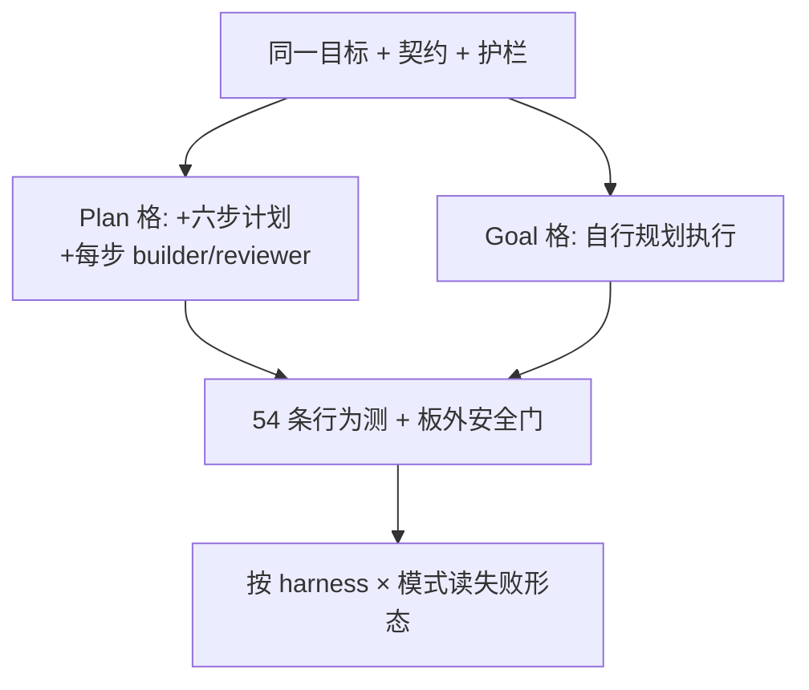

# 目标够硬时，还要不要六步计划？

通用（不限工具）

**一句话看懂**：Claude Code 等指南在推“可验证目标 + 护栏，让模型自己找路”，AmpCode 甚至问“大家知道不一定要用 plan mode 吗？”Tom Skeggs 拿个人助手 Sidekick 积压上 3 个可验收项，在 Claude Code 与 OpenCode 上各跑 5 次：强模型上 goal 更快更稳（只差命名约定），弱本地模型上 goal 会砸产品——plan 才稳。

## 读完你能带走的 7 条收获

1. **/plan 与 /goal 终点可以相同**：差的是模型能不能自己规划、迭代、坚持交付；本文用同一套目标 / 契约 / 约束，只给 plan 格多一份约 125 行六步计划与角色分工（见 3.1）。
2. **对照实验可以很小但可复现**：4 格（Claude Code / OpenCode × plan / goal）× 5 sittings，用 54 条行为测 + 板外安全门打分（见 3.1、3.2）。
3. **Claude Code：goal 胜在速度与成本波动**：中位 53/54、$22.52、75.2 分钟，对 plan 的 54/54、$29.63、88.3 分钟；4 次少过的 1 测全是 `view_page` 命名（见 3.2、3.3）。
4. **OpenCode + Qwen Flash：plan 才可靠**：plan 中位 54/54；goal 中位 53/54，但有 sitting 掉到 48、50，并出现聊天崩溃等真缺陷（见 3.2、3.3）。
5. **Goal 格少派代理、少提交**：Claude plan 平均 spawn 12 个 party agent、10 次 commit；goal 是 6 与 3——计划会规定“每步 builder + 审查”（见 3.2）。
6. **规格测全绿，探针仍可打穿**：几乎每跑都经图片查看工具暴露后门重定向；改 saved chat 路径可送非预期文件（见 3.4）。
7. **实践含义是条件句，不是“plan mode 已死”**：强模型可往 goal 挪；弱模型撤计划会换来 app-breaking（见 3.3、5）。

::: tip 小白先懂这几个词
- [Plan Mode（计划模式）](/glossary#plan-mode)：先写（或被交给）结构化计划，再按步改代码。
- [/goal（目标驱动的长任务）](/glossary#goal)：给可验证目标与护栏，让代理自己规划与迭代。
- [完成标准](/glossary#definition-of-done)：事先写明怎样算做完；本文用 54 条测试充当。
- Guardrails（护栏）：本文里与目标一起下发的固定约束（文件行数上限、工具安全类、禁止某些库等）。
- Builder / reviewer：建造者写代码，审查者按契约挑错；文中 Claude 格用 Opus 5.5 / Sonnet 5.5 搭。
- Adventure Party：作者 harness 里的多智能体编排（文中 plan 格会规定每步谁干）。
:::

## 1. 基本信息

<SourceCard type="文章" title="Plan mode is dead?" author="Tom Skeggs" date="2026-10-30" url="https://freshworktree.com/plan-mode-is-dead/" />

| 项目 | 内容 |
|---|---|
| 链接 | https://freshworktree.com/plan-mode-is-dead/ |
| 类型 | 文章（Fresh Worktree；约 11 分钟） |
| 作者 | Tom Skeggs |
| 发布日期 | 2026-10-30 |
| 使用工具 | 通用对照：Claude Code（Opus 5.5 / Sonnet 5.5）与 OpenCode（本地 Qwen Flash Next + Deepseek Flash 审查）；作者 Adventure Party 编排 |
| 分析依据 | 原文全文（txt + html，2026-11-03 抓取）。数字与引语以原文为准；图表坐标未写出的不补。“我觉得”开头的段落是本站评论。 |

## 2. 这篇在回答什么

同事刚跟你说：别再写长计划了，丢一个 issue 给代理，等 PR。AmpCode 那边更直白：

::: tr 大家知道不一定要用 plan mode 吗？
> "Do people know they don't have to use plan mode?"
:::

作者把争论收成一句话：

::: tr /plan 与 /goal 方法的终点是一样的，问题是 AI 是否已经训得足够好，能自己规划、迭代，并坚持交付合格方案。
> "The destination for /plan and /goal methods is the same, the question is whether AI has been sufficiently well-trained to self plan, iterate, and persistently deliver a quality solution."
:::

他不靠口号，而是拿自己在用的个人 AI 助手 Sidekick 积压里 3 个可验证项，做成 2×2 对照：同一目标与护栏，只给一半格子详细六步计划。

这篇文章主要回答：

1. goal 格和 plan 格提示词到底差在哪？
2. Claude Code 与较弱的 OpenCode 本地模型上，谁更吃 goal？
3. 少过的那几分，是小约定还是产品级缺陷？
4. 行为测过了，安全探针还暴露什么？

## 3. 怎么做

### 3.1 实验怎么搭：同一目标，只多一份六步计划

**是什么**：假设原文写成——

::: tr 给 AI 编码 harness 可验证目标与护栏，将持平或超过传统 plan mode。
> "Providing an AI coding harness with verifiable goals and guardrails will either meet or outperform traditional plan mode"
:::

三个任务难度递增：

1. 把只含 HTML 的邮件读成干净文本（实体解码、保留换行与链接，去掉样式 / 脚本 / 跟踪像素 / 引用回复；若已有纯文本部分则仍用纯文本）。
2. 让助手能安全删除任务、删除列表、重命名 Google 任务列表——含项目安全策略（破坏性标记、有任务时非强制不删、批准卡展示列表名与任务数等）。
3. 在房产扫描定时任务里打开在线房源图库，导航并把照片交给多模态模型解读。

四格各 5 次 sitting：

| Harness | 交给代理的东西 | 模型 |
|---|---|---|
| Claude Code + Adventure Party | 六步计划 **或** 目标+护栏 | claude-opus-5-5、claude-sonnet-5-5 |
| OpenCode + local party | 同上 | local/qwen-flash-next、local/qwen-guide、openrouter Deepseek Flash |

**提示词差在哪**：两边共享目标、resume 契约（进度落文件与 commit，方便长跑续上）、钉死的项目陷阱（图片缓存、420 行文件上限、工具安全类、用哪套 Chrome、不用 trafilatura）。Plan 格额外约 125 行六步（做什么、动哪些文件、怎么验收）以及“谁做什么”（每步一个 builder、每次建造后 reviewer、最难点可选 senior reviewer）。体积：goal **742 词**，plan **2,312 词**。开场句也不同——goal 是“这是目标与护栏，你自行规划执行”；plan 是“范围钉死这三个条目，别的发现先记到板上”。

**评分**：54 条行为测分组为邮件 11、任务列表工具 10、照片进模型 10、房产 job 4、新工具安全 12、积压板 6、本趟自写测须通过 1。另有板外 **Security gate**：用干净副本跑 Sidekick 原有安全测——20 趟全部通过。

我觉得这套设计的可迁移点不是 Adventure Party 本身，而是：**先把“可验证”写成测试清单，再决定要不要把六步计划塞进上下文**。

### 3.2 总表：Claude 吃 goal，OpenCode 吃 plan

原文用一句话概括结果：

::: tr Goal 赢在 Claude Code，Plan 赢在 OpenCode。
> "Goal wins for Claude Code, Plan wins for OpenCode"
:::

中位数（每格 5 sittings）：

| 格 | 测 | 费用 | 活跃分钟 |
|---|---|---|---|
| OpenCode · plan | 54/54 | $0.73 | 401.1 |
| Claude Code · plan | 54/54 | $29.63 | 88.3 |
| OpenCode · goal | 53/54 | $0.38 | 332.3 |
| Claude Code · goal | 53/54 | $22.52 | 75.2 |

作者写：Claude Code 在 goal 上**显著更稳、更快**；OpenCode + Qwen Flash Next 质量上大致相当，但**只有 plan 模式**如此。Claude goal 平均少过 1 测，是轻微命名约定问题；OpenCode goal 则多次交出 **app-breaking** 缺陷。

过程量也对照得好看：

| 格 | Turns | Tool calls | Party agents | Commits | 新增行 |
|---|---|---|---|---|---|
| Claude · plan | 456 | 475 | 12 | 10 | 4,594 |
| Claude · goal | 342 | 363 | 6 | 3 | 4,423 |
| OpenCode · plan | 811 | 1,042 | 12 | 17 | 3,867 |
| OpenCode · goal | 641 | 772 | 8 | 5 | 3,306 |

Plan 格会写明每步派 builder / reviewer，所以 agent 与 commit 更多；goal 格行数并不少多少，但编排更省。时间上 Claude 大约稳定在 ~80 分钟；本地模型约 6 小时。作者还观察到：Claude plan 的费用波动更大，弱模型则是 plan 很稳、goal 时间乱摆。

### 3.3 少过的分：命名约定 vs 真把聊天砸崩

**Claude Code goal** 4 次 53/54，全部同一类：房产 job 的工具列表**没有写出名字** `view_page`，而是各自做了一个建立在 `view_page` 代码上、自己取照片的包装工具。作者判为“可辩护的设计”——板子要求把 `view_page` “接到”房产 job，包装也算接上；测试查的是字面名字，因为脚本只能查名字。

**OpenCode plan** 唯一一次 53/54：自写测试套件里有一条关于“拒绝允许目录内被拦图片名”的测是红的——小缺陷，装了条失败测试。

**OpenCode goal** 才是重的：

- Sitting 3（48/54）：重开带截图的会话触发 image 结果类型上的 `TypeError`（砸掉 4 测）；图库模式要 6 张给 2 张；房产 job 既无评分量表也无 tracker 表名——**会打到任何用过该工具的已存会话**。
- Sitting 4（50/54）：截图模式只回页面文字、没有图；房产 job 不写 tracker 表名。
- Sitting 5（53/54）：把 BK-001 标成完成，但勾选框未勾、笔记无更新——违反板规则 6。

实践建议原文写得很冲：

::: tr 对从业者来说，这可能意味着：Claude Code 继续停在 plan mode，会随着模型被训成目标导向执行而结果变差——考虑现在就转向更偏 goal 的工作流。
> "For practitioners this may indicate staying on plan mode for Claude Code will lead to poorer results over time as their models are trained into goal-oriented execution - consider shifting towards more goal-based workflows now!"
:::

我觉得这句话只对**已经能在 goal 下把产品级缺陷压住的模型档**成立；同一页上的 OpenCode 结果，是反例不是脚注。标题问 “Plan mode is dead?”，正文给的是**分模型的条件结论**。

### 3.4 54 分之外：探针仍打穿安全与质量

作者又做了规格外探针，说明“测过了”不够：

- **H1**：几乎每一趟都通过图片查看工具暴露在后门重定向下。
- **H5**：改 saved chat 里的路径，可指向盘上另一文件，把非预期文件送进数据库。
- **H2**：只有 OC goal 3 在存储位置变更后 reopen 会崩。
- **H3**：OpenCode 各趟没给“删除仍含未完成任务的 Google 列表”加额外校验。

这和站内强调的独立完成标准、安全门（[[15]]、[[56]]）同向：验收清单要覆盖**行为**，探针还要覆盖**规格没写但产品不能破**的面。

## 4. 结果与局限

**文中真正给出的结果**：

- 2×2×5 的中位测分 / 费用 / 时间，以及逐 sitting 表。
- Prompt 体积 742 vs 2,312；过程量（turns、agents、commits）。
- 失败分类：Claude 命名约定 vs OpenCode goal 的崩溃与缺字段。
- 20/20 通过板外安全门；探针 H1/H5 等暴露规格外洞。

**局限与注意**：

- 单人积压、单一应用（Sidekick），不是跨仓基准；“中位”来自每格 5 次，不是大样本。
- Claude 与 OpenCode 的模型档差巨大，结论是“档 × 模式”交互，不能读成“所有 plan mode 过时”。
- 费用按标价；OpenCode 本地增量成本作者称不明显。
- 中断（Claude 5 小时限额、本地让路）已从活跃分钟扣除，但长暂停仍存在。
- 标题营销感强；以正文假设与分格结果为准。

## 5. 结论

这篇最值得带走的不是“杀掉 plan mode”，而是一次干净的消融：**目标、契约、护栏对齐之后，六步计划与角色表还值不值得塞进上下文——取决于模型能不能在 goal 下自己走完，且失败形态是否可接受。** Claude 格里 goal 用更少代理、更少时间、更低中位费用换近乎同分；OpenCode 格里撤计划会换来聊天崩溃。测清单再厚，也别忘探针。

**你可以这样试**

1. 挑 1–3 个真实积压项，先写“怎样算做完”的自动化测（哪怕十几条），再写 goal 短提示与可选六步计划。
2. 同 harness、同测，只改“有无六步计划”，至少各跑 3 次；记录少过的测是命名 / 流程 / 崩溃哪一类。
3. 在行为测之外加 2–3 条安全探针（路径穿越、危险工具默认允许、重开会话）。
4. 弱模型或本地小模型：先别撤计划；强模型再试把计划收成目标 + 护栏 + 验收测。

**读完自测**

1. goal 格和 plan 格共享了什么、只多给了 plan 什么？
2. Claude goal 少过的 1 分与 OpenCode goal 的 48/54，失败性质差在哪？
3. 为什么作者说 20 趟 Security gate 全过，仍要写 H1/H5 探针？
