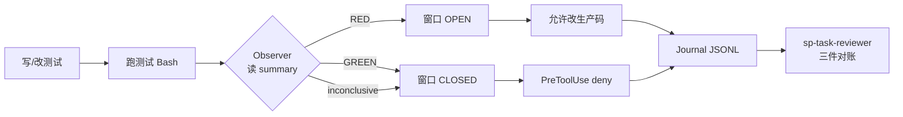

# 提示词拦不住测后写：用 Hooks 强制代理先红再绿

<div class="meta-tags"><span class="tool-tag tool-claude">Claude Code</span></div>

<div class="hook">

**一句话看懂**：Superpowers 和 CLAUDE.md 都说要 TDD，但计划模板里写着 `following TDD if task says to`，子代理又拿不到主会话那套上下文——测后写照样发生。Aitor Alonso 用 Claude Code 的 Pre/PostToolUse hooks 做了一道守卫：生产代码默认上锁，只有观察到**真正失败的测试**（看 summary 行，不看退出码）才开一轮编辑窗口；重构要显式声明并翻成「必须保持绿」；每步写进 journal，独立 reviewer 拿计划期望失败、RED 记录和 diff 三件对账。

</div>

## 读完你能带走的 7 条收获

1. **对 LLM，先失败的测试几乎是刚需**：它给「看起来做完了」之外的真实终点，也避免测写在实现后镜像代码（含 bug）（见 3.1）。
2. **「if task says to」会把 TDD 变成可选**：计划措辞 + 子代理缺上下文 + 模型随机性，三层叠加后规则文件挡不住漂移（见 3.2）。
3. **守卫 = 观察 Bash 测跑 + 闸门 Edit/Write**：RED 开窗、GREEN 关窗；一窗允许多次编辑到绿，状态按 `agent_id` 隔离（见 3.3）。
4. **信 summary 行，不信非零退出码**：编译挂、setup 崩也能非零，却没有任何 assertion——当 RED 会让代理用破构建开锁（见 3.3）。
5. **重构不是逃逸口，是翻转要求**：`tdd-guard refactor "理由"` 之后要绿才能改生产码；测变红就退回要红（见 3.4）。
6. **只武装 implementer，并用第三道 hook 卡住错类型派发**；自定义 `sp-implementer` 把 TDD 写成强制并预载 skill（见 3.4）。
7. **journal + 独立 reviewer**：计划里的期望失败、journal 里的真 RED、使测通过的 diff 必须对得上——别信「我保证跟了 TDD」（见 3.5）。

::: tip 小白先懂这几个词
- [Hooks（钩子）](/glossary#hooks)：Claude Code 在工具调用前/后等固定时刻跑的命令；PreToolUse 可以 deny。
- [Red / Green TDD](/glossary#red-green-tdd)：先看到测试失败（红），再写刚好让它通过的实现（绿）。
- PreToolUse / PostToolUse：工具**之前**可拦截；**之后**能读输出、记状态。
- [TDD Guard（编辑窗口）](/glossary#tdd-guard)：作者实现的状态机——失败测打开生产码编辑权，全绿后重新上锁。
- Journal（JSONL）：按 `agent_id` 追加的测跑、允许/拒绝编辑、重构声明日志。
- [Adversarial Review（对抗式复核）](/glossary#adversarial-review)：验证方不采信作者自述，只看机械证据。
- Superpowers：作者使用的 Claude Code 技能/插件套件（含 brainstorming、subagent-driven-development 等）。
:::

## 1. 基本信息

<SourceCard type="文章" title="Enforcing TDD on AI agents with Claude Code hooks" author="Aitor Alonso" date="2026-10-24" url="https://aalonso.dev/blog/2026/enforcing-tdd-on-ai-agents-with-claude-code-hooks/" />

| 项目 | 内容 |
|---|---|
| 链接 | https://aalonso.dev/blog/2026/enforcing-tdd-on-ai-agents-with-claude-code-hooks/ |
| 类型 | 文章（个人工程博客，约 11 分钟） |
| 作者 | Aitor Alonso |
| 发布日期 | 2026-10-24 |
| 使用工具 | Claude Code（hooks、自定义 subagent）；工作流叠 Superpowers；示例偏 Elixir / ExUnit |
| 分析依据 | 原文全文（`aalonso-tdd-hooks.txt` / `.html`，2026-11-03）。配置与伪码按文中片段摘录；完整 hook 与 agent 提示在作者 GitHub Gist，本文不逐文件展开。数字类结论原文几乎没有量化实验。「我觉得」开头的段落是本站评论。与 [[25]] 对照：那边是提示词级 red/green，这边是 hooks+journal 强制。 |

## 2. 这篇在回答什么

你已经在 CLAUDE.md 和技能里写了「要用 TDD」。代理交活时测试是绿的——但你总怀疑：它是不是先写了实现，再按实现补了几条「不抛错就算过」的测？

Alonso 也烦这件事。obra 的 Superpowers 技能说要跟 TDD，计划与代理却经常不跟。他的选择是：

::: tr 我决定不再客气地请求，而是开始强制执行。
> "I decided to stop asking nicely and start enforcing it."
:::

文章主线不是再讲一遍 TDD 教条，而是：**用 Claude Code hooks 做成确定性的小守卫**——概念够用、片段够短，方便你换成自己的语言和测试跑法。

它主要回答：

1. 为什么 TDD 和 LLM 特别合拍？
2. 为什么「写在规则里」仍然可选、仍然会漂？
3. 观察者 + 闸门 + 每代理窗口怎么接 hooks？
4. 重构、只护 implementer、journal 审查怎么配套？防漂移还是防恶意？



## 3. 怎么做

### 3.1 为什么 TDD 对 LLM 几乎是刚需

**是什么**：经典红→绿→重构循环。作者列了四条「对模型格外硬」的理由。

**为什么**：

1. **真实终点**。他常翻 Claude Code best practices，有一条从头没变过：Claude 会在工作「看起来做完」时停手；要更好结果，就得给它验证手段。没有可验证物，「看起来做完」就是唯一信号。失败测试是强信号，逼代理迭代到通过——正是 LLM 擅长的环。
2. **测写在代码后会锚定实现**。代理读着实现写测，测编码的是代码**做了什么**（含 bug），不是**该做什么**。这和「代理不该审查自己的代码」是同一类锚定。先写测时还没有代码可抄，测只能来自 spec。
3. **从没红过的测什么也证不了**。模型爱写只检查「跑起来不抛」的测（这也是他 CLAUDE.md 第 8 条存在的原因）。先看到因正确原因失败，才证明测测到了东西。
4. **错误比猜测好当上下文**。失败测直接塞错误信息和栈，省得模型在脑子里仿真整程序；且规则是「只写让测通过所需的代码」，顺带卡住范围膨胀。

站内 [[25]] 用一句 `Use red/green TDD` 把纪律装进提示词；本文默认你已经信这条，接下来问的是——**提示词不够时，机器怎么拦**。

### 3.2 问题：TDD 变成了「任务如果这么写」

**是什么**：工作流是 `/braingstorming`（原文拼写）出 spec → 计划 → `subagent-driven-development` 按任务派**新的** implementer 子代理。TDD 写在 Superpowers 哲学里，他以为默认会发生。

读了 implementer 的提示模板后，看到这一行：

::: tr 写测试（若任务要求则遵循 TDD）
> "write tests (following TDD if task says to)"
:::

**为什么会漂**：

- TDD 取决于计划里每个任务的措辞；写计划的 skill 对 TDD 只是 briefly mention。
- implementer 子代理不会像主会话那样注入 Superpowers 上下文，没人提醒 TDD skill。
- 最终是否 TDD，取决于计划措辞和当天模型的随机决定。

第一反应是往 CLAUDE.md 加规则。有用，但仍是模型压力下可以漂走的指令。要确定性，作者认为只剩 hooks。

我觉得这和 [[81]]、[[28]] 是同一课：能用脚本判断的纪律，别只写在会忘的 Markdown 里。差别是 Alonso 把「是否先红」做成了可解析的状态，而不是再叮嘱一句。

### 3.3 守卫：观察测跑、闸门改生产码、信 summary

**怎么接 hooks**：关心两类生命周期点——`PreToolUse`（可 deny）和 `PostToolUse`（可读输出）。在 `settings.json` 里按 matcher 挂命令：

文中给出的接线大致是（抓取日 2026-11-03；空白经压缩）：

```json
{
  "hooks": {
    "PreToolUse": [{
      "matcher": "Edit|Write|MultiEdit",
      "hooks": [{ "type": "command", "command": "python3 ~/.claude/hooks/tdd-guard/pre_edit.py" }]
    }],
    "PostToolUse": [{
      "matcher": "Bash",
      "hooks": [{ "type": "command", "command": "python3 ~/.claude/hooks/tdd-guard/post_bash.py" }]
    }]
  }
}
```

stdin 是 JSON：工具名、输入（改哪个文件、跑什么命令等）；Post 还有 response。来自子代理时还带 `agent_id`（每个派出的子代理唯一）和 `agent_type`（子代理名）。Deny 时打印例如：

Deny 时 stdout 大致如下（理由会展示给代理）：

```json
{
  "hookSpecificOutput": {
    "hookEventName": "PreToolUse",
    "permissionDecision": "deny",
    "permissionDecisionReason": "TDD guard: production code is locked. You need a failing test first."
  }
}
```

理由会展示给代理，好知道下一步做什么。

**结构**：

- **Observer**（Bash 的 PostToolUse）：凡是测跑，读结果、更新状态。
- **Gate**（编辑工具的 PreToolUse）：改生产码前查状态，没挣到窗口就 deny。
- **测试文件永远可改**（否则写不出失败测）；配置、迁移、文档也不闸——加依赖不该先要一条失败测。只有生产代码 gated。

**窗口状态机**（文中伪码）：

- 结果 RED → `window = OPEN`
- 结果 GREEN → `window = CLOSED`
- inconclusive → 不变
- `is_edit_allowed` ⟺ 窗口 OPEN

注意窗口是 **per cycle，不是 per edit**：一次 RED 授权代理改到 GREEN 所需的多次编辑，正是 TDD 允许的。全绿之后，下一块行为需要新的失败测。因此多付的是**每轮多一次测跑**，不是每次编辑一次。

状态按 `agent_id` 存：并行两个 implementer 互不踩；新任务 = 新子代理 = 新 id = 关窗起步。

**信 summary，不信 exit code**：非零退出码不等于「有测试失败」——也可能没编译过、setup 崩了、环境不对。那些情况下**没有任何测做过断言**，若当 RED，代理只需弄破构建就能开锁。观察者解析 summary（如 Elixir 的 `5 tests, 1 failure`）：没有 summary 或 `tests == 0` → INCONCLUSIVE；`failures > 0` → RED；否则 GREEN。

### 3.4 重构模式，以及只武装 implementer

**重构**：行为不变就没有新 RED。作者不加「免检通行证」，而是**翻转要求**：代理用小 CLI 声明重构并必须给理由：

```bash
~/.claude/bin/tdd-guard refactor "extract the pricing rules into their own module"
```

之后生产码编辑需要的是**通过的跑法**而不是失败的；代理在绿套件下重构。若重构中测变红，守卫退回要求 RED——无论是弄坏了，还是开始加行为，都合理。理由入账，审查者可对照 diff：一个「重构」里冒出三个新 public 函数，就不是重构。

**范围**：闸门只对自定义子代理 `sp-implementer` 武装；hooks 先看 `agent_type`，主会话、审查者、其他子代理立刻返回。`sp-implementer` 是 Superpowers implementer 的薄层：保留原提示，只补（1）无论计划怎么写 TDD 强制，（2）预载 TDD skill，（3）短说明 deny 含义、如何声明重构、遇到阻挡报 `BLOCKED` 而不是绕过。

派发两层，因为插件模板会派 general-purpose，且模板在 plugin cache，改了下次更新被覆盖：

1. CLAUDE.md 规定：subagent-driven-development 的 implementer **一律**派成 `sp-implementer`。
2. 第三道 hook：`PreToolUse` 挂在 `Agent` 工具上，拒错类型的 implementer 派发并要求重派。

根因再堵一层：写计划时，凡碰生产码的任务必须包含「写下失败测并写明期望失败」的步骤；纯重构任务要标出来。计划总是显式 TDD，就消掉了模板里的 `if task says to`。

完整 agent 与规则在 GitHub Gist；hooks 面向 Elixir，换语言要自己写 summary 解析。

### 3.5 Journal、审查者，以及防什么

**另一半工作**：事后能查「TDD 是否真发生过」。每次测跑、每次允许/拒绝的编辑、每次重构声明，追加到该代理的 journal（简单 JSONL）。CLI：

```bash
~/.claude/bin/tdd-guard report <agent-id>
```

Superpowers 里每个完成的任务会由新鲜的 task reviewer 检查；他换成 `sp-task-reviewer`：先拿 implementer 的 `agent_id` 读 journal，再下结论。不再信 implementer「我跟了 TDD，保证」式报告。每个任务三件工件必须一致：

1. 计划步骤点名的**期望失败**；
2. journal 里显示带该失败的**真 RED**；
3. 使测通过的**生产码 diff**。

作者指向自己另一篇对抗式审查：验证要机械，别让作者给自己打分——与站内对抗复核同一精神。

**局限（原文 Caveats）**：守卫防的是**善意漂移**（压力下或随机性滑向测后写），不是防恶意代理。真想作弊仍可能：伪造测输出，或用 `sed -i` 经 shell 改代码。两者多半会在 journal 留痕给审查者。犹豫时他选择**偏向记录而不是误拦**——误控诉的守卫没人信，没人信的守卫最后会被关掉。

## 4. 结果与局限

**文中真正落地的**：一套可复述的 hooks 架构（观察者 / 闸门 / 每代理窗口 / refactor CLI / journal / 自定义 implementer+reviewer），以及「信 summary、不信 exit code」「三件对账」两条可迁移规则。没有给出「上线后缺陷率降了 X%」这类实验数字；Elixir summary 解析与 Gist 配置是作者环境特化。

**局限与注意**：

- Bash/`sed` 改文件不经 Edit 工具则闸门看不到——与 [[28]]「只 match Edit\|Write 会漏 Bash」同一类洞；作者靠 journal + reviewer，不靠百分之百拦截。
- 并行与多语言要自己维护 per-runner 的 summary 解析；INCONCLUSIVE 处理不好会误锁或误开。
- 依赖 Claude Code hooks 能力与自定义 subagent；换工具要重做等价生命周期钩子。
- 与 [[25]] 比：提示词零基建、今天就能试；本文强制力强，但要维护状态机与审查代理。

## 5. 结论

Alonso 把「先红再绿」从技能口号收成了 **Pre/PostToolUse 上的小状态机**：生产码默认锁，真 RED（summary）开一轮窗，GREEN 关上；重构显式声明并改成保绿；journal 让审查者不采信作者自述。它防的是漂移，不是 APT。

**你可以这样试**

1. 先只做 Observer：Bash 后解析你的测试 summary，写 JSONL（先别 deny）。
2. 再对生产路径加 PreToolUse 闸门；测试路径放行；状态按会话或 `agent_id`。
3. 有子代理派发时，加 Agent 工具上的类型检查；计划模板去掉任何「if task says to」。
4. 审查清单改成：期望失败原文 ∪ journal RED ∪ diff，三件齐再合并。

**读完自测**

1. 为什么非零退出码不能当 RED？
2. 窗口为什么是 per cycle 而不是每次编辑开一次？
3. 重构模式与「临时关掉守卫」差在哪？
4. 三件对账分别对应计划、journal、代码的哪一块？
