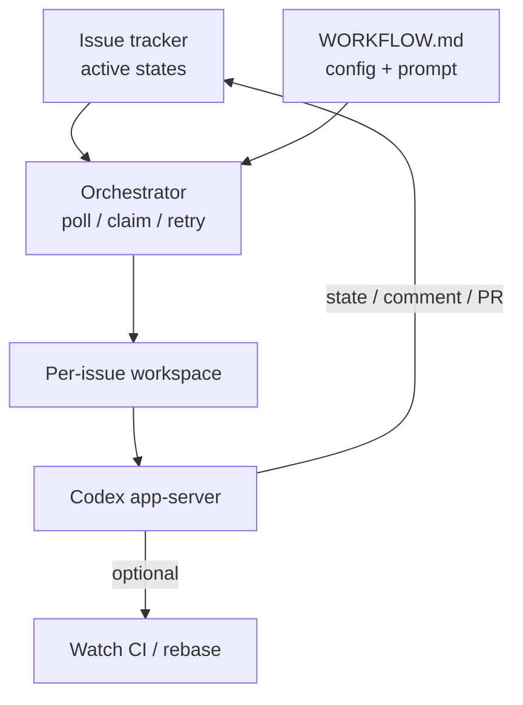

# 把 Linear 当成控制面：Symphony 怎么编排 Codex

Codex

**一句话看懂**：交互式 Codex 会话再快，人也只能稳盯大约 3–5 个标签页——瓶颈变成人类注意力。OpenAI 开源的 Symphony 把 Linear 一类 issue tracker 做成控制面：每个活跃工单对应隔离 workspace 与常驻代理，策略写进仓库里的 `WORKFLOW.md`，实现契约写在语言无关的 `SPEC.md`；内部有团队落地 PR 涨约 500%，但官方明说这是参考实现，不是要长期当独立产品维护。

## 读完你能带走的 7 条收获

1. **瓶颈从“写代码”挪到“盯会话”**：多数人舒适上限大约三到五个会话，再多就会忘谁在干啥（见 3.1）。
2. **控制面应是可交付物（issue），不是 session / PR**：每张活跃票保证有一个代理在自己的 workspace 里跑（见 3.2）。
3. **编排器读票、代理写票**：Symphony 负责轮询、并发、重试与对账；改状态、评论、挂 PR 交给 coding agent 的工具（见 3.2、3.3）。
4. **仓库契约 = `WORKFLOW.md` + `SPEC.md`**：YAML front matter 管轮询 / workspace / hooks / 并发，Markdown 正文是按 issue 渲染的 prompt（见 3.3）。
5. **从刚性状态机改成给目标**：模型会变强，别把代理钉死在“只实现”的小盒子里；给工具和上下文，让它自己推理（见 3.4）。
6. **结果与副作用**：部分团队落地 PR 约 +500%；探索成本下降，PM / 设计也能直接提单；并行过猛会制造合并冲突（见 3.4、4）。
7. **定位是参考规格**：用 Codex App Server + 动态 `linear_graphql` 工具避免把 token 塞进子代理；自己 fork / 重实现（见 3.5、5）。

::: tip 小白先懂这几个词
- [Harness（挽具）](/glossary#harness)：模型外的确定性外壳——工具、循环、审批、上下文。
- [Codex App Server](/glossary#codex-app-server)：Codex 的无头 JSON-RPC 模式，供编排器起线程、推 turn。
- Symphony：OpenAI 开源的“issue → 常驻代理”编排规格与 Elixir 参考实现。
- WORKFLOW.md：仓库内、带 YAML front matter 的工作流契约（轮询、并发、hooks、prompt 模板）。
- SPEC.md：语言无关的问题定义与实现契约；文中称 Symphony「技术上就是」这份规格。
- [Control Plane（控制面）](/glossary#control-plane)：这里指 issue tracker 决定“有什么活、谁在跑”，而不是终端标签页。
- DAG / blocked_by：工单依赖；`Todo` 且存在未终结 blocker 时不派工。
:::

## 1. 基本信息

<SourceCard type="文章" title="An open-source spec for Codex orchestration: Symphony" author="Alex Kotliarskyi, Victor Zhu, Zach Brock（OpenAI）" date="2026-04-27" url="https://openai.com/index/open-source-codex-orchestration-symphony/" />

| 项目 | 内容 |
|---|---|
| 链接 | https://openai.com/index/open-source-codex-orchestration-symphony/ |
| 类型 | 文章（OpenAI 官方工程博客；附开源 SPEC / 参考实现） |
| 作者 | Alex Kotliarskyi、Victor Zhu、Zach Brock |
| 发布日期 | 2026-04-27 |
| 使用工具 | Codex（app-server）；Linear 作 tracker；参考实现用 Elixir |
| 分析依据 | 原文全文（jina 抓取转 txt，2026-11-04）。数字与引语逐字核对；SPEC 细条款只摘编排层，不复述全部 schema。「我觉得」开头的段落是本站评论。本站 [[07]] 讲 harness 工程；本文是其“下一瓶颈：编排”的官方续篇，允许单独成文。 |

## 2. 这篇在回答什么

你们已经按 harness 工程把仓库改成“代理能干活”：测试、lint、文档都齐了。接着工程师开始同时开一堆 Codex 会话——然后发现自己在当人肉调度器。

OpenAI 团队写得很直：

::: tr 代理很快，但我们撞上了系统瓶颈：人类注意力。
> "The agents were fast, but we had a system bottleneck: human attention."
:::

Symphony 的赌注是：别再围着会话和 PR 优化，围着 issue 优化——让 tracker 拉活，编排器保证每张活跃票都有代理在跑。

它主要回答：

1. 交互式编码代理的天花板在哪？
2. 把 issue tracker 做成控制面后，运行时长什么样？
3. `WORKFLOW.md` / `SPEC.md` 各自管什么？
4. 这样工作之后，产出和行为怎么变？新问题是什么？
5. 开源物该怎么用、不该期待什么？

## 3. 怎么做

### 3.1 交互式会话的天花板：3–5 个标签页

**是什么**：即使 CLI / Web 更好用，编码代理仍主要是交互工具。规模上来后，每人开几个 Codex、派活、审输出、纠偏、再重复。

**为什么痛**：

::: tr 实践中，多数人能舒适管理的大约是一次三到五个会话，再多上下文切换就痛苦。
> "In practice, most people could comfortably manage three to five sessions at a time before context switching became painful."
:::

再往上：忘了谁在干什么、跳终端去捅卡住的长任务——等于养了一队很强的初级工程师，却让资深人类去微管理他们。

我觉得这句话比任何“多智能体框架”名词都有用：**先承认人注意力才是调度器的稀缺资源**，再决定要不要上编排层。

### 3.2 控制面：每张活跃票对应一个常驻代理

**是什么**：Symphony 持续看看板，确保每个活跃任务都有代理在环里跑到流程定义的交接态；崩溃 / 停滞就重启；新票出现就拉起。

文中把核心收成一句：

::: tr 对每个未完成任务，保证有一个代理在自己的 workspace 里运行。
> "For every open task, guarantee that an agent is running in its own workspace."
:::

**怎么跑**：

1. 用工单状态当状态机（示例用 Linear：`Todo` / `In Progress` … → `Human Review` / `Done`）。
2. 每张票映射独立 workspace；工作与会话、与“是否必须产生 PR”解耦——有的票跨仓多 PR，有的只做调查。
3. 大功能先让代理出计划，再生成带依赖的任务树；只启动未被 block 的节点，于是执行按 DAG 自然并行（例：React 升级 block 在 Vite 迁移完成之后）。
4. 代理可以自己开 follow-up issue（性能、重构、架构）；人再决定排期。
5. 编排器跑在 devbox、不睡觉——有人在破 wifi 的小屋用手机 Linear 提了三个重要改动。

**边界**：Symphony 是 scheduler / runner / tracker **读端**；写回 tracker 通常由 coding agent 用工具完成。成功可以停在 `Human Review`，不必等于 `Done`。

### 3.3 仓库契约：SPEC.md 与 WORKFLOW.md

打开仓库第一眼：

::: tr Symphony 在技术上就是一份 SPEC.md——对问题与预期解法的定义。
> "Symphony is technically just a SPEC.md file—a definition of the problem and the intended solution."
:::

**SPEC 层（实现契约）**要解决四件事：把执行变成可重复守护进程；按 issue 隔离 workspace；把策略留在仓库的 `WORKFLOW.md`；提供足够可观测性。非目标包括：富 Web UI、通用工作流引擎、内建“怎么改票 / 怎么写评论”的业务逻辑（那属于 prompt + 工具）。

**WORKFLOW.md**：YAML front matter（`tracker` / `polling` / `workspace` / `hooks` / `agent` / `codex`）+ Markdown 正文作 Liquid 风格 prompt 模板。关键旋钮包括：`active_states` / `terminal_states`、`max_concurrent_agents`、workspace hooks（`after_create` / `before_run` …）、`codex.command` 默认 `codex app-server`、停转超时等。配置应可热更新；非法重载不崩服务，沿用上一份有效配置。

**Agent 集成**：经 app-server 的 initialize → thread/start → turn/start；连续 turn 复用同一 `thread_id`。为避免把 Linear token 暴露给子代理，可选动态工具 `linear_graphql`：由 Symphony 侧带鉴权执行 GraphQL，代理只看到结构化结果。

早期版本只是 tmux 里轮询 Linear 的 Codex；不可靠。第二版长在已按 harness 工程改造过的主仓里。之后他们用 Symphony 构建 Symphony，并让 Codex 用多语言实现同一 SPEC 来找歧义。

### 3.4 产出、行为变化，以及“别钉死状态机”

**结果（文中数字）**：

- 内部部分团队在前三周落地 PR 数约 **+500%**（原文：`500% increase in landed pull requests on some teams`）。
- 对外发布后，文称截至 4 月 23 日参考实现约 **15K** GitHub stars。
- 更深的变化是探索经济学：投机任务变便宜；PM / 设计可直接提单，拿回带产品内 walkthrough 视频的 review packet；monorepo 里编排器可看 CI、rebase、处理 flaky，把票shepherd到 Merging。

**新问题**：票级委派后，失去飞行中随时轻推的能力；有时结果完全跑偏——他们用来反推 harness 缺口（E2E、Chrome DevTools、QA smoke、文档、“什么样算好”）。并非所有任务适合 Symphony：仍需强判断的模糊问题，留给交互式会话。

关键转向：

::: tr 于是我们最终转向给代理目标，而不是严格转移；……给它们工具和上下文，然后让它们去干。
> "So we eventually moved toward giving agents objectives instead of strict transitions, much like a good manager would assign a goal to a direct report on their team. The power of models comes from their ability to reason, so give them tools and context and let them cook."
:::

### 3.5 怎么用这份开源：参考实现，不是产品承诺

官方收束：

::: tr 因此，我们不计划把 Symphony 当作独立产品来维护。把它当成参考实现。
> "As such, we don’t plan to maintain Symphony as a standalone product. Think of it as a reference implementation."
:::

用法建议：像当年对着 harness 工程文脚手架仓库一样，把 SPEC 丢给你的编码代理，按自己的 tracker / 沙箱 / 审批姿态重实现。力量来自 Codex 与 app-server；Symphony 只是把已有工具（Codex + Linear）接到“管理工作”的问题上。

## 4. 结果与局限

- **证明过的**：叙事上的 500% 落地 PR（“some teams”、前三周）；15K stars（截至 Apr 23）；内部从交互会话迁到票级编排的过程与 SPEC/WORKFLOW 契约。
- **未给出的**：500% 的分母、团队规模、对照窗口以外的统计；外部复现数据。
- **局限**：丢中途纠偏；并行过猛时合并冲突会爆（社区字段报告亦强调这一点）；高信任默认不适合所有环境；官方不维护成产品。
- **与站内关系**：[[07]] 讲 agent-ready 仓库；本文讲仓库就绪之后如何用 tracker 调度许多 Codex。[[05]] / [[65]] 是任务系统或扇出脚本；Symphony 的差别是 **issue tracker 作权威控制面 + 每票常驻 workspace**。

## 5. 结论

Symphony 把“多智能体”从聊天编排拉回工程常识：**用你们已经在用的看板当调度器，用仓库里的 Markdown 当策略，用 app-server 当执行接口**。人从微管理会话，退回到写票、设依赖、做 Human Review。

我觉得最值得带走的不是 Elixir 参考实现本身，而是那句契约——“每张活跃票都有代理在自己的 workspace 里”——以及“给目标，不要给过死的转移表”。

**你可以这样试**

1. 读 `SPEC.md` 目标 / 非目标，用自己的代理生成一版最小轮询器（先只支持一种 tracker）。
2. 在一个玩具仓写 `WORKFLOW.md`：`active_states`、`max_concurrent_agents=2`、严格的 handoff 状态。
3. 先只派“调查 / 出计划”类票，确认失败成本真的接近于零，再放开实现票。
4. 并发先宁低勿高；合并冲突比“看着热闹”贵。

**读完自测**

1. 为什么说瓶颈是 human attention 而不是模型速度？
2. Symphony 与“在一个终端里开子代理”的分工边界是什么？
3. 为什么 ticket 写入不放在编排器业务逻辑里？
4. `WORKFLOW.md` front matter 和 prompt 正文各管什么？
5. 官方对“产品化维护”的态度是什么？对你选型意味着什么？
