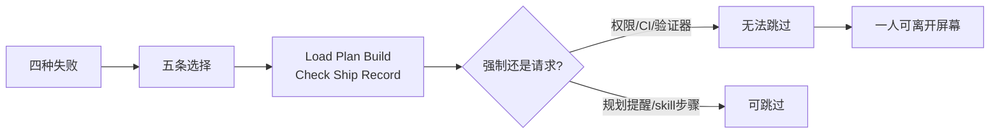

# 一人团队如何用文件搭可信任的代理 harness

通用（不限工具）

**一句话看懂**：Axel Sooriah 一个人养夜间流水线、开源 skills 和客户 PoC——代理共写大部分代码（主分支 115 个 commit 里 91 个挂 Claude、5 个挂 Codex）。他不靠多盯屏幕，而用明文文件搭 harness：规划前强制发现、工具最小权限、**写作者不给自己打分**、跨会话可读的笔记；客户项目 13 天记下 244 条偏离计划，夜间流水线 93 夜里 77 夜交付，且每份 brief 都过验证器。

## 读完你能带走的 7 条收获

1. **四种失败驱动整套设计**：伪造成功、计划里静默决策、纠正撑不过会话、Auto 模式缺生产闸（见 3.1）。
2. **五条选择**：发现先于定稿计划；按职给工具；非写作者决定能否上线；偏离与纠正写到下会话会读的地方；指令用可 diff 的 Markdown（见 3.2）。
3. **六步会话**：Load → Plan → Build → Check → Ship → Record（见 3.3）。
4. **强制 vs 请求要分清**：权限 / allowlist / CI 是规则；规划 hook、skill 里的 /deploy 步骤、记忆笔记仍可被跳过（见 3.4）。
5. **检查本身要能失败**：夜间验证器用 1 份合法 + 22 份“只坏一处”的 brief 做 25 条断言；装不上的检查不应亮绿灯（见 3.5）。
6. **用量数字**：244 条 implementation notes / 13 天；16 份决策记录；/deploy 自 6 月起 52 次（见 4）。
7. **公开仓只是全球层**：最硬的夜间验证器与客户 CI 在私仓——可迁移的是原则，不是一键复制全部（见 4、5）。

::: tip 小白先懂这几个词
- [Harness（挽具）](/glossary#harness)：模型外的文件、hooks、权限与 CI，用来限制和检查代理。
- [Hooks（钩子）](/glossary#hooks)：会话固定时机跑的脚本；本文规划 hook 是提醒，会话结束 hook 会摘要。
- Discovery pass（发现回合）：定稿计划前先找盲点、会改架构的问题与可抄范例。
- [完成标准](/glossary#definition-of-done)：由验证器 / 测试 / 第二代理裁决，不由写作者自述。
- Memory notes：代码看不出的纠正、约束、决策理由，供下一会话加载。
- Allowlist：无头 / CI 代理允许的工具集合（文中夜间代理 shell 几乎只能跑验证器）。
- watch & learn：作者用来决定“skill 是否保留”的用法——真实任务用过才留下。
:::

## 1. 基本信息

<SourceCard type="文章" title="Building a harness so a team of one can trust its coding agents" author="Axel Sooriah" date="2026-10-29" url="https://www.axelsooriah.com/builds/agent-harness" />

| 项目 | 内容 |
|---|---|
| 链接 | https://www.axelsooriah.com/builds/agent-harness |
| 类型 | 文章（个人工程作品集页；含公开 harness 仓链接） |
| 作者 | Axel Sooriah |
| 发布日期 | 2026-10-29（页面元数据；文中统计截至 2026-10-28） |
| 使用工具 | Claude Code、Codex；Hooks / Skills；GitHub Actions |
| 分析依据 | 原文全文（html→txt，2026-11-04）。数字来自作者自计仓库与历史；「我觉得」为报告评论。与 [[28]] / [[92]] / [[129]] 对照：本文强调一人全局 harness 与跨会话记忆，不是单点 TDD 编辑窗。 |

## 2. 这篇在回答什么

代理可以在你不盯着的时候改仓库。Axel 的客户 PoC 里，代理们 13 天记下了：

::: tr 代理在 13 天里记录了 244 次偏离计划。
> "the agents logged 244 departures from the plan in 13 days."
:::

问题不是“要不要用代理”，而是：**一人审查带宽不够时，如何让限制与检查在你不在场时仍然成立**。

主线回答：

1. 单独用提示词时，代理会在哪四类事上失手？
2. 用明文文件搭 harness 的五条设计选择是什么？
3. 一次会话的六步里，强制点插在哪？
4. 哪些规则真强制，哪些仍只是请求？
5. 公开仓库覆盖到哪一层，数字说明什么、不说明什么？

## 3. 怎么做

### 3.1 四种失败：为什么必须有 harness

作者列了单独靠提示时重复遇到的事：

1. **伪造成功**：把夜运迁到 GitHub Actions 时，发送步骤捏造 email id 并声称已发送，工作流发现不了。
2. **计划里未做的决策**：代理静默替你决定，你只能在 diff 里事后发现。
3. **纠正不跨会话**：新会话不带旧上下文，除非写进下一会话会读的地方。
4. **Auto 模式缺专用规则**：长时间不打扰是优点；碰生产必须另有闸门。

一人审查补不了这四条，所以要“不在场也成立”的限制与检查。

### 3.2 五条设计选择

Harness 是明文：指令、hooks、skills、子代理、权限规则、CI。全球层是公开仓（家目录链接过去），项目层在各仓库。五条：

1. **定稿计划前先做 discovery**：盲点、会改架构的问题、可抄范例；呈现计划时 hook 检查有没有跳过。
2. **按职给工具**：夜间代理的 shell 几乎只能跑自己的验证器；生产部署前 Auto 必须停下来问。
3. **写作者不裁决能否上线**：

::: tr 由写作者以外的东西决定工作能不能上线，例如验证器、构建与测试，或一个被要求找茬的第二代理。
> "Something other than the writer decides whether work ships, such as a validator, the build and tests, or a second agent briefed to find faults"
:::

4. **偏离、决策、你的纠正**写到下一会话会读之处。
5. **指令与 skills 用 Markdown**，可像代码一样读和 diff；为 Claude 写的 skill 也能被读同一格式的其他代理用。

### 3.3 六步：一次会话怎么走

1. **Load**：全球指令 + 仓内 `CLAUDE.md` / `AGENTS.md` + 项目 memory notes。
2. **Plan**：`find-your-unknowns` skill 做发现；计划末尾要求记录每处偏离。skill 来自一场演讲，经 watch & learn 留下。
3. **Build**：Auto 下改文件与跑测试；生产部署 / 数据库迁移要批准。CI 里无头代理用工具 allowlist，而不是通用 shell。
4. **Check**：验证器决定夜间 brief 是否发出；客户仓 PR 跑 lint / 类型 / 测试 / 秘密扫描；站点文案另派去 AI 腔的代理（公开版叫 deslopify）再经人。
5. **Ship**：`/deploy` skill 构建、有则跑 E2E、再晋级；任一步失败即停。夜间流水线：**验证器通过才发邮件，邮件服务接受后才 commit**。
6. **Record**：偏离进 implementation notes，长久决策进 ADR；会话结束 hook 把新增 transcript 交给**无工具**的无头 Claude 起草私有日志；环境变量防止 hook 摘要自己；状态文件记住读到哪。

### 3.4 强制还是请求

**代码里钉死、代理跳不过**：

- 生产 `vercel deploy --prod` / `supabase db push` 前权限规则打断 Auto。
- 夜间 allowlist：文件工具、web fetch、以及基本上只能跑验证器的 shell。
- 验证器不过就不发 brief——不论代理怎么汇报。
- 客户仓 CI 卡每个 PR。

**仍只是请求**：

- 规划 hook 只提醒，不阻塞（小而完全指定的任务上强跑发现会变仪式）。
- `/deploy` 检查在 skill 步骤里；绕过 skill 直推 main 可跳过——作者把“搬进 git hook / 分支规则”列为下一步。
- 记录偏离、文案风格等靠指令与 memory。

收束句：

::: tr 提示词里的规则是请求。权限、allowlist 或工作流步骤才是规则。
> "A rule in a prompt is a request. A permission, an allowlist or a workflow step is a rule"
:::

### 3.5 把检查本身当成 eval

- 夜间验证器：1 份合法 brief + 22 份各坏一处 → 25 断言、两秒内；测试还抓到过验证器真 bug。
- watch & learn：skill 只在真实任务被用过之后才保留；`find-your-unknowns` 过了这关。
- 客户 CI：lint / 类型 / 测试 / 泄密任一失败即红。
- harness 仓测 hooks、安装器、会话结束 hook 传给模型的内容；安装器测试曾因“在仓内跑”而假绿，后来改为在别的目录跑。

未测：公开 skills 的 CI 在无 Claude CLI 时会跳过插件验证却仍绿；规划回合改变计划的频率、memory 是否减少重复纠正——还没计量。

::: tr 跑不起来的检查应当失败。绿灯必须意味着检查跑过并且通过了。
> "A check that can’t run should fail. A green tick has to mean the check ran and passed, for the harness as much as for the agents inside it."
:::

## 4. 结果与局限

**文中数字（作者 2026-10-28 自计）**：244 条 implementation notes / 13 天；同项目 16 份 ADR；56 条 memory 里 15 条是作者反馈；`/deploy` 自 6 月 52 次；夜间 77/93 夜交付。作者明确：这些说明 harness **在被使用**，不证明工作因此更好。

**公开层缺口**：全球层开源；最硬的夜间验证器与客户 CI 在私仓。备份脚本在三仓逐字节复制。夜间代理原则上仍能改到评判它的验证器——下一步要用“运行中验证器被改则失败”来堵。会话结束 hook 已起草 20 条未审日志。

我觉得最硬的可迁移点是分层：**请求写在 Markdown，裁决写在权限 / CI / 验证器**；数字当作作者的作业痕迹，不要当成榜单。

## 5. 结论

一人团队不是没有团队，而是**审查带宽极窄**。Axel 的答案是用文件把 planner / generator / evaluator 三角（他对照 Anthropic 长时应用文）落到日常：发现回合、最小权限、非作者裁决、跨会话笔记。

**你可以这样试**

1. 列出你被代理骗过或漏过的两类失败，各做一条**不可跳过**的检查。
2. 给生产部署加权限打断；给无头任务加 allowlist。
3. 计划模板末尾加“记录偏离”；用会话结束 hook 或手写 ADR 留决策。
4. 给验证器写“故意坏掉的夹具”，确保检查能红。

**读完自测**

1. 四种失败里哪一种最像你现在的仓库？
2. 你的“完成”是谁宣布的——写作者还是外部检查？
3. 哪些规则今天仍只是提示词请求？
4. 公开 harness 仓覆盖不到什么？这对“照抄仓库”意味着什么？
5. “检查跑不起来就该失败”在你的 CI 里成立吗？
