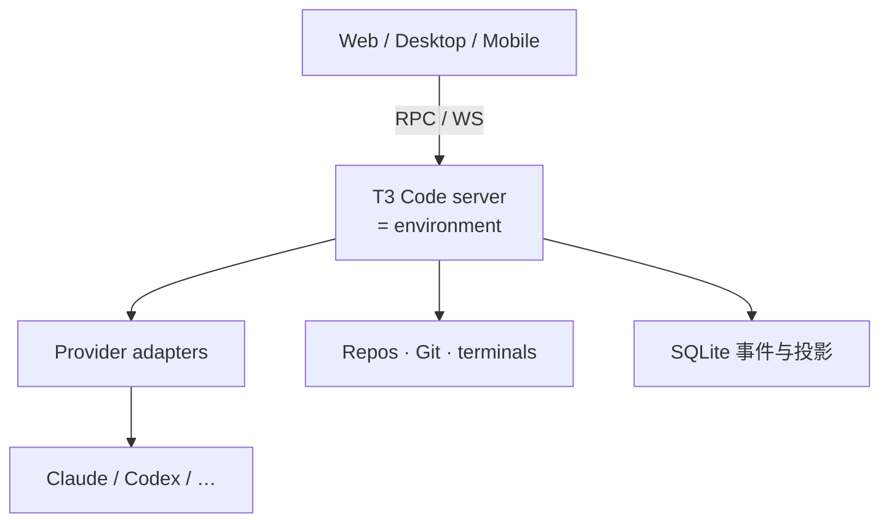

# T3 Code：多厂商编码代理的本机控制面

通用（不限工具）

**一句话看懂**：Codex、Claude Code、Cursor、Grok、OpenCode、Pi 各有界面与会话史，并行一多就不知道谁在改哪、谁在等批准。Flavio Copes 深潜开源的 T3 Code：它不是新模型，也不是托管云代理，而是跑在你机器上的 **agent harness 控制面**——统一项目 / 线程 / 权限 / diff / 终端，通过适配器吃各家事件流；客户端只展示，环境（服务器）才执行。

## 读完你能带走的 8 条收获

1. **问题是“工作模型”缺失**：多仓库、多厂商、多标签页时，终端能保活进程，却给不出共享的任务视图（见 3.1）。
2. **定位**：本机控制面，不是模型供应商、不是万能代理、不是云开发环境、也不是安全边界本身（见 3.2）。
3. **心智模型**：environment（一台服务器）→ project → workspace（当前仓或 worktree）→ thread → turn → provider（见 3.3）。
4. **隔离与权限分开调**：worktree 防串改同一工作树；权限模式映射到各厂商原生策略；Full access 仍是当前默认——要故意改（见 3.4）。
5. **`t3.json` 承载可重复动作**：脚本、worktree 创建钩子、preview URL；密钥不要写进仓（见 3.5）。
6. **架构要点**：认证 WebSocket + Effect RPC；命令→事件→投影；副作用走 reactor；客户端不跑 provider/Git/终端（见 3.6）。
7. **远程是“你的机器可达”**：Tailscale / T3 Connect / SSH 转发；配对链接当密码；HTTPS 客户端不能混连明文后端（见 3.6）。
8. **何时不该用**：单任务单终端、以手改 IDE 为中心、要多租户托管平台、机器不能常开、共享资源未隔离（见 4、5）。

::: tip 小白先懂这几个词
- [Harness（挽具）](/glossary#harness)：模型外的会话、工具、审批与进度外壳；T3 自称其上一层的控制面。
- Control plane（控制面）：统一查看与指挥多个代理运行时的层。
- Environment：一台 T3 服务器及其背后的文件系统与凭据。
- Thread / Turn：耐久会话；一次用户↔代理周期。
- Worktree：同一仓库的额外 checkout，供并行线程隔离文件。
- Provider adapter：把各厂商事件翻译成统一卡片（批准、用量、子代理等）。
- Checkpoint：按 turn 用隐藏 Git ref 存工作区快照，支持按消息回滚。
:::

## 1. 基本信息

<SourceCard type="文章" title="A deep dive into T3 Code" author="Flavio Copes" date="2026-08-28" url="https://flaviocopes.com/t3-code/" />

| 项目 | 内容 |
|---|---|
| 链接 | https://flaviocopes.com/t3-code/ |
| 类型 | 文章（长文深潜；作者个人站） |
| 作者 | Flavio Copes |
| 发布日期 | 2026-08-28（页面 `datePublished`；正文更新至 0.1.6 / 2026-11-01） |
| 使用工具 | 通用：T3 Code 聚合 Codex / Claude Code / Cursor / Grok / OpenCode / Pi 等 |
| 分析依据 | 原文全文（html→txt，2026-11-04）。产品细节随 Alpha 快速变；以文中 0.1.0 导览为主，版本号按原文引用。「我觉得」为本站评论。与 [[124]]：Loams 拆各家 harness 内部；本文拆**之上**的控制面。 |

## 2. 这篇在回答什么

一个代理很好开：`codex` 或 `claude`。难的是同时盯多个：谁在哪个仓、哪个 worktree、谁在等批准、谁的 diff 属于哪次提示、远程机器上还有没有线程。

T3 Code 的回答：

::: tr 它是这些代理的本机控制面，不是新模型，也不是托管编码代理。
> "It is a local control plane for those agents, not a new model or a hosted coding agent."
:::

项目自称：

::: tr 项目称自己为 agent harness 控制面。
> "agent harness control surface"
:::

文章要回答：

1. 它解决什么、明确不解决什么？
2. environment / project / workspace / thread 边界如何划？
3. worktree 与权限模式怎么选？
4. 适配器与服务器架构为什么重要？
5. 远程与安全上要守住什么？

## 3. 怎么做

### 3.1 问题：进程在，工作模型不在

单任务单仓时，直接开厂商 CLI 几乎无法被打败。工作一多，你需要知道：代理↔仓库↔分支、谁在跑 / 谁在等权限、变更属于哪次 prompt、开发服务器在哪、哪条线程已有 PR、用量花在哪。IDE 可能只深接自家代理；托管平台又常把活搬进别人的环境。

T3 在仓库旁起本地服务器：拉起厂商工具、管项目状态、跑 Git、开终端、把归一化事件推给客户端。浏览器 / 桌面 / 手机是视图；**服务器是中心**。

### 3.2 是什么 / 不是什么

**是**：MIT 开源 Alpha 控制面；自带订阅与 CLI 登录仍在你的机器；结构化事件（不仅是刮终端字）。文称 2026-08-27 过 20,000 GitHub stars；导览跟 0.1.0（2026-10-15），文末提到稳定标签到 0.1.6。

**不是**：

- 模型供应商（不送额度）
- 抹平差异的“唯一代理”（换厂商仍可能行为大变）
- 云开发环境（关笔记本，活就停——除非你自备常开机器）
- 人人适用的 IDE 替代
- 安全边界本身（权限模式减意外，不让危险命令变安全）

### 3.3 心智模型

- **Environment**：一台 T3 服务器 + 背后机器（文件系统、凭据、终端）。
- **Project**：环境本地、根在某目录的记录；可有 `t3.json`。
- **Workspace**：线程真正写字的目录——当前 checkout，或新建 Git worktree。
- **Thread**：耐久对话（关客户端也在服务器）。
- **Turn**：一次用户消息到代理结束 / 失败 / 等待。
- **Provider**：真正的运行时。

关键规则：

::: tr 客户端展示工作。环境执行工作。
> "The client shows the work. The environment performs the work."
:::

### 3.4 Worktree 与权限：两套旋钮

**当前 checkout**：单写者、要看见未提交改动、或不支持 worktree 时。共享文件系统——T3 理得清线程，理不清两人同时改同一文件。

**新 worktree**：后台实现任务的强默认；仍共享端口、本地库、容器名等外部资源，除非项目 setup 脚本拆开。

作者经验法则：受控单流用当前仓；真独立并行用 worktree；有价值文件用 Supervised；Full access 留给可丢弃或强隔离环境。

权限四档（Supervised / Auto-accept edits / Auto / Full access）映射到各厂商原生策略；缺能力则回退为询问，而不是假装能执行。注意：

::: tr Full access 去掉命令与编辑提示。它也是当前默认。
> "Full access removes command and edit prompts. It is also the current default."
:::

远程批准很方便，也更容易变成反射性乱点——界面降摩擦，不降责任。

### 3.5 项目配置与审查环

`t3.json` 可声明默认 workspace 模式、命名脚本、`runOnWorktreeCreate`、preview URL。脚本拿到 `T3CODE_PROJECT_ROOT` / `T3CODE_WORKTREE_PATH`。密钥不要进 Git。

审查侧：按 **turn / 分支 / 未暂存** 看 diff；隐藏 Git ref 做 checkpoint，支持“还原到此消息”（工作区 + 厂商会话一起还原）。Settle 把线程移出注意力但不删。可把线程链到 PR，合并后自动 settle。

0.1.0 起有 `delegate_task`：父代理可派其他厂商子代理并等待——跨 harness 协作的推荐方式；中途硬切厂商会丢推理与附件。

### 3.6 架构与远程

最重要的架构句：

::: tr 客户端不运行 provider 进程、Git、终端或文件系统操作。服务器做这些。
> "Clients do not run provider processes, Git commands, terminal commands, or filesystem operations. The server does."
:::

实现上：认证 WebSocket 上的 typed RPC；命令经决策函数变成事件，与投影同事务写入 SQLite；单 worker 串行命令；reactor 处理起进程等副作用。适配器负责发现可执行文件、会话续接、流式事件、批准、中断、用量——UI 不应到处 `if provider ===`。

远程路径：局域网、Tailscale、T3 Connect（托管隧道辅助）、桌面 SSH 转发。配对令牌一次性；哈希里的 token 用后从 URL 去掉。托管 HTTPS 客户端不能连明文 HTTP 后端（浏览器混合内容规则）。Linux user systemd / macOS LaunchAgent 可装后台服务；Windows 当时不支持该 service 命令。

## 4. 结果与局限

- **文中没有**统一 benchmark 证明“用了 T3 更快”；价值主张是可操作性与架构清晰。
- **Alpha**：期望 bug 与频繁变更；服务器与客户端要一起升级。
- **本地≠本地推理**：控制面在你机器上，云模型仍走厂商网络。
- **适配器滞后**：最新厂商特性仍可能只有原生 CLI 最快。
- **与 cmux / Herdr / 托管平台**：终端原生 vs 应用原生 vs 别人供机器——文中有对照表，选型看你缺的是窗格、结构化线程，还是弹性计算。

我觉得对知识库读者，T3 的课不是“必须装这个 App”，而是：**多厂商并行时，先画清 environment 边界与“谁执行”**；再决定用 T3、tmux 还是自研看板。

## 5. 结论

T3 Code 把“一堆编码代理”收成可搜索、可批准、可按 turn 回滚的本机控制面。它赚的是适配器与多客户端协议的工程，不是新模型魔法。

**你可以这样试**

1. 桌面或 `npx t3@latest`，只接一个已会用的厂商，Supervised 下做只读调查。
2. 再做一次小编辑，看 per-turn diff 与 revert。
3. 为仓库写最小 `t3.json`（dev + test）；想清楚默认 local 还是 worktree。
4. 本地稳定后再配对第二设备；生产命令不要在手机上随手批准。

**读完自测**

1. “本机控制面”与托管代理平台的执行边界差在哪？
2. environment 和 project 为何不能混用？
3. 为什么 worktree 与 Full access 不能互相替代？
4. 为什么客户端禁止直接跑 provider 进程？
5. 远程配对链接应按什么级别的秘密保管？
