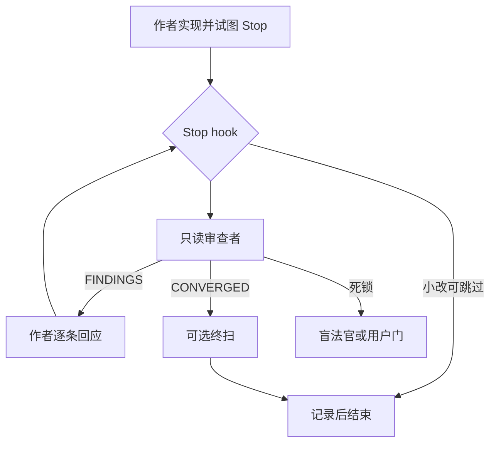

# 别让代理给自己打分：用 Stop hook 做强制交叉审查

通用（不限工具）

**一句话看懂**：同一会话里说“请审查你刚写的代码”，代理要么太宽容，要么沿用制造 bug 的盲点。wonjoon 的 sparring 把审查做成 **Stop hook 停机条件**：作者想结束回合时，只读审查者必须给出 `CONVERGED`，否则 `decision: block` 把理由打回；跨厂商可 Claude 写 Codex 审或反过来。小基准上无审查 17/24，一轮环后 24/24——作者自限：示例不是统计研究。

## 读完你能带走的 6 条收获

1. **自审的两种失败**：过度慷慨，或重复同一盲点（见 3.1）。
2. **停机条件 ≠ 提示请求**：作者无法直接绕过 hook 环；空对象 `{}` 才是两端都认的“放行”（见 3.2）。
3. **一轮结构**：FINDINGS 分 MECHANICAL / DESIGN；死锁走盲法官或用户门；必须逐条回应才能进下一轮（见 3.3）。
4. **防说服**：每轮对固定 baseline 全新审查；指纹合并同缺陷；作者辩词不进入审查者提示（见 3.4）。
5. **软硬轮次帽 + 终扫**：高产才可延长；重复缺陷不延长；风险路径再跑一轮盲扫（见 3.5）。
6. **强制与请求完全不同**：hook 能阻止“无审查结束”；修得对不对仍靠下一轮验证（见 3.6、5）。

::: tip 小白先懂这几个词
- [Hooks（钩子）](/glossary#hooks)：Stop hook 在代理将结束回合时运行。
- Stop hook block：返回 `decision: "block"` 与 `reason`，reason 成为模型下一条指令。
- [Adversarial Review（对抗式复核）](/glossary#adversarial-review)：审查者与作者分离，只读权限。
- CONVERGED / FINDINGS：审查者输出的两种首行状态。
- Blind judge：死锁时只看代码与该 finding、不看辩论史的裁决者。
- sparring：作者开源的插件名（`/spar:fight`、`/spar:ready`）。
:::

## 1. 基本信息

<SourceCard type="文章" title="Keeping Agents from Grading Their Own Code: sparring" author="wonjoon" date="2026-07-30" url="https://wnjoon.github.io/sparring-on-agents/" />

| 项目 | 内容 |
|---|---|
| 链接 | https://wnjoon.github.io/sparring-on-agents/ |
| 类型 | 文章（个人博客；约 12 分钟；附插件安装） |
| 作者 | wonjoon |
| 发布日期 | 2026-07-30 |
| 使用工具 | Claude Code 与 Codex 的 Stop hook；`jq`；只读 sandbox / `claude -p` |
| 分析依据 | 原文全文（2026-11-04）。基准为作者植入缺陷的示例，非大样本。「我觉得」为本站评论。与 [[129]]：那边强制 TDD 编辑窗；这边强制交叉审查环。 |

## 2. 这篇在回答什么

代理写代码越来越顺，但不擅长发现自己的错。最自然的反应是再问一句“审查你刚写的”。同一会话里，这常常没用。

sparring 的设定是 harness 层，不是提示层：

::: tr 把审查当作停机条件，而不是一条请求。
> "Treat review as a stopping condition, not a request."
:::

核心问题：

1. 为什么同会话自审靠不住？
2. Stop hook 怎样把“审完才能停”做成结构？
3. 多轮里如何防止“辩赢”代替“改对”？
4. 轮次上限与计划层怎么加？
5. 小基准说明了什么边界？

## 3. 怎么做

### 3.1 问题：自己给自己打分

同会话审查常见两种结局：对结果过于慷慨；或保留制造 bug 的同一盲点——再看一次也看不见。sparring 要做两件事：作者模型与审查模型分离；审查是停机条件。

### 3.2 Stop hook：block、放行与 fail-open

Claude Code（以及文中的 Codex）在回合将结束时跑 Stop hook。返回 `block` 时，`reason` 成为模型新指令；直到审查者宣布收敛。

::: tr 作者没有直接绕过这个环的办法。
> "The author has no direct way to bypass this loop."
:::

实现细节：空对象 `{}` 表示批准。显式 `decision: "approve"` 曾在 Codex 0.144.1 触发 invalid JSON，收敛后反而放不出去。hook 自己崩溃时默认放行——漏一次审查坏，把用户锁死在坏会话里更坏：

::: tr 如果 hook 自己崩溃了，它默认批准。
> "If the hook itself crashes, it approves by default."
:::

### 3.3 一轮怎么走

`/spar:fight` 先写状态文件（`active`、`round`、`base_sha`、审查者、`max_rounds` 等）。作者照常写代码；试图停止时 hook 运行。极小改动（文中：≤10 行且 ≤2 路径且无风险路径）可跳过并记录。

否则起只读审查者：Codex 用 `codex exec --sandbox read-only`；Claude 单厂商模式用 `claude -p --safe-mode` 且工具限于 Read/Grep/Glob。只有作者能改代码。

输出格式被 hook 解析：首行必须是 `STATUS: CONVERGED` 或 `STATUS: FINDINGS`；每条 finding 含级别。`[MECHANICAL]` 应立即修；`[DESIGN]` 先辩论，不成则问用户。作者必须写响应文件；缺答则继续 block。

### 3.4 防止“辩赢”

危险不只是漏 bug，还有作者说服审查者放行。结构对策：

- 每轮对**固定 baseline** 全新审查；“我已按上轮改了”不进入审查者提示。
- 同一 finding 两轮仍被拒 → 死锁：机械问题进盲法官（`RULING: UPHELD` 则必须修）；设计问题进用户门，写入 `.claude/spar-ledger.md` 以免反复。
- 用文件名 + 归一化标题指纹合并“换说法的同一缺陷”，死锁计数连续。

### 3.5 轮次帽、终扫与计划层

软帽默认 5：仅当上轮“高产”（全部明确 FIXED、无拒绝/未答/模糊/待裁决/挂起设计/重复缺陷）才可延到硬帽（通常 2×软帽）。重复缺陷出现则不延长。

收敛后若碰风险路径、≥3 轮或有过设计 finding，再跑终扫；状态词用 `SWEEP: CLEAN|FINDINGS`，不用 `STATUS: CONVERGED`，以免和非审查环混淆。

`/spar:ready` 把规格打成勾选计划并开分支；计划本身先审一次（`PLAN-REVIEW:`），再任务级 `/spar:fight`。前任务未收敛不得偷偷做下一件。

方向可反：Codex 写、`claude -p` 审，同一门卫脚本。

### 3.6 小基准与课

三道示例题各植一处合理缺陷，隐藏 oracle 打分：

::: tr 无审查：24 分里的 17 分，即 71%。
> "Without review: 17 out of 24 points, or 71%"
:::

::: tr 审查环之后：24 分满分。
> "After the review loop: 24 out of 24 points"
:::

跨厂商与同厂商结果相同。作者写明：示例不是统计研究，任务小、规格清楚。

最大课：

::: tr “要求模型遵守规则”和“让系统强制执行规则”完全不是一回事。
> "“asking the model to follow a rule” and “making the system enforce the rule” are completely different."
:::

hook 能强制：无审查不能结束、无响应不能进入下一轮、审查者无写权限。hook 不能单独证明“FIXED”真的修对——那要下一轮再看。

我觉得和 [[129]] 叠用最有价值：一边管“何时准改生产码”，一边管“声称做完前必须过独立审查”。

## 4. 结果与局限

- **有**：可安装的 Stop-hook 环；防说服与死锁设计；17→24 的示例分。
- **限**：小样本；hook 崩 fail-open；审查结果必须不可被作者编辑，否则门闩失效。
- **对比**：[[129]] 管 TDD 编辑窗；本文管交叉审查停机条件。

## 5. 结论

sparring 把“第二意见”从礼貌请求升级成**回合能否结束的门闩**。一人团队若已经在用 hooks 做 TDD 窗，下一步很自然是：换一个只读审查者，并把收敛写进 Stop hook。

**你可以这样试**

1. 先手工：作者会话结束后，另开只读会话审 diff；满意再合并。
2. 有 `jq` 时按文安装插件，用小仓跑 `/spar:fight`。
3. 把设计争议记进 ledger，避免同一产品问题打转。
4. 别把示例 24/24 当成通用正确率。

**读完自测**

1. 同会话自审的两种典型失败是什么？
2. 为什么放行要用 `{}` 而不是 `approve`？
3. 防说服的关键手段有哪些？
4. 软帽在什么条件下才延长？
5. hook 能强制什么、不能强制什么？
