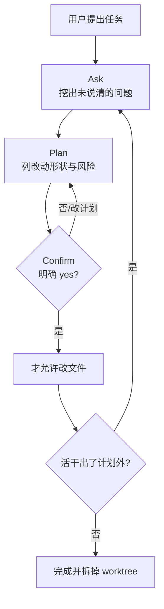

# 先问、再计划、确认后才改文件

Claude Code

**一句话看懂**：真正能干的编码代理最吓人的地方，是它下手太快——两句话之后四十秒，九个文件已经动了，其中一半你不想要，还有一个悄悄改了你花一周加固过的查询。Adron 把这当成工作流问题而不是提示词问题：在 InterlinedList 仓库里立下 Ask → Plan → Confirm 门闸，**没过三拍不许改文件**；审批只覆盖当时那份计划，活干大了必须停下来重规划。再配上每个代理一个 git worktree，把爆炸半径关进隔离目录。

## 读完你能带走的 6 条收获

1. **速度本身是风险**：代理拿掉了资深工程师自带的停顿，于是把“产出一个 diff”当成目标，而不是“产出我们同意的那个 diff”（见 3.1）。
2. **门闸三拍按顺序**：Ask 先把未说清的问题挖出来 → Plan 写出改哪些 / 不改哪些 → Confirm 拿到明确 yes 才动手（见 3.2）。
3. **审批有范围**：只批准当时那份计划；工作长出计划外，必须重规划，而不是悄悄扩 scope（见 3.2）。
4. **同一道门，按角色改问法**：迁移、单测、e2e、文档、博客各自问不同的事；只读审查者默认只做 Ask，一旦被要求修复就立刻恢复完整三拍（见 3.3）。
5. **慢一点是故意的**：读一份短计划几秒；打回一份跑错方向的九文件 diff 要读、拒、重提示，还要担心漏看了什么（见 3.4）。
6. **门闸 + worktree**：计划保证“本来就不该有爆炸”；worktree 保证“就算炸了也撞不到别人的分支”（见 3.4）。

::: tip 小白先懂这几个词
- [Plan mode（计划模式）](/glossary#plan-mode)：先出计划再改代码的工作方式；本文把它落成仓库级站立指令。
- [Ask / Plan / Confirm](/glossary#ask-plan-confirm)：三拍门闸——先问清、再列计划、明确确认后才编辑。
- [Git Worktree](/glossary#worktree)：同一仓库的额外检出目录，可挂独立分支；用来关住并行代理的爆炸半径。
- Escape hatch（逃生口）：请求真的无歧义且低风险时，允许跳过提问，避免为一行文案改动连问三句。
- Risky（文中特定含义）：auth、IDOR、订阅门槛、SSRF、密钥、破坏性或难回滚的改动。
:::

## 1. 基本信息

<SourceCard type="文章" title="Ask, Plan, Confirm: Making Agents Stop Before They Start" author="Adron" date="2026-08-20" url="https://compositecode.blog/2026/08/20/plan-then-build/" />

| 项目 | 内容 |
|---|---|
| 链接 | https://compositecode.blog/2026/08/20/plan-then-build/ |
| 类型 | 文章（工程博客） |
| 作者 | Adron（Composite Code；文中称在建 InterlinedList） |
| 发布日期 | 2026-08-20（页面 Posted on） |
| 使用工具 | Claude Code（`.claude/workflows/plan-first.md`；多代理各链到同一工作流） |
| 分析依据 | 原文全文（html→txt，2026-11-05）。引语与流程描述逐字摘自正文；「我觉得」为本站评论。与 [[127]] / [[64]] / [[112]] 对照：本文强调编辑前的三拍门闸，而不是 goal vs plan 选型或环境拆分细节。 |

## 2. 这篇在回答什么

你给代理两句需求，它四十秒后交出九个文件的改动——实现手法可能没错，但**事情本身理解错了，而且从未停下来核对**。Adron 看够了这类事故后，不再把它当“提示词写得不够好”，而当成**工作流缺门闸**：

::: tr 更好的一次性提示词不是修复办法。一道门才是：在代理问完该问的、给我看过计划、并且拿到 yes 之前，不许它改文件。
> "A better one-shot prompt is not the fix. A gate is: the agent is not allowed to edit files until it has asked what it needs to ask, shown me a plan, and gotten a yes."
:::

主线回答四个问题：

1. 为什么去掉停顿会同时带来价值与危险？
2. Ask / Plan / Confirm 各自要产出什么，才算过门？
3. 八个角色代理如何共用一道门、又各自改写提问内容？
4. 这道门和“每代理一个 worktree”怎么叠在一起用？

## 3. 怎么做

### 3.1 为什么速度本身是问题

人类工程师自带停顿：资深开发摸你的库之前会先问几句、草绘思路、也许在工单上留一句。那个停顿便宜地拦住了“做错的活”——拦在一句话里，而不是拦在你必须读完再拒掉的 diff 里。

代理拿掉了这个停顿。作者认为：**这既是它大部分价值，也是大部分危险，发生在同一次动作里。** 立刻动手的代理优化的是错误目标——把“产出一个 diff”当目标，而真正目标是“产出我们同意的那个 diff”。两者之间的缝，就是被删掉的工作和悄然扩大的范围。

这不是知识问题：代理知道怎么写代码，它只是从未核对自己在写**对的**代码。跳过停顿，是用一点可预期的小成本，去换一笔大而不确定的成本。

### 3.2 三拍：Ask → Plan → Confirm

工作流写在 `.claude/workflows/plan-first.md`，仓库里每个代理都链到它。三拍按顺序，**实现被挡在三拍全部通过之后**。

**Ask。** 在选定方案之前，先把提示词里没说清的摊开：模糊范围、未声明的边界情况、藏在技术请求里的产品决策、功能要不要分档。迁移代理问列类型、可空性、有没有破坏性含义；Next.js 代理问哪些界面进、哪些不进。规则有逃生口：为一行文案改动连问三句本身也很烦——**只有请求真正无歧义且低风险时才跳过提问**；有疑虑就问。一句尖锐的问题，永远比一次做错的构建便宜。

**Plan。** 动手前先摆出改动形状：会动哪些文件 / 路由 / 组件、故意不动哪些、做法、迁移（永远加法）、这次改动需要的测试，以及任何 risky 项。在这个仓库里 risky 有特定含义：auth、IDOR、订阅门槛、SSRF、密钥处理、破坏性或难回滚的事。计划是决策辅助，不是文档——短到一口气读完，又具体到“批准它”真的意味着什么。

**Confirm。** 只有明确 yes 之后才实现。来回里计划变了，就重述修订版再拿一次 yes。长会话里真正管用的那一句是：

::: tr 批准的范围，只覆盖当时被批准的那份计划。如果工作长出了计划外，代理停下来重规划，而不是悄悄扩大。
> "approval is scoped to the plan that was approved. If the work grows past it, the agent stops and re-plans instead of quietly expanding."
:::

作者说，正是这最后一条，拦住了“小修”变成“一下午我从没签过字的改动”。

### 3.3 同一道门，按角色改写

他不想把同一段通用段落贴八遍。门相同，但问什么取决于岗位，于是每个代理拿到按自己车道写的三拍：

- **迁移**：规划精确的幂等 `migration.sql`，确认纯加法后才应用。
- **单测**：问锁定哪些行为、mock 哪些边界，再列出每个测试文件会断言的用例。
- **e2e**：点名流程、鉴权与种子前置条件、关键断点。
- **文档**：确认三份文档里哪些在范围内、要不要新页。
- **博客**（写本文的那个）：先定角度、章节弧线、以及要用哪段真实代码核对主张，再起草一个字。

两个**只读审查者**是有趣的边界。安全与 UX 不实现，就没有“编辑”可挡。对他们，门退化成第一拍：范围若模糊就确认审查范围（哪些路由、多深、哪些断点），然后产出发现。但用户一旦说“现在去修你找到的”，他们就变成实现者，**完整的 ask-plan-confirm 在碰代码前立刻弹回**。审查者不能从“这是发现”滑进“而且我已经修了”，而不过和其他人同一道线。

### 3.4 关于“这会更慢”以及和 worktree 叠用

“这会更慢”——作者说那正是重点，而且没听起来那么真。计划步骤花你几秒和一次阅读。打回一份四十秒、九文件、方向错了的 diff，要花阅读 + 拒绝 + 重提示，外加对“它还动了什么你没看见”的隐隐担心。门闸把小而可预期的成本前置，避开大而不确定的成本。一天里多次交接之后，两边差得很远。

它还和作者给这些代理养成的另一习惯叠在一起：每个代理在**隔离的 git worktree**、自己的分支上干活，任务落地后拆掉。

::: tr 先计划，再在不会和别人撞车的沙箱里做已批准的工作。Worktree 关住爆炸半径。计划保证本来就不该有一场爆炸。
> "Plan first, then do the approved work in a sandbox that cannot collide with anyone else. The worktree contains the blast radius. The plan makes sure there is not supposed to be a blast in the first place."
:::

我觉得可以这样记：**计划回答“该不该炸、炸哪里”；worktree 回答“炸了会不会波及主工作区”。** 两道控制别互相替代。

## 4. 结果与局限

文中**没有**给出门闸前后的定量对照（例如返工次数、平均 diff 大小、拒绝率）。证据是作者反复目击的失败模式，以及他把停顿重新写进 InterlinedList 仓库站立指令后的工程判断。

局限要讲清楚：

- 逃生口依赖“真正无歧义且低风险”的判断——模型可能误判，人仍要抽查。
- 计划“短到一口气读完”是风格要求；复杂迁移可能挤成假短计划。
- 只读审查者“一说修复就弹回全门”依赖指令被遵守；没有 hooks / CI 硬挡时，仍可能滑过去（对照 [[132]] 的强制 vs 请求分层）。
- 与 worktree 的组合假设任务边界清；共享数据库或端口时还要另拆环境（见 [[112]]）。

## 5. 结论

代理不是不会写代码，而是太快把“能写”当成“该写”。Adron 的修复不是更长的 system prompt，而是**编辑前不可跳过的三拍**，外加审批范围锁死在当时那份计划上。

**你可以这样试**

1. 在仓库加一份 `plan-first` 工作流：未过 Ask/Plan/Confirm 禁止改文件。
2. 给迁移 / 测试 / 前端各写一版“该问什么”的短清单；给审查者写清退化与回弹规则。
3. 在 Confirm 条款里写明：计划外生长必须重规划。
4. 每个代理任务开独立 worktree；合并后再拆。

**读完自测**

1. 你最近一次讨厌的代理 diff，是实现错了，还是事本身理解错了？
2. 你的“计划”具体到批准它意味着什么了吗？
3. 活干出计划外时，代理会停还是继续？
4. 只读审查者被要求修复时，会不会跳过 Confirm？
5. 你有没有用 worktree 关爆炸半径，却没把门闸补上？
