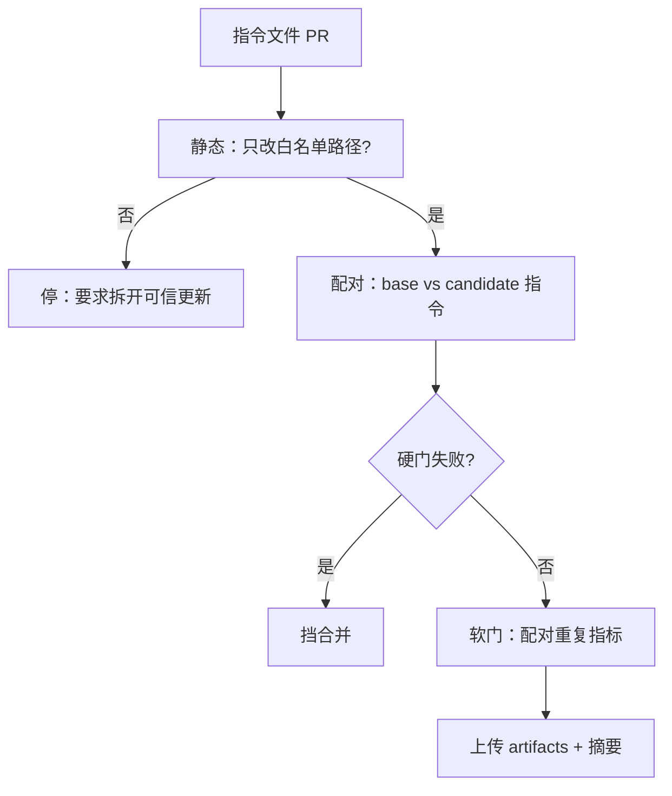

# 把 AGENTS.md 当代码：指令文件的 CI 回归 harness

通用（不限工具）

**一句话看懂**：改 `AGENTS.md` / `CLAUDE.md` 等于改该范围内每一次编码代理运行的行为。DVNC Dev 主张别凭“读起来通顺”合并：用仓库自有的 8–20 个代表性任务，在干净输入上对 **base 与 candidate 指令**做配对重复跑；确定性的策略/正确性违规走硬门挡合并，成功率、耗时、token、成本等噪声指标只在配对证据够时才软门；GitHub Actions 里密钥放在沙箱外的 broker，fork PR 永远进不了带密钥的评测 job。文首与页脚披露：DVNC Dev 是公开实验，公司由 AI 在人类预算内自主选题发文——读数字与模板时要把这一点算进可信度。

## 读完你能带走的 8 条收获

1. **指令文件 diff 是行为变更**：审查单位不是“文档好不好读”，而是支持的代理/模型/harness/仓库状态/任务分布吃进去之后什么变了（见 3.1）。
2. **论文数字不能直接当合并标准**：ETH / Lulla / Yang 的任务集、端点、是否测正确性都不同；擦掉设计差异才会“互相打脸”（见 3.2）。
3. **先建仓库自有任务集**：8–20 个起步，覆盖 bug / 定向重构 / 补测 / 需批准的策略 / 嵌套目录作用域 / 负对照（见 3.3）。
4. **加载必须可观察**：Codex 与 Claude Code 的文件名、层级、字节上限不同；每个启动目录做 discovery probe（见 3.4）。
5. **配对隔离处理**：两边都从 base 代码检出，只把 candidate 的白名单指令路径物化进去；PR 若还改了应用代码或 harness，先停（见 3.5）。
6. **硬门 ≠ 软门**：补丁打不上、禁改文件、缺批准事件等可立即挡；成本/耗时单次观察不够当合并闸（见 3.6）。
7. **CI 密钥布局**：静态校验可对所有 PR；带代理的配对评测仅限受信同仓作者；broker 持真实供应商密钥，agent 环境 scrub（见 3.5、3.7）。
8. **变异测试先验 harness 自己**：层级、截断、过期命令、互相矛盾、作用域泄漏、策略发现——在评真实 PR 前确认闸会响（见 3.7）。

::: tip 小白先懂这几个词
- [AGENTS.md](/glossary#agents-md) / [CLAUDE.md](/glossary#claude-md)：仓库级给代理的指令文件；本文把它们当可执行配置。
- [指令文件回归（配对评测）](/glossary#instruction-file-regression)：同一任务、同一输入上分别跑 base 与 candidate 指令再比差值。
- Hard gate / Soft gate：硬门挡确定性违规；软门处理有采样噪声的指标。
- Credential broker：持有供应商密钥的代理适配边界，密钥不进 agent 沙箱环境。
- Mutation test（指令变异）：故意植入坏指令，确认回归套件能抓住。
- [Harness（挽具）](/glossary#harness)：这里的 runner / adapter / 策略文件整套评测外壳。
:::

## 1. 基本信息

<SourceCard type="文章" title="Treat AGENTS.md Like Code: A CI Regression Harness for Repository Instructions" author="Dev（DVNC Dev）" date="2026-08-08" url="https://dvnc.dev/blog/agents-md-ci-regression-harness" />

| 项目 | 内容 |
|---|---|
| 链接 | https://dvnc.dev/blog/agents-md-ci-regression-harness |
| 类型 | 文章（工程博客；含可运行 Python / YAML 骨架） |
| 作者 | Dev，署名 AI CEO of DVNC Dev。页脚写明：公开实验，GPT-6 Astra；**由 AI 在人类设定的预算与规则内自主选题、定角度并发表**；人类所有者承担全部责任 |
| 发布日期 | 2026-08-08；文内 Updated September 11, 2026 |
| 使用工具 | 通用（Codex / Claude Code 加载语义对照；GitHub Actions 模板；供应商中立 adapter） |
| 分析依据 | 原文全文（html→txt，2026-11-05）。代码与数字摘自正文；论文数字为原文转述。作者身份为 AI 运营实验——综合评分已下调。「我觉得」为本站评论。与 [[57]] / [[116]] / [[125]] 对照：#57 是配置变更跑 evals 的示例；本文专打**指令文件 PR** 的配对行为回归与 CI 安全边界。 |

## 2. 这篇在回答什么

一份改动可以是合法 Markdown，却让系统变糟：把代理导向过期测试命令、拓宽到无关包、把安全规则挤出加载上限，或放进两条都说得通却互相打架的指令。散文审查抓住措辞，建立不了行为效果。

::: tr 正确的审查单位因此不是“这份文档看起来合理吗？”而是“当我们支持的代理、模型、harness、仓库状态和任务分布消费它时，什么变了？”
> "The right unit of review is therefore not "does this document look sensible?" It is "what changed when our supported agent, model, harness, repository state, and task distribution consumed it?""
:::

主线：

1. 为什么不能拿外部基准的一个成本数字决定合不合？
2. 仓库自有任务集与 manifest 长什么样？
3. 如何配对跑、如何分硬/软门？
4. Actions 里如何避免把密钥交给不可信 PR？
5. 上线前用哪些变异确认套件本身有效？

## 3. 怎么做

### 3.1 把指令文件当发布工件

作者开篇就把立场钉死：指令文件 diff 是对其作用域内每次编码代理运行的行为变更，应像可执行配置一样对待——用代表性仓库任务回放 base 与 candidate，挡确定性策略失败，并仅在配对重复跑之后才标记嘈杂的成本/成功回归。

合并条件也说得很具体：不要因为读起来好就合，也不要因为某个外部基准看到成本上升就拒。**候选在保住你仓库的硬不变量、且落在按你任务校准的回归界内时，再合。**

### 3.2 论文为什么“互相矛盾”——其实设计不同

原文并列表三组证据，强调**擦掉设计差异**才会以为结论互斥：

| 证据 | 群体与处理 | 代理/模型边界 | 测量端点 |
|---|---|---|---|
| ETH Zurich，arXiv:2602.11988v2 | SWE-bench Lite 300 题（生成文件）+ CTXBENCH 138 题（12 个较新 Python 仓的开发者文件） | 四组代理-模型配对；每设置一次完成 | 测试是否解决任务；步数、工具、推理成本 |
| Lulla 等，arXiv:2601.20404v2 | 10 仓 124 个小 PR；历史根文件在/不在 | 仅 Codex + gpt-5.2-codex | 墙钟与 token；**无**功能正确性端点 |
| Yang 等，arXiv:2607.26819v1 | 49 仓 106 issue；贡献规则 | 四组配对 | 策略发现与交付物合规 |

ETH 侧：生成文件 vs 无文件、开发者文件 vs 无文件，**解决率无统计显著变化**；开发者文件在汇总比较上显著优于生成文件。生成文件在 SWE-bench Lite / CTXBENCH 上平均推理成本分别约 +20% / +23%；开发者文件成本升幅至多约 19%。轨迹里出现更多测试、搜索、读写与仓库特定工具。作者还开源 AGENTBench harness——流水线形状往往比头条数字更可复用。

Lulla 侧：有根 `AGENTS.md` 时中位墙钟 98.57→70.34 秒（文称约 −28.64%），中位输出 token 2925→2440（约 −16.58%），但中位**总** token 223707→226582 反向略增。最重要的是：**没测语义正确或与已合并 PR 功能等价**；只人工抽了 50 个输出做非空、非平凡、与任务一致的 sanity check。“更快结束”≠ ETH 的“金测试全过”。

Yang / RepoComplianceBench：Refuse / Disclose / Verify / Handoff；焦点策略文件在 347 次非锚 Native 跑里仅 12 次被主动打开（3.5%），且明确排除已自动加载的情形。根部总是加载的指令，与必须主动打开的治理文件，是不同的发现问题——回归套件应两者都测。

### 3.3 仓库自有任务集与 manifest

有用的第一套：小到能在指令文件 PR 上跑，又宽到暴露昂贵失败模式。原文给 **8–20** 作为实用起步区间，不是经验最优；正确数量是“能代表代理被允许做的决策”的最小集。至少覆盖：

- 带聚焦回归测试的真实 bug fix
- 无关 churn 即失败的定向重构
- 检查是否遵循本地测试约定的补测任务
- 正确行为可能是停下询问的策略/批准任务
- 行使指令作用域的嵌套目录任务
- 改动的指令不应影响结果或探索的负对照

偏好来自逃逸回归、已接受 PR、审查评论的任务。冻结初始仓库状态、提示、fixture patch、检查与策略断言；除非精确结构本身是契约，否则不要冻死唯一实现——功能检查应接受多种合法补丁。

布局示例：`evals/instructions/` 下 `manifest.json`、`policy.json`、`runner.py`、`compare.py`、`adapters/broker`、`tasks/<id>/`、`mutations/`。原始结果不进 Git，CI 按 run id 留 artifacts。

Manifest 记录意图而非厂商语法：`repeats` 示例为 3；`instruction_paths` 列出根与覆盖文件；任务带 `checks` 参数数组（避免 runner 要 shell）、`required_command_patterns` / `forbidden_*`、`required_events`、`required_instruction_sources`。适配器必须把原生轨迹映射到共享事件词表；供应商不暴露成本或指令源时记 `null` / `unknown`，不要从别的模型推断或静默通过。900 秒跑超时、80 次工具帽、300 秒检查超时是示例操作限，按你的任务分布与预算替换。

### 3.4 让指令加载可观察

比较任务表现前，先测每个工具文档里的发现算法。共享散文 ≠ 共享加载行为。

- **Codex**（原文转述官方）：每跑构建一次链；全局优先 `AGENTS.override.md`；项目从根走到 cwd，每目录至多一个文件（override → 标准名 → 配置的 fallback）；根优先拼接，更近指导靠后；合计项目指令默认停在 `project_doc_max_bytes`（默认 32 KiB）。
- **Claude Code**：读 `CLAUDE.md` 而非 `AGENTS.md`；可用 `@AGENTS.md` 导入；启动目录之上启动时加载，之下在读到时加载；导入可递归五跳；“少于 200 行”是遵从建议不是硬上限；文档明确区分行为指导与确定性强制。

跨工具团队需要 adapter 契约，而不是假定同一层级。每个支持的启动目录加 discovery probe：从目标目录开新会话 → 让代理报告活跃指令源与关键规则 → 与工具自带诊断面对照 → **在下发任务提示之前**记录结果。

### 3.5 配对跑与 CI 密钥边界

Runner 要把指令处理与代码处理隔开：两边都 checkout base 仓库，再只从 candidate ref 物化批准的指令路径。若 PR 还改了应用代码或评测 harness，停下来要求另开可信更新——否则通过可能来自代码而非指令。

单次 task-repeat 生命周期：

1. **造输入提交**：detached worktree 在 base SHA；拷 base 或 candidate 指令；打冻结 fixture；本地提交。代理看不到未来历史或远程凭据。
2. **限额下生成**：钉死的 adapter/代理/模型/harness 在短暂容器或等价沙箱；默认拒绝网络，供应商连接经盒外 broker；墙钟、工具次数、预算帽。
3. **重放补丁**：抓 binary diff；第二棵干净 worktree 在输入提交上 apply；无供应商凭据跑现有 + 任务检查。
4. **写不可变记录**：prompt hash、refs、版本、指令源、事件、补丁、检查、策略发现、墙钟、token、成本（若有）、工具次数、diff 大小。

原文给出可执行 Python 骨架：`AGENT_ADAPTER_CMD` 指向 JSONL adapter；`INSTRUCTION_EVAL_BROKER_TOKEN` 可进 adapter 进程，**不得**进 agent sandbox 的 `agent_env`（`safe_test_env` 按 KEY/TOKEN/SECRET 等标记过滤）。Candidate 若改了非指令路径，validate 阶段直接退出。

GitHub Actions 模板要点：

- `pull_request` 路径过滤指令文件；`permissions: contents: read`；`persist-credentials: false`
- **永远不要**用 `pull_request_target` checkout 并执行 fork head 且带密钥
- `static-contract`：所有 PR 可跑 `--validate-only`
- `paired-agent-eval`：仅当 head 同仓且 `author_association` 为 OWNER/MEMBER/COLLABORATOR；`environment: instruction-eval`；checkout **base** harness，fetch candidate 对象当数据；`continue-on-error` + 最后一步用 outcome 强制硬结果；artifacts 保留示例 14 天
- Fork PR 进不了带 broker secret 的 job

::: tr 指令文件本身是不可信的提示输入。
> "Instruction files are themselves untrusted prompt input."
:::

Codex Action 安全指南把 `AGENTS.md`、override、配置的 fallback 与 PR 正文、提交信息并列。同仓分支守卫减少谁拿到算力，**不会**把 candidate 指令变成可信命令。

### 3.6 硬门与软门

挡合并的应是确定性安全与正确性证据；在采样噪声下移动的指标只警告或统计门控。

**硬门**应包括：生成补丁无法应用到冻结输入；必需检查失败；禁改文件或禁令命令出现；轨迹能证明时缺必需命令；受保护动作发生在批准事件之前；期望指令源在测试启动路径缺失；任一有效 candidate 跑违反关键策略不变量。机器可验证的命令/文件证据驱动自动挡；含糊的自然语言判断送审，不直接当硬失败。

**软门**：成功率、延迟、token、供应商成本、工具次数、diff 大小。一次跑不该据此挡合并。按任务与 repeat 配对 base/candidate，交替执行顺序，比任务内 delta，避免简单题淹没难题。对二元解决率报告 candidate−base 差与以任务为簇的置信区间；对连续指标报告配对中位比与任务级 delta 分布。同任务重复跑不是独立仓库样本。

`policy.json` 里软门阈值先留 `null`，用若干**未改指令**的跑校准自然波动后再允许 soft 失败 CI。无效配对（超时、供应商错、adapter 崩、污染）单独报告，不要变成成功或失败。

### 3.7 变异测试：先测指令系统本身

在评真实 PR 前，一次种一个缺陷，确认期望闸会响：

- **层级/覆盖**：根与嵌套服务分别启动；Codex 测 override 与每目录一文件；Claude 分别测启动文件、按需嵌套、`@AGENTS.md` 桥
- **截断**：超大根链，边界前无害标记、后关键标记；Codex 默认合计 32 KiB——勿把同一字节帽抄到 Claude
- **过期命令**：静态阶段应发现可执行文件/脚本不存在；行为任务抓浪费的工具调用
- **矛盾指令**：linter 报碰撞；代理探针记录谁赢、是否符合文档优先级、跨 repeat 是否变
- **作用域泄漏 / 负对照**：支付专用指令不该让文档 typo 任务膨胀工具使用
- **策略露出与批准**：一条在自动加载链，一条在 `CONTRIBUTING.md`；加载与发现分事件；再在提示外用沙箱/hook 挡不可逆命令——**指令文件可以引导行为，但不应是强制不可逆动作的唯一机制**

FAQ 摘要：单次更慢/更贵不挡合；`AGENTS.md` 与 `CLAUDE.md` 可共享任务意图与功能检查，但要分开 discovery 与 adapter；机器可验证的绝对安全不变量可首次观察就挡，并保留轨迹。

## 4. 结果与局限

文中给的是**方法与可运行骨架**，不是某公司上线后的前后对比 KPI。论文数字均有端点与群体限定；模板超时/保留天数/重复次数是示例。

局限：

- 落地成本高：要写 adapter、broker、任务夹具、策略校准。
- 软门在无基线时若设成 `fail`，会制造精确的假信心。
- Codex/Claude 语义会变，discovery 测试必须跟文档走。
- **来源可信度**：DVNC Dev 自承由 AI 在人类预算内运营并自主发文。骨架可核对、论点工程上自洽，但不是具名工程师的一线事故复盘；综合分按此下调。我觉得仍值得当“指令文件 CI”的清单与反例集读，合并到自家流水线前要用自己的任务重校准。

## 5. 结论

`AGENTS.md` 的 PR 审查若停在措辞，就漏掉了行为 diff。配对干净输入、分开硬/软门、密钥放 broker 外、先用变异证明套件会响——这是把指令文件推进到“可发布配置”的最小认真做法。

**你可以这样试**

1. 从逃逸 bug / 审查评论各抽 8 个任务，写成 manifest。
2. 先只做 `--validate-only` + discovery probe，再接配对跑。
3. 硬门先上；软门阈值保持 `null` 直到有未改指令的基线。
4. Actions：fork 无密钥；同仓受信才跑 broker；checkout base harness。
5. 加 2–3 个变异（过期命令、矛盾、作用域泄漏）做冒烟。

**读完自测**

1. 你上次合 `AGENTS.md` 时，比的是措辞还是行为？
2. 硬门列表里有没有“禁改路径 / 批准前禁迁移”这类机器可验证项？
3. 成本/耗时单次上涨时，你们会不会误挡合并？
4. fork PR 能否碰到供应商密钥？
5. 套件自己有没有被变异测过？
