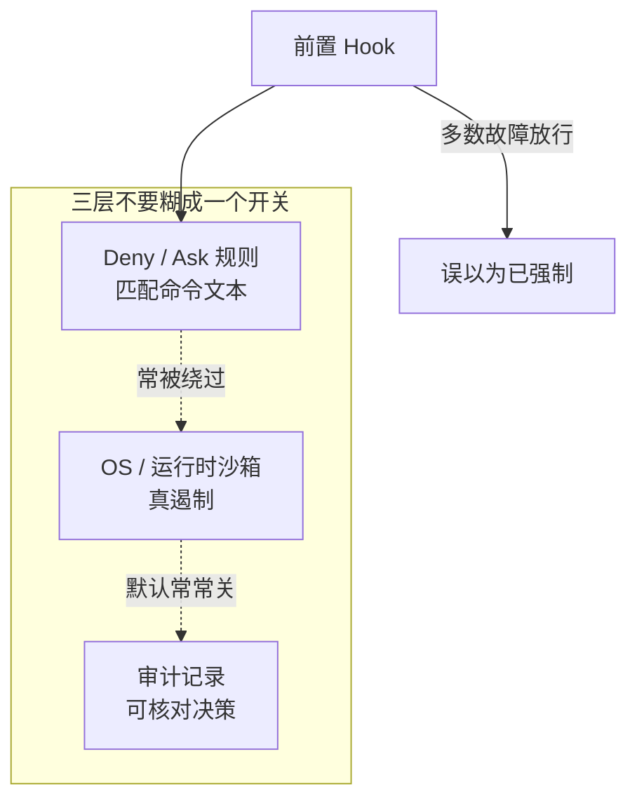

# 七家编码代理到底能强制什么

通用（不限工具）

**一句话看懂**：Thinking Raven 用同一套 16 个问题核对七家编码代理（Claude Code、Codex CLI、Gemini CLI、OpenCode、Cursor、GitHub Copilot、Windsurf/Devin Desktop）——开发者、团队或管理员**通过配置**到底能让代理做什么、拦住什么。核对日 2026-10-13；依据官方文档、changelog，开源的还看源码，每条答案带出处。头条不是功能清单，而是：七家都能用前置 hook 挡住工具调用，但多数 hook 崩溃/超时默认放行；**零家**能靠规则真正“完全禁掉命令”；**零家**在本机保留防篡改的逐条权限决策日志。Deny、沙箱、审计是三层不同的控制，设置页常常把它们糊成一个开关。

## 读完你能带走的 7 条收获

1. **先查克隆仓自己的配置**：各家对 Workspace Trust / 未信任目录是否应用 hooks、权限与沙箱差很大；Claude Code 的 `-p` 无头模式甚至不做信任检查（见 3.1）。
2. **“Deny”常常只是“Ask”**：命令规则匹配的是文本/前缀/模式，包装器或另一解释器能绕过；要与 OS 沙箱配对（见 3.2）。
3. **读拒绝大多盖不住 shell**：没有沙箱时，禁 Read 挡不住任意脚本打开文件（见 3.2）。
4. **沙箱多半默认关**：Codex 与 Cursor Auto-review 是例外；OpenCode 没有，建议 Docker/VM（见 3.3）。
5. **管理员锁多半活在客户端**：Copilot 跨面最整齐；Claude/Codex 托管锁有通道缺口；Cursor 组设置“最松者赢”（见 3.3）。
6. **Hook 能挡，但多数故障放行**：Claude / Cursor 可选择 fail-closed；Codex / Gemini / Windsurf 文档上崩溃即放行（见 3.4）。
7. **没有防篡改的本机权限账本**：多数要开 OpenTelemetry；Cursor/Windsurf 靠 post-tool hook 自建（见 3.4）。

::: tip 小白先懂这几个词
- Deny rule（拒绝规则）：按命令文本/模式禁止或逼问；不等于 OS 强制。
- [Sandbox（沙箱）](/glossary#sandbox)：OS/运行时级遏制，限制进程能碰的文件与网络。
- [Fail-open（故障放行）](/glossary#fail-open) / [Fail-closed（故障收紧）](/glossary#fail-closed)：hook 崩溃或超时时默认放行还是默认挡住。
- Workspace Trust：编辑器/CLI 是否在信任目录前应用仓库自带配置。
- Managed policy：组织下发、用户改不掉的客户端/云端策略。
- Audit log：谁在何时批准/拒绝了哪次工具调用的记录；防篡改更苛刻。
:::

## 1. 基本信息

<SourceCard type="文章" title="What each coding agent can enforce" author="Thinking Raven" date="2026-10-13" url="https://thinkingraven.com/research/agent-capabilities-2026" />

| 项目 | 内容 |
|---|---|
| 链接 | https://thinkingraven.com/research/agent-capabilities-2026 |
| 类型 | 文章（研究报告页；含 7×16 矩阵） |
| 作者 | Thinking Raven（站点/组织署名；**未见个人作者名**） |
| 发布日期 | 2026-10-13（页眉 Checked 13 October 2026） |
| 使用工具 | 通用（七家对照） |
| 分析依据 | 原文全文（优先 txt；html 选择性核对，2026-11-05）。本篇**不**展开全部 16×7 单元格，聚焦七条 headline 与 deny≠sandbox≠audit；矩阵作证据索引。产品细节随版本变，以原文标注的文档/源码为准。「我觉得」为本站评论。与 [[113]] / [[118]] / [[124]] / [[56]] 对照：那些深挖一两家机制或隔离阶梯；本文是跨产品“能强制到哪”的对照表。 |

## 2. 这篇在回答什么

设置页上每家都能勾“权限”“沙箱”“hook”，但真正问题是：

::: tr 开发者、团队或管理员通过配置，到底能让每家代理做什么，或拦住它做什么？
> "what can a developer, a team or an admin actually make each agent do, or stop it doing, through configuration?"
:::

作者用同一 16 问扫七家，并给出三条总括：7/7 能在工具调用前用 hook 挡住；多数情况下 hook 崩溃或超时**默认放行**；0/7 能完全禁掉命令（拒绝规则只匹配命令文本，包装器可绕过，有的只是逼问）；0/7 在机器上保留每次权限决策的防篡改日志（多数要开 OpenTelemetry 才记）。

本篇主线压缩为：

1. 七条 headline 各自改写哪条默认假设？
2. 为什么 deny、沙箱、审计必须分开设计？
3. 打开陌生仓库或跑无头模式时，先检查什么？

## 3. 怎么做

### 3.1 Headline 01：克隆仓的配置是第一道检查

各家对“还没信任这个文件夹时，仓内配置算不算数”差得很锐：

- **信任前忽略**：Claude Code（交互）、Codex、Gemini CLI（当时发行版）、Copilot CLI 与 VS Code。
- **一打开就应用**：Cursor 默认 Workspace Trust 关着，所以仓的 hooks、权限允许列表和沙箱设置**一打开就生效**。OpenCode 根本没有信任提示。
- **无头例外**：Claude Code 的 `-p`（headless）**没有**信任检查——即便从未信任过的目录，仓内 hooks 与 `.mcp.json` 服务器也会跑。
- **信任之后**：Codex 仓可把批准关掉——`approval_policy = "never"` 加 `sandbox_mode = "danger-full-access"`。自 0.147.0 起，某些 Codex 流程会在无提示下把项目记为已信任。Claude Code / Gemini CLI / Copilot CLI 在信任后**不能**由仓打开 bypass/yolo，但多数代理仍可预批准命令/工具并加入 MCP 与 hooks。

实操含义：领到陌生仓先看它有没有 hooks / MCP / `danger-full-access` 一类配置，再决定用哪家、哪个模式打开——尤其 Cursor 默认与 Claude 无头。

### 3.2 Headline 02–03：Deny 常是 Ask，读拒绝盖不住 shell

**02 — “Deny” 往往等于“Ask”，且命令规则都匹配文本。**

VS Code 的 false terminal 规则与 Windsurf Cascade 的 deny 列表只是强制提示，“Allow all”还能跳过。七家全都按命令文本、前缀或模式匹配，所以包装器、绝对路径或另一解释器能绕过拒绝规则——因此矩阵在这一格全员 **partial**。作者的处方很干脆：

::: tr 把拒绝规则与 OS 沙箱配对。
> "Pair deny rules with the OS sandbox."
:::

**03 — 读拒绝大多覆盖代理自带的读工具，而不是 shell。**

开着 OS 沙箱时，shell 读也会被挡住：Codex（权限配置文件由沙箱强制）、Claude Code、Copilot。Claude **不开**沙箱时：Read deny 也会挡住它认得的文件命令（`cat`/`head`/`tail`/`sed`/`tee`）和 `<` 重定向，但挡不住 `grep -r` 或自己打开文件的脚本。到不了终端的规则：Gemini CLI 的 ignore、OpenCode 的读规则、Windsurf 的 `.devinignore`、`.cursorignore`。Cursor 沙箱限制的是工作区**外**的读，不是工作区**内**的秘密。

### 3.3 Headline 04–05：沙箱默认关；管理员锁在客户端

**04 — 沙箱几乎处处有，但大多默认关。**

- 默认开：Codex；以及 Cursor 的 Auto-review 模式（不在允许列表上的命令进沙箱）。
- 默认关：Claude Code、Gemini CLI、Copilot。
- 部分或没有：Windsurf 只在 Devin Local 有；OpenCode 没有，建议 Docker 或 VM。

**05 — 管理员大多能锁掉 bypass，但锁活在客户端。**

- 最强：Copilot，CLI / VS Code / JetBrains 一套托管设置。
- Claude Code 与 Codex：都有托管锁；Claude 的服务器托管设置在 Bedrock / Vertex / 自定义 base URL 上不会拉取；Codex 云策略只到 ChatGPT 登录。
- Cursor：组设置合并时**最松的那个赢**。
- Windsurf：只盖 Cascade。
- Gemini CLI：系统设置路径可用环境变量改指。
- OpenCode：关不掉 `--auto`。

组织策略若只写在“能改客户端的人够意思”的假设上，缺口就在这里。

### 3.4 Headline 06–07：Hook 故障放行；没有防篡改本机账本

**06 — 七家都能用 hook（或等价物）在调用前挡住；多数默认故障放行。**

全部七家能在运行前挡住调用。OpenCode 用进程内插件而不是 hook 命令。

- **故障放行且文档未提供改法**：Codex、Gemini CLI、Windsurf——hook 崩溃或超时就放行。
- **故障放行除非你选择收紧**：Claude Code（`onFailure: "block"`，2.1.295+）、Cursor（`failClosed: true`）。
- **Copilot**：命令 hook 崩溃或非零退出会挡；**超时仍放行**。

只加 hook、不测崩溃路径，等于假强制——与 [[132]] / [[134]] 强调的“强制 vs 请求”同一条缝。

**07 — 没有代理为本机每次权限决策保留防篡改记录。**

Claude / Codex / Gemini / Copilot：通常要打开 OpenTelemetry 才记；Gemini 可写本地文件。OpenCode 默认记每次权限检查，但是用户可写文件，且只留最新 10 个。Cursor 与 Windsurf：文档路径是 post-tool hook 自建记录；其管理员审计日志**不覆盖**代理工具调用。

### 3.5 怎么用这张矩阵（而不背 112 格）

矩阵七家 × 十六问，格子标 Supported / Partial，Partial 必带限制说明。本站建议的用法：

1. **选你家代理的一列**，只读与你威胁模型相关的行：信任、deny、读、沙箱、托管锁、hook 失败模式、审计。
2. **把三层拆开画清单**：文本 deny、OS 沙箱是否默认开、hook 是否 fail-closed、决策是否进不可改日志。
3. **用两三个具体场景压测**：陌生仓用 Cursor 打开；Claude `-p` 跑未信任目录；Codex 仓内 `danger-full-access`；hook 脚本故意 `exit 1` 或挂起。
4. **产品表当索引**：需要字节级细节时回原文对应 agent 小节与引用来源，不要把本站压缩版当规格书。

我觉得最容易错的，是把“设置页有 Deny”读成“命令真的跑不了”。矩阵的价值正在于把这种误读摊开。

### 3.6 三家对照切片（矩阵怎么读）

不必背完整表格。下面三刀切开“设置页看起来一样、强制强度不一样”：

**Codex：信任后的全开组合。** 仓内可写 `approval_policy = "never"` 配 `sandbox_mode = "danger-full-access"`。再叠加“某些流程自 0.147.0 起可无提示记为已信任”，陌生仓用 Codex 打开时，先搜这两个键比先看功能列表更要紧。沙箱本身在 Codex 是默认开的——这是它和 Claude/Gemini/Copilot 默认关的对照点；但“默认开”挡不住你（或仓）显式选 danger-full-access。

**Claude Code：无头信任缺口 + 可选手动收紧 hook。** 交互模式在信任前忽略仓配置；`-p` 无头却跑 hooks 与 `.mcp.json`。安全相关 hook 不要只测 happy path：2.1.295 起可设 `onFailure: "block"`，把崩溃从放行改成挡住——不设就仍是故障放行。Read deny 在无沙箱时只覆盖它认得的文件命令，不覆盖任意脚本。

**Cursor：默认信任关着。** Workspace Trust 默认 off，意味着 hooks、权限允许列表、沙箱设置一打开文件夹就生效——这和 Claude 交互 / Codex / Gemini / Copilot“先忽略”相反。组级托管合并时最松设置获胜，组织以为锁死 bypass，实际可能被更松的组合拆掉。Auto-review 模式会给不在允许列表上的命令加沙箱，这是“部分默认开”的另一条路径。

把这三刀放回矩阵：同一格的 Partial 往往来自“文本匹配 / 默认关 / 客户端锁 / 故障放行”之一，而不是厂商懒得做开关。

## 4. 结果与局限

**结果形态**：对照研究 + 可点击矩阵，不是单一仓库的事故复盘。头条比例（7/7、0/7）是作者按统一问题打的总括；每个 Partial 都有限制句。

局限：

- 核对日 2026-10-13；CLI 小版本会改 fail-closed 默认值与托管拉取范围。
- 七家覆盖主流，不等于全部编码代理。
- 作者署名为组织 Thinking Raven，无具名个人；证据链靠文档/源码引用支撑，读时仍应点开原文出处。
- 本站文章有意压缩产品表——深度单元格以原文为准。

## 5. 结论

“能配置”不等于“能强制”。Thinking Raven 的七条 headline 把信任边界、文本 deny、默认关的沙箱、客户端托管锁、hook 故障模式和审计缺口摊在同一张桌上。设计控制时，把 deny、沙箱、审计当成三层，而不是一个开关的三个名字。

**你可以这样试**

1. 列出你在用的代理：信任前是否应用仓内 hooks？无头是否跳过信任？
2. 给高危命令同时设文本 deny **和**默认开的沙箱；单测包装脚本能否绕过。
3. 把 hook 崩溃/超时路径测一遍；能开 `failClosed` / `onFailure: block` 就开。
4. 决定权限决策记到哪里：OTel、本地文件还是 post-tool hook——并承认默认通常不够防篡改。
5. 打开原文矩阵，只精读你那一列。

**读完自测**

1. 你仓库的 deny 规则挡住的是字符串，还是进程能力？
2. 沙箱现在是默认开还是手动开？
3. hook 挂了会怎样——放行还是挡住？
4. 管理员锁在客户端被改掉或绕过登录通道时，组织策略还在吗？
5. 出事后你能否证明某次工具调用被批准或拒绝过？
