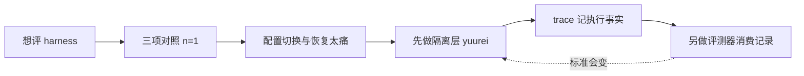

# 评测编码代理 harness 之前，我得先把它隔离开

<div class="meta-tags"><span class="tool-tag tool-general">通用（不限工具）</span></div>

<div class="hook">

**一句话看懂**：Shin Takamatsu 本来想写“模型 vs harness”对照文，结果三项配置各跑一次也说不清——拿走自制 harness 并没有让 Claude 更好，探索反而变窄。他意识到真正卡住的是**配置切换本身**：skills、指令、hooks 散落各处，worktree 只解决仓库半边。于是先做了 yuurei：用可版本化的 Profile 在临时执行单元里跑代理，把隔离与评测拆成两个工具；trace 只记执行事实，不替你下“决策好不好”的判断。

</div>

## 读完你能带走的 7 条收获

1. **评测前先问能不能干净重跑**：配置换不干净，分数再漂亮也说不清比的是什么（见 3.1、3.2）。
2. **一次三项对照不支持“harness 设天花板”**：去掉自制 harness 后探索变窄，没有出现预期的改进；且每条件 n=1（见 3.1）。
3. **Git worktree 只隔离仓库状态**：skills / settings / hooks 的加载位置与规则因运行时而异，恢复日常环境成本高（见 3.2）。
4. **yuurei 三件套**：Profile（运行时+原生配置）× Task（提示）→ Run（带 trace/日志的一次执行）（见 3.3）。
5. **隔离有边界**：默认是临时 `HOME` 级配置隔离，不是 OS 沙箱；可复现配置 ≠ 行为每次相同（见 3.3）。
6. **刻意拆开隔离与评测**：行为问题（有没有发现风险、是故意不动还是根本没看见）靠 PR diff 答不了；评测标准会变，不该逼隔离层一起重写（见 3.4）。
7. **下一步实验方向**：保留旧 harness、换新模型——若原地改文件，旧配置可能已经消失（见 3.4、4）。

::: tip 小白先懂这几个词
- [Harness（挽具）](/glossary#harness)：本文指积累在 skills 与 `CLAUDE.md` / `AGENTS.md` 里的工作流指令。
- Profile（配置档案）：某一运行时及其原生配置文件的可版本化快照。
- [yuurei](/glossary#yuurei)：作者开源的 CLI，用隔离 Profile 跑编码代理并留下 trace。
- Trace：一次 Run 的机器可读记录（运行时、结果、超时、摘要摘要 digest、隔离校验等）。
- n = 1：每个条件只跑一次，不足以分离模型效应与运行时效应。
- [Git Worktree](/glossary#worktree)：隔离工作树；本文强调它不解 harness 配置半边。
:::

## 1. 基本信息

<SourceCard type="文章" title="Before I Could Evaluate My Coding-Agent Harness, I Had to Isolate It" author="Shin Takamatsu" date="2026-11-04" url="https://dev.to/shimpeiws/before-i-could-evaluate-my-coding-agent-harness-i-had-to-isolate-it-3ohm" />

| 项目 | 内容 |
|---|---|
| 链接 | https://dev.to/shimpeiws/before-i-could-evaluate-my-coding-agent-harness-i-had-to-isolate-it-3ohm |
| 类型 | 文章（DEV；日文原稿英译改编） |
| 作者 | Shin Takamatsu（DEV：shimpeiws） |
| 发布日期 | 2026-11-04（英文改编）；日文原稿 2026-09-14 |
| 使用工具 | Claude Code、Codex；yuurei（文末对照 v1.4.0，另支持 OpenCode） |
| 分析依据 | 原文全文（html→txt，2026-11-05）。文中注明 Implementation update November 5, 2026 对照 v1.4.0；「我觉得」为本站评论。与 [[57]] / [[123]] / [[94]] 对照：那些谈评测设计与分数，本文先解决隔离前置条件。 |

## 2. 这篇在回答什么

作者本想写清：编码代理的**模型**和围着它的 **harness** 到底谁在拖后腿。他拿同一仓库、同一起点提交、同一提示词跑了三组，却得不到够写完那篇文章的答案。于是故事变成了另一件事——

::: tr 我开始写一篇关于编码代理模型与其周围 harness 关系的文章。……结果从未清晰到让我写完。相反，我做了 yuurei。
> "I started writing an article about the relationship between coding-agent models and the harnesses around them. … the results never gave me a clear enough answer to finish it. Instead, I built yuurei"
:::

主线四个问题：

1. 那次三项对照实际看见了什么？
2. 为什么“换 harness 再比”在日常环境里痛到做不下去？
3. yuurei 把什么变成了版本化输入？
4. 为什么隔离工具不应该顺带兼任评测器？



## 3. 怎么做

### 3.1 三项对照：假设没被支持

文中的 harness，指他堆在 skills 和 `CLAUDE.md` / `AGENTS.md` 里的工作流指令：先理解代码、审设计、看着险就停、再请另一个代理核实结果。

新模型 GPT-6 Astra 出来后，他随手让很少用的 Codex 重构一个开源项目，结果好于预期。于是怀疑：在 Claude Code 上花更多功夫养的 harness，会不会反而设了天花板？三组条件：

| 运行 | 运行时与模型 | Harness |
|---|---|---|
| PR1 | Codex CLI / GPT-6 Astra | 仅通用 pstack skill |
| PR2 | Claude Code / Sonnet 5 | 自制 harness |
| PR3 | Claude Code / Sonnet 5 | 仅 pstack |

pstack 是面向调查、设计、验证的通用 skill 集合；“仅 pstack”表示不用自制 harness。

假设是：约束太多，擅长给代理**停下的理由**，不太擅长停下之后找安全替代方案——而这是他能改的。对照**不支持**该假设：PR3 去掉自制 harness 后，探索变窄，没有写出专门测试，也没走到设计决策。令人失望的是，他想找的解释并不在“自己能改的那一层”；模型和执行环境的差异仍可能是原因。

作者明确：每条件只跑一次（n = 1），不足以确立普遍效应，也分不开模型效应与运行时效应。能说的更窄：在这次对照里，拿走自制 harness **没有**带来预期的改进。

### 3.2 Worktree 只解决一半

仓库侧，`git worktree` 能在同一起点给出多份工作树。难的是 harness：skills、指令文件、settings、hooks 散落多处，各运行时加载规则不同。Claude Code 可以设 `CLAUDE_CONFIG_DIR`，但不能假定这就隔离了一切——他每次都要看 `/status` 的 Setting sources，确认实际加载了什么。切换自制部分靠规程和脚本；事后恢复日常环境仍费时间，因为没全部还原正确。Codex 那次他以为很少用所以 pstack 不在，事后才发现那边也激活了。

一次对照三跑已经够痛。若再拆掉 harness 组件、弄出十几二十个变体，每一变体都要备份、替换、重启、恢复——人会卡在维护对照环境，还没量到想量的东西。

### 3.3 yuurei：把 harness 变成版本化输入

因此他做了 yuurei：每次运行创建临时执行单元，按选定 Profile 跑编码代理，把运行时配置与日常全局设置分开。基本模型三部分：

| 概念 | 含义 |
|---|---|
| Profile | 某一运行时及其原生配置：skills、指令、settings、hooks |
| Task | 发给运行时的说明 |
| Run | 用某个 Profile + Task 的一次执行，自带 trace 与日志 |

Profile 放在 `.yuurei/` 下，可进版本控制。对他最有用的是：harness 变成**有名字的工件**，而不是一堆不断被覆盖的文件。

最小示例（需 Node.js ≥22、已装 Claude Code、以及适配器支持的显式认证环境变量）：

```bash
npm install -g yuurei
mkdir yuurei-demo && cd yuurei-demo
yuurei init
yuurei doctor
yuurei profile list
yuurei run hello
yuurei trace show <run-id>
```

默认脚手架选 Claude Code 并建一个小问候 Task，用来检查环境，不是重构实验。认证须在 run 前就绪；仅有交互式登录不一定够。

每次 Run 有 `trace.json`：运行时、执行结果、是否超时、profile/task digest、隔离校验等；日志与 trace 留在 `.yuurei/runs/<run-id>/`。Digest 让你核对**用了哪套配置**，并不证明产出的代码正确。

::: tr 代理的汇报需要核实。我用来测量的基础设施也一样。
> "An agent's report needs verification. So does the infrastructure I use to measure it."
:::

原文对照里，看起来最自主的那个 PR，还错误地声称自己的检查已通过——所以这条特别刺耳。

隔离一词在此有明确限度：yuurei 分开配置与环境变量，默认隔离级别用临时 `HOME`；**不是 OS 沙箱**，代理执行的代码仍有你用户账号可用的访问权。同样，可复现配置并不意味着跨次运行行为相同。

### 3.4 为什么把隔离和评测拆开

最初他想做一个工具既隔离又评测，后来放弃了——因为评测设计还没想清楚。原对照里突出的差异关乎**行为**，而不只是最终产物质量：代理有没有发现风险改动？发现之后是故意不动，还是根本没看见？决定不做之后有没有另找改进？有没有把决策交回人？PR diff 单独答不了这些；他还不知道如何收成结构化观察。

若把评测塞进同一工具，就必须先定这些，才能发布责任已经清晰的隔离机制——未定的评测设计会阻塞已经清楚的基础设施。他希望依赖反过来：评测器消费 yuurei 的执行记录，而 yuurei 不必知道谁在消费。

实践好处：评测标准会随模型进步而变；他不想每次改标准都重做隔离层。于是执行可重复，评测问题保持开放。Trace 记执行事实，不把事实自动变成“决策好”的判断，也不保证未来评测器需要的所有行为证据都已捕获。

日文稿时点的 v0.3 范围：Claude Code 与 Codex 的单运行时执行；每种运行时×模型×harness×task 独立。不含：跨运行时移植 harness、自动打产物质量分、成本/ROI 看板、OS 级沙箱、团队认证；也没有“同一 Profile+Task 重复执行”的分组概念——而行为有噪声，要下更强结论需要重复。

2026-11-05 实现更新：对照 v1.4.0，已支持 OpenCode；后续有实验性 `--seed-repo` 与可选 `--observe`（记录准备好的环境信息，**不**解决上述行为评测问题）。这些不改变原实验及其结果。

仍想测的问题：积累的 harness 会不会让我拿不到新模型本可提供的改进？原对照固定 Sonnet 5 只改 harness，答不了。需要反向对照：保留 harness、换模型——而这要求旧 harness 在想跑的时候还在。若一直原地改，下个模型到来时它可能已经没了。yuurei 是在为这场还没测的实验做准备。

## 4. 结果与局限

**已证明的**：在所述三项、各 n=1 的对照里，去掉自制 harness 未带来预期改进；配置切换成本高到会阻碍继续比较。

**未证明的**：harness 是否对更新模型设天花板；模型效应 vs 运行时效应；任何质量分数。

**工具边界**：配置/`HOME` 隔离 ≠ 沙箱；digest ≠ 正确性；trace ≠ 行为评测；作者自限无跨运行时移植与自动打分。

我觉得这篇最有用的交付物不是“三项谁赢”，而是把**评测基建的前置依赖**说清楚：先能保存和重放配置，再谈分数。

## 5. 结论

想比较 harness，却连“现在加载的是哪一套”都说不清时，先写评测器是本末倒置。Takamatsu 的顺序是：隔离 → 留下机器可读记录 → 另开评测问题。

**你可以这样试**

1. 把当前 skills / 指令 / hooks 拷成一份命名 Profile，放进版本库。
2. 用临时目录或专用工具跑同一 Task 两次，核对 digest 是否一致。
3. 列表写出你关心的行为问题（发现风险？故意跳过？交回人？），先别塞进隔离 CLI。
4. 换模型前，冻结一份旧 Profile，而不是原地覆盖。

**读完自测**

1. 你上次“对比两种配置”，真的只改了声称要改的那一层吗？
2. Worktree 之外，你的 hooks/settings 从哪加载？如何验证？
3. 你的评测指标能区分“看见风险却不动”和“没看见”吗？
4. 隔离层和打分层是不是绑在同一个工具里、改一处就要动两处？
5. 三个月后旧 harness 还能原样重跑吗？
