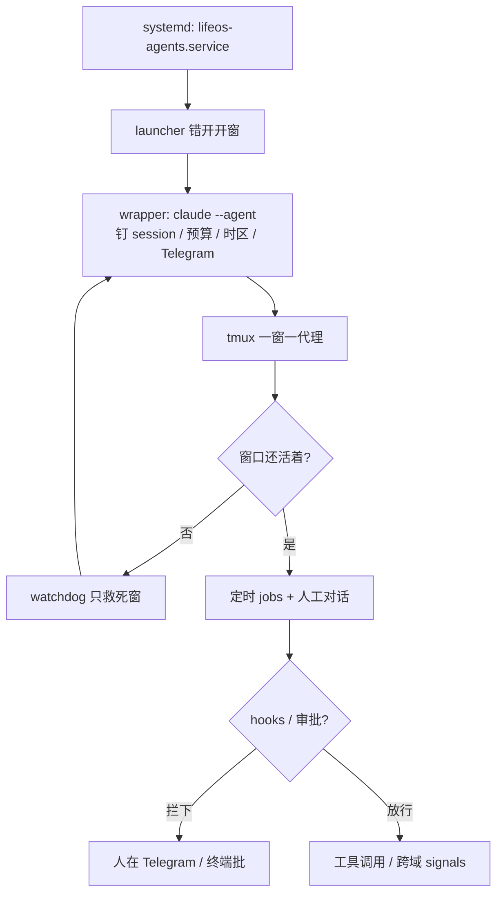

# 自托管常驻 Claude Code 代理舰队怎么搭

Claude Code

**一句话看懂**：Dave Remy 不用代理框架，把九个命名的 Claude Code 会话做成常驻舰队——各占一个 tmux 窗口，systemd 开机拉起，watchdog 每五分钟只救死窗，每人一个 Telegram bot 和一份 git 里的 markdown 定义。真正的成本不在「会不会开会话」，而在自己补上的连续性、定时账本、跨域路由、预算切换和硬门闸；跑了八个月、仓库 3,761 次提交之后，他的结论是：已生活在 Claude Code 里的人可以这样搭，多数人仍更适合托管产品。

## 读完你能带走的 7 条收获

1. **常驻不必另买框架**：Claude Code + 终端复用器 + 操作系统的服务管理器就够跑舰队；人和会话之间不要再夹一层（见 3.1）。
2. **一域一代理一 bot**：九个角色按健康 / 财务 / 通讯 / 工程等切开，跨域消息过首席幕僚并落 signals；模型档也按活分——路由监控用 Sonnet，重活用 Opus（见 3.2）。
3. **保活四层缺一不可**：systemd 建会话 → launcher 错开启动 → wrapper 钉 session ID / 预算 / 时区 → watchdog 按窗口救火（见 3.3）。
4. **沉默失败是主敌**：跑了但空 ≈ 从没跑、发布报成功却 API 全拒——要用 ledger 和「读回才算发布」把失败变可见（见 3.4）。
5. **hooks 比模型记忆硬**：外发邮件 / iMessage、改生产库、定时任务工具面，用 hook 挡；审批清单写进定义（见 3.4）。
6. **会话内定时不可靠当日历**：即便能跨 resume，仍七天过期、宕机不补；真日历活放在 jobs 清单编成的 systemd timer（见 3.4）。
7. **托管省基础设施，自托管买集成**：邮件、财务和写软件同一工具同仓库，门闸坏了可 commit 修；代价是几千次提交的运维面（见 3.5）。

::: tip 小白先懂这几个词
- [tmux](/glossary#tmux)：终端复用器；断线后会话仍在服务器上，可再附着。
- [Hooks（钩子）](/glossary#hooks)：工具调用前后强制跑的脚本；不依赖模型是否「记得」规则。
- [MCP](/glossary#mcp)：给代理接外部工具的协议；本文按代理裁剪，财务工具不到研究代理。
- [Session Handoff（会话交接）](/glossary#session-handoff)：重启前写下、重启后认领的在飞工作状态。
- Watchdog（看门狗）：定时检查各窗口是否还活着，只重启死的，不拖垮其他八个。
- Ledger（运行账本）：每个定时任务写下「查了什么、找到什么」，避免「空结果」和「没跑」长得一样。
:::

## 1. 基本信息

<SourceCard type="文章" title="Persistent Agents on Claude Code" author="Dave Remy" date="2026-10-30" url="https://daveremy.github.io/persistent-agents/" />

| 项目 | 内容 |
|---|---|
| 链接 | https://daveremy.github.io/persistent-agents/ |
| 类型 | 文章（工作笔记 working note，v1.2，CC BY 4.0） |
| 作者 | Dave Remy |
| 发布日期 | 2026-10-30（页面日期；同日更新 v1.2） |
| 使用工具 | Claude Code（`claude --agent`；配套 tmux / systemd / Telegram / 自建脚本） |
| 分析依据 | 原文全文（html→txt，2026-11-06）。引语与数字逐字摘自正文；仓库提交数、任务数等为作者截至 2026-10-28 的自报。「我觉得」开头的段落是本站评论。与 [[89]] / [[48]] / [[41]] 对照：本文强调自托管 always-on 舰队与沉默失败可见化，而不是单机控制台三件套或厂商云端会话本身。 |

## 2. 这篇在回答什么

你已经天天用 Claude Code 写代码。忽然市面上多了「永远在线」的个人代理：Grok Bot、Muse、Claude Duet。要不要另买一套？还是把现有终端会话硬撑成舰队？

Remy 选了第三条路，而且已经跑了八个月：九个命名会话常驻在一台 Linux hub 上，从健康打卡到客服回复都走同一套 Claude Code。主线回答五个问题：

1. 为什么离开 OpenClaw，改压在 Claude Code 上？
2. 九个常驻代理怎么按域切开、怎么跟人请示？
3. 保活四层各自挡住哪类死法？
4. 常驻会暴露哪些「单人交互会话」没有的缺口，怎么补？
5. 和托管产品比，省什么、买什么？

## 3. 怎么做

### 3.1 为什么离开 OpenClaw，压在 Claude Code 上

2026 年初他跟风跑 OpenClaw：专用 Mac mini，还给助手单独身份——另一套名字、Gmail、GitHub。三件事把它结束掉：

- **单独身份**带来并行账号、凭据和权限同步，加活不加价值。
- **条款不稳**：经 OpenClaw 用 Claude 的服务条款一直在变，地基晃。
- **时间错配**：真干活仍要 Claude Code；大半时间耗在框架本身，产出很少。

2026-02-26 他开了 LifeOS 这个 Claude Code 项目，次日关掉 OpenClaw 网关。Mac mini 留下——买来托管代理，结果证明更有用的是「从不睡觉的机器」，正好给 tmux。03-24 起，会话变成常驻。

主发现写得很干脆：对已经会用 Claude Code 的工程师，不必再买专用产品或框架。

::: tr Claude Code、一个终端复用器和操作系统的服务管理器，就足以跑一支常驻代理舰队。
> "Claude Code, a terminal multiplexer and the operating system's service manager are enough to run a fleet of persistent agents."
:::

人和 Claude Code 之间**没有**代理框架。代价是后文整段基础设施——连续性、调度、路由、在场、预算、门闸——都要自己补。我觉得可以先记住这句取舍：**框架替你藏复杂度；自建逼你把复杂度写成可 revert 的提交。**

### 3.2 九个常驻：一域一 bot，审批写死

每个代理一个领域、一个 Telegram bot。七个跑 Opus 5.5；做路由和监控的两个跑 Sonnet。短命的 sprint 开发/审查代理按需起，不计入九人。

| 代理 | 角色 | 模型 | 代表约束 |
|---|---|---|---|
| Marcus | 首席幕僚 / 默认入口 | Sonnet | 跨域消息过它并写入当日 signals；刻意少工具 |
| Huberman | 健康 | Opus | 报训练合规率必须交代有多少次对不上计划 |
| Buffett | 财务 | Opus | 每笔券商下单单独票；批量改/删要确认；>$500 告警 |
| Franklin | 通讯 | Opus | 不经批准不发邮件或短信 |
| Karpathy | CTO | Opus | 生产部署与改生产数据逐步批；审查可调 Codex / Grok |
| Moss | 运维 | Sonnet | 拥有 227 行任务清单里的 138 行；不部署、不改应用代码 |
| Will | 客服 | Opus | 只回应不外联；未测到的零不要报 |
| Sagan | 研究 | Opus | 从不发帖、注册或花钱；可写 Typefully 草稿等人确认 |
| Fish | 营销 | Opus | 发布/开账号/联系/广告花钱需批；发布以读回帖为准 |

状态分两摊：Obsidian 仓库（日记、项目、参考）和放定义 / skills / 脚本的 git 仓。共享 `CLAUDE.md` 管跨代理怎么说话、审批层级、渠道规则；每个代理自己的 markdown 写角色、语气、启动必读 canon、以及「未经批准绝不能做」的清单。代理可以改这些文件，但**每次改动单独 commit**，并留下可一键 revert 的标记。

Telegram 是异步面。三条用出来的规则：在哪个通道问就在哪个通道回；代理主动推的告警永远去 Telegram；一个 bot 只允许一个 poller——曾经开过第二会话，两个进程抢同一 token 会冲突。没有「安静时段」：代理随时可工作，是否打断由手机勿扰决定。

### 3.3 保活四层：systemd → launcher → wrapper → watchdog

九个代理住在同一个 tmux 会话 `lifeos-agents` 里，一窗一代理。窗口顺序按「我多常跟它说话」排，常用的占数字键前面；状态栏着色，手机小屏也能一眼认出。tmux 在这里干三件事：没终端也保活、任意设备附着找回原状、给脚本稳定的 session/window/pane 地址。

四层保活：

1. **systemd** 用户服务 `lifeos-agents.service` 开机创建 tmux 会话。整台 hub 重启只走 systemd——从某个 pane 里跑重启脚本，会把自己半途杀掉。
2. **launcher**（`lifeos-agents.sh`）按窗口错开几秒启动。九个会话共享一个登录 token，一起刷新会 race，结果集体登出。
3. **wrapper**（`agent-wrapper.sh`）在每个窗口里做重启环：包住 `claude --agent <name>`，每次启动读预算态选模型、恢复钉死的 session ID、挂上该代理的 Telegram bot、设好时区，并以 `/initagent` 作为首条 prompt 让代理重读定义。时区不是细节：hub 时钟是 UTC，日程按亚利桑那时间写，迁 Linux 第一天就发现本该 07:26 的提醒会在 00:26 响。
4. **watchdog**（`agent-watchdog.sh`）由 systemd timer 每五分钟跑：逐窗检查，**只重启死的**。它的来历很具体——2026 年 7 月 Mac mini 上整支舰队两次各挂了大约八天（2–10 日、13–21 日），Telegram、邮件和营销日程一起停，没有东西把它们拉起来。

远程不在 hub 本体办公：机器没有桌椅键鼠。入口是 Tailscale 上的 ssh + tmux、手机/平板上的终端 App、Telegram，以及长文用的私有 Claude Artifact。

### 3.4 常驻要自补的基础设施——以及沉默失败

Claude Code 本是给人坐在终端前用的。九个会话连续跑，会冒出单人交互根本碰不到的问题。作者用一张表概括「缺口 → 补丁」；下面按主线拆开。

**连续性。** 重启或清空上下文会丢掉在飞状态 → 每代理一份 handoff 文档，重启前写、重启后认领；drain 步骤先停掉新子代理再交接；session ID 钉在 wrapper 里。

**真日历。** 会话内定时任务曾经会随会话消失；到 Claude Code 2.1.314，作者用同一 session ID 退出再 resume，复现任务活过并又触发了两次（单次试验，2026-10-30）。即便如此，它们仍七天过期，且会话宕机期间到期的不会补跑——不能当「某天必须发生」的日历。于是：

- `config/jobs.tsv` 列 227 个任务（拥有者、日程、命令），脚本编成 systemd timer（hub 上 190 个用户 timer），并检查「排了程的不能漏出清单」。
- 需要判断的活走 `dispatch.sh`：起无头 `claude -p`，按**交付物**（该写出的文件或消息）而不是 exit code 判成败。
- 不需要判断的活是普通脚本。
- 每个任务往月度 JSONL **ledger** 写一行：查了什么、找到什么。

ledger 的来历是一次三小时事故：2026-08-14，调度守卫正确跳过了一次运行且什么都没说，被人读成调度器坏了，引发舰队级告警、四个代理改配置、再撤回。根因句写得很清楚：

::: tr 没有账本时，一个跑了但什么都没找到的任务，看起来和一个从没跑过的任务一模一样。
> "Without the ledger, a job that ran and found nothing looked the same as a job that never ran."
:::

**跨域消息。** 日常问答可以代理直连；跨域或需要留痕的，一律经首席幕僚写入当日 signals 再转发。每条带发送方铸造的 ID，重试不会双投；路由不可达就先 append 同一行，小时扫补发。

**预算与模型。** wrapper 每次启动读 `NORMAL` / `CONSERVE` / `EXHAUSTED`；前两态七个 Opus 代理跑 Opus 5.5，第三态降 Sonnet。改一个文件就能在下次启动切全舰队；另有脚本可切正在跑的会话。状态行共享最近的五小时 / 七天限流读数，避免安静窗口显示过期数字。重编码活交给 Codex 子代理，吃的是两份 ChatGPT Plus 额度而不是 Claude 周限额。自 2026-10-25 起，不需要本机或个人数据、只要 GitHub 仓的 sprint 故事也可丢进 Claude Code 云端会话（首日 19 个）。

**硬门闸。** 仓库里 44 个 skills、29 个 hooks。hooks 是最强规则：挡未经批准的外发邮件和 iMessage、挡生产库变更、把定时任务锁在它声明的工具面、drain 时禁止派新活、审计日志去掉凭据。MCP 按代理裁剪——财务工具不到研究代理。密钥不进仓库文件：启动时 wrapper 从 1Password 只读服务账号注入进程环境；最敏感的健康库密钥只给健康代理。

还有一个小而好用的补丁：[tickler-mcp](https://github.com/daveremy/tickler-mcp)——会话装不下「三天后查一下」的意向，就放到会话外的 tickler 店，由定时任务到期路由回原代理或 Telegram。迁到 hub 之后代理们建了 224 条（37 条仍 pending，13 条循环）。

失败表里还有几条同一模式：Haiku 把给别人的回复写进自己的 pane（舰队禁 Haiku）；营销发布步骤报成功而 Typefully API 全拒（「读回帖才算发布」）；一个 pane 登出切号导致九个一起掉线（先记下全部 session ID 再切）；代理在对话中无警告重启整 hub（重启需 CTO 同意并先给一行通知）。作者的归纳是：

::: tr 贯穿这份清单的一个模式是：这些失败大多是沉默的。
> "A pattern runs through the list: most of these failures were silent."
:::

回复没送达、任务跳过无痕、发布假成功——看起来都像正常运转。大量基础设施存在的理由，就是让沉默失败变得可见。

成本也不含糊：自 2026-02-26 起仓库 3,761 次提交，接近他的应用 Neuralingual（3,879），至少是其他任一项目的八倍；到 2026-10 有 434 个 bash 文件、约 91,000 行。门闸和解析改动平均三轮 review，多半是 shell 坑——于是 10 月停写新 shell，新工具改 TypeScript。维护这套系统占用的开发时间，超过他任何一个主项目，但少于全部主项目之和。

### 3.5 和托管产品比什么

2026 下半年托管常驻代理密集出现。对照表（文中 Table 5）的要点：

- **跑在哪**：本方案是自有 Linux 服务器；Grok Bot / Muse / Claude Duet 是每用户一台云 VM；Claude Code Projects 是云会话或经 Remote Control 回本机。
- **几个代理**：本方案九个独立会话、各自定义与权限；多数托管是单代理或共享一台 VM 的若干命名 bot。
- **自己跑多久**：systemd timer + 无头任务 vs 产品内建 routines / 轮询。
- **外发、付款、删除的审批**：本方案 hooks + 自维护书面规则；托管产品内建；Projects 云线程不应用仓库 hooks。
- **谁维护、能否改自身机械**：本方案是「我和代理」，且可通过 git 改自己的代码；托管产品由厂商维护，用户改不了机械。

托管产品直接抹掉第 4、5 节的大半：没有服务器、没有重启处理、没有调度器、没有 token 竞态。对多数人，这是更好的选择。它们给不了的是集成：管邮件和财务的代理，与写软件、合并 PR 的代理，在同一工具、同一仓库里；研究代理当天就能给工程代理开进 sprint 的 issue；门闸坏了，修复是一次可读可 revert 的 commit。

两边已在一处碰头：自包含的开发活可以跑进 Anthropic 云端会话，需要本机或个人数据的仍留在 hub。Claude Code Projects 最接近工程侧，但云线程会加载仓里的 `CLAUDE.md`，却不加载 skills、hooks、权限规则或 MCP——本方案依赖的门闸在那里不会跑；经 Remote Control 跑在本机才会。Projects 与其他 Claude Code 会话共享计划限额，且文档自称耗得更快，所以也缓解不了卡着他们的周限额。作者尚未试用；与 Claude Duet 的重叠也未测。

我觉得可以这样记：**托管买的是「少运维」；自托管买的是「同一套门闸能同时管钱、邮件和发版」。** 先问自己缺的是哪一种，再决定要不要抄九个角色名。

## 4. 结果与局限

文中可核对的自报结果包括：八个月常驻、九个命名代理、仓库截至 2026-10-28 的 3,761 次提交、227 行任务清单 / 190 个用户 timer、44 skills / 29 hooks、tickler 224 条、云端 sprint 首日 19 个。失败表给出了多起改设计的事故与对应补丁（含两次约八天的全舰队停机）。**没有**对照实验证明「自托管比托管少出错」或「ledger 让误报率降了百分之几」——证据是工程日志式的前后因果。

局限要讲清：

- 维护时间占每周多少**未测量**；shell 债已在迁 TypeScript，但仍是真实软件。
- 单点：一台服务器、九会话共享一个登录 token、一个能批门闸动作的人。
- 与 Claude Duet、Claude Code Projects、云端定时任务的重叠或替代关系**未实测**。
- 会话内定时即便能跨 resume，仍不适合当硬日历。
- 作者自己写明：对多数人，托管产品是更好选择；本文写给已经生活在 Claude Code 里、还想把代理留在同一处的人。

## 5. 结论

常驻个人代理不是「再买一个产品品类」的同义词。Remy 的做法是：把 Claude Code 会话当成进程，用 tmux 和 systemd 养活，用 hooks、ledger 和读回确认对付沉默失败，用一域一 bot 和书面审批对人负责。贵的是运维面；换来的是邮件、金钱和发版共用一套可 git 的机械。

**你可以这样试**

1. 先不要上九个角色。选一个域（例如「夜间 CI 摘要」），用 tmux 单窗 + systemd 用户服务跑一个 `claude --agent`，确认重启后能用钉死的 session ID 回来。
2. 给这个代理写一份「未经批准绝不能做」清单，并把外发 / 删改类动作做成 hook 硬挡，而不是只写在 markdown 里。
3. 任何「某天必须跑」的活，退出会话内 cron，改成 jobs 清单 + 每跑一行 ledger（查了什么 / 找到什么）。
4. 加窗口级 watchdog：只救死窗，避免一次崩溃清空所有上下文。
5. 若你并不需要邮件/财务/发版同仓集成，优先评估托管常驻代理，把自建力气留在门闸与证据上。

**读完自测**

1. 你的「常驻」挂了以后，是人发现的，还是有东西在五分钟内拉起来？
2. 定时任务空结果和没跑，在你的日志里长得一样吗？
3. 发布 / 外发成功是看 exit code，还是能读回外部系统？
4. 九个（或两个）会话是否共享一个登录 token？切号时有没有先记下 session ID？
5. 你要的是少运维，还是同一套 hooks 同时管钱和代码？
