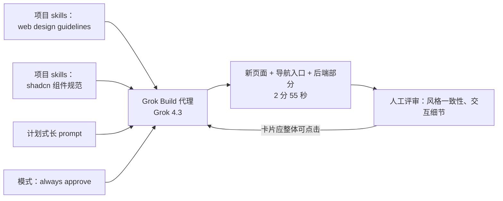

# 换了代理工具，设计规范还能用吗：OrcDev 用项目 Skills 让 Grok Build 一次生成页面

Grok Build

**一句话看懂**：OrcDev 把自己项目里现成的两套设计 skills（网页设计规范、shadcn）复制到 Grok Build 读取的 `.grok` 目录，再贴上一份像计划书一样详细的 prompt，开着 always approve 模式，2 分 55 秒后得到一个风格和整站一致的新页面，还多出了导航入口和“本月精选”区块。他的结论是：**模型是谁不重要，工作流才重要**。这是一次 10 分钟的个人演示，可带走的是“把规范放进仓库，换工具也能复用”，不足以拿来评价 Grok Build 本身。

## 读完你能带走的 5 条收获

1. **把设计规范写成 skills 放进仓库**，换一个代理工具时复制过去就能用，不用重新教一遍（见 3.1）。
2. **大任务先写计划式的长 prompt**：页面目标、每张卡片的字段、筛选、hover、占位链接、交互细节，一次说清（见 3.2）。
3. **always approve 适合有完整规范、改动范围清楚的任务**，讲者用它一次跑完；但这时人工评审更重要（见 3.3）。
4. **评审产物时，分开看“超出要求的部分”和“需要改的部分”**：多出来的导航入口和精选区块是惊喜，卡片不能整体点击是要改的（见 3.4）。
5. **单次演示只能说明“这次可行”**：没有对比、没有失败记录，速度比较也只是讲者的感觉（见 3.5、4）。

::: tip 小白先懂这几个词
- [Grok Build](/glossary#grok-build)：xAI 的终端编码代理。
- [Skills](/glossary#skills)：教代理做某件事的说明书，可以放在仓库里复用。
- [AGENTS.md](/glossary#agents-md)：多家代理通用的项目说明文件。
- [Always Approve](/glossary#always-approve)：代理不再询问、直接执行。
- [Plan Mode](/glossary#plan-mode)：先出计划再动手的模式。
:::

## 1. 基本信息

<YouTube id="W8wECVc3z6E" title="I Put Grok Build to the Test" />

| 项目 | 内容 |
|---|---|
| 讲者 / 频道 | OrcDev（独立开发者，公开构建自己的产品）／ **OrcDev** |
| 发布日期 | 2026-05-19 |
| 时长 | 10:20 |
| 使用工具 | Grok Build（early beta）+ Grok 4.3；项目级 skills（web design guidelines、shadcn 相关 skill）、plan / always approve 模式、`/model`、多代理并行 |
| 分析依据 | YouTube 英文自动字幕全文（yt-dlp，2026-10-14 重新抓取；原始识别轨 en-orig 与 en 轨内容一致），用于逐字核对引语；视频章节；xAI 发布文 x.ai/news/grok-build-cli（2026-10-14 curl，用于核对功能说法）；视频截图（0:25 截图里的英文是画面原文）。自动字幕有识别错误（如把 shadcn 识别成 “Shed C”），已在文中注明。prompt 全文视频里没有完整展示，下文只列讲者口述的要点。“我觉得”开头的段落是本站评论。 |

章节：0:00 介绍 → 0:26 价格与安装 → 1:18 功能与命令 → 2:57 构建 UI 项目 → 6:14 结果评审 → 7:56 展望。

<figure class="shot"><figcaption>📷 视频截图 · <a href="https://www.youtube.com/watch?v=W8wECVc3z6E&t=25s" target="_blank" rel="noopener">0:25</a> · 0:25 xAI 的 Grok Build 页面：<Trans zh="Grok Build 目前面向 SuperGrok Heavy 订阅用户提供早期测试">“Grok Build is in early beta for SuperGrok Heavy subscribers”</Trans>，下方是一行安装命令。</figcaption></figure>

## 2. 这篇在回答什么

你在 Claude Code 或 Cursor 里花了几个月，把项目的设计规范调教得差不多了。这时出了一个新的代理工具，你想试试。问题是：之前攒下的那些规范，新工具能直接用吗？还是又要从头教一遍？

OrcDev 用自己最讲究设计的项目 Shipper Club 做了一次测试：让 Grok Build 新建一个公开页面 “What members are building”，展示社区成员在做的项目。这个视频回答四个问题：

1. 已有的设计规范怎么交给新工具？（3.1）
2. prompt 怎么写？（3.2）
3. 用什么模式跑，跑了多久？（3.3）
4. 结果怎么样，讲者得出了什么结论？（3.4、3.5）

## 3. 怎么做

### 3.1 复用已有 skills 作为设计上下文

为什么这一步最重要？因为设计规范如果只存在于你脑子里，或者只存在于某个工具的设置里，每换一个工具都要重新教。写成 skills 放进仓库，哪个代理都能读。

讲者的项目里本来就有 `.agents`、`.claude`、`.cursor` 等目录。他把现成的 skills 直接复制到 Grok Build 读取的 `.grok` 目录下：

::: tr 这里能看到 Grok 目录，里面放着我的 web design guidelines（网页设计规范）和 shadcn skill。
> "here we can see the Grok directory, and here I have web design guidelines and Shed C and skill."
:::

（字幕里的 “Shed C” 应为 shadcn 的语音识别误差。）他在介绍文档时也说过，已经测过把 skills 放进这个目录能用。xAI 发布文里的说法是：

::: tr 你的 AGENTS.md、插件、hooks、skills 和 MCP server 都能开箱即用。
> "Your AGENTS.md, plugins, hooks, skills, and MCP servers all work out of the box."
:::

<figure class="shot"><figcaption>📷 视频截图 · <a href="https://www.youtube.com/watch?v=W8wECVc3z6E&t=240s" target="_blank" rel="noopener">4:00</a> · 4:00 项目的文件树里同时有 .agents、.claude、.cursor、.grok 等目录，讲者把现成的 skills 复制到了 .grok 下。</figcaption></figure>

我觉得这一节的启发比 Grok Build 本身更持久：规范放进仓库，就和代码一起被版本管理，也和具体工具解耦。

### 3.2 先写一份计划式的长 prompt

讲者没有现场即兴写 prompt，而是事先准备了一大段：

::: tr 做这么大的东西时，我总是先把计划写好。
> "I'm always planning things up when I'm creating something this big."
:::

视频里没有完整展示 prompt 原文，按他口述，里面包括：

| 部分 | 内容 |
|---|---|
| 目标 | 新建公开页面 “What members are building”，展示成员的项目 |
| 设计方向 | 写在 prompt 里，要求遵循项目的设计风格 |
| 卡片字段 | 项目名、成员名、简介、分类徽章等 |
| 数据 | 先用占位项目（具体项目由 AI 自己挑） |
| 交互 | 分类筛选、细微的 hover 效果、交互细节 |
| 链接 | 先指向 `#`，以后再换成真实项目 |

<figure class="shot"><figcaption>📷 视频截图 · <a href="https://www.youtube.com/watch?v=W8wECVc3z6E&t=340s" target="_blank" rel="noopener">5:40</a> · 5:40 讲者把整段 prompt 粘进 Grok Build，开头是“Create a new public &quot;What Members Are Building&quot; page for Shipper Club”，代理开始思考。</figcaption></figure>

### 3.3 选好模式，一次执行

Grok Build 用 `Shift+Tab` 在三种模式间切换：默认模式、plan 模式、always approve 模式。讲者选了 always approve：

<Trans zh="我就放手赌一把，选 always approve。">“I'm going like yoloing this and going always approve.”</Trans>

贴进 prompt、回车，结果是：

<Trans zh="2 分 55 秒后完成">“it's done after 2 minutes and 55 seconds”</Trans>

这包括页面 UI 和讲者说的后端部分。他还说感觉 Grok Build 比 Claude Code 和 Codex 快，但自己也不知道为什么，视频里没有做对比。

视频前半段还提到了几个功能：文档里的 skills、插件、插件市场；能在 CLI 里生成图片和视频的命令（讲者说别的 CLI 没有）；`/model` 可以接入其他模型的 API key；5 套界面主题。这些和本次任务关系不大，一笔带过。

### 3.4 评审产物

讲者逐项看了生成的页面。

**超出要求的部分（讲者认为是加分）：**

- 导航栏里多了一个新入口，prompt 里没要求；
- 多了一个“本月精选”（Highlighted this month）区块，讲者说本来没想要，但觉得很好；
- 文案<Trans zh="一点都不像 AI 写的">“not AI-ish at all”</Trans>；
- 遵循了项目的设计风格，还复用了落地页上的一个细节。

**需要改的部分：**

- 整张卡片应该是一个链接，而不只是里面一个 ghost 风格的 “view” 按钮。

<figure class="shot"><figcaption>📷 视频截图 · <a href="https://www.youtube.com/watch?v=W8wECVc3z6E&t=542s" target="_blank" rel="noopener">9:02</a> · 9:02 生成的“What Members Are Building”页面：顶部是分类筛选（All、SaaS、AI Tools、Design 等），下面是“Highlighted this month”精选区块，再往下是成员项目卡片。</figcaption></figure>

注意，“多出来的东西”在 always approve 模式下是双刃剑。这次是惊喜，换一个项目可能就是越界改动。讲者没有看代码 diff，也没有展示后端部分。

### 3.5 讲者的工作流观点

讲者最后把这次成功归功于项目本身准备得好：

::: tr 用哪个模型并不重要，重要的是你的工作流。
> "it doesn't matter which model we are using. It matters like your workflow is something that matters"
:::

他还说试过同时跑三四个代理做不同任务，它们<Trans zh="不会互相覆盖">“it's not like in FileZilla that it is overriding everything”</Trans>，但这部分没有演示。

视频里还有一段新闻性质的内容：价格（每月 300 美元，讲者拿到过一个 99 美元、6 个月的优惠，但说多数人看不到）；讲者发推说模型还差得远，Elon Musk 回复说 Grok 4.3 每几天就在改进，接下来会加入 Cursor 的数据做补充训练。这些和工作流无关，不展开。

## 4. 结果与局限

| 项目 | 视频里的情况 |
|---|---|
| 用时 | 2 分 55 秒（含 UI 和讲者说的后端部分） |
| 风格一致性 | 讲者认为符合项目设计 |
| 超出要求 | 导航入口、本月精选区块 |
| 要改的 | 卡片应整体可点击 |
| 代码质量、后端实现 | 未展示 |
| 速度对比、多代理并行 | 只有讲者口述，无演示或数据 |

::: warning 局限与注意
- 只有一次演示，一个项目，没有对比其他工具，也没有失败的例子。
- 开的是 always approve，讲者没有检查代码 diff；多出来的改动在别的项目里可能是越界。
- 字幕是自动生成的，有识别错误；prompt 全文没有展示。
- 价格、优惠和 Elon Musk 的回复属于当时的新闻，可能已经过时。
:::

## 5. 结论

这个视频说明了一件事：**一个准备充分的项目（规范写成 skills、任务写成计划式 prompt），可以让一个新代理工具很快产出风格一致的结果**。功劳更多在项目准备，而不在工具。

我觉得值得带走的是讲者的做法，而不是他对 Grok Build 的评价。一次 3 分钟的成功演示，不足以说明工具在复杂任务上表现如何。

### 你可以这样试

- [ ] 把你项目里的设计规范或组件约定整理成一个 skill，放进仓库，在两个不同的代理工具里各跑一次同样的任务，对比结果。
- [ ] 下次让代理做一个新页面前，先按 3.2 的表格写出目标、字段、数据、交互和链接，再交给它。
- [ ] 评审代理的产出时，单独列出“我没要求但它做了”的部分，逐条决定保留还是回退。

### 读完自测

1. 讲者是怎么把已有的设计规范交给 Grok Build 的？
2. 他的 prompt 里包含哪几部分？
3. 生成的页面里，哪些是超出要求的？哪一点需要改？
4. 为什么说这次演示不足以评价 Grok Build 本身？
