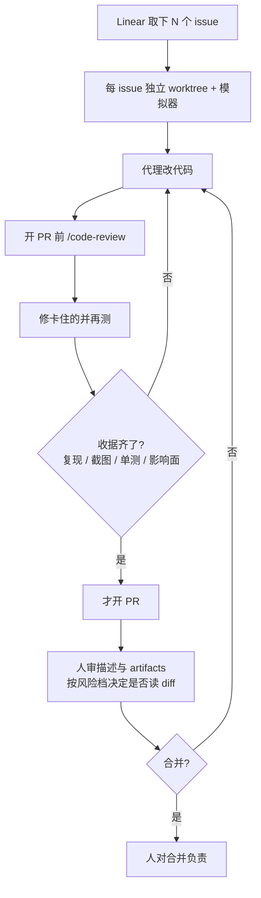

# 开 PR 前先交证据收据

Claude Code

**一句话看懂**：Alex Grebenyuk 觉得「一个代理开 PR、另一个再审」是反着的——审查和「能工作的证明」应是写变更的一部分，发生在开 PR 之前；PR 上留给人的是合并责任。他在 iOS 仓用 `/fix-issues` → `/code-review` → 再测，并强制前后截图 / 复现 / 单测等收据；加上之后，仓库 AI 审查器从同类修复的 10/23 降到 1/11（且仅 nit）。风险分 Low / Medium / High，脚本只能抬档，不能靠作者身份降档。

## 读完你能带走的 6 条收获

1. **开 PR 后再让 AI 审是模仿人类流程，不是代理流程**：审查应嵌进做变更，并带上可核验的证明（见 3.1）。
2. **自审放在开 PR 前**：对 diff 跑审查、修卡住的、再测；周围结构另派一只代理看重复与破坏面（见 3.2）。
3. **信心来自收据，不来自「我说能用」**：先无修复复现、前后截图或 walkthrough、会红的单测、按风险扩检查面（见 3.2）。
4. **两件不可协商**：变更能工作的证明；人对合并负责。AI 不能对任何事负责（见 3.3）。
5. **档位由变更定，不由作者定**：代理初评 + 脚本只可抬高；关键路径两人审，小修复可跳读代码但要诚实（见 3.3）。
6. **描述和 artifacts 开始比 diff 更重要**：工具仍围着 diff；人至少审清描述与证据，小改往往够用（见 3.3）。

::: tip 小白先懂这几个词
- [Code Review（代码审查）](/glossary#code-review)：读变更、找问题、决定能否合并；本文主张代理自审发生在开 PR 前。
- [Git Worktree](/glossary#worktree)：同一仓库的额外工作目录；每个 issue 单独一棵，互不踩文件。
- [MCP](/glossary#mcp)：此处接 Xcode / 模拟器，让代理自己点 UI、抓截图。
- Receipts（证据收据）：不建分支也能在一分钟内核验的材料——复现、截图、失败单测、检查范围。
- Risk tier（风险档）：Low / Medium / High，决定要不要人读代码、几个人读。
:::

## 1. 基本信息

<SourceCard type="文章" title="Bring Receipts" author="Alex Grebenyuk" date="2026-10-29" url="https://kean.blog/post/pr-reviews-are-for-humans" />

| 项目 | 内容 |
|---|---|
| 链接 | https://kean.blog/post/pr-reviews-are-for-humans |
| 类型 | 文章（个人工程博客，约 7 分钟） |
| 作者 | Alex Grebenyuk（kean.blog） |
| 发布日期 | 2026-10-29（页面日期） |
| 使用工具 | Claude Code（`/fix-issues`、`/code-review` skills；Xcode 27 MCP + 模拟器；仓库侧 AI 审查器作对照） |
| 分析依据 | 原文全文（html→txt，2026-11-06）。引语与 1/11、10/23 等数字摘自正文；PR #5539 为作者给出的公开例子。「我觉得」开头的段落是本站评论。与 [[60]] / [[32]] / [[95]] 对照：本文把「按风险定人数」和「带证据交付」收成开 PR 前的硬步骤，并明确反对把 AI 二次审查留到 PR 打开之后。 |

## 2. 这篇在回答什么

代理已经写大部分代码、开大部分 PR；仓库里还蹲着 CodeRabbit、Copilot 或 Anthropic Code Review。常见画面是：一个代理开 PR，另一个再审一遍。作者觉得这是反的——我们把为人设计的流程教给机器去模仿。

主线回答三个问题：

1. 为什么「开了 PR 再 AI 审」值得拆掉？
2. 开 PR 前如何把自审和证据收据做进同一条流水线？
3. 人合并时什么不可协商，风险三档怎么定？

## 3. 怎么做

### 3.1 为什么开 PR 后再审是反的

AI 审查器确实能抓到真 bug，每次改动也确实该过审查。作者反对的不是「要不要审」，而是**审的时机**：

::: tr 审查应当是做变更的一部分，连同它能工作的证明。两者都有了之后，就没必要再让一个代理审一遍；剩下的审查是给人的。
> "The review should be part of making the change, along with the proof that it works. Once you have both, there’s no point in an agent reviewing it again, and the review that’s left is for humans."
:::

脚注里他同意 Greptile 的观点：用新鲜上下文让 AI 审 AI 写的代码并不傻——所以他仍然跑审查，只是把位置挪到**开 PR 之前**。我觉得这句话的尖锐处在于：PR 上的机器人评论，经常是把本该在工作树里闭环的活，延迟成了异步噪音。

### 3.2 自审 + 四件收据

他仍在迭代，但主路径已经固定。多数 bug 修复走 `/fix-issues` skill：从 Linear 取下一批 issue，每个在自己的 worktree 和模拟器里修。开 PR 前代理对 diff 跑 `/code-review`，修掉会卡住的问题，再测一遍。

前后对照（同一类修复）：加上开 PR 前自审之后，仓库 AI 审查器 flag 了 **1 / 11** 个 PR，且只是 nit；之前是 **10 / 23**。这是作者仓内计数，不是对照实验，但方向清楚。

diff 审查只看见「改了什么」，看不见周围。于是第二只代理专门看变更如何嵌进代码库：有没有重复、该不该复用某个 helper、是否违背现有 pattern、会不会弄坏某个 caller——也就是人本来会靠读 diff 去找的那类问题。不过作者说得很干脆：这两种审查都不是信心来源，**证明**才是。

他不要代理告诉他「能用」，而要一分钟内、不建分支就能核验的东西：

1. **先在无修复的构建上复现**；复现不了就停。
2. **前后截图**；静帧不够就上 walkthrough，步骤和日志跟视频放一起。
3. **逻辑可测时**，写在无修复时会失败的单元测试。
4. **按风险扩大检查面**：越危险，越要扫可能波及的区域。

以前这对每个 PR 都太贵；现在有 Xcode 27 MCP 和模拟器，代理可以自己点。公开例子是 Pocket Casts iOS 的 [PR #5539](https://github.com/Automattic/pocket-casts-ios/pull/5539)：修 RTL 语言下 mini player 进度条布局——截图就是全部所需证明；PR 里还有根因、风险、测试步骤和结果。仓库 AI 审查器仍扫了两遍，什么都没找到——作者认为这正说明开 PR 前的审查已经做完了该做的事。

另有一条工程卫生：截图和视频不要再传到「有链接就能看」的 secret gist（开源仓勉强可接受，但有过代理把内部截图泄露出去的案例）；改用 `gh` 直接附到 PR，私密级别跟仓库走。

### 3.3 人合并：两不可协商与风险三档

审查留给人。引用 IBM 1979 内部培训那句（经 Simon Willison 流传）之后，作者钉下两件不可协商的事：

::: tr 你对合并进去的东西负责，而 AI 不能对任何事负责。
> "You’re responsible for what gets merged, and AI can’t be responsible for anything."
:::

其余都可协商，**包括是否读代码**。他总是审描述和 artifacts；对小改动，它们常常比 diff 更能说明问题。每个 PR 让代理自评风险，例如 `Risk: Low. Only the mini player's progress/time row layout changes.`，再映射到人数：

| 档 | 含义 | 何时 |
|---|---|---|
| Low | 不读代码 | 例如单屏约束修复 |
| Medium | 一人审（作者本人） | 代理写了代码，人已是第二双眼睛 |
| High | 两人审 | playback / sync / purchases / sign-in 等关键路径 |

Claude Code 团队也用「零 / 一 / 二」三档人批准；他借来的规则是：

::: tr 变更决定档位，而不是作者。
> "the change sets the tier, not the author."
:::

代理评级只是起点。脚本检查 diff，**只能抬高**：碰到关键区域 → High；动到共享代码、已有测试、CI，或超过少数文件 → 至少 Medium。截图只证明屏上变了什么，不证明 diff 还碰了什么——所以不能靠几张图把档位偷偷压下去。

和 Claude 团队的分歧在「什么可以跳过读代码」：他们偏向文档、文案、仅内部功能、旗后加法——性质上偏安全的变更；他还把「用户看得见的小修复」（如上面的 RTL）算进去，前提是截图真能当证明。两边共同点是：对自己诚实，该抬就抬。

文末他还望向「比 diff 更大的 PR」：无障碍与多机 walkthrough 报告、用数字说的「无性能回归」、顺手发现的问题写回 Linear 与 PR、对照 Figma、diff 导览视频、浏览器里带状态的模拟器。这些是方向，不是他已经全落地的清单。知识传递上，少读 diff 会少掉团队同步——可以用代理发周简报（新 pattern、改动的 API、应用变更导览）补；但人仍需懂架构和关键路径，否则看不懂自己在批什么。

我觉得可以和站内几篇叠着读：[[60]] 讲按风险定审查人数，[[32]] 讲带证据交付，[[95]] 讲代理自验证——本文把它们收成一句可执行的话：**收据在 PR 前闭环，人在 PR 上负责。**

## 4. 结果与局限

可核对的结果主要是作者自报的前后计数：开 PR 前自审之后，仓库 AI 审查器从同类修复的 **10/23** 降到 **1/11**（仅 nit）；以及公开 PR #5539 作为「截图即收据」的样例。文中**没有**更大规模的对照、也没有精确率 / 漏报率测量。

局限：

- 工具链偏 iOS（Xcode MCP、模拟器）；原则可迁，命令不可照搬。
- 「小修复可不读代码」依赖诚实抬档；模型初评偏低时，要靠脚本和人纠正。
- 1/11 vs 10/23 是单仓、同类修复的前后观察，不是随机对照。
- 「描述比 diff 重要」不意味着永远不读代码——High 档和共享代码路径仍然要人读。

## 5. 结论

目标不该是把旧的人类审查流程原样自动化，而是找到代理真正合适的用例。代理写代码时，审查和证明是写作的一部分，而且应在开 PR 之前做完；证据够好，甚至不必读每一个 diff。PR 上剩下的，是人决定合并，并为此负责。

**你可以这样试**

1. 给「修 issue」技能加上硬步骤：独立 worktree → 无修复复现 → 修改 → `/code-review` → 再测 → 凑齐收据 → 才允许 `gh pr create`。
2. PR 模板强制四块：根因、风险档、测试步骤、证据链接（截图 / 视频 / 失败单测）。
3. 加一个只升不降的风险脚本：关键路径、共享代码、测试 / CI、文件数超阈 → 抬档。
4. 人审时默认先看描述和 artifacts；只有 Medium / High 才展开 diff。
5. 把仓库 AI 审查器留着做抽查，但不要把它当成开 PR 后的主闸——主闸应在工作树里。

**读完自测**

1. 你最近一次 AI 审查评论，是在开 PR 前就能修掉的，还是必须留到 PR 上？
2. 不建分支，你能不能一分钟内核验这个 PR「真的修好了」？
3. 风险档是变更定的，还是「谁开的 PR」定的？
4. 截图有没有被用来掩盖「还动了共享代码」？
5. 合并按钮按下去时，负责的人是谁？
