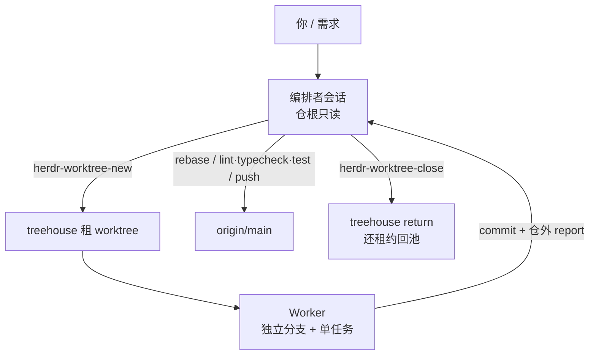

# 编排者不改代码：租赁 worktree 里并行工人

<div class="meta-tags"><span class="tool-tag tool-claude">Claude Code</span></div>

<div class="hook">

**一句话看懂**：想并行时，两个 Claude 塞进同一份 checkout 会互相踩文件；一个长会话又把半成品塞满上下文。Giacomo Mantovani 把活拆成硬角色——**一个编排者只规划、审阅、合入，绝不改代码**；每个任务在 treehouse 租来的 git worktree 里开短命 worker，干完在分支上提交并写仓外报告；关工人必须还租约，否则池子会被「幽灵租约」占满。

</div>

## 读完你能带走的 6 条收获

1. **并行的第一刀是角色，不是多开终端**：同 checkout 互踩、长会话塞半成品，解法是「只读编排 + 短寿工人」（见 3.1）。
2. **编排者不改代码写进全局 CLAUDE.md**：要改就开 worktree；在 worktree 里只读写那里（见 3.1）。
3. **创建工人五步 + 仓外报告**：租 durable lease → checkout 分支 → herdr 开会话 → 等可交互再发任务；Stop hook 回传 done/waiting（见 3.2）。
4. **合入只有一个地方**：rebase `origin/main`、跑满检查、再 push；工人自己推会跳过 rebase 后的 gate（见 3.3）。
5. **关工人必须走脚本**：手关 pane 不释放 durable lease；默认池 16 会悄悄耗尽（见 3.4）。
6. **另外两个实战坑**：agent 名全局唯一会撞车；启动瞬间发 prompt 会进输入框却未提交（见 3.4）。

::: tip 小白先懂这几个词
- [Orchestration（编排）](/glossary#orchestration)：这里指「只读规划/审阅」与「短寿写码」的角色拆分，不是两个对等写手并排敲。
- [Git Worktree](/glossary#worktree)：同一仓库的额外检出目录，可挂独立分支；本文每任务一份。
- [CLAUDE.md](/glossary#claude-md)：Claude Code 加载的项目/全局指令；作者把「编排者不改仓」写在这里。
- Durable lease（耐久租约）：treehouse 占用 worktree 直到显式 `return`；进程没了租约仍在。
- [Stop Hook](/glossary#stop-hook)：工人结束或等待时通知编排者 pane，免轮询。
- herdr / treehouse：作者用来保会话与管理 worktree 池的开源工具；可替换，角色与租约纪律才是主线。
:::

## 1. 基本信息

<SourceCard type="文章" title="My Claude Code workflow: one orchestrator and many parallel workers" author="Giacomo Mantovani" date="2026-10-14" url="https://www.mantovani-giacomo.com/en/blog/claude-code-orchestrator-parallel-workers" />

| 项目 | 内容 |
|---|---|
| 链接 | https://www.mantovani-giacomo.com/en/blog/claude-code-orchestrator-parallel-workers |
| 类型 | 文章（个人工程博客） |
| 作者 | Giacomo Mantovani |
| 发布日期 | 2026-10-14（页面 META / 核实） |
| 使用工具 | Claude Code；辅以 herdr、treehouse 与自写 `herdr-worktree-new` / `close` 脚本 |
| 分析依据 | 原文全文（curl HTML→txt，2026-11-06）。引语与命令逐字摘自正文；「我觉得」为本站评论。本站 [[23]] / [[112]] 讲 worktree 并行与环境拆分；[[131]] 讲 issue 控制面编排；本文焦点是**编排者只读纪律、租赁清理与作者踩过的失败模式**（herdr 在他文偶作工具出现，此处不展开产品说明书）。 |

## 2. 这篇在回答什么

你已经会开第二个 Claude Code 标签页了——然后发现两个会话改同一份工作树，或者一个会话从早干到晚，上下文里全是半截任务。

作者的拆法很干脆：

::: tr 我把 Claude Code 跑成一个编排者加若干工人。编排者从不改代码。
> "I run Claude Code as one orchestrator plus several workers. The orchestrator never edits code."
:::

主线四个问题：

1. 单会话和「编排 + 工人」差在哪，何时该切换？
2. 新工人如何租 worktree、接到唯一任务、交出仓外报告？
3. 编排者如何按仓规审分支，并在唯一合并点 rebase / 检查 / 推送？
4. 关闭与故障：漏租约、名字碰撞、发题过早、内置 worktree 孤儿——以及常见误用。



## 3. 怎么做

### 3.1 为什么拆成只读编排者和短寿工人

**是什么**：编排者是开在仓库根的 Claude Code 会话——读代码、跟人聊、拆任务、审回报；**不编辑仓库里的文件**。工人是另一份 worktree、自己的分支、单一任务上的短会话；结束后在分支上 commit，并写一份短报告：做了什么、动了哪些文件、还剩什么、怎么验证。报告放在仓外，避免进 commit。

规则写进**全局** `CLAUDE.md`（每个项目都会加载）：

::: tr 如果需要改动，就开一个 worktree；在 worktree 里，只在那里读和改。
> "if a change is needed, open a worktree; inside a worktree, read and edit only there."
:::

**为什么**：单会话一次只能安心干一件；硬开两个会在同一 checkout 上互踩。长会话把每次探索都留在上下文里，规划质量下降。对比表里作者写得很直——单会话的失败模式是「半成品混进工作树」；编排方案的失败模式换成「跳过清理时的漏租约和陈旧 worktree」。

小修、你很熟的仓，仍用单会话。作者摸向工人的时机是：**两个以上独立任务**，或**一个任务大到想把探索踢出规划会话**。

我觉得可以先记一句：**编排者不改代码，不是谦虚，是为了让「工人看到的树」和「你审的树」别分叉。** 一对分叉的半成品，审查会变成合并冲突。

### 3.2 创建工人：租约、就绪后再发题、仓外报告

从编排者跑作者的薄封装：

```bash
herdr-worktree-new feat/blog-table-block "Add a table block to the blog schema and renderer, with tests"
```

脚本五步：远程 fetch → 向 treehouse 要带 **durable lease** 的 worktree（占住直到显式归还）→ 在该路径 checkout 分支（本地已有 / 跟踪远程 / 新建）→ 把该路径开成 herdr workspace，单 tab 跑 Claude Code → **等到 agent 界面报可接受输入**，再把任务发出去，并追加固定 suffix（要求分支 commit、仓外写 summary、不要在仓内造报告文件）。

关键调用形态（原文）：

```bash
path=$(treehouse get --lease --lease-holder claude --no-fetch)
cd "$path" && git checkout -q -b "$branch"
herdr worktree open --workspace "$ws" --path "$path" --label "$branch" --no-focus
```

Stop hook 在工人结束或等待回答时通知编排者 pane，出现 `[worker done]` / `[worker waiting]`，不用轮询。`--no-focus` 把焦点留在调用方，编排者可以边规划下一题。

**为什么要「就绪再发」**：作者踩过竞态——agent 一启动就塞 prompt，字进了输入框却没提交，工人干坐着。脚本改为 poll 到 interactive（带上限）再发送。

### 3.3 审阅与唯一合并点

工人报 done 后，编排者先读报告，再读分支 diff，对照仓库自己的规则。作者这个站是 `CLAUDE.md` + `CODING_STANDARDS`：测试先行、system map 与文档同 diff 更新、新 UI 字符串英意双语字典都加、只用 pnpm。

过关则按仓的 ship 配置交货。这个仓**没有 PR**，gate 过后分支直上 main：

```bash
git fetch origin && git rebase origin/main
pnpm lint && pnpm typecheck && pnpm test
git push origin HEAD:main
```

从 worktree 里 `push HEAD:main` 可行，即使别处检出了 main。rebase 动过内容就再跑检查；冲突或拒推全部停给人；**禁止 force-push main**。把 typecheck 放进 gate 是故意的——该站生产 build 会忽略类型错误。

一个减痛规则：散文文档**一句一行**。三个工人同改一篇文档时，rebase 常常按行自动合，少打冲突。

::: tr 合并只在一个地方，而且是在检查之后。
> "One place merges, after the checks."
:::

工人各自推、各自合，就没人在 **rebase 之后的结果** 上跑满 gate。

### 3.4 关闭、漏租约，以及另外几处实战坑

关闭用 `herdr-worktree-close <workspace-id>`：工作树有未提交改动 → exit 2 并打印 `git status`；干净 → `treehouse return`、关 herdr workspace、删报告。`return` 会放租约、清残留进程、reset、回池；若不能确认没有外来进程，就**留着 worktree 和租约**——安全默认。

**最惨的一次是漏租约。** Durable 的含义是：worktree 里已经没有进程，租约仍在。作者用手关 herdr workspace、没走 close 脚本，租约就挂着。treehouse 默认池 **16**；有一天每个新工人都失败——16 个全标 in use，几乎没人在跑。修复是 `treehouse return`；习惯是**永远经脚本关工人**。

另外几处：

- **名字碰撞**：herdr agent 名在整个实例唯一，不是 per-pane；每个工人都叫 `claude`，第二个挂掉。现在名字带上 workspace id，且小写（herdr 要求小写；id 在 w19 之后会变成大写字母）。
- **发题过早**：见 3.2；竞态导致「看似发了、其实没提交」。
- **内置 worktree 助手留孤儿**：指令禁止本流程使用 Claude Code 自带 worktree 工具——它们会在 `.claude/worktrees` 留无人清理的检出。一个带显式租约的池更好审计。

常见误用清单（原文）：编排者自己改代码；一工人两任务；跳过书面报告；工人自己 merge；手关空间。每一条都对应上面的机制——尤其是「编排者一动手，工作树就和工人所见分叉，审查变成两坨半成品的合并」。

## 4. 结果与局限

文中**没有**吞吐、冲突率、返工次数等定量前后对照。证据是作者在自有仓库（含本站）上的脚本、指令文件，以及具名失败：漏满 16 租约、名字撞车、prompt 竞态、内置 worktree 孤儿。

局限要讲清：

- 强依赖 herdr + treehouse + 自写脚本；换工具时要自己重做「租约 / 就绪探测 / 关闭」三件套。
- 「编排者不改代码」靠 `CLAUDE.md` 纪律，不是 OS 级强制；模型仍可能手滑（对照 [[132]] 的强制 vs 请求分层）。
- 无 PR、直推 main 适合作者的个人站；团队仓通常还要 PR / CI 人审。
- 一句一行对散文友好，对大块代码/表格不适用。
- 文末有咨询导流，与机制无关，本站不展开。

## 5. 结论

并行代理的难点，往往不在「能不能多开几个模型」，而在**谁准改文件、改动落在哪份树上、合入前谁跑满检查、用完有没有把隔离资源还回去**。Mantovani 给出的可迁移内核是：编排者只读、工人一任务一租约、报告仓外、合并单点、关闭走还租约的脚本——并把漏租约、撞名、发题过早写成可复查的事故。

**你可以这样试**

1. 在全局或仓级指令写死：规划会话禁止编辑；要改必须进独立 worktree。
2. 一任务一分支；结束条件写成「commit + 仓外三节报告（做了/未完/怎么验）」。
3. 合并只从一个角色发起：先 rebase 再跑你的 lint/typecheck/test，再推。
4. 若用 worktree 池，关闭路径必须 `return` 租约；定期核对「标 in use 的树里是否真有 agent」。
5. 创建会话后先确认可交互，再注入任务文本。

**读完自测**

1. 你的「编排」会话这周改过业务文件吗？
2. 并行任务是否共用同一工作树？
3. 工人结束后，有没有一份仓外说明「故意没做完什么」？
4. 关闭标签页后，隔离目录/租约是否还挂着？
5. 合入前的检查，是在 rebase 之后的树上跑的，还是工人本地树上跑的？
