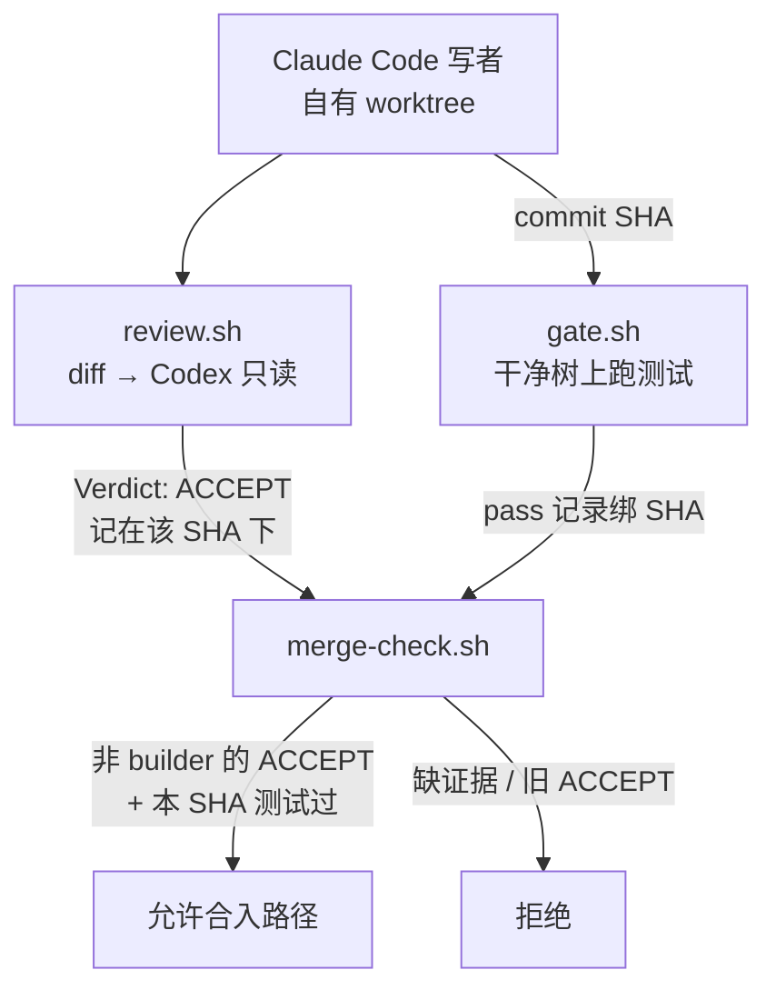

# Claude 写、Codex 审：ACCEPT 必须绑死这个 commit

<div class="meta-tags"><span class="tool-tag tool-general">通用（不限工具）</span></div>

<div class="hook">

**一句话看懂**：并排开 Claude Code 和 Codex 还不算协作。Iliya Oblakov 的做法是硬角色——**Claude 在自有 worktree 里写，Codex 只读审查**，终消息必须出现一行 `Verdict: ACCEPT` 或 `Verdict: CHANGES REQUIRED`；`gate.sh` / `review.sh` / `merge-check.sh` 把测试通过与 ACCEPT **都记在具体 commit 名下**，旧绿灯盖不住新 SHA。文中最响的坑：把 `GATE_CMD` 收窄到「会过的那几个测试」，门闸照样写 PASS。

</div>

## 读完你能带走的 7 条收获

1. **先定谁写谁审**：写作堆上下文，审查主要看 diff、规则与意图；审查者永不亲手修（见 3.1）。
2. **Verdict 只有一行合法开头**：`Verdict: ACCEPT` 或 `Verdict: CHANGES REQUIRED`，再跟 findings；`BUILDER=` 可对调角色（见 3.1）。
3. **`-s read-only` 不够**：MCP 仍可能改沙箱外；Stop hook 可能把终消息换成空，门闸找不到 verdict（见 3.2）。
4. **共享规则要短**：Codex 默认 `project_doc_max_bytes` 为 32 KiB，长 `AGENTS.md` 末尾可能永远进不去（见 3.2）。
5. **证据按 commit 命名**：新 commit 从零开始；旧 ACCEPT 不能为无人审过的代码背书（见 3.3）。
6. **先 commit 再跑门闸**：未提交/未跟踪一律拒；测试跑完若留下脏文件，全绿也算失败（见 3.3）。
7. **收窄 `GATE_CMD` 能假绿**：计数检查只看「输出报告了几个」，不看「该跑哪些」；信任前读 pass 记录的 `Command:`（见 3.4）。

::: tip 小白先懂这几个词
- [Git Worktree](/glossary#worktree)：写者在自己的检出里改；与审查者隔离。
- [Sandbox（沙箱）](/glossary#sandbox)：此处指 Codex `codex exec -s read-only`，可读、跑只读命令，不可写。
- [Stop Hook](/glossary#stop-hook)：在 `codex exec` 下也会跑；乱续跑可能清空「最后一条消息」。
- [CLAUDE.md](/glossary#claude-md) / [AGENTS.md](/glossary#agents-md)：两引擎共享的短 house rules；写者停、不碰 `.ai/`、不 merge；审查者只读。
- Verdict：审查终稿必须以恰好一行 `Verdict: ACCEPT` 或 `Verdict: CHANGES REQUIRED` 开头。
- GATE_CMD：门闸用来跑测试的命令；收窄它不会自动让 merge-check 报警。
:::

## 1. 基本信息

<SourceCard type="文章" title="How to use Claude Code and Codex together: setup lessons from my review gate" author="Iliya Oblakov" date="2026-10-29" url="https://rayastats.com/en/blog/use-claude-code-and-codex-together" />

| 项目 | 内容 |
|---|---|
| 链接 | https://rayastats.com/en/blog/use-claude-code-and-codex-together |
| 类型 | 文章（免费实践帖；非付费套件销售页） |
| 作者 | Iliya Oblakov |
| 发布日期 | 2026-10-29 |
| 使用工具 | Claude Code + OpenAI Codex CLI（角色可对调）；bash 门闸脚本 |
| 分析依据 | 原文全文（curl HTML→txt，2026-11-06）。引语、报错与 Node 示例逐字摘自正文；「我觉得」为本站评论。对照 [[111]] 三种协作法、[[117]] 写/审八坑、[[134]] Stop hook 交叉审：本文增量是 **SHA 级证据绑定** 与 **`GATE_CMD` 收窄假绿**。文末提到的付费 Two Engines Kit 仅作事实一句，不展开。 |

## 2. 这篇在回答什么

多数「双引擎」教程停在：共享一份指令、各开一个 worktree。作者关心的是再往后半截——**怎样让一次审查和一次测试跑，真的对即将合入的那次提交生效**，以及配置里哪些地方会偷偷翻车。

::: tr 若你想把 Claude Code 和 Codex 一起用，第一个决定是谁干什么。
> "If you want to use Claude Code and Codex together, the first decision is who does what."
:::

主线四个问题：

1. 为什么默认 Claude 写、Codex 只读审，且审查者不修？
2. 「只读」怎样才算真只读？共享规则为什么必须短？
3. 测试与 Verdict 如何绑死具体 commit？为什么必须先 commit？
4. 收窄测试命令为何仍能拿到 PASS？两层缓解是什么？



## 3. 怎么做

### 3.1 一人写、一人只读审，审查者不修

**是什么**：Claude Code 在自己的 git worktree 里写。Codex 审结果，终消息里必须有**恰好一行**以 `Verdict: ACCEPT` 或 `Verdict: CHANGES REQUIRED` 开头的 Verdict，后面再跟 findings。

**为什么这样分**：写作会堆上下文——计划、brief、worktree、gate 日志；审查需要的少得多，主要是 diff、规则、以及改动想达成什么。审查 prompt 写明 <Trans zh="你只审查；你从不修复">"You review; you never fix"</Trans>，并要求每个问题写到作者能在**新 commit** 里修。改动始终在桌子的一侧，修复另走一轮审查。

角色可以对调：门闸里设 `BUILDER=codex`，就变成 Codex 写、Claude Code 审。作者另有一文补 definition of done、逐行 house rules 与结束轮次的规则——本文只钉「分工 + 门闸」。

我觉得这和「两个模型互相改同一棵树」是反着来的：**所有权清晰，比模型更聪明更重要。**

### 3.2 让只读名副其实，规则短到塞得进 Codex

Codex 审查调用（原文）：

```bash
codex exec -s read-only --color never --output-last-message <file> -
```

沙箱允许读文件、跑 `git diff` 这类只读命令，不能写。但还有两样会「顺路上车」：

1. **`~/.codex/config.toml` 里的 MCP**：审查时也会启动。能改沙箱外状态的 server，等于拆掉只读；审查期间对其设 `enabled = false`。
2. **Hooks 在 `codex exec` 下同样执行**：若 Stop hook 让 Codex 审完继续干，可能把最终消息换成空的。门闸找不到 verdict → exit 1；诊断日志还在，**Verdict 没存下来**——本意是「别停」，结果是「这场审查等于没说」。

Claude 当审查者时，工具只给 Read / Grep / Glob；它不能跑 git，所以脚本把 commits 与完整 diff **写进 prompt**。

两边还要同一套短 house rules：项目 `CLAUDE.md` 与 `AGENTS.md` 各一段——写者一次改一处就停、别碰 `.ai/`、永不 merge；审查者保持只读。

::: tr 把 Codex 那部分写短。Codex 在指令文件合计大小达到 project_doc_max_bytes（默认 32 KiB）后就不再追加，所以很长的 AGENTS.md 末尾的规则可能永远到不了它。
> "Keep the Codex part short. Codex stops adding instruction files once their combined size reaches `project_doc_max_bytes`, which is 32 KiB by default, so rules at the end of a long `AGENTS.md` may never reach it."
:::

指令文件也是入口：引擎会遵循它加载到的任何文件，包括你没写的那份。作者另文演示 Downloads 里种植的 `AGENTS.md`——本站点到为止。

### 3.3 证据绑死 commit，先提交再检查

作者称这是循环的核心。每份证据以它覆盖的 commit 命名：

- `gate.sh`：在干净 checkout 上跑测试命令，按该 commit 写 pass 记录；
- `review.sh`：把 commits 与 diff 交给另一引擎，把 verdict 存到所审 commit 下；
- `merge-check.sh`：除非你当前所在 commit **两者都有**，且 ACCEPT 来自**不是 builder** 的审查者，否则拒绝。

::: tr 新 commit 一开始没有任何证据，所以针对旧 commit 的 ACCEPT 不能覆盖无人审查过的代码。
> "A new commit starts with no evidence, so an ACCEPT for an older commit cannot cover code nobody reviewed."
:::

演示（替身审查者、不调真模型）：`sum.sh` 跳过第一个参数；测试只断言 `sum 0 4`——跳过一个 0 仍得对答案。测试过、审查要求改；**修复那个 commit 必须自己再挣 pass 和 ACCEPT**。

三份脚本都拒绝「有未提交或未跟踪文件」的工作树——因为测试可能在**还没进 commit 的文件**上变绿。项目要把 `.ai/` 写进 `.gitignore`；在 scratch 仓试用时，你刚改的 `.gitignore` 本身就是未提交改动，于是门闸拒绝的第一件事，往往就是你为门闸加上的那一行：

```text
gate: REFUSED: uncommitted changes, untracked files or flagged files (or git failed); commit, remove or unflag them first
```

测完还会再查一遍：测试命令若留下文件，即使断言全过也失败：

```text
gate: the run left changed, untracked or flagged files (or git failed)
```

快照或构建产物若写进仓内，应指到 git 忽略的目录，并**先提交**那次 `.gitignore` 变更。

### 3.4 陷阱：收窄后的 GATE_CMD 仍然 PASS

门闸记 PASS 的条件是：测试命令在干净 checkout 上 exit 0，且计数检查接受输出。它**不知道**项目里有哪些测试。

Node 20.19 的 scratch 例：`add()` 实现是错的；`test/add.test.js` 测 `add()`，`test/format.test.js` 测别的函数。

- `GATE_CMD="node --test test/"` → `gate: FAIL (exit 1)`，不写 pass；
- `GATE_CMD="node --test test/format.test.js"` → `gate: PASS on <sha>`，**照样写了 pass 记录**，而 `add()` 仍错。

默认计数检查只在「输出空」或「摘要加总为 0」时失败；这里跑了一个测试，就过了。pass 记录里留着 `Command:` 行，但 `merge-check.sh` **不拿它和任何东西比对**。

两层缓解：

1. 设 `GATE_COUNT_RE`，并把 `GATE_MIN_TESTS` 设成项目测试总数。上例 `GATE_MIN_TESTS=2` 时，收窄命令只报 1 个会失败，并打出相应提示。加测时要人手抬这个数；它比的是输出里的总数，**不显示跑了哪几个**。
2. 审查 prompt 要求检查「削弱既有检查」的改动——覆盖**写进 commit 的**测试脚本收窄。但命令行上的 `GATE_CMD` **根本不进 diff**，只有计数检查看得到；审查也会漏。

::: tr 在你信任一份 pass 记录之前，先读它的 Command: 行。
> "Before you trust a pass record, read its `Command:` line."
:::

门闸本身**不**保证代码正确，也**不**负责 push 或 merge。作者提到另有付费套件可把 merge 钉在已门闸的 commit 上——本文主线到「证据诚实」为止。

## 4. 结果与局限

证据是可复现的门闸行为与 Node 示例，不是线上缺陷率或人工审查对照实验。`sum.sh` / `add()` 案例证明的是**流程能否识破假绿**，不是模型谁更强。

局限：

- 计数下限靠人维护；漏抬 `GATE_MIN_TESTS` 会回到假绿。
- 只读靠 sandbox + 关 MCP + 管 hooks；配置漂移会静默破坏。
- `merge-check` 不比对 `Command:`——纪律仍有一半在人读日志。
- 免费文不包含自动 merge；合入策略要自建或另寻方案。
- 与 [[134]] 的 Stop hook 强制环不同：这里的硬挡在 bash 门闸，不在写者会话的停机 hook。

## 5. 结论

双引擎协作若只有「两个 CLI」，审查和测试很容易变成**上一版代码的纪念品**。Oblakov 把 ACCEPT 与测试通过都钉在具体 SHA 上，并逼你先 commit、再跑、再读 `Command:`——门闸证明的是「这份证据覆盖的是不是你要合的那次提交」，不是「代码一定对」。

**你可以这样试**

1. 写死角色：一侧只写、一侧只读；审查 prompt 含「永不修复」与单行 Verdict。
2. 三脚本：`gate` / `review` / `merge-check`，产物文件名带 commit；禁止用旧 SHA 的 ACCEPT 放行新 SHA。
3. 审查用 `codex exec -s read-only`；审查前关掉会写环境的 MCP，并检查 Stop hook 会不会清空终消息。
4. 设 `GATE_MIN_TESTS`（或等价计数）为全量测试数；合入前人工扫一眼 pass 记录的 `Command:`。
5. 任何门闸相关的 `.gitignore` 变更，先单独 commit，再跑脚本。

**读完自测**

1. 你的「审查通过」有没有绑到具体 commit 哈希？
2. 审查者能不能改文件或经 MCP 改环境？
3. 上一次测试命令，是全量还是手打收窄的？pass 记录里怎么写？
4. 未提交改动时，门闸是拒了，还是默默在脏树上跑绿？
5. 修复审查意见后，是amend 混进旧证据，还是新 commit 重新挣 ACCEPT？
